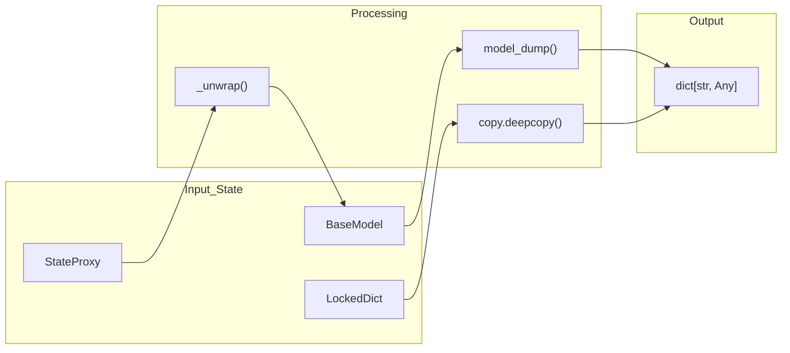

<!-- source: DeepWiki mcp.deepwiki.com · repo crewAIInc/crewAI · page 3.3 State Management and Persistence · fetched 2026-11-09 -->

# State Management and Persistence

<details>
<summary>Relevant source files</summary>

The following files were used as context for generating this wiki page:

- [docs/edge/ar/concepts/checkpointing.mdx](docs/edge/ar/concepts/checkpointing.mdx)
- [docs/edge/ar/guides/flows/mastering-flow-state.mdx](docs/edge/ar/guides/flows/mastering-flow-state.mdx)

</details>


## Purpose and Scope

This document details how state is managed, synchronized, and persisted across CrewAI Flows and Crews. The state management architecture provides typed structured state with Pydantic, thread-safe collection proxies for parallel execution, distributed/local locking via `LockStore`, automatic persistence using the `@persist` decorator and event-driven Checkpointing, and flow recovery mechanisms (`from_pending()`, `resume()`, and state branching via `restore_from_state_id`).

**Sources:** [lib/crewai/src/crewai/flow/flow.py:47](), [lib/crewai/src/crewai/flow/flow.py:47](), [lib/crewai/src/crewai/flow/flow.py:47](), [lib/crewai/src/crewai/utilities/lock_store.py:1-17](), [docs/edge/ar/concepts/checkpointing.mdx:7-48](), [docs/edge/ar/guides/flows/mastering-flow-state.mdx:121-129]()

## State Model Definition

Flow state is defined using Pydantic `BaseModel` subclasses, providing strict type validation and structured data access. CrewAI provides a `FlowState` base class that automatically injects a unique flow identifier into the state model.

### FlowState Base Model

```python
class FlowState(BaseModel):
    """Base model for all flow states, ensuring each state has a unique ID."""
    id: str = Field(
        default_factory=lambda: str(uuid4()),
        description="Unique identifier for the flow state",
    )
```

**Sources:** [lib/crewai/src/crewai/flow/flow.py:47]()

### State Definition to Code Entity Mapping

The diagram below bridges natural language concepts of state management with their corresponding code entities.

Title: State Definition to Code Entity Mapping

```mermaid
graph TB
    subgraph "Natural_Language_Space"
        UserDef[""User Flow State Definition""]
        DataShape[""Structured Data Validation""]
        SafeAccess[""Thread-Safe Concurrent Access""]
    end

    subgraph "Code_Entity_Space"
        BaseModel[""pydantic.BaseModel""]
        FlowState[""FlowState (flow.py:108)""]
        StateProxy[""StateProxy (flow.py:582)""]
        LockedList[""LockedListProxy (flow.py:419)""]
        LockedDict[""LockedDictProxy (flow.py:499)""]
    end

    UserDef --> FlowState
    DataShape --> BaseModel
    SafeAccess --> StateProxy
    StateProxy --> LockedList
    StateProxy --> LockedDict
```

**Sources:** [lib/crewai/src/crewai/flow/flow.py:47](), [lib/crewai/src/crewai/flow/flow.py:47](), [lib/crewai/src/crewai/flow/flow.py:47](), [lib/crewai/src/crewai/flow/flow.py:47]()

## Thread-Safe State Access

The `StateProxy` class wraps flow state objects to intercept attribute access and ensure thread-safe operations during parallel execution. When state attributes contain lists or dictionaries, `StateProxy` automatically wraps them in `LockedListProxy` and `LockedDictProxy`.

### StateProxy and Collection Proxy Architecture

Title: StateProxy and Collection Proxy Architecture

```mermaid
graph TB
    subgraph "StateProxy[T]"
        StateProxyClass[""StateProxy[T]<br/>_proxy_state: T<br/>_proxy_lock: threading.Lock""]
        GetAttr[""__getattr__(name)<br/>Returns LockedListProxy<br/>or LockedDictProxy""]
        SetAttr[""__setattr__(name, value)<br/>Acquires _proxy_lock""]
    end
    
    subgraph "LockedListProxy[T]"
        ListProxyClass[""LockedListProxy[T]<br/>Subclasses list<br/>_list: list[T]<br/>_lock: threading.Lock""]
        ListAppend[""append(item)<br/>with _lock""]
    end
    
    subgraph "LockedDictProxy[T]"
        DictProxyClass[""LockedDictProxy[T]<br/>Subclasses dict<br/>_dict: dict[str, T]<br/>_lock: threading.Lock""]
        DictSetItem[""__setitem__(key, value)<br/>with _lock""]
    end
    
    GetAttr -->|"if value is list"| ListProxyClass
    GetAttr -->|"if value is dict"| DictProxyClass
```

**Sources:** [lib/crewai/src/crewai/flow/flow.py:47](), [lib/crewai/src/crewai/flow/flow.py:47](), [lib/crewai/src/crewai/flow/flow.py:47]()

## Centralized Locking (LockStore)

For persistence operations and state modifications across multiple threads or processes, CrewAI uses a centralized locking utility.

### Lock Selection Logic

The `lock` function in `lock_store.py` selects a backend based on environment configuration:
1. **Redis Lock**: If `REDIS_URL` is configured and the `redis` package is present, it provisions a `portalocker.RedisLock`.
2. **File Lock**: Otherwise, it falls back to a local file-based `portalocker.Lock`.

Title: Distributed vs Local Locking Logic

```mermaid
graph TD
    Start[""lock(name) call""]
    CheckRedis["_redis_available()?"]
    RedisLock["portalocker.RedisLock<br/>(via Redis connection)"]
    FileLock["portalocker.Lock<br/>(via tempfile path)"]
    Yield["yield while held"]

    Start --> CheckRedis
    CheckRedis -- "Yes" --> RedisLock
    CheckRedis -- "No" --> FileLock
    RedisLock --> Yield
    FileLock --> Yield
```

**Sources:** [lib/crewai/src/crewai/utilities/lock_store.py:17]()

## The `@persist` Decorator and State Persistence

The `@persist()` decorator enables automatic state snapshotting at key execution milestones in CrewAI Flows. 

When applied to a `Flow` subclass, state updates are automatically captured and committed to storage. `@persist` supports resuming execution under the same state identifier (`inputs["id"]`) or branching into a new lineage using `restore_from_state_id`.

**Sources:** [docs/edge/ar/guides/flows/mastering-flow-state.mdx:96-129]()

## Checkpointing System

The Checkpointing system captures the full execution snapshot of a `Crew`, `Flow`, or `Agent`, including configurations, agent memory, task progress, and intermediate outputs.

### Event-Driven Snapshots
Checkpointing is triggered by events defined in `CheckpointConfig`. The default trigger is `task_completed`, which saves a snapshot after each completed task. High-frequency triggers like `llm_call_completed` are also supported.

### Storage Providers
- **JsonProvider**: Serializes each checkpoint into an individual JSON file.
- **SqliteProvider**: Commits checkpoints to a single SQLite database configured with WAL mode for high-frequency writes.

**Sources:** [docs/edge/ar/concepts/checkpointing.mdx:27-44](), [docs/edge/ar/concepts/checkpointing.mdx:125-160]()

## Persistence Implementations

### SQLite Flow Persistence
`SQLiteFlowPersistence` manages flow state snapshots and pending human-in-the-loop feedback context within a local SQLite database, backed by thread-safe locking mechanisms.

**Key Tables:**
- `flow_states`: Holds history of state snapshots per execution.
- `pending_feedback`: Stores context for flows paused awaiting feedback.

**Sources:** [lib/crewai/src/crewai/flow/persistence/sqlite.py:74-120]()

### Memory Storage (LanceDB)
The unified memory system utilizes `LanceDBStorage` for vector-backed persistence, featuring optimistic concurrency control and automatic conflict retries.

**Sources:** [lib/crewai/src/crewai/memory/storage/lancedb_storage.py:41-152]()

## Flow Recovery, Resumption, and State Branching

### Resuming vs. Forking State

CrewAI distinguishes between extending an existing execution history and branching off a historical snapshot.

| Feature | Parameter | Behavior | Use Case |
| :--- | :--- | :--- | :--- |
| **Resume** | `inputs={"id": <uuid>}` | Writes continue under the same UUID, extending history. | Recovering a failed flow or continuing a long-running process. |
| **Fork** | `restore_from_state_id` | Hydrates state from snapshot, but writes under a new `state.id`. | Running experiments or parallel branches from a common baseline. |

**Sources:** [docs/edge/ar/guides/flows/inputs-id-deprecation.mdx:33-38](), [docs/edge/ar/guides/flows/mastering-flow-state.mdx:121-129]()

### Flow.from_pending()
Restores a suspended flow instance from persistent storage using a `flow_id`, reloading `state_data` and `PendingFeedbackContext` to re-initialize execution.

**Sources:** [lib/crewai/src/crewai/flow/flow.py:47]()

### Flow.resume()
Resumes flow execution by processing pending feedback and routing to subsequent `@listen` methods based on emitted signals.

**Sources:** [lib/crewai/src/crewai/flow/flow.py:47]()

## State Serialization

Flows use `_copy_and_serialize_state()` to transform complex state structures (including Pydantic models and thread-safe proxies) into plain Python dictionaries for serialization.

Title: State Serialization Data Flow



**Sources:** [lib/crewai/src/crewai/flow/flow.py:47]()

---

