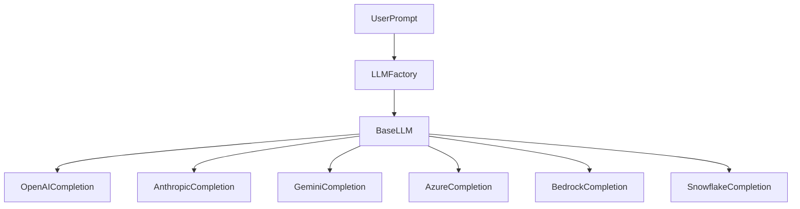
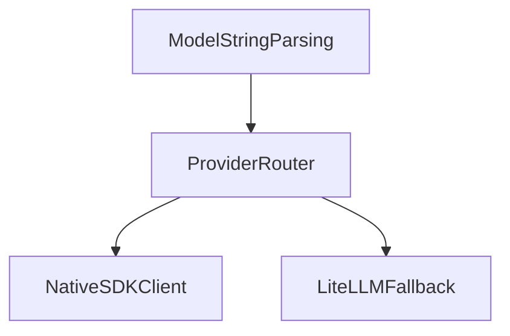

<!-- source: DeepWiki mcp.deepwiki.com · repo crewAIInc/crewAI · page 4.2 Provider-Specific Implementations · fetched 2026-11-09 -->

# Provider-Specific Implementations

Relevant source files

The following files were used as context for generating this wiki page:

- [docs/edge/ar/concepts/llms.mdx](docs/edge/ar/concepts/llms.mdx)

This page provides an overview of the native SDK implementations for each supported LLM provider in CrewAI. Each provider class extends `BaseLLM` and interfaces directly with the respective provider's Python SDK, enabling optimized performance, native function calling, streaming, and provider-specific capabilities [docs/edge/ar/concepts/llms.mdx:10](). While many providers are supported via LiteLLM fallback, core providers feature dedicated implementations [docs/edge/ar/concepts/llms.mdx:101-108]().

For information on the factory pattern and model routing, see [LLM Architecture and Providers](#4.1).

Title: Provider Factory and Native Implementations Architecture

Sources: [docs/edge/ar/concepts/llms.mdx:10-108]()

---

## 4.2.1 OpenAI Provider

The OpenAI integration provides native support for `OpenAICompletion`, handling Chat Completions and Responses APIs, built-in tools, `auto_chain`, and zero-data-retention (ZDR) compliance configurations.

For detailed documentation, configuration parameters, and code examples, see [OpenAI Provider](#4.2.1).

Sources: [docs/edge/ar/concepts/llms.mdx:120-188]()

---

## 4.2.2 Azure Provider

The Azure integration manages enterprise-grade deployments through `AzureCompletion` and `ChatCompletionsClient`, supporting custom endpoints, deployment naming conventions, and specific API version parameters.

For detailed setup instructions, see [Azure Provider](#4.2.2).

Sources: [docs/edge/ar/concepts/llms.mdx:10-108]()

---

## 4.2.3 Anthropic Provider

The Anthropic integration utilizes `AnthropicCompletion` to handle complex tool use blocks, extended thinking configurations, and precise system message formatting required by Claude models.

For implementation details, see [Anthropic Provider](#4.2.3).

Sources: [docs/edge/ar/concepts/llms.mdx:10-108]()

---

## 4.2.4 Gemini Provider

The Gemini integration bridges direct API usage and Google Cloud Vertex AI through `GeminiCompletion`, handling `FunctionDeclaration` structures and specific multi-modal role mappings.

For deeper technical information, see [Gemini Provider](#4.2.4).

Sources: [docs/edge/ar/concepts/llms.mdx:10-108]()

---

## 4.2.5 Bedrock Provider

The AWS Bedrock integration implements `BedrockCompletion` using the unified Converse API, supporting enterprise guardrail configurations and `toolSpec` formatting.

For architecture and configuration guides, see [Bedrock Provider](#4.2.5).

Sources: [docs/edge/ar/concepts/llms.mdx:10-108]()

---

## 4.2.6 Snowflake and OpenAI-Compatible Providers

This section covers specialized execution environments, including `SnowflakeCompletion` for Snowflake Cortex AI models and the general OpenAI-compatible provider interface for self-hosted or custom model endpoints.

For details on custom integrations, see [Snowflake and OpenAI-Compatible Providers](#4.2.6).

Title: Model Routing and Provider Resolution

Sources: [docs/edge/ar/concepts/llms.mdx:100-108]()

---

