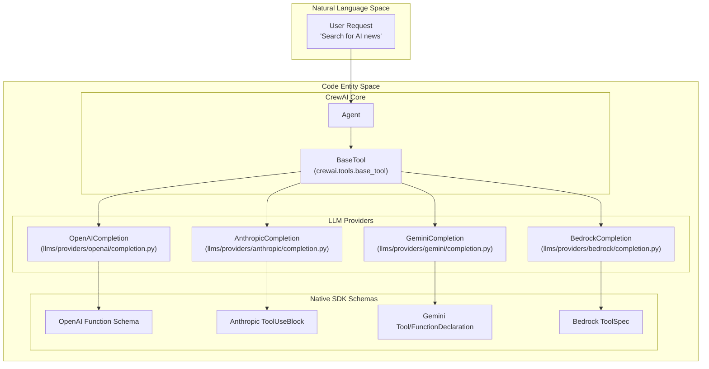
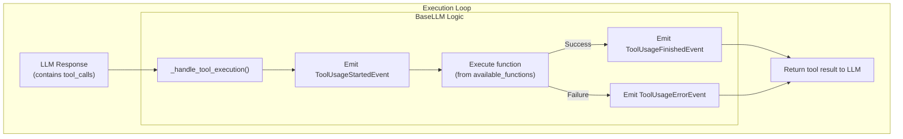
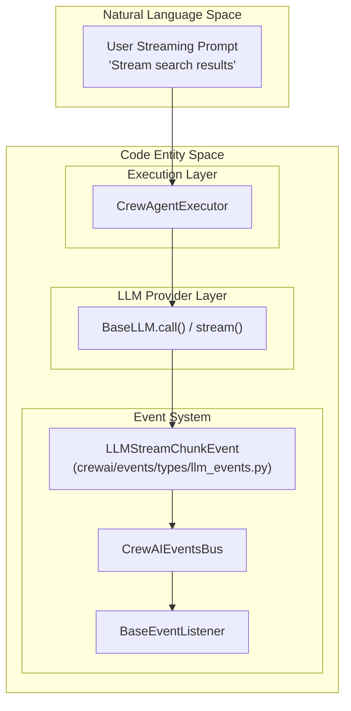
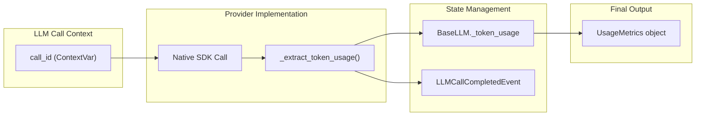

<!-- source: DeepWiki mcp.deepwiki.com · repo crewAIInc/crewAI · page 4.4 Tool Calling and Streaming · fetched 2026-11-09 -->

# Tool Calling and Streaming

Relevant source files

The following files were used as context for generating this wiki page:

- [docs/edge/ar/concepts/event-listener.mdx](docs/edge/ar/concepts/event-listener.mdx)
- [docs/edge/ar/concepts/tools.mdx](docs/edge/ar/concepts/tools.mdx)

This page documents the tool calling and streaming mechanisms in CrewAI's LLM integration layer. It covers how agents invoke tools through LLM function calling, how streaming responses are handled, and how events are emitted throughout the process for observability and telemetry.

For information about the overall LLM architecture and provider abstraction, see [LLM Architecture and Providers](). For details on LLM hooks for intercepting calls, see [LLM Hooks System](). For tool system design and custom tool development, see [Tool System Overview]().

## Tool Calling Architecture

All LLM providers in CrewAI implement a unified tool calling mechanism that converts CrewAI's tool definitions into provider-specific formats, executes tools when requested by the LLM, and emits events for monitoring.

### Tool Format Conversion

Each provider translates CrewAI tool schemas into the provider's native format. This typically involves converting Pydantic-based tool definitions into JSON schemas or provider-specific objects.

| Provider | Implementation Class | Primary Tool Format |
|----------|----------------------|---------------------|
| OpenAI | `OpenAICompletion` | Function calling schema with `type: "function"` |
| Anthropic | `AnthropicCompletion` | Tool use format with `input_schema` |
| Azure | `AzureCompletion` | `ChatCompletionsToolDefinition` objects |
| Gemini | `GeminiCompletion` | `FunctionDeclaration` objects |
| Bedrock | `BedrockCompletion` | Converse API `ToolSpec` format |

Providers use the common `generate_model_description` utility to extract tool parameters from CrewAI tool definitions before applying provider-specific formatting.

Title: Tool Calling Conversion Flow

**Sources:**
- [lib/crewai/src/crewai/llms/providers/openai/completion.py:149-185]()
- [lib/crewai/src/crewai/llms/providers/anthropic/completion.py:146-170]()
- [lib/crewai/src/crewai/llms/providers/azure/completion.py:72-128]()
- [lib/crewai/src/crewai/llms/providers/gemini/completion.py:40-111]()
- [lib/crewai/src/crewai/llms/providers/bedrock/completion.py:208-250]()

### Tool Execution Flow

When an LLM requests a tool call, the provider extracts tool information from the response and delegates execution. CrewAI supports two primary modes:
1. **Executor-Orchestrated**: The `CrewAgentExecutor` receives the tool call request, executes the tool, and sends the result back in the next LLM turn.
2. **Direct Execution**: Native providers can execute tools immediately within the `call()` or `acall()` loop if `available_functions` are provided. This is handled by the `_handle_tool_execution` method in `BaseLLM`.

Title: LLM-Driven Tool Execution Flow

**Sources:**
- [lib/crewai/src/crewai/llms/base_llm.py:188-210]()
- [lib/crewai/src/crewai/events/types/tool_usage_events.py:31-48]()
- [lib/crewai/src/crewai/agents/agent_builder/base_agent_executor_mixin.py:118-125]()

## Streaming Response Architecture

CrewAI implements a robust streaming architecture that surfaces real-time updates from LLMs. This is powered by a central event bus and provider-specific stream iterators.

### LLMStreamChunkEvent

During streaming, providers emit `LLMStreamChunkEvent` for every chunk received from the upstream API. This event includes:
- `chunk`: The raw text or JSON delta.
- `tool_call`: A `ToolCall` object if the chunk is part of a function call.
- `call_type`: `LLMCallType.LLM_CALL` or `LLMCallType.TOOL_CALL`.
- `response_id`: A unique identifier for the streaming session.

Title: Streaming Event Architecture from User Intent to Event Bus

**Sources:**
- [lib/crewai/src/crewai/events/types/llm_events.py:81-89]()
- [lib/crewai/src/crewai/llms/base_llm.py:23-30]()

### Streaming Workflow by Provider

Each native provider implements a specialized streaming loop to handle the unique data structures returned by different SDKs.

#### OpenAI and Azure
OpenAI uses `ChatCompletionChunk` objects. The `OpenAICompletion` class iterates over the stream, accumulating `content` for text and `tool_calls` for function requests.

**Sources:**
- [lib/crewai/src/crewai/llms/providers/openai/completion.py:11-16]()
- [lib/crewai/src/crewai/llms/providers/azure/completion.py:30-37]()

#### Anthropic
Anthropic provides a specialized `MessageStream`. CrewAI's `AnthropicCompletion` handles `TextBlock`, `ThinkingBlock`, and `ToolUseBlock` updates. It also supports **Thinking/Reasoning chunks** via `LLMThinkingChunkEvent`.

**Sources:**
- [lib/crewai/src/crewai/llms/providers/anthropic/completion.py:25-31]()
- [lib/crewai/src/crewai/events/types/llm_events.py:91-97]()

#### Gemini and Bedrock
Gemini uses a `GenerateContentResponse` iterator. Bedrock utilizes the AWS Converse Stream API, processing events like `messageStart`, `contentBlockDelta`, and `messageStop`.

**Sources:**
- [lib/crewai/src/crewai/llms/providers/gemini/completion.py:27-30]()
- [lib/crewai/src/crewai/llms/providers/bedrock/completion.py:194-206]()

## Token Usage Tracking

CrewAI tracks token usage meticulously across both synchronous and streaming calls. This data is essential for the `UsageMetrics` reported at the end of a Crew kickoff.

### Usage Tracking Logic

1. **Context Management**: Every LLM call is wrapped in a `llm_call_context` which generates a unique `call_id` using `uuid.uuid4()`.
2. **Event Emission**: When a call completes, an `LLMCallCompletedEvent` is emitted containing the final `response` and metadata.
3. **Internal Accumulation**: The `BaseLLM` class maintains an internal `_token_usage` dictionary.
4. **Metrics Extraction**:
   - **OpenAI**: Extracted from `completion.usage`.
   - **Anthropic**: Extracted from `message.usage`.
   - **Gemini**: Extracted from `response.usage_metadata`.
   - **Bedrock**: Extracted from `metadata["usage"]`.

Title: Token Usage Data Flow

**Sources:**
- [lib/crewai/src/crewai/llms/base_llm.py:58-82]()
- [lib/crewai/src/crewai/llms/base_llm.py:147-153]()
- [lib/crewai/src/crewai/types/usage_metrics.py:1-10]()
- [lib/crewai/src/crewai/llms/providers/openai/completion.py:13-16]()

## Implementation Details

### call_id and ContextVars
To ensure events are correctly associated with specific tasks and agents in a concurrent environment, CrewAI uses `contextvars` to store the `_current_call_id`. This ID is injected into every `LLMEventBase` subclass.

**Sources:**
- [lib/crewai/src/crewai/llms/base_llm.py:58-61]()
- [lib/crewai/src/crewai/events/types/llm_events.py:9-13]()

### Handling Context Window Errors
All native providers include logic to detect and raise `LLMContextLengthExceededError` when the LLM signals that the input is too long, using the `is_context_length_exceeded` utility.

**Sources:**
- [lib/crewai/src/crewai/llms/providers/anthropic/completion.py:13-16]()
- [lib/crewai/src/crewai/llms/providers/openai/completion.py:22-25]()
- [lib/crewai/src/crewai/llms/providers/gemini/completion.py:14-17]()

---

