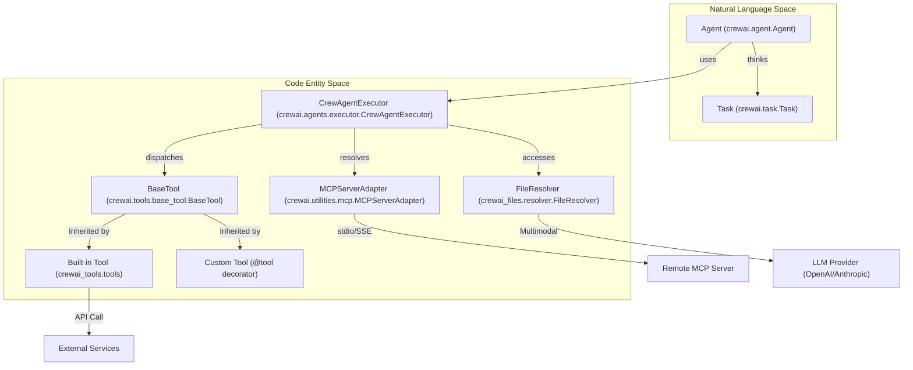
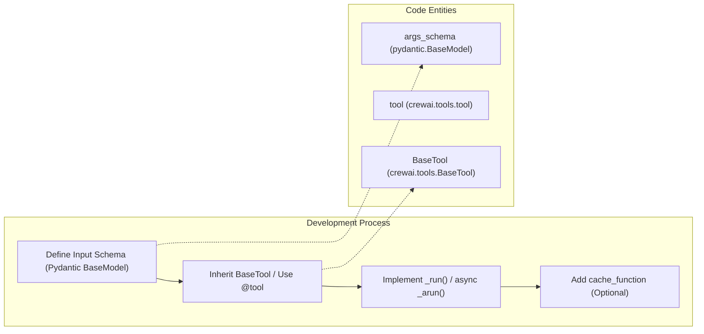

<!-- source: DeepWiki mcp.deepwiki.com · repo crewAIInc/crewAI · page 5 Tools and Integrations · fetched 2026-11-09 -->

# Tools and Integrations

Relevant source files

The following files were used as context for generating this wiki page:

- [.github/workflows/generate-tool-specs.yml](.github/workflows/generate-tool-specs.yml)
- [docs/edge/ar/concepts/tools.mdx](docs/edge/ar/concepts/tools.mdx)

Tools in CrewAI provide Agents with **callable functions** to perform actions beyond text generation. This ecosystem bridges the gap between LLM reasoning and real-world execution, enabling agents to browse the web, read local files, interact with databases, and connect to enterprise platforms.

The tool ecosystem is composed of several specialized layers:
*   **Built-in Tools**: High-performance utilities provided by the `crewai-tools` package.
*   **External Protocols**: Integration with the Model Context Protocol (MCP) for remote tool hosting.
*   **Custom Development**: Frameworks for building domain-specific tools using the `BaseTool` interface or `@tool` decorator.
*   **Enterprise Connectors**: Managed integrations for platforms like Slack, Salesforce, and Jira via CrewAI AMP.
*   **File Handling**: Specialized multimodal support via `crewai-files`.

### Tool Execution Architecture

The following diagram illustrates how an `Agent` interacts with different tool types through the `CrewAgentExecutor`, bridging natural language intent to code entities.

**Diagram: Agent Tool Interaction Flow**

Sources: [docs/edge/ar/concepts/tools.mdx:10-21](), [docs/edge/ar/concepts/tools.mdx:117-145]()

---

## crewai-tools Package
The `crewai-tools` package is a standalone library containing over 100 pre-built tools. It is designed to be installed as an extra to the core framework via `pip install 'crewai[tools]'` [docs/edge/ar/concepts/tools.mdx:45-49]().

Key capabilities include:
*   **Web & Search**: `SerperDevTool`, `WebsiteSearchTool`, and `FirecrawlSearchTool` for real-time information retrieval [docs/edge/ar/concepts/tools.mdx:60-61](), [docs/edge/ar/concepts/tools.mdx:138-142]().
*   **Data Processing**: `CSVSearchTool`, `JSONSearchTool`, and `DirectoryReadTool` for structured data analysis [docs/edge/ar/concepts/tools.mdx:131-135]().
*   **Development**: `CodeInterpreterTool` for executing Python code and `GithubSearchTool` for repository interaction [docs/edge/ar/concepts/tools.mdx:129-129](), [docs/edge/ar/concepts/tools.mdx:141-141]().

For details, see [crewai-tools Package](#5.2).

Sources: [docs/edge/ar/concepts/tools.mdx:43-62](), [docs/edge/ar/concepts/tools.mdx:124-145]()

---

## Model Context Protocol (MCP)
CrewAI supports the Model Context Protocol, allowing agents to connect to remote MCP servers. This enables the use of tools that are hosted outside the primary Python environment, providing specialized context or proprietary data access [docs/edge/ar/concepts/tools.mdx:13-15]().

The integration utilizes:
*   `MCPServerAdapter`: Manages the connection to the MCP host.
*   `mcp_native_tool`: Allows agents to treat MCP resources as native tools.
*   **Transport Support**: Includes `stdio`, `SSE`, and `streamable-http`.

For details, see [Model Context Protocol (MCP)](#5.3).

Sources: [docs/edge/ar/concepts/tools.mdx:13-15]()

---

## Custom Tool Development
When built-in tools are insufficient, developers can create custom tools by inheriting from `BaseTool` or using the `@tool` decorator [docs/edge/ar/learn/create-custom-tools.mdx:16-47](). This requires defining a Pydantic schema for arguments, ensuring the Agent understands how to provide the correct inputs.

**Diagram: Custom Tool Development Flow**

Sources: [docs/edge/ar/learn/create-custom-tools.mdx:20-47](), [docs/edge/ar/learn/create-custom-tools.mdx:51-77]()

For details, see [Custom Tool Development](#5.4).

Sources: [docs/edge/ar/concepts/tools.mdx:34-41](), [docs/edge/ar/learn/create-custom-tools.mdx:16-77]()

---

## Enterprise Integrations Catalog
The Agent Management Platform (AMP) provides an Enterprise Integrations Catalog with 28+ managed connectors. These tools are pre-configured for high-security environments and include built-in OAuth handling [docs/edge/ar/concepts/tools.mdx:23-32]().

**Available Integrations include:**
*   **Communication**: Slack, Microsoft Teams, Gmail.
*   **CRM/Sales**: Salesforce, HubSpot.
*   **Engineering**: Jira, GitHub, Notion.
*   **Data**: Snowflake, Google Drive, AWS S3.

For details, see [Enterprise Integrations Catalog](#5.5).

Sources: [docs/edge/ar/concepts/tools.mdx:23-32]()

---

## File Handling (crewai-files)
The `crewai-files` package provides a robust layer for multimodal file handling. It manages the lifecycle of files across different LLM providers (OpenAI, Anthropic, Gemini, Bedrock).

**Features:**
*   `FileResolver`: Automatically routes files to the appropriate provider-specific storage or upload mechanism.
*   `FileInput`: Typed structures for handling images, documents, and spreadsheets.
*   **Caching**: Intelligent caching of uploaded files to reduce latency and API costs [docs/edge/ar/concepts/tools.mdx:40-41]().

For details, see [File Handling (crewai-files)](#5.6).

Sources: [docs/edge/ar/concepts/tools.mdx:40-41]()

---

## Tool Feature Matrix

| Feature | Built-in Tools | MCP Tools | Custom Tools | Enterprise (AMP) |
| :--- | :--- | :--- | :--- | :--- |
| **Source** | `crewai-tools` | Remote Server | User Code | AMP Catalog |
| **Complexity** | Low (Ready to use) | Medium | High | Low (Managed) |
| **Persistence** | In-memory | Remote | User-defined | Managed |
| **Caching** | Supported [docs/edge/ar/concepts/tools.mdx:120-120]() | Provider-dependent | Optional [docs/edge/ar/learn/create-custom-tools.mdx:49-61]() | Built-in |
| **Async Support** | Yes | Yes | Yes [docs/edge/ar/learn/create-custom-tools.mdx:63-77]() | Yes |

Sources: [docs/edge/ar/concepts/tools.mdx:34-41](), [docs/edge/ar/concepts/tools.mdx:119-120](), [docs/edge/ar/learn/create-custom-tools.mdx:49-77]()

---

