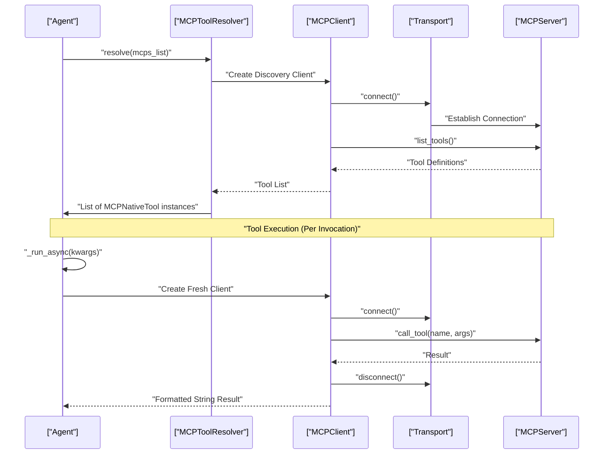
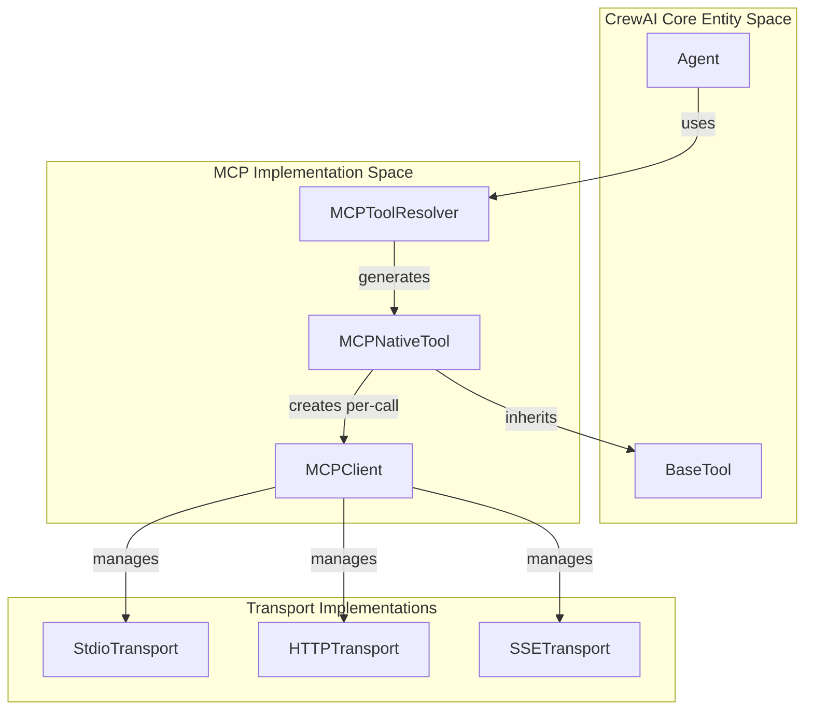

<!-- source: DeepWiki mcp.deepwiki.com · repo crewAIInc/crewAI · page 5.3 Model Context Protocol (MCP) · fetched 2026-11-09 -->

# Model Context Protocol (MCP)

<details>
<summary>Relevant source files</summary>

The following files were used as context for generating this wiki page:

- [docs/edge/ar/concepts/tools.mdx](docs/edge/ar/concepts/tools.mdx)

</details>


The Model Context Protocol (MCP) is an open protocol that enables CrewAI agents to access external tools and services through standardized server adapters. MCP provides a unified way to integrate third-party applications, databases, and APIs into your crews without writing custom tool wrappers for each integration [docs/edge/ar/concepts/tools.mdx:13-15]().

CrewAI provides two primary integration paths: a high-level **Simple DSL Integration** via the `mcps` field on Agents, and a low-level **MCPServerAdapter** for manual connection management.

Sources: [docs/edge/ar/concepts/tools.mdx:13-15]()

---

## Protocol Overview

MCP is a standardized protocol specification that defines how tools, resources, and prompts are exposed by servers and consumed by clients. In CrewAI's context:

- **MCP Servers** expose tools with standardized schemas describing their capabilities [docs/edge/ar/concepts/tools.mdx:13-15]().
- **MCPToolResolver** acts as the primary orchestrator, converting MCP tool definitions into CrewAI-compatible `MCPNativeTool` objects which inherit from `BaseTool` [lib/crewai/src/crewai/mcp/tool_resolver.py:47-48]().
- **Agents** use these tools transparently, with automatic discovery and lifecycle management.

Sources: [docs/edge/ar/concepts/tools.mdx:13-15](), [lib/crewai/src/crewai/mcp/tool_resolver.py:47-48]()

---

## Architecture and Data Flow

The MCP integration is centered around the `MCPToolResolver`, which handles three types of references: native configurations (Stdio/HTTP/SSE), external HTTPS URLs, and AMP (Agent Management Platform) catalog references [lib/crewai/src/crewai/mcp/tool_resolver.py:3-9]().

### MCP Tool Resolution and Execution



**Title: MCP Tool Discovery and Execution Sequence**

Sources: [lib/crewai/src/crewai/mcp/tool_resolver.py:69-89](), [lib/crewai/src/crewai/tools/mcp_native_tool.py:113-119](), [lib/crewai/src/crewai/mcp/client.py:142-153]()

### Code Entity Mapping

The following diagram bridges the natural language space to code entity space by mapping logical MCP components to their specific class implementations within the codebase.



**Title: MCP System Class Relationships**

Sources: [lib/crewai/src/crewai/mcp/tool_resolver.py:46-58](), [lib/crewai/src/crewai/tools/mcp_native_tool.py:16-24](), [lib/crewai/src/crewai/mcp/client.py:56-70]()

---

## Key Components

### MCPToolResolver
The `MCPToolResolver` [lib/crewai/src/crewai/mcp/tool_resolver.py:46-58]() is responsible for the lifecycle of MCP connections. It converts server references into `BaseTool` instances and ensures that all client connections are properly closed during cleanup [lib/crewai/src/crewai/mcp/tool_resolver.py:46-58]().
- **`resolve()`**: Dispatches to specific resolution methods based on the input type: StdioConfig, HTTPConfig, SSEConfig, or a string URL/slug [lib/crewai/src/crewai/mcp/tool_resolver.py:69-89]().
- **`cleanup()`**: Iterates through all active clients and calls `disconnect()` asynchronously to prevent resource leaks [lib/crewai/src/crewai/mcp/tool_resolver.py:91-106]().

### MCPNativeTool
The `MCPNativeTool` [lib/crewai/src/crewai/tools/mcp_native_tool.py:16-24]() acts as a proxy for remote MCP tools. Unlike standard tools, it creates a fresh `MCPClient` and transport for every invocation [lib/crewai/src/crewai/tools/mcp_native_tool.py:16-24](). This design ensures that parallel tool calls do not share mutable connection state, avoiding concurrency errors in the underlying `anyio` cancel scopes [lib/crewai/src/crewai/tools/mcp_native_tool.py:101-112]().

### MCPClient
The `MCPClient` [lib/crewai/src/crewai/mcp/client.py:56-70]() manages the `ClientSession` from the base `mcp` SDK. It handles:
- **Initialization**: Calls `session.initialize()` which is required by the MCP protocol for capability negotiation [lib/crewai/src/crewai/mcp/client.py:189-194]().
- **Tool Execution**: Wraps `call_tool` and handles result formatting, extracting text from complex MCP content items [lib/crewai/src/crewai/tools/mcp_native_tool.py:121-132]().
- **Timeouts**: Enforces default timeouts for connection (30s), execution (30s), and discovery (30s) to ensure agent responsiveness [lib/crewai/src/crewai/mcp/client.py:43-47]().

Sources: [lib/crewai/src/crewai/mcp/tool_resolver.py:46-106](), [lib/crewai/src/crewai/tools/mcp_native_tool.py:16-132](), [lib/crewai/src/crewai/mcp/client.py:43-194]()

---

## Transport Mechanisms

CrewAI supports three primary transport mechanisms for MCP communication:

| Transport | Implementation Class | Use Case |
| :--- | :--- | :--- |
| **Stdio** | `StdioTransport` | Local servers communicating via standard input/output (e.g., `npx` or `python` scripts) [lib/crewai/src/crewai/mcp/transports/stdio.py]() |
| **SSE** | `SSETransport` | Remote servers providing real-time data streaming via Server-Sent Events [lib/crewai/src/crewai/mcp/transports/sse.py]() |
| **HTTP** | `HTTPTransport` | Remote servers using flexible (potentially bi-directional) HTTPS communication [lib/crewai/src/crewai/mcp/transports/http.py]() |

Sources: [lib/crewai/src/crewai/mcp/tool_resolver.py:26-29](), [lib/crewai/src/crewai/mcp/client.py:56-70]()

---

## Observability and Events

The MCP system emits granular events through the `crewai_event_bus` to allow for monitoring and tracing [lib/crewai/src/crewai/mcp/client.py:20-28]().

- **Connection Events**: `MCPConnectionStartedEvent`, `MCPConnectionCompletedEvent`, and `MCPConnectionFailedEvent` track the lifecycle of the server link [lib/crewai/src/crewai/events/__init__.py:67-69]().
- **Execution Events**: `MCPToolExecutionStartedEvent`, `MCPToolExecutionCompletedEvent`, and `MCPToolExecutionFailedEvent` provide visibility into tool inputs, outputs, and errors [lib/crewai/src/crewai/events/__init__.py:70-72]().

Sources: [lib/crewai/src/crewai/events/__init__.py:65-73](), [lib/crewai/src/crewai/mcp/client.py:159-170]()

---

## Configuration and Usage

MCP tools can be added to an agent using the `mcps` parameter, which accepts a list of server configurations or URLs.

```python
from crewai import Agent
from crewai.mcp import StdioConfig

agent = Agent(
    role="Data Specialist",
    goal="Query the database for user trends",
    backstory="Expert in data retrieval.",
    mcps=[
        StdioConfig(
            command="npx",
            args=["-y", "@modelcontextprotocol/server-postgres", "postgresql://localhost/db"]
        )
    ]
)
```

Sources: [docs/edge/ar/concepts/tools.mdx:13-15](), [lib/crewai/src/crewai/mcp/tool_resolver.py:26-29]()

---

