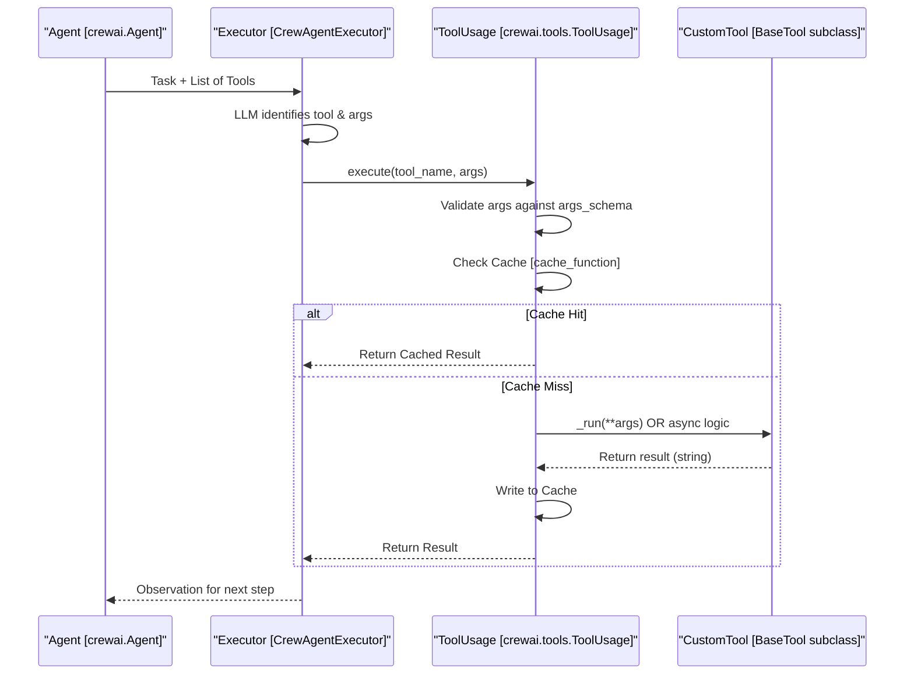

<!-- source: DeepWiki mcp.deepwiki.com · repo crewAIInc/crewAI · page 5.4 Custom Tool Development · fetched 2026-11-09 -->

# Custom Tool Development

<details>
<summary>Relevant source files</summary>

The following files were used as context for generating this wiki page:

- [docs/edge/ar/guides/tools/publish-custom-tools.mdx](docs/edge/ar/guides/tools/publish-custom-tools.mdx)
- [docs/edge/ar/learn/create-custom-tools.mdx](docs/edge/ar/learn/create-custom-tools.mdx)
- [docs/edge/ar/learn/dalle-image-generation.mdx](docs/edge/ar/learn/dalle-image-generation.mdx)

</details>


This page provides a comprehensive guide for developing custom tools that extend agent capabilities in CrewAI. Custom tools enable agents to interact with external APIs, perform computations, access databases, manipulate files, or execute any specialized logic required for your use case [docs/edge/ar/learn/create-custom-tools.mdx:8-10]().

For information about the built-in tool ecosystem, see [Tool Categories and Capabilities](#5.2.1). For details on tool execution internals and caching, see [Tool Calling and Streaming](#4.4). For MCP-based tool integration, see [Model Context Protocol (MCP)](#5.3).

---

## Tool Architecture Overview

CrewAI's tool system is built around two primary abstractions: `BaseTool` (the user-facing base class for custom tools) and `CrewStructuredTool` (the internal representation used during execution). When you assign tools to an agent, they are automatically converted to structured format for LLM interaction and execution tracking.

### Code Entity Space to Natural Language Space

The following diagram maps high-level tool concepts to their specific implementation classes and functions within the codebase.

Title: Tool Implementation and Execution Mapping
```mermaid
graph TB
    subgraph "ToolDefinitionSpace"
        [CUSTOM] ["Custom Class<br/>extends BaseTool"]
        [DECORATOR] ["@tool decorator<br/>in crewai.tools"]
    end
    
    subgraph "CoreInterface"
        [BASETOOL] ["BaseTool class<br/>[docs/edge/ar/learn/create-custom-tools.mdx]"]
    end
    
    subgraph "InternalRepresentation"
        [STRUCTURED] ["CrewStructuredTool<br/>[crewai/utilities/agent_utils.py]"]
    end
    
    subgraph "LLMSchemaSpace"
        [OPENAI_SCHEMA] ["OpenAI Function Schema<br/>via to_openai_schema()"]
    end
    
    subgraph "ExecutionEngine"
        [EXECUTOR] ["CrewAgentExecutor<br/>[crewai/agents/executor.py]"]
        [USAGE] ["ToolUsage class<br/>[crewai/tools/tool_usage.py]"]
    end
    
    [CUSTOM] --> [BASETOOL]
    [DECORATOR] --> [BASETOOL]
    [BASETOOL] -->|"parse_tools()"| [STRUCTURED]
    [STRUCTURED] -->|"convert_to_openai_schema()"| [OPENAI_SCHEMA]
    [EXECUTOR] -->|"calls execute()"| [USAGE]
    [USAGE] --> [STRUCTURED]
```
Sources: [docs/edge/ar/learn/create-custom-tools.mdx:16-36](), [docs/edge/ar/guides/tools/publish-custom-tools.mdx:22-43]()

---

## Creating Tools with BaseTool Class

Subclassing `BaseTool` is the recommended approach for creating complex tools that require explicit input validation, environment variable management, or both synchronous and asynchronous implementations [docs/edge/ar/learn/create-custom-tools.mdx:16-18]().

### Essential Attributes and Methods

To create a tool by subclassing, you must define:

| Attribute/Method | Description |
| :--- | :--- |
| `name` | A short, descriptive identifier for the tool. [docs/edge/ar/guides/tools/publish-custom-tools.mdx:37-37]() |
| `description` | Detailed instructions telling the agent when and how to use the tool. [docs/edge/ar/guides/tools/publish-custom-tools.mdx:38-38]() |
| `args_schema` | A Pydantic `BaseModel` defining the input parameters for validation. [docs/edge/ar/guides/tools/publish-custom-tools.mdx:39-39]() |
| `_run()` | The synchronous execution logic. [docs/edge/ar/guides/tools/publish-custom-tools.mdx:41-42]() |

### Implementation Example

```python
from crewai.tools import BaseTool
from pydantic import BaseModel, Field

class MyToolInput(BaseModel):
    """Input schema for MyCustomTool."""
    argument: str = Field(..., description="Description of the argument.")

class MyCustomTool(BaseTool):
    name: str = "Name of my tool"
    description: str = "What this tool does. It's vital for effective utilization."
    args_schema: type[BaseModel] = MyToolInput

    def _run(self, argument: str) -> str:
        # Synchronous logic
        return "Tool's result"
```
Sources: [docs/edge/ar/learn/create-custom-tools.mdx:20-36](), [docs/edge/ar/guides/tools/publish-custom-tools.mdx:26-43]()

---

## Creating Tools with @tool Decorator

The `@tool` decorator provides a concise way to transform a function into a tool. This is ideal for simpler utilities where a full class definition is unnecessary [docs/edge/ar/learn/create-custom-tools.mdx:38-47]().

### Decorator Requirements

When using the `@tool` decorator:
1. The function **must** have a docstring, which CrewAI uses as the tool's description [docs/edge/ar/guides/tools/publish-custom-tools.mdx:47-47]().
2. The function **must** use type annotations for all parameters and the return value [docs/edge/ar/guides/tools/publish-custom-tools.mdx:66-66]().
3. The function can be either `def` (sync) or `async def` (async) [docs/edge/ar/learn/create-custom-tools.mdx:71-77]().

### Sync and Async Decorator Examples

```python
from crewai.tools import tool
import aiohttp

# Synchronous simple tool
@tool("Tool Name")
def my_simple_tool(question: str) -> str:
    """Tool description for clarity."""
    return "Tool output"

# Asynchronous tool for I/O bound tasks
@tool("Async Web Fetcher")
async def fetch_webpage(url: str) -> str:
    """Fetch content from a webpage asynchronously."""
    async with aiohttp.ClientSession() as session:
        async with session.get(url) as response:
            return await response.text()
```
Sources: [docs/edge/ar/learn/create-custom-tools.mdx:40-47](), [docs/edge/ar/learn/create-custom-tools.mdx:67-77]()

---

## Tool Configuration and Advanced Features

### Input Validation with args_schema

Defining an explicit `args_schema` using Pydantic is highly recommended. It ensures the agent provides correctly typed data and generates clearer documentation for the LLM [docs/edge/ar/learn/create-custom-tools.mdx:18-18]().

### Error Handling and Caching

CrewAI tools include built-in mechanisms for robustness and performance:
- **Caching**: All tools support caching to reuse results. Users can define a `cache_function` for granular control over when to cache a result based on arguments and output [docs/edge/ar/learn/create-custom-tools.mdx:49-61]().

```python
@tool("Tool with Caching")
def cached_tool(argument: str) -> str:
    """Tool functionality description."""
    return "Cacheable result"

def my_cache_strategy(arguments: dict, result: str) -> bool:
    # Custom logic to decide whether to cache
    return True if some_condition else False

cached_tool.cache_function = my_cache_strategy
```
Sources: [docs/edge/ar/learn/create-custom-tools.mdx:49-61]()

---

## Data Flow: From Agent to Tool Execution

The following diagram illustrates the data flow when an `Agent` decides to use a custom tool.

Title: Tool Execution Sequence

Sources: [docs/edge/ar/learn/create-custom-tools.mdx:34-35](), [docs/edge/ar/learn/create-custom-tools.mdx:57-61]()

---

## Packaging and Distribution

If you build a tool that could benefit the community, you can package it as a standalone Python library and publish it to PyPI [docs/edge/ar/guides/tools/publish-custom-tools.mdx:8-10]().

### Package Structure
A standard CrewAI tool package should follow this structure [docs/edge/ar/guides/tools/publish-custom-tools.mdx:69-80]%:
```text
crewai-custom-tool/
├── pyproject.toml
├── LICENSE
├── README.md
└── src/
    └── crewai_custom_tool/
        ├── __init__.py
        └── tools.py
```
Sources: [docs/edge/ar/guides/tools/publish-custom-tools.mdx:69-80]()

### Publishing to PyPI
Using `uv`, you can build and publish your tool [docs/edge/ar/guides/tools/publish-custom-tools.mdx:84-90]%:
```bash
# Build the package
uv build

# Publish to PyPI
uv publish
```
Sources: [docs/edge/ar/guides/tools/publish-custom-tools.mdx:82-90]()

---

