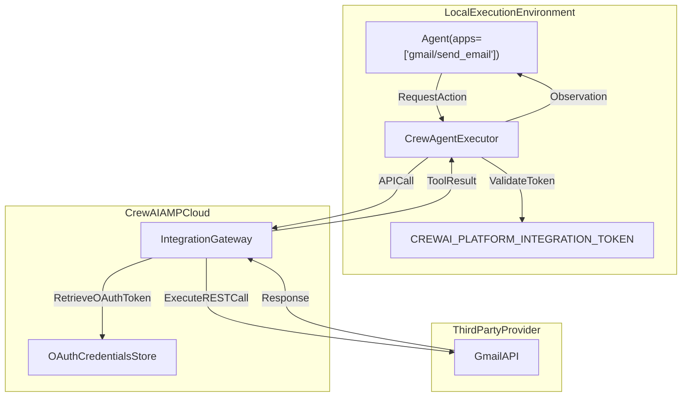
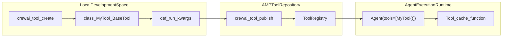

<!-- source: DeepWiki mcp.deepwiki.com · repo crewAIInc/crewAI · page 5.5 Enterprise Integrations Catalog · fetched 2026-11-09 -->

# Enterprise Integrations Catalog

<details>
<summary>Relevant source files</summary>

The following files were used as context for generating this wiki page:

- [.env.test](.env.test)
- [docs/edge/ar/concepts/tools.mdx](docs/edge/ar/concepts/tools.mdx)

</details>


The Enterprise Integrations Catalog documents the suite of managed connectors available within the CrewAI Agent Management Platform (AMP). These integrations allow agents to interact with third-party enterprise applications—such as Salesforce, Slack, and Google Drive—using OAuth-based authentication and standardized tool interfaces.

Sources: `[.env.test:120-131]`, `[docs/edge/ar/concepts/tools.mdx:23-32]`

## Integration Architecture and Data Flow

Enterprise integrations in CrewAI function by bridging the CrewAI AMP control plane with the local execution environment of an agent. When an agent is configured with `apps`, it utilizes a platform-provided token (`CREWAI_PLATFORM_INTEGRATION_TOKEN`) to authenticate requests against the AMP integration gateway, which then proxies the tool calls to the respective third-party API.

### Authentication and Connectivity Flow

The following diagram illustrates the flow from the request in an agent to the execution of an enterprise action, mapping the relationship between the `Agent` configuration and the platform integration token.

**Diagram: Enterprise Integration Execution Flow**



Sources: `[.env.test:120-131]`, `[docs/edge/ar/concepts/tools.mdx:23-32]`

## Configuration and Setup

To use enterprise integrations, developers must link their accounts via the CrewAI AMP dashboard and configure their local environment to communicate with the platform.

### 1. Platform Connection
Users must navigate to the Integrations section of the CrewAI dashboard and complete the OAuth flow for the desired service. This authorizes CrewAI AMP to manage tokens on behalf of the agents.

### 2. Environment Configuration
The execution environment requires the `crewai-tools` package and specific environment variables to authenticate with the enterprise gateway.

| Requirement | Value / Command |
| :--- | :--- |
| **Package** | `pip install 'crewai[tools]'` |
| **Auth Variable** | `CREWAI_PLATFORM_INTEGRATION_TOKEN` |
| **Personal Access** | `CREWAI_PERSONAL_ACCESS_TOKEN` |

Sources: `[.env.test:128-129]`, `[docs/edge/ar/concepts/tools.mdx:43-49]`

## Using Integrations with Agents

Agents access these integrations through the `apps` parameter in the `Agent` constructor. This parameter accepts canonical names for entire applications or specific actions within those applications.

### Implementation Example
The following code demonstrates how to initialize an agent with specific Gmail capabilities, utilizing tools from the `crewai_tools` package.

```python
from crewai import Agent, Task, Crew
from crewai_tools import SerperDevTool

# Agent configured with specific enterprise app actions
email_agent = Agent(
    role="Email Manager",
    goal="Manage and organize email communications",
    backstory="An AI assistant specialized in email management.",
    apps=['gmail', 'gmail/send_email'],  # Canonical app name and specific action
    tools=[SerperDevTool()] # Combining standard tools with Enterprise Apps
)

# Task utilizing the enterprise tool
email_task = Task(
    description="Draft and send a follow-up email to john@example.com",
    agent=email_agent,
    expected_output="Confirmation of sent email"
)
```
Sources: `[docs/edge/ar/concepts/tools.mdx:53-81]`, `[docs/edge/ar/concepts/tools.mdx:124-142]`

## Integration Catalog

The following table categorizes the primary enterprise connectors available in the catalog and their associated environment configurations for testing and production.

| Category | Supported Integrations | Key Capabilities | Relevant Env Keys |
| :--- | :--- | :--- | :--- |
| **Communication** | Gmail, Slack, Microsoft Teams | Sending emails, workspace alerts, channel management. | `ZAPIER_API_KEY` |
| **Project Management** | Jira, ClickUp, Asana, Notion, GitHub | Issue tracking, task updates, repository management. | `GITHUB_API_KEY` |
| **CRM** | Salesforce, HubSpot, Zendesk | Lead management, pipeline tracking. | `HUBSPOT_API_KEY` |
| **Data & Warehouse** | Snowflake, Databricks, SingleStore | Querying enterprise data, RAG on structured data. | `SNOWFLAKE_ACCOUNT`, `DATABRICKS_TOKEN` |
| **Search & Web** | Serper, Exa, Firecrawl, Browserbase | Web scraping, structured search, automated browsing. | `SERPER_API_KEY`, `FIRECRAWL_API_KEY` |

Sources: `[.env.test:47-57]`, `[.env.test:89-112]`, `[docs/edge/ar/concepts/tools.mdx:124-145]`

## Internal Tools and Repository
Beyond third-party integrations, the platform allows for the deployment of "Internal Tools." These are custom tools developed locally using the `BaseTool` interface and published to the CrewAI AMP Tool Repository.

**Diagram: Internal Tool Lifecycle and Code Mapping**

This diagram maps the development workflow to the underlying code entities, class definitions, and CLI commands.



Sources: `[docs/edge/ar/concepts/tools.mdx:119-121]`, `[docs/edge/ar/concepts/tools.mdx:23-32]`

---

