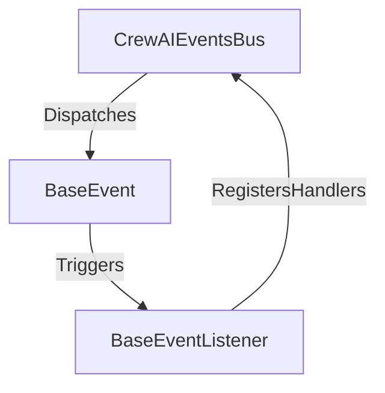
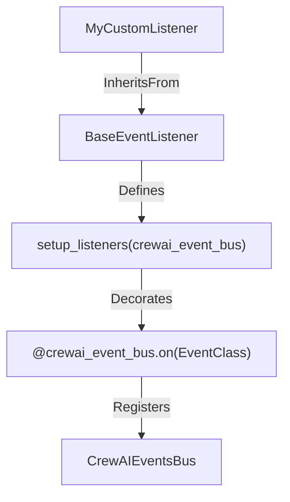

<!-- source: DeepWiki mcp.deepwiki.com · repo crewAIInc/crewAI · page 6.1 Event Bus and Listeners · fetched 2026-11-09 -->

# Event Bus and Listeners

Relevant source files

The following files were used as context for generating this wiki page:

- [docs/edge/ar/concepts/event-listener.mdx](docs/edge/ar/concepts/event-listener.mdx)

## Purpose and Scope
This document covers the `crewai/events` package [docs/edge/ar/concepts/event-listener.mdx:1-10](), detailing the core event bus architecture, available event types across crew lifecycles, execution engines, tools, and flows, as well as guidelines for implementing and registering custom event listeners for monitoring and integration.

---

## 1. Architectural Components of the Event System

The CrewAI event system is built around a centralized publish-subscribe pattern that emits telemetry and lifecycle notifications during execution [docs/edge/ar/concepts/event-listener.mdx:12-14](). The architecture consists of three primary components:

- **`CrewAIEventsBus`**: The central event bus instance that manages listener registrations, event routing, and dispatcher hooks [docs/edge/ar/concepts/event-listener.mdx:16]().
- **`BaseEvent`**: The foundational data class from which all domain-specific events inherit, providing shared context and metadata [docs/edge/ar/concepts/event-listener.mdx:17]().
- **`BaseEventListener`**: An abstract base class utilized to structure custom listeners by implementing the `setup_listeners` interface [docs/edge/ar/concepts/event-listener.mdx:18]().

*Sources: [docs/edge/ar/concepts/event-listener.mdx:12-21]()*

---

## 2. Event Types Inventory

CrewAI categorizes events across different subsystems of agentic orchestration. Listeners can selectively bind to any subset of these events [docs/edge/ar/concepts/event-listener.mdx:96-98]().

### Crew and Test Events
- `CrewKickoffStartedEvent`, `CrewKickoffCompletedEvent`, `CrewKickoffFailedEvent` [docs/edge/ar/concepts/event-listener.mdx:102-104]()
- `CrewTestStartedEvent`, `CrewTestCompletedEvent`, `CrewTestFailedEvent` [docs/edge/ar/concepts/event-listener.mdx:105-107]()
- `CrewTrainStartedEvent`, `CrewTrainCompletedEvent`, `CrewTrainFailedEvent` [docs/edge/ar/concepts/event-listener.mdx:108-110]()

### Agent and Task Events
- `AgentExecutionStartedEvent`, `AgentExecutionCompletedEvent`, `AgentExecutionErrorEvent` [docs/edge/ar/concepts/event-listener.mdx:114-116]()
- `LiteAgentExecutionStartedEvent`, `LiteAgentExecutionCompletedEvent` [docs/edge/ar/concepts/event-listener.mdx:117-118]()
- `TaskStartedEvent`, `TaskCompletedEvent`, `TaskFailedEvent` [docs/edge/ar/concepts/event-listener.mdx:122-124]()

### Tool, MCP, and Knowledge Events
- `ToolUsageStartedEvent`, `ToolUsageFinishedEvent`, `ToolUsageErrorEvent` [docs/edge/ar/concepts/event-listener.mdx:128-130]()
- `MCPConnectionStartedEvent`, `MCPConnectionCompletedEvent`, `MCPConnectionFailedEvent` [docs/edge/ar/concepts/event-listener.mdx:134-136]()
- `MCPToolExecutionStartedEvent`, `MCPToolExecutionCompletedEvent`, `MCPToolExecutionFailedEvent` [docs/edge/ar/concepts/event-listener.mdx:137-139]()
- `KnowledgeRetrievalStartedEvent`, `KnowledgeRetrievalCompletedEvent` [docs/edge/ar/concepts/event-listener.mdx:143-144]()
- `KnowledgeQueryStartedEvent`, `KnowledgeQueryCompletedEvent`, `KnowledgeQueryFailedEvent` [docs/edge/ar/concepts/event-listener.mdx:145-147]()

### Flow, LLM, Memory, and A2A Events
- `FlowCreatedEvent`, `FlowStartedEvent`, `FlowFinishedEvent`, `FlowFailedEvent`, `FlowPausedEvent` [docs/edge/ar/concepts/event-listener.mdx:157-161]()
- `LLMCallStartedEvent`, `LLMCallCompletedEvent`, `LLMCallFailedEvent`, `LLMStreamChunkEvent` [docs/edge/ar/concepts/event-listener.mdx:165-168]()
- `MemoryQueryStartedEvent`, `MemoryQueryCompletedEvent`, `MemorySaveStartedEvent`, `MemorySaveCompletedEvent` [docs/edge/ar/concepts/event-listener.mdx:172-175]()
- `AgentReasoningStartedEvent`, `AgentReasoningCompletedEvent`, `AgentReasoningFailedEvent` [docs/edge/ar/concepts/event-listener.mdx:179-181]()
- `A2ADelegationStartedEvent`, `A2ADelegationCompletedEvent`, `A2AConversationStartedEvent` [docs/edge/ar/concepts/event-listener.mdx:185-187]()

*Sources: [docs/edge/ar/concepts/event-listener.mdx:96-187]()*

---

## 3. Building and Registering Custom Listeners

To create a custom listener, developers must subclass `BaseEventListener`, implement the `setup_listeners` method, and decorate inner functions using `@crewai_event_bus.on()` [docs/edge/ar/concepts/event-listener.mdx:37-60]().

*Sources: [docs/edge/ar/concepts/event-listener.mdx:37-74]()*

### Registration Pattern
Listeners must be instantiated within application entrypoints (such as crew definition files) so that their subscriptions are initialized on the event bus prior to kickoff execution [docs/edge/ar/concepts/event-listener.mdx:76-94]().

*Sources: [docs/edge/ar/concepts/event-listener.mdx:37-94]()*

---

