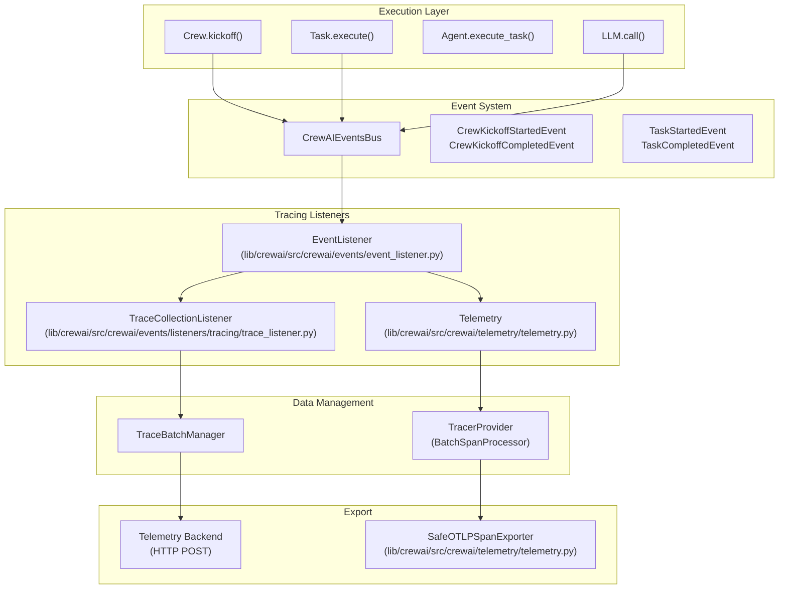
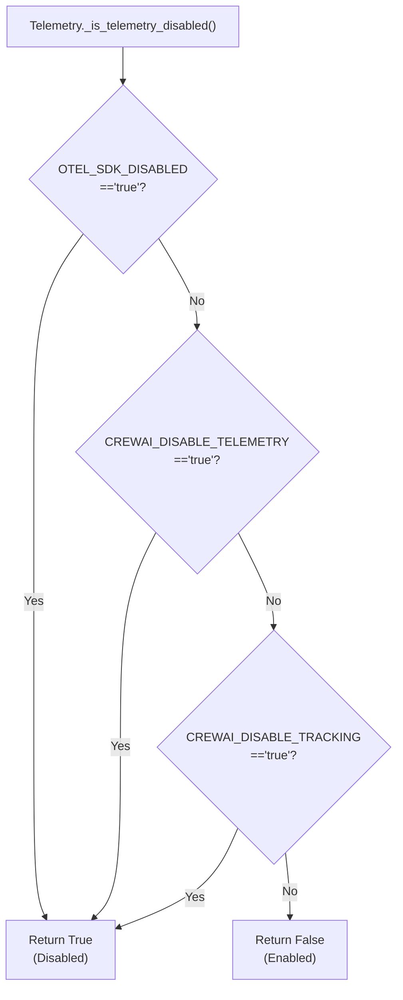
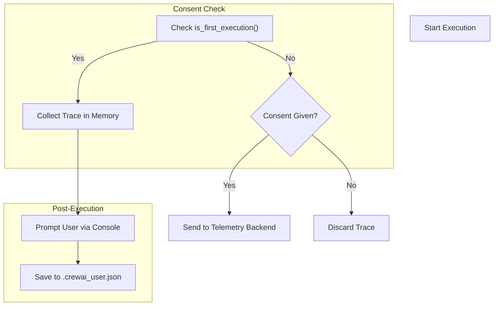
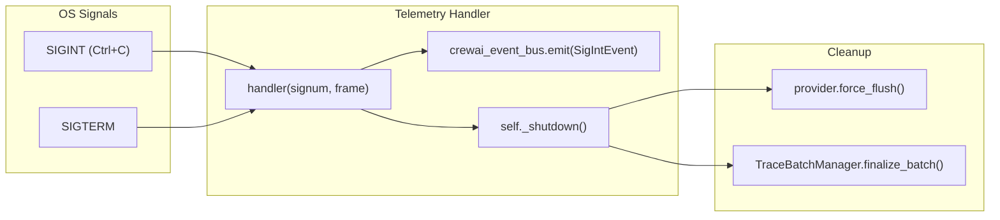

<!-- source: DeepWiki mcp.deepwiki.com · repo crewAIInc/crewAI · page 6.2 Built-in Tracing and Telemetry · fetched 2026-11-09 -->

# Built-in Tracing and Telemetry

Relevant source files

The following files were used as context for generating this wiki page:

- [.env.test](.env.test)
- [docs/edge/ar/concepts/event-listener.mdx](docs/edge/ar/concepts/event-listener.mdx)

## Purpose and Scope

This document describes CrewAI's event-driven tracing and telemetry system, which collects execution traces for observability and debugging. The system is built on a dual architecture: a high-level **Event-Driven Tracing** system using `TraceCollectionListener` to capture framework events, and a low-level **OpenTelemetry (OTEL) Integration** that provides standardized performance spans.

The system respects user privacy through configurable opt-in mechanisms, first-time user consent flows, and a global kill switch via the `OTEL_SDK_DISABLED` flag.

**Sources:** [lib/crewai/src/crewai/telemetry/telemetry.py:1-53](), [lib/crewai/src/crewai/events/listeners/tracing/trace_listener.py:1-115]()

---

## Tracing Architecture Overview

The tracing system captures events from the `CrewAIEventsBus` [docs/edge/ar/concepts/event-listener.mdx:16-16]() and processes them through two distinct paths: framework-specific trace collection and standardized OpenTelemetry spans.

### High-Level Architecture

Title: "Tracing Architecture and Code Entities"

**Key Components:**

| Component | Location | Purpose |
|-----------|----------|---------|
| `Telemetry` | [lib/crewai/src/crewai/telemetry/telemetry.py:88-137]() | Singleton managing OpenTelemetry SDK initialization and OTEL spans. |
| `TraceCollectionListener` | [lib/crewai/src/crewai/events/listeners/tracing/trace_listener.py:115-694]() | Singleton orchestrating high-level framework trace collection. |
| `EventListener` | [lib/crewai/src/crewai/events/event_listener.py:119-148]() | Primary listener that bridges events to both `Telemetry` and `TraceCollectionListener`. |
| `SafeOTLPSpanExporter` | [lib/crewai/src/crewai/telemetry/telemetry.py:65-86]() | Wrapper for `OTLPSpanExporter` that prevents telemetry failures from crashing the app. |
| `CrewAIEventsBus` | [docs/edge/ar/concepts/event-listener.mdx:16-16]() | Unique event bus that manages registration and dispatching of events. |

**Sources:** [lib/crewai/src/crewai/telemetry/telemetry.py:88-137](), [lib/crewai/src/crewai/events/event_listener.py:119-148](), [docs/edge/ar/concepts/event-listener.mdx:16-20]()

---

## Tracing Enablement and OTEL_SDK_DISABLED

Tracing and telemetry can be disabled globally or specifically via environment variables.

### Enablement Priority System

Title: "Telemetry Disablement Priority Flow"

**Global Kill Switches:**

*   **`OTEL_SDK_DISABLED`**: Standard OpenTelemetry flag. If set to `true`, the `Telemetry` class will not initialize the `TracerProvider` [lib/crewai/src/crewai/telemetry/telemetry.py:146-152]().
*   **`CREWAI_DISABLE_TELEMETRY`**: Framework-specific flag to disable all telemetry collection [lib/crewai/src/crewai/telemetry/telemetry.py:150-150]().
*   **`CREWAI_TESTING`**: In test environments, telemetry is typically disabled via `.env.test` [/.env.test:143-146]().

**Sources:** [lib/crewai/src/crewai/telemetry/telemetry.py:146-156](), [/.env.test:143-146]()

---

## OpenTelemetry Implementation

The `Telemetry` class initializes a `TracerProvider` with a `BatchSpanProcessor` and a `SafeOTLPSpanExporter`.

### Initialization Flow

When `EventListener` is instantiated, it triggers `Telemetry.set_tracer()` [lib/crewai/src/crewai/events/event_listener.py:140-140]().

1.  **Resource Creation**: Defines the service name as `crewai-telemetry` [lib/crewai/src/crewai/telemetry/telemetry.py:121-123]().
2.  **Exporter Setup**: Uses `SafeOTLPSpanExporter` pointing to the CrewAI telemetry endpoint [lib/crewai/src/crewai/telemetry/telemetry.py:127-132]().
3.  **Span Processing**: Spans are batched using `BatchSpanProcessor` for performance [lib/crewai/src/crewai/telemetry/telemetry.py:127-134]().
4.  **Signal Handling**: Registers `atexit` and signal handlers (SIGTERM, SIGINT) to ensure spans are flushed on exit [lib/crewai/src/crewai/telemetry/telemetry.py:170-190]().

### Enterprise OpenTelemetry Export

CrewAI AMP supports exporting **Traces** and **Logs** directly to external OpenTelemetry collectors or backends like Datadog.

*   **Semantic Conventions**: Follows OpenTelemetry GenAI Semantic Conventions for standardizing LLM-related metadata.
*   **Fault Tolerance**: The `SafeOTLPSpanExporter` [lib/crewai/src/crewai/telemetry/telemetry.py:65-86]() catches all exceptions during the export process to ensure telemetry issues never block the primary agent logic.

**Sources:** [lib/crewai/src/crewai/telemetry/telemetry.py:109-137](), [lib/crewai/src/crewai/telemetry/telemetry.py:65-86]()

---

## User Consent and First-Time Flow

For high-level framework traces (managed by `TraceCollectionListener`), CrewAI implements a consent flow to balance developer experience with privacy.

### Consent Logic and Data Flow

Title: "User Consent and Trace Flow"

1.  **Detection**: User preferences are stored locally in `~/.crewai/storage/.crewai_user.json`.
2.  **Prompt**: A Rich-formatted panel asks the user if they want to enable tracing for debugging.
3.  **Persistence**: The choice is saved to `trace_consent` in the user data file.

**Sources:** [lib/crewai/src/crewai/events/listeners/tracing/trace_listener.py:115-694]()

---

## Trace Collection and Batching

The `TraceCollectionListener` handles framework-specific events like `CrewKickoffStartedEvent` or `AgentExecutionCompletedEvent` [docs/edge/ar/concepts/event-listener.mdx:102-115]().

### TraceBatchManager
The `TraceBatchManager` (internal to `TraceCollectionListener`) aggregates these events into a structured trace. It ensures that related events (e.g., all tasks within a specific crew kickoff) are grouped together before being sent to the telemetry backend via an HTTP POST request.

**Sources:** [lib/crewai/src/crewai/events/listeners/tracing/trace_listener.py:115-694](), [docs/edge/ar/concepts/event-listener.mdx:100-189]()

---

## System Signal Handling

The `Telemetry` class ensures that traces are not lost during unexpected shutdowns by hooking into system signals.

Title: "Signal Handling and Graceful Shutdown"

**Implementation Details:**
*   **Main Thread Check**: Signal handlers are only registered if `Telemetry` is initialized in the main thread [lib/crewai/src/crewai/telemetry/telemetry.py:176-180]().
*   **Graceful Shutdown**: The `_shutdown` method calls `provider.shutdown()` on the OTEL TracerProvider to flush remaining spans [lib/crewai/src/crewai/telemetry/telemetry.py:220-225]().

**Sources:** [lib/crewai/src/crewai/telemetry/telemetry.py:170-225]()

---

## Summary

CrewAI's built-in tracing and telemetry system provides:

1.  **Dual-Layer Tracing**: High-level framework traces via `TraceCollectionListener` and standardized performance spans via OpenTelemetry.
2.  **Standardized OTEL Support**: Integrates with the OpenTelemetry ecosystem, respecting `OTEL_SDK_DISABLED`.
3.  **Fault Tolerance**: `SafeOTLPSpanExporter` ensures that network or backend failures do not interrupt agent execution.
4.  **Privacy First**: Anonymous collection by default, with clear user consent flows for detailed tracing.
5.  **Robust Cleanup**: Signal-aware flushing of trace batches and OTEL spans to prevent data loss on process exit.

---

