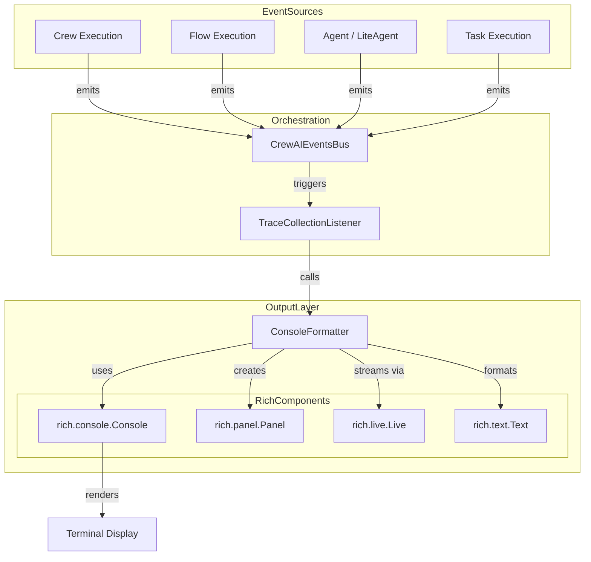
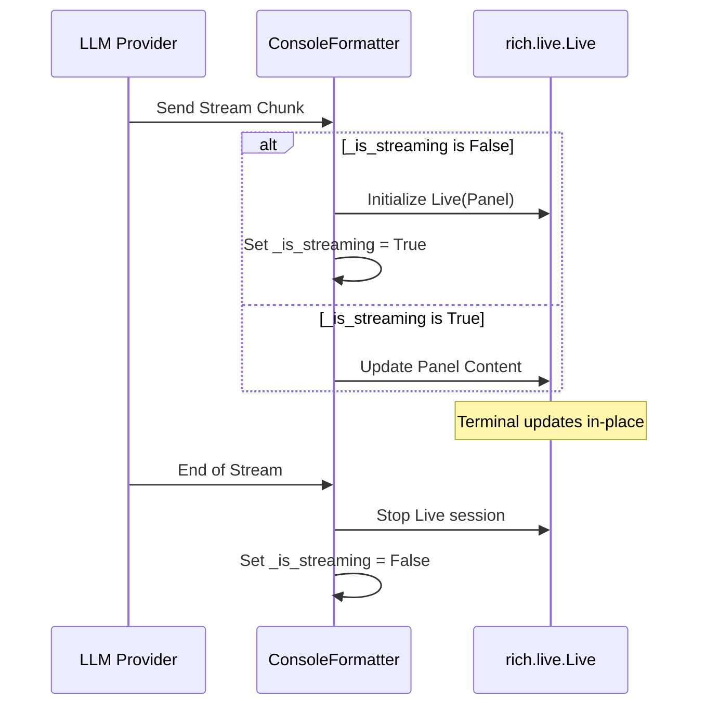
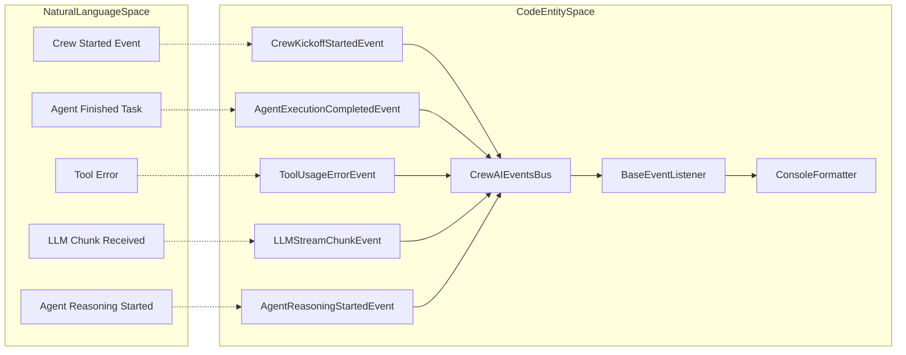

<!-- source: DeepWiki mcp.deepwiki.com · repo crewAIInc/crewAI · page 6.3 Console Formatter and Output · fetched 2026-11-09 -->

# Console Formatter and Output

Relevant source files

The following files were used as context for generating this wiki page:

- [docs/edge/ar/concepts/event-listener.mdx](docs/edge/ar/concepts/event-listener.mdx)

The purpose of this page is to document the `ConsoleFormatter` component, its integration with CrewAI's event bus architecture, rich text terminal rendering, live streaming displays, status panels, version update notifications, and console suppression mechanisms.

---

## 1. Architecture and Integration

The `ConsoleFormatter` acts as the visual output layer within CrewAI's event-driven framework. It receives execution events dispatched through the internal event system and translates them into styled, readable terminal outputs using the `rich` library.

Sources: [lib/crewai/src/crewai/events/utils/console_formatter.py:6-71](), [lib/crewai/src/crewai/events/listeners/tracing/trace_listener.py:129-175]()

---

## 2. ConsoleFormatter Class Structure

The `ConsoleFormatter` class is defined in `lib/crewai/src/crewai/events/utils/console_formatter.py` [44-63](). It manages terminal state, streaming contexts, and global metrics such as tool usage frequencies across multi-threaded executions.

| Attribute | Type | Purpose |
|-----------|------|---------|
| `console` | `Console` | An instance of `rich.console.Console` used for rendering output. |
| `verbose` | `bool` | Determines whether detailed logs are rendered to the terminal. |
| `_streaming_live` | `Live \| None` | Active `rich.live.Live` session for updating character streams. |
| `_is_streaming` | `bool` | Flag tracking whether an LLM token stream is currently active. |
| `tool_usage_counts` | `ClassVar[dict]` | Global mapping of tool identifiers to invocation totals. |
| `_tool_counts_lock` | `ClassVar[Lock]` | Thread synchronization lock for safe updates to `tool_usage_counts`. |

Sources: [lib/crewai/src/crewai/events/utils/console_formatter.py:44-63]()

---

## 3. Version and Tracing Notifications

The formatter handles environment status checks, alerting users about updates or missing configurations during initialization.

### Version Update Messages
The method `_show_version_update_message_if_needed` [73-127]() validates the local installation against PyPI using `is_newer_version_available()` and `is_current_version_yanked()`.
- **Update Available**: Renders a yellow notification panel if a newer version exists [113-118]().
- **Yanked Version**: Renders a red alert panel if the current package version has been pulled from PyPI due to critical issues [102-107]().
- **Bypass Conditions**: Checks are skipped when running in CI environments or if `CREWAI_DISABLE_VERSION_CHECK` is configured [75-76]().

### Tracing Status Messages
The `_show_tracing_disabled_message_if_needed` method [128-171]() evaluates `is_tracing_enabled_in_context()` and guides users on how to activate telemetry via environment variables or CLI configurations [137-171]().

Sources: [lib/crewai/src/crewai/events/utils/console_formatter.py:73-171](), [lib/crewai/src/crewai/cli/version.py:155-216]()

---

## 4. Output Control and Suppression

Programmatic executions or library integrations frequently require disabling terminal output. CrewAI manages this through context variables.

### Context-Aware Suppression
Two thread-local `ContextVar` instances govern suppression state [14-20]():
- `_disable_version_check`: Suppresses PyPI version verification notices.
- `_suppress_console_output`: Globally suppresses all invocations of `ConsoleFormatter.print()`.

### Helper Functions
- `set_suppress_console_output(suppress: bool)` [23-32](): Adjusts the suppression flag and returns a restoration token.
- `should_suppress_console_output()` [35-41](): Inspects current suppression status.

Sources: [lib/crewai/src/crewai/events/utils/console_formatter.py:14-42]()

---

## 5. Streaming and Status Panels

The formatter provides specialized utilities for encapsulating and streaming execution details.

### Standardized Content Creation
- `create_panel()` [64-71](): Wraps input strings within a `rich.panel.Panel` featuring predefined padding and borders.
- `create_status_content()` [172-195](): Generates `rich.text.Text` nodes featuring distinct headers and structured key-value parameters.

### Streaming Display Implementation
Streaming leverages `_streaming_live`. When a stream initiates, a `Live` render context is established. Subsequent chunks mutate panel data in-place without refreshing the entire buffer.

Sources: [lib/crewai/src/crewai/events/utils/console_formatter.py:59-71](), [lib/crewai/src/crewai/events/utils/console_formatter.py:197-205]()

---

## 6. Tool Usage and A2A Formatting

Tool executions and agent handoffs track state to produce coherent chronological output.

### Tool Iteration Tracking
The `tool_usage_counts` dictionary [45]() records tool execution counts, enabling labels like `Tool Name (Attempt #2)`. Modifications are protected by `_tool_counts_lock` [46]() to prevent race conditions during concurrent crew executions.

### A2A Interaction State
Agent-to-Agent (A2A) dialogues utilize tracking attributes such as:
- `current_a2a_turn_count` [48]()
- `_pending_a2a_message` [49]()
- `_current_a2a_agent_name` [52]()

Sources: [lib/crewai/src/crewai/events/utils/console_formatter.py:45-52]()

---

## 7. Reasoning Output

When agents execute with reasoning enabled (`reasoning=True`) [docs/edge/ar/concepts/reasoning.mdx:14](), the `ConsoleFormatter` intercepts and presents cognitive reflection logs, including:
1.  **Task Understanding**: Interpretation of input constraints [docs/edge/ar/concepts/reasoning.mdx:122-124]().
2.  **Key Steps**: The projected sequence of actions [docs/edge/ar/concepts/reasoning.mdx:125-131]().
3.  **Challenge Approach**: Planned mitigation for ambiguous inputs [docs/edge/ar/concepts/reasoning.mdx:132-136]().
4.  **Tool Selection**: Rationale for chosen tools [docs/edge/ar/concepts/reasoning.mdx:137-141]().

Sources: [docs/edge/ar/concepts/reasoning.mdx:14-148]()

---

## 8. Integration with Event System

Decoupled publishing and subscription occur via the framework event bus, bridging event occurrences to concrete formatting logic.

Sources: [docs/edge/ar/concepts/event-listener.mdx:16-18](), [docs/edge/ar/concepts/event-listener.mdx:102-181]()

---

## 9. Integration with TraceListener

The `TraceCollectionListener` interfaces with `ConsoleFormatter` to provide telemetry feedback:
- **Initialization**: Accepts an optional formatter instance during instantiation [151-175]().
- **First-Time UX**: Uses `FirstTimeTraceHandler` to prompt users about trace visibility [53-61]().
- **Trace URLs**: Renders ephemerally tracked trace URLs inside styled panels [149-191]().

Sources: [lib/crewai/src/crewai/events/listeners/tracing/trace_listener.py:151-175](), [lib/crewai/src/crewai/events/listeners/tracing/first_time_trace_handler.py:149-191]()

---

