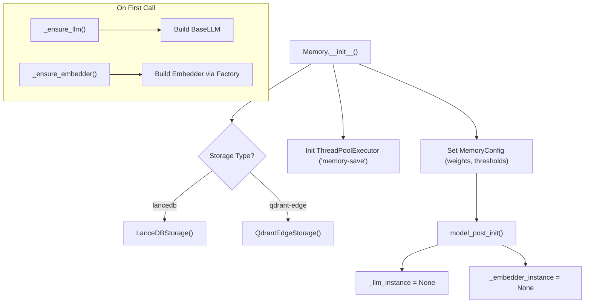
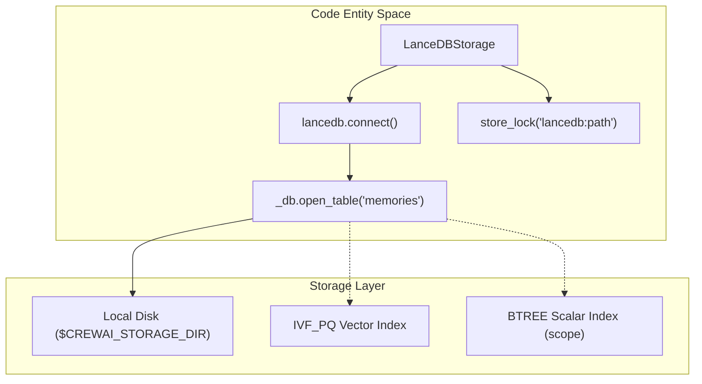
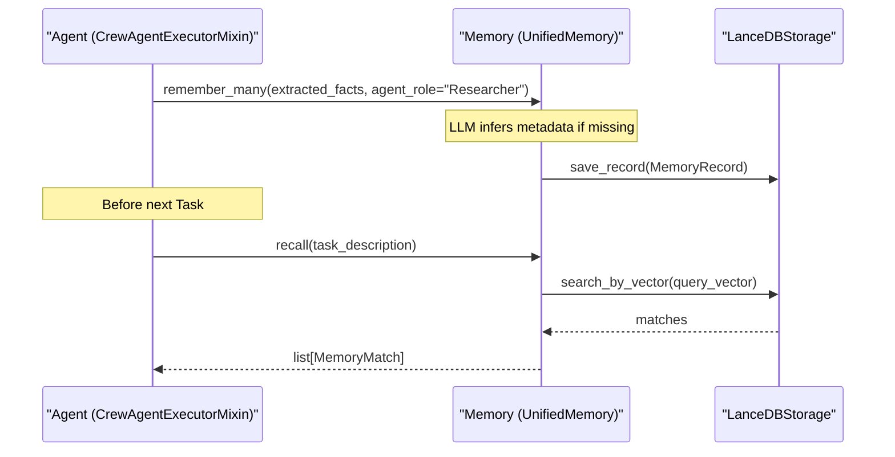

<!-- source: DeepWiki mcp.deepwiki.com · repo crewAIInc/crewAI · page 7.1 Unified Memory Architecture · fetched 2026-11-09 -->

# Unified Memory Architecture

Relevant source files

The following files were used as context for generating this wiki page:

- [docs/edge/ar/concepts/memory.mdx](docs/edge/ar/concepts/memory.mdx)

This document describes the architectural design of CrewAI's unified memory system. It covers the core `Memory` class, its constituent components (LLM analyzer, embedder, storage backend), and how these pieces fit together to provide intelligent, context-aware memory for agents and flows.

The unified memory architecture replaces the legacy separate memory types (short-term, long-term, entity, external) with a single intelligent API that leverages LLM analysis for self-organization.

Sources: [lib/crewai/src/crewai/memory/unified_memory.py:56-108](), [docs/edge/ar/concepts/memory.mdx:8-13]()

---

## Overview

The unified memory system provides a single `Memory` class [lib/crewai/src/crewai/memory/unified_memory.py:56-62]() that replaces separate memory types with one intelligent API. Key features include:

- **LLM-driven analysis**: Uses an LLM to infer scope, categories, and importance when saving [docs/edge/ar/concepts/memory.mdx:10-10]().
- **Adaptive recall**: Supports `RecallFlow` for intelligent retrieval with composite scoring (semantic similarity, recency, and importance) [lib/crewai/src/crewai/memory/unified_memory.py:59-61]().
- **Pluggable storage**: Defaults to `LanceDBStorage` but supports custom backends via the `StorageBackend` protocol [lib/crewai/src/crewai/memory/unified_memory.py:70-73]().
- **Flexible embeddings**: Works with various providers through a unified factory [lib/crewai/src/crewai/memory/unified_memory.py:50-54]().
- **Standalone operation**: Functions independently of agents or crews [docs/edge/ar/concepts/memory.mdx:42-44]().

Sources: [lib/crewai/src/crewai/memory/unified_memory.py:56-108](), [docs/edge/ar/concepts/memory.mdx:8-13]()

---

## Core Components

### Memory Class

The `Memory` class is the central orchestrator for all memory operations. It manages the lifecycle of the LLM analyzer, the embedder, and the storage backend.

| Component | Role | Default |
| :--- | :--- | :--- |
| **LLM Analyzer** | Infers metadata, performs consolidation, and drives deep recall [lib/crewai/src/crewai/memory/unified_memory.py:66-69](). | `gpt-4o-mini` |
| **Embedder** | Generates vectors for semantic search [lib/crewai/src/crewai/memory/unified_memory.py:74-77](). | OpenAI `text-embedding-3-small` |
| **Storage Backend** | Persists records and manages vector indices [lib/crewai/src/crewai/memory/unified_memory.py:70-73](). | `LanceDBStorage` |
| **EncodingFlow** | Orchestrates batch-native saving, deduplication, and consolidation [lib/crewai/src/crewai/memory/encoding_flow.py:89-97](). | Internal |
| **RecallFlow** | Handles adaptive-depth retrieval with iterative deepening [lib/crewai/src/crewai/memory/recall_flow.py:58-64](). | Internal |

Sources: [lib/crewai/src/crewai/memory/unified_memory.py:56-89](), [lib/crewai/src/crewai/memory/encoding_flow.py:89-97](), [lib/crewai/src/crewai/memory/recall_flow.py:58-64]()

### Memory Initialization Logic

The system uses lazy initialization [lib/crewai/src/crewai/memory/unified_memory.py:168-173](). Components are only built when the first memory operation (save or recall) is triggered.

Diagram: Memory Component Initialization (Natural Language Space to Code Entity Space)

Sources: [lib/crewai/src/crewai/memory/unified_memory.py:151-186](), [lib/crewai/src/crewai/memory/storage/lancedb_storage.py:44-78]()

---

## Architectural Layers

### Layer 1: Storage and Persistence

The `StorageBackend` defines the contract for memory persistence. `LanceDBStorage` is the default implementation, providing high-performance vector search and ACID-compliant storage.

Diagram: LanceDB Storage Implementation

Sources: [lib/crewai/src/crewai/memory/storage/lancedb_storage.py:41-114](), [lib/crewai/src/crewai/utilities/lock_store.py:17]()

### Layer 2: Processing Flows

Memory operations are handled by specialized `Flow` subclasses that manage complex multi-step logic.

#### The Encoding Pipeline (`EncodingFlow`)
Used by `remember()` and `remember_many()`, this pipeline processes items through five steps [lib/crewai/src/crewai/memory/encoding_flow.py:3-9]():
1. **Batch Embed**: Single call to the embedder for all items [lib/crewai/src/crewai/memory/encoding_flow.py:128-135]().
2. **Intra-batch Dedup**: Uses cosine similarity to drop near-exact duplicates within the batch [lib/crewai/src/crewai/memory/encoding_flow.py:141-160]().
3. **Parallel Find Similar**: Concurrent storage searches for existing similar records [lib/crewai/src/crewai/memory/encoding_flow.py:179-200]().
4. **Parallel Analyze**: LLM calls for field resolution (scope/importance) and consolidation planning [lib/crewai/src/crewai/memory/encoding_flow.py:24-29]().
5. **Execute Plans**: Batch storage writes and updates [lib/crewai/src/crewai/memory/encoding_flow.py:8-9]().

#### The Retrieval Pipeline (`RecallFlow`)
Used by `recall()`, it implements adaptive-depth retrieval [lib/crewai/src/crewai/memory/recall_flow.py:58-64]():
1. **Query Analysis**: Distills queries into targeted sub-queries [lib/crewai/src/crewai/memory/recall_flow.py:189-200]().
2. **Parallel Search**: Multi-query, multi-scope search across the storage backend [lib/crewai/src/crewai/memory/recall_flow.py:91-108]().
3. **Confidence Routing**: If top scores are below thresholds, triggers deeper exploration [lib/crewai/src/crewai/memory/recall_flow.py:112-118]().

Sources: [lib/crewai/src/crewai/memory/encoding_flow.py:3-100](), [lib/crewai/src/crewai/memory/recall_flow.py:58-200]()

---

## Agent and Crew Integration

Agents automatically interface with the unified memory system during task execution.

### Memory Scoping
Memories are organized into hierarchical scopes like `/crew/research/agent/researcher` [lib/crewai/src/crewai/agents/agent_builder/base_agent_executor_mixin.py:59-61]().

Diagram: Memory-Agent Association

Sources: [lib/crewai/src/crewai/agents/agent_builder/base_agent_executor_mixin.py:29-67](), [lib/crewai/src/crewai/memory/memory_scope.py:19-24]()

---

## Component Interaction Summary

| Feature | Technical Implementation | File Reference |
| :--- | :--- | :--- |
| **Composite Scoring** | Blends semantic (0.5), recency (0.3), and importance (0.2). | [lib/crewai/src/crewai/memory/unified_memory.py:78-89]() |
| **Concurrency** | `portalocker` or Redis-based locking for storage access. | [lib/crewai/src/crewai/utilities/lock_store.py:17]() |
| **Background Saves** | `ThreadPoolExecutor` with worker `memory-save` handles writes. | [lib/crewai/src/crewai/memory/unified_memory.py:143-146]() |
| **Memory Tools** | `RecallMemoryTool` and `RememberTool` provided to agents. | [lib/crewai/src/crewai/tools/memory_tools.py:25-81]() |
| **Event Bus** | Emits `MemorySaveStartedEvent`, `MemoryQueryCompletedEvent`, etc. | [lib/crewai/src/crewai/memory/unified_memory.py:14-22]() |

Sources: [lib/crewai/src/crewai/memory/unified_memory.py:14-149](), [lib/crewai/src/crewai/tools/memory_tools.py:104-130]()

---

