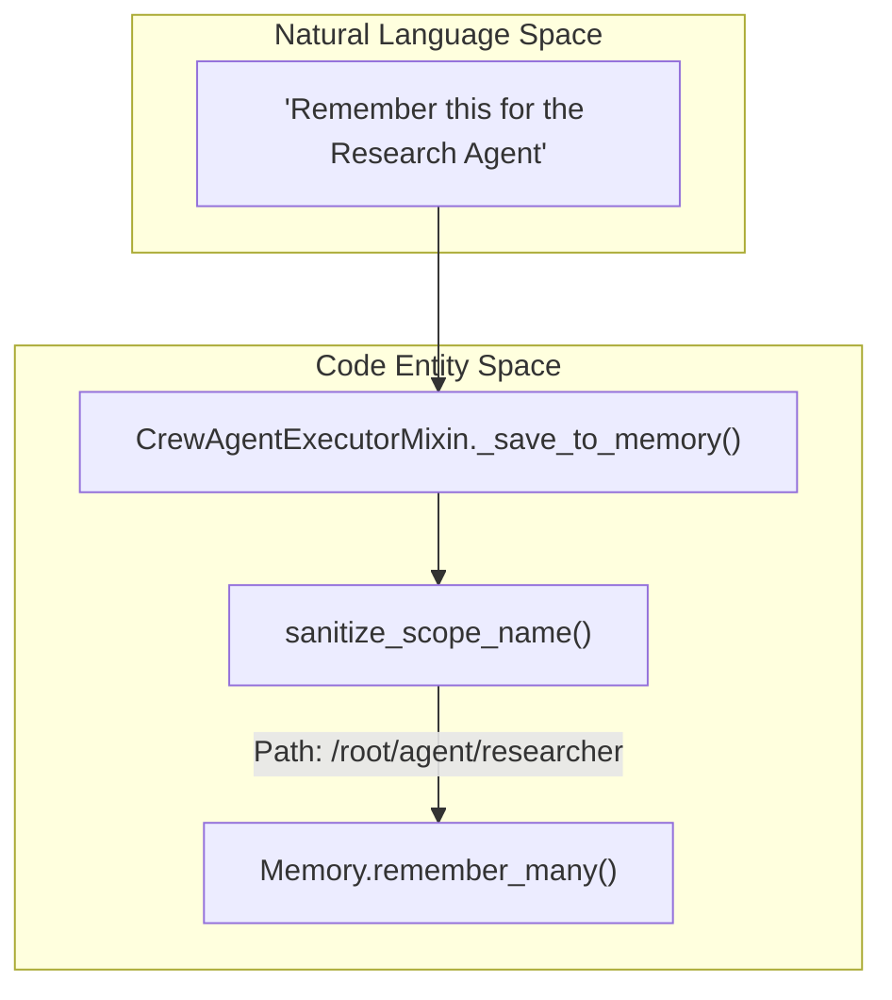
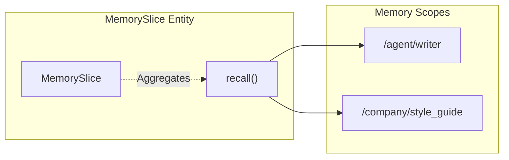

<!-- source: DeepWiki mcp.deepwiki.com · repo crewAIInc/crewAI · page 7.2 Memory Operations and Scopes · fetched 2026-11-09 -->

# Memory Operations and Scopes

<details>
<summary>Relevant source files</summary>

The following files were used as context for generating this wiki page:

- [docs/edge/ar/concepts/memory.mdx](docs/edge/ar/concepts/memory.mdx)

</details>


This page documents the technical implementation of saving and retrieving memories using the unified memory system, focusing on hierarchical scopes, restricted views (`MemoryScope`), and cross-scope access (`MemorySlice`).

## Overview

The `Memory` class provides a unified interface for all memory operations [lib/crewai/src/crewai/memory/unified_memory.py:56-62](). It uses an LLM to analyze content during saves to infer metadata like importance and categories, and it employs a sophisticated retrieval pipeline for recall. A key architectural feature is the filesystem-like hierarchical scope system, which allows for fine-grained organizational control [lib/crewai/src/crewai/memory/unified_memory.py:232-281]().

Sources: [lib/crewai/src/crewai/memory/unified_memory.py:56-62](), [lib/crewai/src/crewai/memory/unified_memory.py:232-281]()

## Core Memory Operations

The system provides three primary methods for interacting with the storage backend via the `Memory` class.

### remember() - Synchronous Save

The `remember()` method is used for saving a single memory record [lib/crewai/src/crewai/memory/unified_memory.py:232-281](). If parameters like `scope`, `categories`, or `importance` are omitted, the system triggers an LLM analysis of the content to infer these values using `analyze_memory()` [lib/crewai/src/crewai/memory/unified_memory.py:488-518]().

```python
record = memory.remember(
    content="The project deadline is moved to Friday.",
    scope="/projects/alpha",
    importance=0.9
)
```

Sources: [lib/crewai/src/crewai/memory/unified_memory.py:232-281](), [lib/crewai/src/crewai/memory/unified_memory.py:488-518]()

### remember_many() - Non-blocking Batch Save

For efficiency, `remember_many()` allows saving multiple items [lib/crewai/src/crewai/memory/unified_memory.py:283-333](). It performs intra-batch deduplication (filtering items with similarity > 0.98) and executes the saving process in a background thread pool (`_save_pool`) [lib/crewai/src/crewai/memory/unified_memory.py:143-147]().

```python
memory.remember_many([
    "Meeting notes from 10 AM...",
    "User feedback on the new UI..."
])
```

Sources: [lib/crewai/src/crewai/memory/unified_memory.py:283-333](), [lib/crewai/src/crewai/memory/unified_memory.py:143-147]()

### recall() - Retrieval

Retrieval uses a composite score combining semantic similarity, recency, and importance [lib/crewai/src/crewai/memory/unified_memory.py:335-402](). It supports two modes:
- **Shallow**: Direct vector search using `storage.search()`.
- **Deep**: Uses `RecallFlow` for adaptive-depth exploration and LLM-driven query refinement.

Sources: [lib/crewai/src/crewai/memory/unified_memory.py:335-402]()

## Hierarchical Scopes

Memories are organized in a tree structure using path strings (e.g., `/crew/research/agent/analyst`). This allows for context-dependent isolation and discovery.

### Automatic Agent Scoping

When an agent saves a task result to memory, the system automatically extends the `root_scope` to include the agent's role [lib/crewai/src/crewai/agents/agent_builder/base_agent_executor_mixin.py:29-67](). This ensures that memories generated by a specific agent are logically grouped under that agent's path within the crew's hierarchy.


**Diagram: Agent-to-Scope Association**

Sources: [lib/crewai/src/crewai/agents/agent_builder/base_agent_executor_mixin.py:29-67](), [lib/crewai/src/crewai/memory/utils.py:1-20]()

### Scope Discovery and Inspection

The `Memory` class provides utility methods to navigate this hierarchy:
- `tree(path, max_depth)`: Returns a visual string representation of the scope tree [lib/crewai/src/crewai/memory/unified_memory.py:433-467]().
- `list_scopes(path)`: Lists child scopes under a specific path [lib/crewai/src/crewai/memory/unified_memory.py:433-467]().
- `info(path)`: Returns `ScopeInfo` containing record counts and categories [lib/crewai/src/crewai/memory/unified_memory.py:433-467]().

Sources: [lib/crewai/src/crewai/memory/unified_memory.py:433-467]()

## Restricted Views: MemoryScope

A `MemoryScope` provides a restricted view of the underlying `Memory` instance [lib/crewai/src/crewai/memory/memory_scope.py:19-183](). All operations performed through a `MemoryScope` are automatically prefixed with a `root_path`.

| Feature | Description |
| :--- | :--- |
| **Isolation** | Operations cannot "escape" the `root_path`. |
| **Relative Paths** | Passing `scope="/sub"` to a `MemoryScope` with root `/A` results in path `/A/sub`. |
| **Subscoping** | `subscope(path)` creates a narrower `MemoryScope`. |

```python
base_mem = Memory()
scoped_mem = base_mem.scope("/project/alpha")
scoped_mem.remember("Decision made.") # Saved to /project/alpha
```

Sources: [lib/crewai/src/crewai/memory/memory_scope.py:19-183]()

## Cross-Scope Access: MemorySlice

A `MemorySlice` allows an agent to access multiple disjoint branches of the scope tree simultaneously [lib/crewai/src/crewai/memory/memory_scope.py:185-288](). This is typically used to give an agent access to its private memory plus shared organizational knowledge.

- **Recall**: Aggregates results from all configured scopes by iterating through the internal `scopes` list [lib/crewai/src/crewai/memory/memory_scope.py:228-245]().
- **Read-Only**: Often configured as `read_only=True` to prevent agents from polluting shared knowledge bases while allowing them to learn from them.


**Diagram: MemorySlice Multi-Scope Aggregation**

Sources: [lib/crewai/src/crewai/memory/memory_scope.py:185-288]()

## Memory Tools for Agents

Agents interact with memory through specialized tools defined in `crewai.tools.memory_tools`.

- **RecallMemoryTool**: Allows the agent to perform vector searches across its assigned scope/slice by invoking `memory.recall()` [lib/crewai/src/crewai/tools/memory_tools.py:65-72]().
- **RememberTool**: Allows the agent to explicitly save facts via `memory.remember()` [lib/crewai/src/crewai/tools/memory_tools.py:122-129](). This tool is omitted if the memory view is marked as `read_only`.

Sources: [lib/crewai/src/crewai/tools/memory_tools.py:25-130]()

## Summary of Scope Operations

| Class | Primary Use Case | Path Handling |
| :--- | :--- | :--- |
| `Memory` | Global management and root access. | Absolute paths. |
| `MemoryScope` | Restricted agent/task context. | Prefixes all paths with `root_path`. |
| `MemorySlice` | Multi-context retrieval (e.g., Private + Shared). | Iterates over a list of paths. |

Sources: [lib/crewai/src/crewai/memory/memory_scope.py:19-288](), [lib/crewai/src/crewai/memory/unified_memory.py:56-137]()

---

