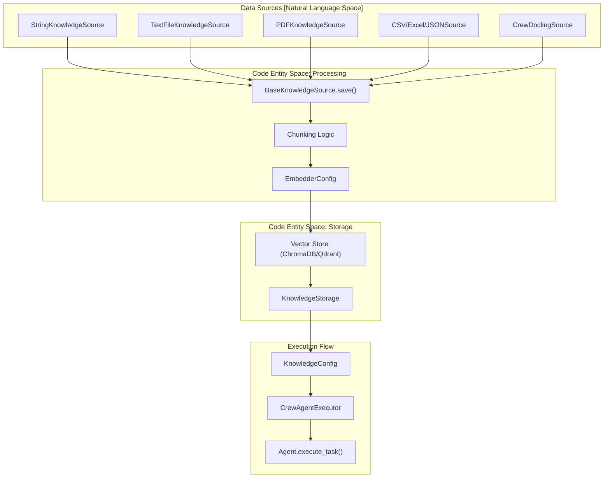
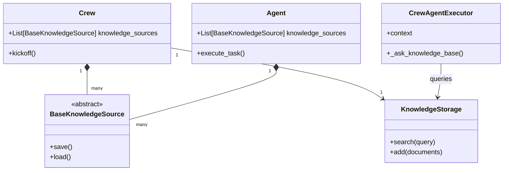

<!-- source: DeepWiki mcp.deepwiki.com · repo crewAIInc/crewAI · page 7.4 Knowledge Sources and Configuration · fetched 2026-11-09 -->

# Knowledge Sources and Configuration

Relevant source files

The following files were used as context for generating this wiki page:

- [docs/edge/ar/concepts/knowledge.mdx](docs/edge/ar/concepts/knowledge.mdx)

The Knowledge system in CrewAI provides agents with access to external information sources, effectively acting as a reference library during task execution. This system enables agents to ground their responses in domain-specific data, maintain context across interactions, and support decisions with real-world information.

### Core Architecture and Data Flow

The Knowledge system is integrated at both the `Agent` and `Crew` levels. When a `Crew` is initialized with `knowledge_sources`, it sets up a shared context that all participating agents can access. Alternatively, individual agents can be configured with specific knowledge sources for specialized expertise.

#### Knowledge Initialization Flow
The following diagram illustrates how knowledge sources are processed from raw data into a queryable format accessible by agents, bridging Natural Language Space to Code Entity Space.

**Knowledge Processing and Retrieval Pipeline**

Sources: [docs/edge/ar/concepts/knowledge.mdx:10-101](), [lib/crewai/src/crewai/knowledge/source/base_knowledge_source.py:11-30]()

### Knowledge Sources

CrewAI supports a variety of knowledge sources, each specialized for different data formats. All sources inherit from the `BaseKnowledgeSource` abstract class.

| Source Class | Description | Requirements |
| :--- | :--- | :--- |
| `StringKnowledgeSource` | Processes raw strings directly into the knowledge base. | None |
| `TextFileKnowledgeSource` | Reads and indexes `.txt` files. | Files in `./knowledge` |
| `PDFKnowledgeSource` | Extracts and indexes content from `.pdf` documents. | `pypdf` |
| `CSVKnowledgeSource` | Processes structured `.csv` data. | `pandas` |
| `ExcelKnowledgeSource` | Indexes `.xlsx` or `.xls` spreadsheets. | `pandas`, `openpyxl` |
| `JSONKnowledgeSource` | Parses and indexes `.json` files. | None |
| `CrewDoclingSource` | Advanced source for web content and complex documents using Docling. | `docling` |

Sources: [docs/edge/ar/concepts/knowledge.mdx:153-213](), [lib/crewai/src/crewai/knowledge/source/base_knowledge_source.py:11-11]()

### Knowledge Configuration (`KnowledgeConfig`)

The `KnowledgeConfig` defines how agents interact with the stored knowledge. It governs parameters such as the number of chunks to retrieve and the threshold for relevance.

#### Key Configuration Parameters
*   **`top_k`**: The number of relevant document segments to retrieve for a given query.
*   **`score_threshold`**: The minimum similarity score required for a chunk to be included in the agent's context.

Agents access this configuration during the `kickoff` process. If a `Crew` has knowledge sources defined, it initializes a `KnowledgeStorage` instance which manages the underlying vector database. By default, CrewAI uses **ChromaDB**, but it also supports **Qdrant** [docs/edge/ar/concepts/knowledge.mdx:30-47]().

Sources: [docs/edge/ar/concepts/knowledge.mdx:30-47](), [lib/crewai/src/crewai/knowledge/storage/knowledge_storage.py:10-40]()

### Agent and Crew Integration

Knowledge can be scoped to either a specific agent or the entire crew.

1.  **Agent-Level Knowledge**: Configured via the `knowledge_sources` parameter in the `Agent` constructor. This is ideal for "Specialist" agents who require exclusive access to certain technical manuals or private data [docs/edge/ar/concepts/knowledge.mdx:229-244]().
2.  **Crew-Level Knowledge**: Configured in the `Crew` constructor. These sources are available to all agents within the crew, providing a shared "common sense" or project-wide context [docs/edge/ar/concepts/knowledge.mdx:92-98]().

**Entity Relationship: Knowledge to Code Entities**

Sources: [lib/crewai/src/crewai/crew.py:55-100](), [lib/crewai/src/crewai/agent.py:45-90](), [lib/crewai/src/crewai/knowledge/storage/knowledge_storage.py:10-40]()

### Implementation Details: Retrieval Augmented Generation (RAG)

CrewAI provides a provider-agnostic RAG abstraction. You can configure the RAG system using `set_rag_config` with either `ChromaDBConfig` or `QdrantConfig` [docs/edge/ar/concepts/knowledge.mdx:30-59]().

When an agent executes a task, the `CrewAgentExecutor` uses the knowledge base to augment the prompt. This happens dynamically:
1.  **Query Generation**: The agent's task description and current context are used to generate a search query.
2.  **Retrieval**: The `KnowledgeStorage.search()` method retrieves the most relevant `top_k` chunks based on the `KnowledgeConfig`.
3.  **Augmentation**: These chunks are injected into the agent's system prompt or context window before the LLM call to provide factual grounding.

Sources: [docs/edge/ar/concepts/knowledge.mdx:61-63](), [lib/crewai/src/crewai/agents/executor.py:20-100]()

---

