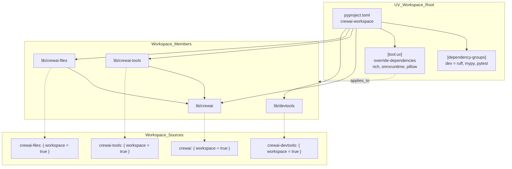
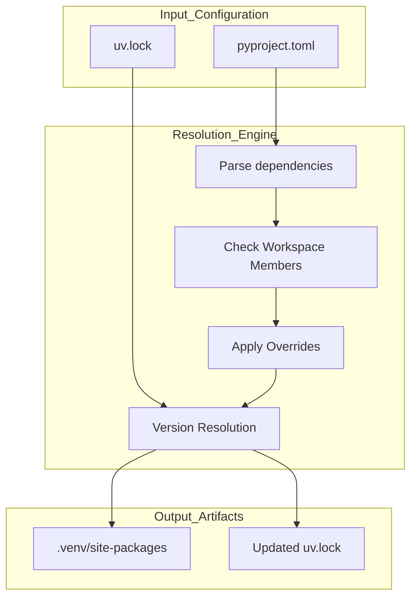

<!-- source: DeepWiki mcp.deepwiki.com · repo crewAIInc/crewAI · page 8.3 Dependency Management with UV · fetched 2026-11-09 -->

# Dependency Management with UV

<details>
<summary>Relevant source files</summary>

The following files were used as context for generating this wiki page:

- [.github/CONTRIBUTING.md](.github/CONTRIBUTING.md)
- [.github/workflows/build-uv-cache.yml](.github/workflows/build-uv-cache.yml)
- [.python-version](.python-version)

</details>


This document explains how CrewAI uses UV for dependency management across its monorepo workspace and user projects. UV is a fast Python package installer and resolver written in Rust that provides reproducible builds through lock files and efficient workspace management.

For information about the overall workspace and monorepo architecture, see [1.1. Workspace and Monorepo Architecture](). For package structure details, see [1.2. Package Structure and Dependencies]().

## Purpose and Scope

UV serves as the primary dependency manager for:
- The CrewAI monorepo workspace containing internal packages.
- User-generated Crew and Flow projects via the CLI.
- Development dependencies shared across packages.
- Conflict resolution through dependency overrides.
- Reproducible builds via `uv.lock` files.

## UV as the Package Manager

CrewAI adopted UV for its performance and workspace management capabilities. UV provides:

- **Fast resolution**: Rust-based dependency resolver significantly faster than pip.
- **Workspace support**: Native monorepo management with shared dependencies.
- **Lock files**: Reproducible builds through `uv.lock` files that capture exact versions.
- **Override mechanism**: Ability to resolve transitive dependency conflicts.
- **Virtual environment management**: Integrated venv creation and management.

### Workspace Configuration

The monorepo defines a UV workspace in `pyproject.toml` [pyproject.toml:176-182]():

```toml
[tool.uv.workspace]
members = [
    "lib/crewai",
    "lib/crewai-tools",
    "lib/devtools",
    "lib/crewai-files",
]
```

This configuration establishes the internal packages as workspace members, allowing them to reference each other during development and testing.

Sources: [pyproject.toml:176-182]()

## Workspace Dependency Sources

UV workspace sources define how internal packages reference each other. The configuration in `pyproject.toml` [pyproject.toml:185-190]() establishes workspace dependencies:

| Package Name | Source Type | Purpose |
|--------------|-------------|---------|
| `crewai` | workspace | Core framework as workspace dependency |
| `crewai-tools` | workspace | Tools package as workspace dependency |
| `crewai-devtools` | workspace | Development utilities as workspace dependency |
| `crewai-files` | workspace | File handling package as workspace dependency |

When a workspace member declares a dependency on another member, UV resolves it to the local workspace source rather than fetching from PyPI. This enables live development across packages without reinstallation.

Sources: [pyproject.toml:185-190]()

## Override Dependencies for Conflict Resolution

UV's override mechanism resolves transitive dependency conflicts that would otherwise prevent installation. The configuration in `pyproject.toml` [pyproject.toml:168-174]() defines critical overrides:

### Dependency Overrides in Code

```toml
override-dependencies = [
    "rich>=13.7.1",
    "onnxruntime<1.24; python_version < '3.11'",
    "pillow>=12.1.1",
    "langchain-core>=1.2.11,<2",
    "urllib3>=2.6.3",
]
```

1.  **Rich**: Forces `rich>=13.7.1` to resolve conflicts between `composio-core` and `textual` [pyproject.toml:169-169]().
2.  **ONNX Runtime**: Caps `onnxruntime` at `<1.24` for Python versions below 3.11 to ensure compatibility with `qdrant[fastembed]` [pyproject.toml:170-170]().
3.  **Security Patches**: `langchain-core` is pinned to `>=1.2.11` to address security vulnerabilities [pyproject.toml:172-172]().
4.  **Pillow**: Forces `>=12.1.1` to ensure modern API availability despite transitive constraints [pyproject.toml:171-171]().

Sources: [pyproject.toml:163-174]()

## Workspace Architecture and Dependency Flow

### Diagram: UV Workspace Dependency Resolution



This diagram shows how UV resolves dependencies across the workspace. Workspace sources enable local package references, and `override-dependencies` resolve conflicts globally across all members.

Sources: [pyproject.toml:163-190](), [.github/CONTRIBUTING.md:32-39]()

## UV Command Workflows

### Development Workflow

For developers working in the CrewAI monorepo, `uv` is the mandatory tool for environment setup [.github/CONTRIBUTING.md:152-163]().

| Command | Purpose | Effect |
|---------|---------|--------|
| `uv sync --all-groups --all-extras` | Initialize development environment | Creates `.venv` with all workspace packages and extras [.github/CONTRIBUTING.md:25-25]() |
| `uv run pre-commit install` | Setup git hooks | Installs hooks defined in workspace [.github/CONTRIBUTING.md:27-27]() |
| `uv add --package crewai <pkg>` | Add package dependency | Updates specific member's `pyproject.toml` [.github/CONTRIBUTING.md:154-154]() |
| `uv run ruff check lib/` | Run linter | Executes `ruff` within the managed environment [.github/CONTRIBUTING.md:62-62]() |

### Lock File Requirements

The `uv.lock` file is critical for the CrewAI ecosystem. It ensures that every contributor and CI runner uses the exact same version of dependencies, preventing "it works on my machine" issues [.github/CONTRIBUTING.md:159-161]().

Sources: [.github/CONTRIBUTING.md:21-28](), [.github/CONTRIBUTING.md:152-163]()

## CI/CD and Cache Management

To optimize build times, CrewAI uses GitHub Actions to maintain a global UV cache. The `build-uv-cache.yml` workflow populates the cache for multiple Python versions (3.10 through 3.13) [build-uv-cache.yml:20-22]().

### Cache Population Logic
The workflow executes `uv sync --all-groups --all-extras --no-install-project` to fetch all possible dependencies without installing the local workspace members into the environment [build-uv-cache.yml:38](). This ensures that subsequent CI runs can pull from the cache rather than the network.

### Dependabot Integration
CrewAI uses Dependabot to monitor `uv` package ecosystem updates weekly [.github/dependabot.yml:5-9](). This includes security updates and minor/patch version bumps grouped for efficient review [.github/dependabot.yml:12-22]().

Sources: [.github/workflows/build-uv-cache.yml:1-48](), [.github/dependabot.yml:1-26]()

## Dependency Resolution Flow

### Diagram: UV Dependency Resolution Process



This diagram illustrates how UV processes `pyproject.toml` configurations, applies overrides, and generates the final environment and lock file.

Sources: [pyproject.toml:163-190](), [.github/CONTRIBUTING.md:152-163]()

## Development Dependency Groups

The monorepo defines shared development dependencies in `pyproject.toml` [pyproject.toml:9-33]():

### Code Quality and Testing

| Category | Packages | Purpose |
|----------|----------|---------|
| **Linting/Formatting** | `ruff`, `pre-commit`, `commitizen` | Static analysis and commit standardization |
| **Type Checking** | `mypy`, `types-requests`, `types-pyyaml` | Strict type enforcement across the monorepo |
| **Security** | `bandit` | Security scanning for common vulnerabilities |
| **Testing** | `pytest`, `pytest-asyncio`, `vcrpy` | Unit and integration testing infrastructure |

Sources: [pyproject.toml:9-33](), [.github/CONTRIBUTING.md:62-69]()

## UV Configuration Reference

### Tool Configuration Structure

The complete UV configuration in `pyproject.toml` [pyproject.toml:163-190]() includes:

```toml
[tool.uv]
override-dependencies = [ ... ]

[tool.uv.workspace]
members = [ "lib/crewai", ... ]

[tool.uv.sources]
crewai = { workspace = true }
...
```

### Configuration Elements

| Section | Purpose | Scope |
|---------|---------|-------|
| `[tool.uv]` | Top-level UV settings | Global configuration |
| `override-dependencies` | Force specific versions | All workspace members and transitive deps |
| `[tool.uv.workspace]` | Define workspace members | Monorepo package list |
| `[tool.uv.sources]` | Package source mappings | Development-time resolution |

Sources: [pyproject.toml:163-190]()

---

