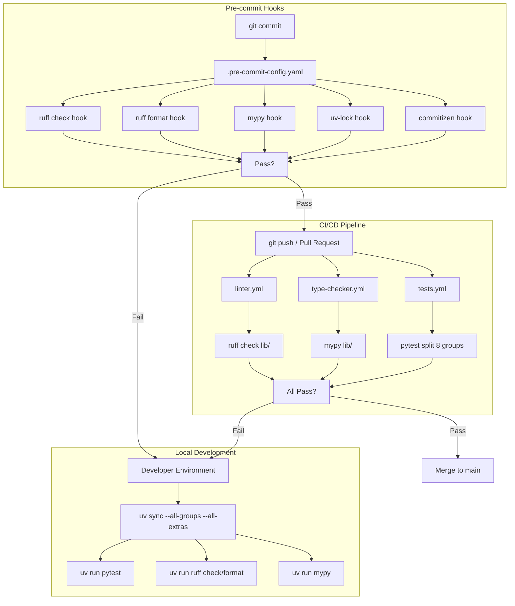
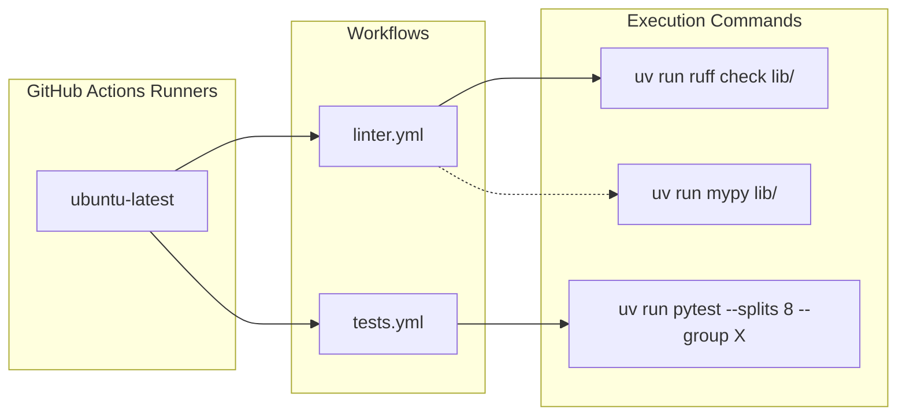

<!-- source: DeepWiki mcp.deepwiki.com · repo crewAIInc/crewAI · page 9 Development Infrastructure · fetched 2026-11-09 -->

# Development Infrastructure

<details>
<summary>Relevant source files</summary>

The following files were used as context for generating this wiki page:

- [.editorconfig](.editorconfig)
- [.github/CONTRIBUTING.md](.github/CONTRIBUTING.md)
- [.gitignore](.gitignore)

</details>


The CrewAI monorepo uses a comprehensive development infrastructure built on `uv` for dependency management, `pytest` for testing with parallel execution and test splitting, `ruff` for linting/formatting, `mypy` for type checking, and GitHub Actions for CI/CD. All development tools are configured at the workspace root in `pyproject.toml` and apply uniformly across the workspace packages: `crewai`, `crewai-tools`, `crewai-files`, and `devtools`.

This page covers:
- **Testing Infrastructure (9.1)**: pytest configuration, test splitting across 8 groups, duration caching, network isolation
- **CI/CD Workflows (9.2)**: GitHub Actions workflows for testing, linting, type checking, and cache management
- **Code Quality Tools (9.3)**: ruff (30+ rule categories), mypy (strict mode), bandit (security scanning)
- **Pre-commit Hooks (9.4)**: Local validation hooks that run before commits and pushes
- **Documentation Infrastructure (9.5)**: Mintlify-based docs system with multi-locale support
- **Contribution Workflow and Governance (9.6)**: Rules for contributing, conventional commits, and issue/PR templates.

**Sources:** [.github/CONTRIBUTING.md:32-41]()

---

## Development Workflow Overview

The CrewAI development infrastructure implements a multi-layered quality assurance strategy that operates at three checkpoints: local development, pre-commit validation, and continuous integration.

### Development Flow Diagram
"Workflow from Local Development to CI/CD"


**Sources:** [.github/CONTRIBUTING.md:19-28](), [.github/CONTRIBUTING.md:57-69]()

---

## Workspace Configuration

The development infrastructure is configured at the workspace root and applies to all packages in the monorepo.

### Core Configuration and Setup

The repository is a `uv` workspace. Developers set up the environment using:
```bash
uv sync --all-groups --all-extras
uv run pre-commit install
```
[.github/CONTRIBUTING.md:25-27]()

| Tool | Purpose | Primary Command |
|------|---------|-----------------|
| `ruff` | Linting and formatting | `uv run ruff check lib/` |
| `mypy` | Type checking | `uv run mypy lib/` |
| `pytest` | Testing | `uv run pytest lib/crewai/tests/` |
| `uv` | Dependency management | `uv add --package <pkg> <dep>` |

### CI Resource Management
"Mapping CI Workflows to Code Execution"


### Development Requirements

- **Python Versions**: Supports 3.10 through 3.14 (development target 3.12) [[.github/CONTRIBUTING.md:15]()]
- **Package Manager**: `uv` is required; direct `pip` usage is discouraged [[.github/CONTRIBUTING.md:160-163]()]
- **Strict Typing**: Full type annotations are required on all functions and classes [[.github/CONTRIBUTING.md:74]()]

**Sources:** [.github/CONTRIBUTING.md:13-28](), [.github/CONTRIBUTING.md:71-79](), [.github/CONTRIBUTING.md:150-161]()

---

## Testing Infrastructure

The testing infrastructure uses `pytest` to execute suites across multiple packages. In CI, tests are split to ensure fast feedback loops.

### Key Testing Features

- **Parallel Execution**: CI runs tests across 8 parallel groups per Python version.
- **Test Splitting**: Uses `pytest-split` logic via `--splits 8 --group ${{ matrix.group }}`.
- **Duration Caching**: CI attempts to restore test durations from `.test_durations_py*` to optimize splitting.
- **Multi-Package Testing**:
  - `lib/crewai/tests/` [[.github/CONTRIBUTING.md:112]()]
  - `lib/crewai-tools/tests/` [[.github/CONTRIBUTING.md:121]()]

For details, see [Testing Infrastructure](#9.1).

**Sources:** [.github/CONTRIBUTING.md:108-122]()

---

## CI/CD Workflows

CrewAI uses GitHub Actions to automate quality control and release processes.

### Workflow Matrix

| Workflow | Trigger | Description |
|----------|---------|-------------|
| `tests.yml` | `pull_request` | Runs the test matrix (4 Py versions x 8 groups) |
| `linter.yml` | `pull_request` | Executes `ruff` checks and formatting validation. |
| `type-checker.yml` | `pull_request` | Runs `mypy` across Python 3.10-3.13. |
| `build-uv-cache.yml` | `push`, `schedule` | Pre-builds the `uv` environment to speed up subsequent CI runs. |

For details, see [CI/CD Workflows](#9.2).

**Sources:** [.github/CONTRIBUTING.md:136-137]()

---

## Code Quality and Pre-commit

The project enforces high standards through automated linting and strict type checking.

- **Ruff**: Handles both linting and formatting. It enforces Google-style docstrings and specific rules for async/await correctness [[.github/CONTRIBUTING.md:62-75]()]
- **Mypy**: Configured for strict mode. It forbids bare `dict`/`list` without type parameters and requires built-in generics (e.g., `list[str]`) [[.github/CONTRIBUTING.md:73-78]()]
- **Pre-commit**: Automatically runs `ruff`, `mypy`, and `uv-lock` validation before every commit [[.github/CONTRIBUTING.md:59]()]

For details, see [Code Quality Tools](#9.3) and [Pre-commit Hooks](#9.4).

**Sources:** [.github/CONTRIBUTING.md:57-79](), [.github/CONTRIBUTING.md:124-134]()

---

## Documentation Infrastructure

Documentation is managed as code within the monorepo and deployed via Mintlify.

- **Location**: Docs live in the `docs/` directory [[.github/CONTRIBUTING.md:41]()]
- **Multi-locale**: Supports English (`en`), Arabic (`ar`), Korean (`ko`), and Brazilian Portuguese (`pt-BR`) [[.github/CONTRIBUTING.md:142]()]
- **Manifest**: Navigation and configuration are defined in `docs/docs.json` [[.github/CONTRIBUTING.md:140]()]

For details, see [Documentation Infrastructure](#9.5).

**Sources:** [.github/CONTRIBUTING.md:138-149]()

---

## Contribution Workflow and Governance

CrewAI encourages community contributions and maintains a structured workflow to ensure code quality and project consistency.

- **Conventional Commits**: All commits must follow the [Conventional Commits](https://www.conventionalcommits.org/) specification, including type and scope [[.github/CONTRIBUTING.md:80-98]()]
- **Branching Strategy**: New features or fixes should be developed on branches named `<type>/<short-description>` off the `main` branch [[.github/CONTRIBUTING.md:45-55]()]
- **Pull Requests**: PRs should represent a single logical change, follow conventional commit titling, and link to an existing open issue for first-time contributors [[.github/CONTRIBUTING.md:100-108]()]
- **AI-Generated Contributions**: Any PR or issue created by an LLM or AI agent must be labeled `llm-generated` [[.github/CONTRIBUTING.md:1-7]()]
- **Issue Reporting**: Use provided GitHub issue templates for bug reports and feature requests [[.github/CONTRIBUTING.md:167-171]()]
- **Licensing**: Contributions are licensed under the [MIT License](LICENSE) [[.github/CONTRIBUTING.md:174]()]

For details, see [Contribution Workflow and Governance](#9.6).

**Sources:** [.github/CONTRIBUTING.md:1-7](), [.github/CONTRIBUTING.md:45-55](), [.github/CONTRIBUTING.md:80-98](), [.github/CONTRIBUTING.md:100-108](), [.github/CONTRIBUTING.md:167-171](), [.github/CONTRIBUTING.md:174]()

---

