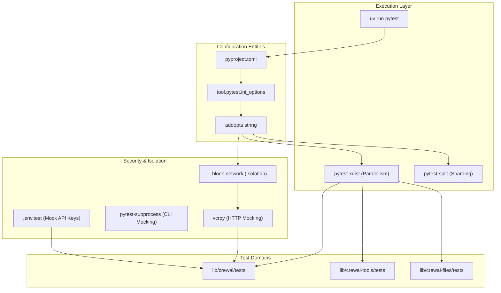
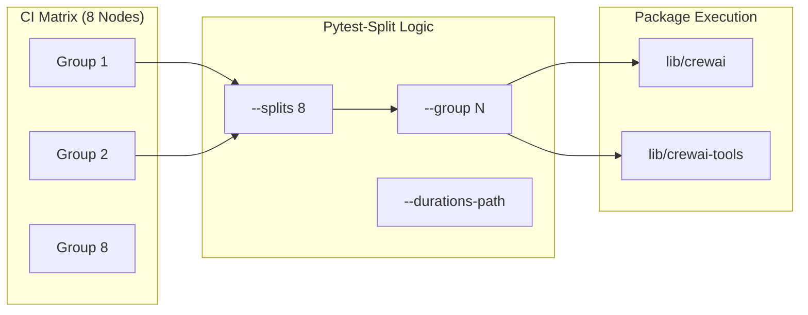

<!-- source: DeepWiki mcp.deepwiki.com · repo crewAIInc/crewAI · page 9.1 Testing Infrastructure · fetched 2026-11-09 -->

# Testing Infrastructure

<details>
<summary>Relevant source files</summary>

The following files were used as context for generating this wiki page:

- [.env.test](.env.test)
- [.github/workflows/tests.yml](.github/workflows/tests.yml)
- [.github/workflows/update-test-durations.yml](.github/workflows/update-test-durations.yml)
- [conftest.py](conftest.py)

</details>


## Purpose and Scope

This document covers the testing infrastructure for the CrewAI codebase, focusing on pytest configuration, test execution mechanisms, parallel testing strategies, VCR cassette recording for HTTP interaction mocking, network isolation, async test support, and test fixtures. This page describes how tests are configured and executed locally and in CI environments across the monorepo packages.

For CI/CD workflows and GitHub Actions configuration, see page 9.2. For code quality tools (ruff, mypy, bandit), see page 9.3. For pre-commit hooks, see page 9.4.

---

## Test Infrastructure Overview

CrewAI uses a comprehensive test infrastructure built on `pytest` with multiple plugins to enable parallel execution, test splitting, network blocking, and HTTP interaction recording. The infrastructure is designed to handle the core `crewai` package, `crewai-tools`, and `crewai-files`.

### Test Configuration

The workspace-level test configuration is defined in the root `pyproject.toml` and applies to all internal packages:

[pyproject.toml:130-144]()

```toml
[tool.pytest.ini_options]
markers = [
    "telemetry: mark test as a telemetry test (don't mock telemetry)",
]
testpaths = [
    "lib/crewai/tests",
    "lib/crewai-tools/tests",
    "lib/crewai-files/tests",
]
asyncio_mode = "strict"
asyncio_default_fixture_loop_scope = "function"
addopts = "--tb=short -n auto --timeout=60 --dist=loadfile --max-worker-restart=2 --block-network --import-mode=importlib"
```

**Key configuration options:**
- **Test paths**: Tests are located in `lib/crewai/tests`, `lib/crewai-tools/tests`, and `lib/crewai-files/tests` [pyproject.toml:134-138]().
- **Parallel execution**: `-n auto` uses `pytest-xdist` to automatically detect CPU cores for local execution [pyproject.toml:141]().
- **Timeout**: 60-second timeout per test to prevent hangs in LLM-related logic [pyproject.toml:141]().
- **Distribution strategy**: `--dist=loadfile` ensures all tests in a single file run on the same worker, preserving file-level fixture state [pyproject.toml:141]().
- **Network blocking**: `--block-network` prevents accidental external network calls to LLM providers during unit tests [pyproject.toml:141]().

### Test Dependencies

The development dependency group manages the testing stack:

| Package | Version | Purpose |
|---------|---------|---------|
| `pytest` | 8.4.2 | Core testing framework [pyproject.toml:15]() |
| `pytest-asyncio` | 1.3.0 | Async test support for Flows and Async Agents [pyproject.toml:16]() |
| `pytest-subprocess` | 1.5.3 | Mocking CLI commands and shell executions [pyproject.toml:17]() |
| `vcrpy` | 7.0.0 | HTTP interaction recording (pinned for compatibility) [pyproject.toml:18]() |
| `pytest-recording` | 0.13.4 | VCR cassette integration for pytest [pyproject.toml:19]() |
| `pytest-randomly` | 4.0.1 | Randomize test order to find hidden dependencies [pyproject.toml:20]() |
| `pytest-timeout` | 2.4.0 | Enforces execution limits [pyproject.toml:21]() |
| `pytest-xdist` | 3.8.0 | Multi-CPU parallel test execution [pyproject.toml:22]() |
| `pytest-split` | 0.10.0 | Test splitting for CI horizontal scaling [pyproject.toml:23]() |

**Sources:** [pyproject.toml:10-33](), [pyproject.toml:130-145]()

---

## Test Execution Architecture

The following diagram bridges the high-level testing requirements to the specific code entities and configurations that implement them.

### Testing System Mapping

Sources: [pyproject.toml:130-145](), [conftest.py:16-154](), [.env.test:1-160]()

### VCR Cassettes and HTTP Compatibility
The test suite uses VCR (Video Cassette Recorder) to record and replay HTTP interactions. This is critical for testing LLM integrations without incurring costs.

Due to changes in `aiohttp`, the framework implements a specific patch in `conftest.py` to maintain compatibility with `vcrpy`.

- **aiohttp Patching**: The function `_patch_vcrpy_aiohttp_compat()` restores the `AsyncStreamReaderMixin` and rebuilds the `MockClientResponse` signature to prevent `AttributeError` and `TypeError` during cassette playback [conftest.py:16-102]().
- **Binary Content Handling**: A patched version of `_make_vcr_request` handles binary request bodies (e.g., file uploads) by encoding them in base64 if UTF-8 decoding fails [conftest.py:137-154]().
- **Bedrock Host Normalization**: A custom matcher `bedrock_host_matcher` ensures AWS Bedrock requests match across different regions by normalizing hostnames to `bedrock-runtime.vcr.amazonaws.com` [conftest.py:120-135]().

### Network Isolation and Environment
- **Strict Mode**: Async tests are run in `strict` mode [pyproject.toml:139]().
- **Network Blocking**: The `--block-network` flag is enabled by default in `addopts` [pyproject.toml:141]().
- **Mock Environment**: The file `.env.test` provides "fake" API keys for all supported providers (OpenAI, Anthropic, Gemini, Azure, etc.) to ensure tests do not require real credentials [.env.test:10-57]().
- **Feature Flags**: Telemetry and Tracing are explicitly disabled during testing via `CREWAI_DISABLE_TELEMETRY=true` and `OTEL_SDK_DISABLED=true` [.env.test:143-146]().

**Sources:** [pyproject.toml:130-145](), [conftest.py:16-154](), [.env.test:1-160]()

---

## Test Splitting and CI Scaling

To optimize CI duration, tests are split across 8 parallel groups. This is managed by `pytest-split` and GitHub Actions matrices.

### CI Distribution Architecture


Sources: [.github/workflows/tests.yml:39-113](), [.github/workflows/update-test-durations.yml:1-61]()

### Test Splitting Implementation
In the CI workflow, the test suite is invoked with specific sharding arguments for both the core library and the tools package:

[.github/workflows/tests.yml:97-112]()

```bash
# Core package tests
cd lib/crewai && uv run pytest \
  -vv \
  --splits 8 \
  --group ${{ matrix.group }} \
  $DURATIONS_ARG \
  --durations=10 \
  --maxfail=3

# Tools package tests
cd lib/crewai-tools && uv run pytest \
  -vv \
  --splits 8 \
  --group ${{ matrix.group }} \
  --durations=10 \
  --maxfail=3
```

### Duration Caching
The system supports duration-based splitting to ensure each CI node finishes at approximately the same time.
1. **Storage**: Durations are stored in files named `.test_durations_py3_12` (version specific) [.github/workflows/update-test-durations.yml:52-53]().
2. **Update Workflow**: A dedicated workflow `Update Test Durations` runs on pushes to `main` that touch test files [.github/workflows/update-test-durations.yml:3-9]().
3. **Current Status**: In the main `tests.yml` workflow, duration-based splitting is currently bypassed (`DURATIONS_ARG=""`) to avoid test duplication issues until a fix for `pytest-split` is merged [.github/workflows/tests.yml:80-95]().

**Sources:** [.github/workflows/tests.yml:39-113](), [.github/workflows/update-test-durations.yml:1-61]()

---

## Code Quality and Static Analysis

Beyond functional testing, the infrastructure includes strict static analysis gates.

### Static Analysis Configuration
- **Ruff**: Configured with over 30 rule categories including `ASYNC`, `PERF`, and `S` (Bandit security) [pyproject.toml:51-82]().
- **Mypy**: Enforces `strict = true` and `disallow_untyped_defs = true` [pyproject.toml:113-114](). It targets Python 3.12 specifically for type checking [pyproject.toml:121]().
- **Bandit**: Scans for security vulnerabilities, excluding template directories [pyproject.toml:126-127]().

### Pre-commit Integration
Local development is protected by pre-commit hooks that run these tools before every commit:

[.pre-commit-config.yaml:1-22]()

```yaml
- id: ruff
  entry: bash -c 'source .venv/bin/activate && uv run ruff check --config pyproject.toml "$@"'
- id: mypy
  entry: bash -c 'source .venv/bin/activate && uv run mypy --config-file pyproject.toml "$@"'
```

**Sources:** [pyproject.toml:36-127](), [.pre-commit-config.yaml:1-33]()

---

## Summary of Test Constraints

| Feature | Implementation | File Reference |
|---------|----------------|----------------|
| **Parallelism** | `pytest-xdist` (-n auto) | [pyproject.toml:141]() |
| **Network Isolation** | `--block-network` | [pyproject.toml:141]() |
| **Async Support** | `pytest-asyncio` (strict) | [pyproject.toml:139]() |
| **CI Sharding** | `pytest-split` (8 groups) | [.github/workflows/tests.yml:34]() |
| **Mocking** | `vcrpy`, `pytest-subprocess` | [pyproject.toml:17-18]() |
| **Env Mocking** | `.env.test` | [.env.test:1-160]() |
| **Discovery** | `test_*.py`, `Test*`, `test_*` | [pyproject.toml:134-138]() |

**Sources:** [pyproject.toml:130-145](), [.github/workflows/tests.yml:1-108](), [.env.test:1-160]()

---

