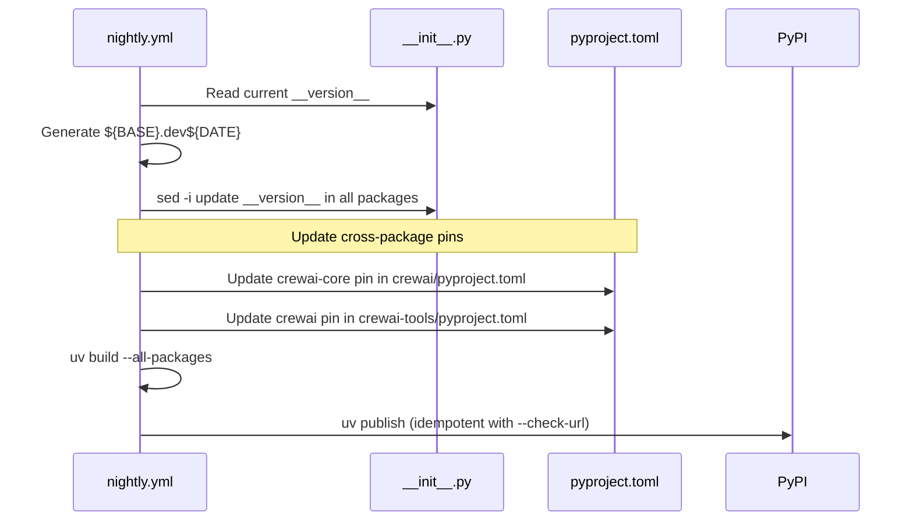

<!-- source: DeepWiki mcp.deepwiki.com · repo crewAIInc/crewAI · page 9.2 CI/CD Workflows · fetched 2026-11-09 -->

# CI/CD Workflows

Relevant source files

The following files were used as context for generating this wiki page:

- [.github/dependabot.yml](.github/dependabot.yml)
- [.github/workflows/codeql.yml](.github/workflows/codeql.yml)
- [.github/workflows/ftc-require-issue.yml](.github/workflows/ftc-require-issue.yml)
- [.github/workflows/generate-tool-specs.yml](.github/workflows/generate-tool-specs.yml)
- [.github/workflows/linter.yml](.github/workflows/linter.yml)
- [.github/workflows/nightly.yml](.github/workflows/nightly.yml)
- [.github/workflows/pr-size.yml](.github/workflows/pr-size.yml)
- [.github/workflows/pr-title.yml](.github/workflows/pr-title.yml)
- [.github/workflows/publish.yml](.github/workflows/publish.yml)
- [.github/workflows/stale.yml](.github/workflows/stale.yml)
- [.github/workflows/tests.yml](.github/workflows/tests.yml)
- [.github/workflows/type-checker.yml](.github/workflows/type-checker.yml)
- [.github/workflows/vulnerability-scan.yml](.github/workflows/vulnerability-scan.yml)

## Purpose and Scope

This document describes the GitHub Actions CI/CD workflows that enforce code quality, run tests, manage security scanning, and handle the release process for the CrewAI monorepo. These workflows ensure that every pull request meets the framework's standards for type safety, linting, and functional correctness across multiple Python versions (3.10, 3.11, 3.12, and 3.13).

The CI/CD infrastructure is optimized for performance using the `uv` package manager and parallel job execution across the workspace.

Sources: [.github/workflows/tests.yml:1-101](), [.github/workflows/type-checker.yml:1-71](), [.github/workflows/linter.yml:1-51]()

## Workflow Architecture Overview

The CI/CD system consists of quality gates for pull requests, maintenance workflows for cache optimization, security scans, and a publication pipeline for releasing stable and nightly packages to PyPI.

### CI/CD System Flow

```mermaid
graph TB
    subgraph "Trigger Events"
        PR["Pull Request"]
        MainPush["Push to main"]
        Manual["workflow_dispatch"]
        Schedule_5d["Schedule (5 days)"]
        Schedule_Nightly["Schedule (Daily 6am)"]
    end
    
    subgraph "Quality Gates (PR)"
        Tests["tests.yml<br/>32 parallel jobs"]
        TypeCheck["type-checker.yml<br/>Mypy matrix"]
        Linter["linter.yml<br/>Ruff check/format"]
        CodeQL["codeql.yml<br/>Security scanning"]
        VulnScan["vulnerability-scan.yml<br/>pip-audit"]
        PRSize["pr-size.yml<br/>Label PR size"]
        PRTitle["pr-title.yml<br/>Conventional commit"]
        FTCIssue["ftc-require-issue.yml<br/>First-time contributor"]
        GenerateToolSpecs["generate-tool-specs.yml<br/>Update tool.specs.json"]
    end
    
    subgraph "Maintenance (Main)"
        UVCache["build-uv-cache.yml<br/>Warm up deps"]
        Stale["stale.yml<br/>Mark stale issues/PRs"]
    end
    
    subgraph "Release Pipelines"
        Publish["publish.yml<br/>Manual Stable Release"]
        Nightly["nightly.yml<br/>Daily Canary Release"]
    end

    PR --> Tests
    PR --> TypeCheck
    PR --> Linter
    PR --> CodeQL
    PR --> VulnScan
    PR --> PRSize
    PR --> PRTitle
    PR --> FTCIssue
    PR --> GenerateToolSpecs
    
    MainPush --> UVCache
    Schedule_5d --> UVCache
    Schedule_5d --> Stale
    
    Manual --> Publish
    Schedule_Nightly --> Nightly
```

**System Components**:
- **Quality Gates**: Enforce standards on every PR. `tests.yml` runs the suite across Python 3.10–3.13 [.github/workflows/tests.yml:33-40](). `pr-size.yml` labels pull requests based on their size [.github/workflows/pr-size.yml:1-25](). `pr-title.yml` enforces conventional commit message format for PR titles [.github/workflows/pr-title.yml:1-41](). `ftc-require-issue.yml` ensures first-time contributors link an issue to their PRs [.github/workflows/ftc-require-issue.yml:1-134](). `generate-tool-specs.yml` automatically updates `tool.specs.json` when `lib/crewai-tools` changes [.github/workflows/generate-tool-specs.yml:1-64]().
- **Maintenance**: `build-uv-cache.yml` runs every 5 days to prevent GitHub cache expiration by populating global `uv` caches for all supported Python versions [.github/workflows/build-uv-cache.yml:10-22](). `stale.yml` marks and closes stale issues and pull requests [.github/workflows/stale.yml:1-29]().
- **Security**: `codeql.yml` performs advanced static analysis [.github/workflows/codeql.yml:12](), while `vulnerability-scan.yml` uses `pip-audit` to check for known CVEs in dependencies [.github/workflows/vulnerability-scan.yml:46-93]().

Sources: [.github/workflows/tests.yml:33-40](), [.github/workflows/build-uv-cache.yml:10-22](), [.github/workflows/vulnerability-scan.yml:46-93](), [.github/workflows/codeql.yml:12](), [.github/workflows/pr-size.yml:1-25](), [.github/workflows/pr-title.yml:1-41](), [.github/workflows/ftc-require-issue.yml:1-134](), [.github/workflows/generate-tool-specs.yml:1-64](), [.github/workflows/stale.yml:1-29]()

## Pull Request Quality Gates

### Parallel Test Execution (`tests.yml`)

The test workflow utilizes a matrix strategy to run 32 concurrent jobs (4 Python versions × 8 test groups) [.github/workflows/tests.yml:36-40]().

**Execution Logic**:
1.  **Environment Setup**: Restores the global `uv` cache based on `uv.lock` hash [.github/workflows/tests.yml:47-57]().
2.  **Dependency Installation**: Runs `uv sync --all-groups --all-extras` to prepare the workspace [.github/workflows/tests.yml:66-67]().
3.  **Test Splitting**: Uses `pytest-split` to distribute tests. While duration-based splitting is currently disabled to fix a mismatch issue [.github/workflows/tests.yml:80-83](), it is configured to utilize cached timings from `.test_durations_py*` [.github/workflows/tests.yml:69-73]().
4.  **Package Coverage**: Executes tests for both `lib/crewai` [.github/workflows/tests.yml:97-103]() and `lib/crewai-tools` [.github/workflows/tests.yml:105-112]().

Sources: [.github/workflows/tests.yml:36-112]()

### Type Checking (`type-checker.yml`)

Type checking is performed using `mypy` across the Python version matrix (3.10–3.13) [.github/workflows/type-checker.yml:31-38]().

-   **Sync**: Ensures all optional dependencies and groups are present for accurate type inference [.github/workflows/type-checker.yml:63-64]().
-   **Check**: Runs `uv run mypy lib/` to cover the entire monorepo source [.github/workflows/type-checker.yml:66-67]().
-   **Aggregation**: A summary job `type-checker` provides a single status check for branch protection [.github/workflows/type-checker.yml:94-111]().

Sources: [.github/workflows/type-checker.yml:31-111]()

### Linter (`linter.yml`)

The linter workflow uses `ruff` to enforce code style and catch common errors. It runs on pull requests that involve code changes [.github/workflows/linter.yml:3-29]().

-   **Dependency Installation**: Installs project dependencies using `uv sync --all-groups --all-extras --no-install-project` [.github/workflows/linter.yml:56-57]().
-   **Ruff Check**: Executes `uv run ruff check lib/` to identify linting issues [.github/workflows/linter.yml:60-61]().
-   **Ruff Format**: Runs `uv run ruff format --check lib/` to verify code formatting compliance [.github/workflows/linter.yml:63-64]().
-   **Caching**: Utilizes `uv` cache for faster dependency installation [.github/workflows/linter.yml:37-48]().

Sources: [.github/workflows/linter.yml:3-64]()

### CodeQL Analysis (`codeql.yml`)

The CodeQL workflow performs advanced security analysis on the codebase. It runs on pushes to `main` and pull requests targeting `main` [.github/workflows/codeql.yml:14-23]().

-   **Languages**: Configured to analyze `actions` and `python` languages [.github/workflows/codeql.yml:48-51]().
-   **Initialization**: Uses `github/codeql-action/init` to set up the CodeQL environment, referencing a custom configuration file `.github/codeql/codeql-config.yml` [.github/workflows/codeql.yml:70-76]().
-   **Analysis**: Executes `github/codeql-action/analyze` to perform the scan and upload results to GitHub Security tab [.github/workflows/codeql.yml:100-102]().

Sources: [.github/workflows/codeql.yml:14-102]()

### Vulnerability Scanning (`vulnerability-scan.yml`)

This workflow uses `pip-audit` to scan dependencies for vulnerabilities [.github/workflows/vulnerability-scan.yml:46-81](). It includes an ignore list for CVEs that are local-only or lack available fixes, such as specific memory corruption issues in `torch` or pre-auth RCE in `chromadb` HTTP servers [.github/workflows/vulnerability-scan.yml:89-92]().

Sources: [.github/workflows/vulnerability-scan.yml:46-92]()

### PR Hygiene Automations

Several workflows are in place to maintain pull request quality and contributor experience:

-   **PR Size Check (`pr-size.yml`)**: Automatically labels pull requests with size categories (XS, S, M, L, XL) based on lines of code changed. It ignores specific files like `uv.lock` and test duration files [.github/workflows/pr-size.yml:1-32]().
-   **PR Title Check (`pr-title.yml`)**: Enforces conventional commit message standards for PR titles (e.g., `feat(scope): description`). It defines allowed types like `feat`, `fix`, `chore`, etc., and provides an error message for non-compliant titles [.github/workflows/pr-title.yml:1-41]().
-   **First-time Contributor Issue Required (`ftc-require-issue.yml`)**: For first-time contributors, this workflow checks if their pull request references an open issue. If not, it comments on the PR, adds a `needs-issue` label, and closes the PR, guiding the contributor to create or link an issue [.github/workflows/ftc-require-issue.yml:1-134]().
-   **Generate Tool Specifications (`generate-tool-specs.yml`)**: This workflow automatically regenerates `lib/crewai-tools/tool.specs.json` whenever changes occur in `lib/crewai-tools/src/crewai_tools/**`. It uses a GitHub App token to commit and push the updated `tool.specs.json` file directly to the branch [.github/workflows/generate-tool-specs.yml:1-64]().

Sources: [.github/workflows/pr-size.yml:1-32](), [.github/workflows/pr-title.yml:1-41](), [.github/workflows/ftc-require-issue.yml:1-134](), [.github/workflows/generate-tool-specs.yml:1-64]()

## Release and Publication

### Stable Release (`publish.yml`)

The publication workflow is a manual process triggered via `workflow_dispatch` [.github/workflows/publish.yml:3-10]().

**Release Implementation**:
-   **Build**: Uses `uv build --all-packages` to generate wheels and sdists for all workspace members [.github/workflows/publish.yml:39-42]().
-   **Security**: Explicitly skips `crewai_devtools` as it is a private package [.github/workflows/publish.yml:83-87]().
-   **Notification**: A Python script parses the `crewai` version from `lib/crewai/src/crewai/__init__.py` [.github/workflows/publish.yml:106-111]() and formats a Slack payload with release notes fetched via `gh release view` [.github/workflows/publish.yml:116-158]().

Sources: [.github/workflows/publish.yml:3-158]()

### Nightly Canary Release (`nightly.yml`)

The nightly workflow automates the publication of development versions to PyPI every day at 6am UTC if new commits are detected [.github/workflows/nightly.yml:3-5]().

**Nightly Versioning Logic**:
1.  **Change Detection**: Checks for commits within the last 25 hours [.github/workflows/nightly.yml:25-34]().
2.  **Version Stamping**: Appends `.devYYYYMMDD` to the base version found in `lib/crewai/src/crewai/__init__.py` [.github/workflows/nightly.yml:53-62]().
3.  **Internal Sync**: Uses `sed` to update all cross-package dependency pins in `pyproject.toml` files to the new nightly version to ensure internal compatibility across `crewai`, `crewai-core`, `crewai-tools`, `crewai-files`, and `crewai-cli` [.github/workflows/nightly.yml:75-82]().

### Version Stamping and Dependency Update

Sources: [.github/workflows/nightly.yml:25-86](), [.github/workflows/nightly.yml:118-134]()

## Maintenance and Caching

### UV Cache Management (`build-uv-cache.yml`)

To optimize CI performance, a dedicated workflow builds and saves global `uv` caches [.github/workflows/build-uv-cache.yml:1](). This runs on every push to `main` affecting `uv.lock` or `pyproject.toml` and every 5 days via cron [.github/workflows/build-uv-cache.yml:3-11]().

-   **Path**: Caches `~/.cache/uv`, `~/.local/share/uv`, and `.venv` [.github/workflows/build-uv-cache.yml:41-47]().
-   **Key**: Uses a combination of Python version and the hash of `uv.lock` [.github/workflows/build-uv-cache.yml:48]().

Sources: [.github/workflows/build-uv-cache.yml:1-48]()

### Dependabot Configuration (`dependabot.yml`)

Dependabot is configured to automatically check for and update dependencies.

-   **Package Ecosystem**: Monitors the `uv` package ecosystem within the root directory [.github/dependabot.yml:5-6]().
-   **Schedule**: Checks for updates weekly on Monday [.github/dependabot.yml:7-9]().
-   **PR Limit**: Limits the number of open pull requests to 10 [.github/dependabot.yml:10]().
-   **Grouping**: Organizes updates into `security-updates` and `patch-minor-updates` groups [.github/dependabot.yml:11-22]().
-   **Ignored Updates**: Ignores major version updates to prevent breaking changes from being automatically merged [.github/dependabot.yml:23-26]().

Sources: [.github/dependabot.yml:1-26]()

### Stale Issues and Pull Requests (`stale.yml`)

This workflow automatically manages stale issues and pull requests to keep the repository clean and focused.

-   **Schedule**: Runs daily at 12:10 UTC [.github/workflows/stale.yml:10-11]().
-   **Issue Management**:
    -   Labels issues with `no-issue-activity` if no activity for 30 days [.github/workflows/stale.yml:20-21]().
    -   Comments on stale issues with a message and closes them after 5 more days of inactivity [.github/workflows/stale.yml:22-24]().
-   **Pull Request Management**:
    -   Labels PRs with `no-pr-activity` if no activity for 45 days [.github/workflows/stale.yml:26-27]().
    -   Does not automatically close stale PRs (`days-before-pr-close: -1`) [.github/workflows/stale.yml:28]().
-   **Operations Limit**: Processes up to 1200 items per run to avoid hitting API rate limits [.github/workflows/stale.yml:29]().

Sources: [.github/workflows/stale.yml:1-29]()

---

