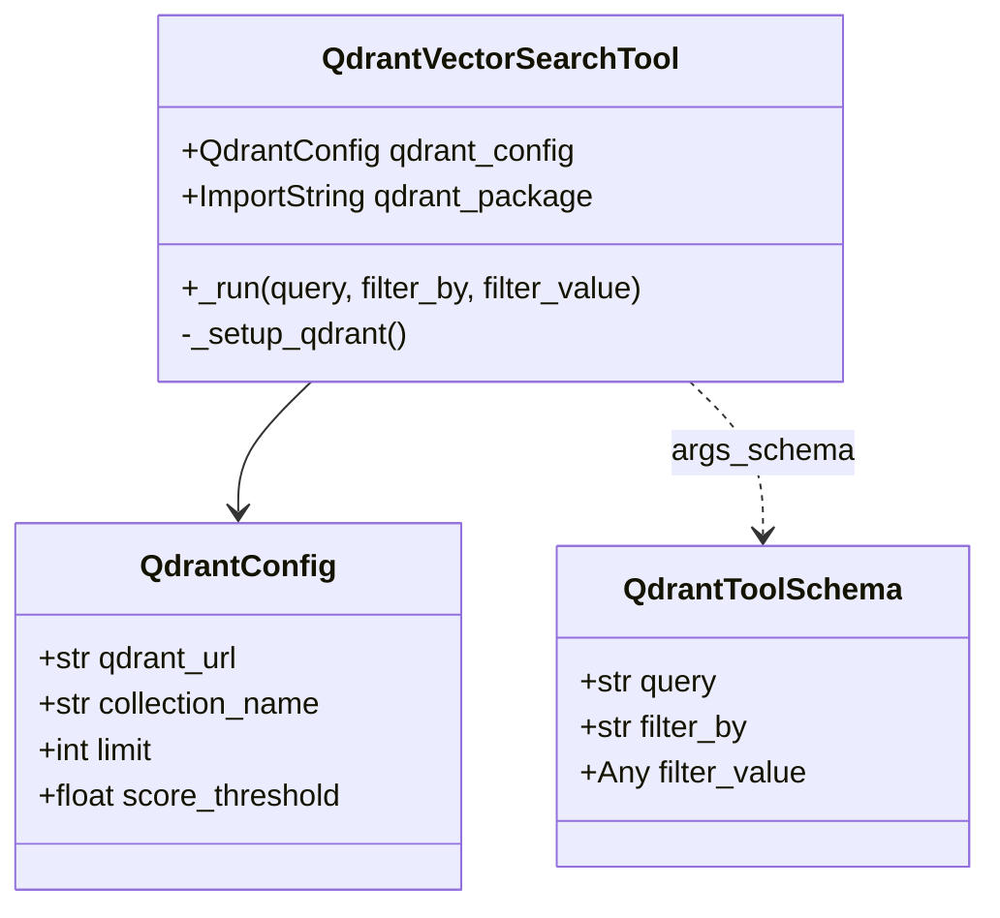

<!-- source: DeepWiki mcp.deepwiki.com · repo crewAIInc/crewAI · extra page Tool Categories and Capabilities · fetched 2026-11-09 -->

# Tool Categories and Capabilities

<details>
<summary>Relevant source files</summary>

The following files were used as context for generating this wiki page:

- [.env.test](.env.test)
- [docs/edge/ar/concepts/tools.mdx](docs/edge/ar/concepts/tools.mdx)

</details>


## Purpose and Scope

This page catalogs the 100+ pre-built tools available in the `crewai-tools` package, organized by functional category and capability. Each tool provides specific functionality that agents can invoke to accomplish tasks, from web scraping and search to database queries and AI services. Tools in CrewAI are callable functions that grant agents the ability to take actions, working alongside MCP servers, Skills, and Knowledge bases [docs/edge/ar/concepts/tools.mdx:13-15]().

For information on the tool execution lifecycle, caching mechanisms, and the `ToolUsage` system, see [Enterprise Integrations Catalog](#5.5). For details on managing optional dependencies that tools require, see [Optional Tool Dependencies](#5.2.2). For guidance on creating custom tools, see [Custom Tool Development](#5.4).

---

## Tool Organization in Code

The `crewai-tools` package exports all tools through a centralized `__init__.py` file, with optional dependencies defined in `pyproject.toml` to minimize dependency bloat [lib/crewai-tools/src/crewai_tools/__init__.py:1-295](), [lib/crewai-tools/pyproject.toml:31-145]().

### Tool Export Architecture

```mermaid
graph TB
    subgraph "crewai-tools Package Structure"
        InitFile[""crewai_tools/__init__.py (Exports 100+ tools)""]
        PyProject[""crewai-tools/pyproject.toml ([project.optional-dependencies])""]
        
        subgraph "Tool Categories"
            WebTools[""tools/*/web scraping tools""]
            SearchTools[""tools/*/search tools""]
            FileTools[""tools/*/file tools""]
            DBTools[""tools/*/database tools""]
            AITools[""tools/*/AI/ML tools""]
            CloudTools[""aws/*/cloud tools""]
            IntegrationTools[""tools/*/integration tools""]
            AdapterTools[""adapters/*""]
        end
        
        subgraph "Optional Dependencies"
            Scrapfly[""scrapfly-sdk""]
            SQLAlchemy[""sqlalchemy""]
            Multion[""multion""]
            Firecrawl[""firecrawl-py""]
            Composio[""composio-core""]
            Browserbase[""browserbase""]
            Others[""serpapi, tavily-python, exa-py, stagehand, apify, mongodb, etc.""]
        end
    end
    
    InitFile --> WebTools
    InitFile --> SearchTools
    InitFile --> FileTools
    InitFile --> DBTools
    InitFile --> AITools
    InitFile --> CloudTools
    InitFile --> IntegrationTools
    InitFile --> AdapterTools
    
    PyProject --> Scrapfly
    PyProject --> SQLAlchemy
    PyProject --> Multion
    PyProject --> Firecrawl
    PyProject --> Composio
    PyProject --> Browserbase
    PyProject --> Others
    
    WebTools -.requires.-> Scrapfly
    WebTools -.requires.-> Firecrawl
    WebTools -.requires.-> Browserbase
    IntegrationTools -.requires.-> Composio
    IntegrationTools -.requires.-> Multion
    DBTools -.requires.-> SQLAlchemy
```

Sources: [lib/crewai-tools/src/crewai_tools/__init__.py:1-295](), [lib/crewai-tools/pyproject.toml:31-145]()

---

## Tool Categories

### Category Distribution

```mermaid
graph LR
    subgraph "Tool Categories by Count"
        WebScraping[""Web Scraping & Browsing (15 tools)""]
        Search[""Search & Discovery (16 tools)""]
        Files[""File & Document Ops (13 tools)""]
        Database[""Database & Vector Search (8 tools)""]
        AI[""AI & ML Services (7 tools)""]
        Cloud[""Cloud & AWS (4 tools)""]
        Integration[""Automation & Integration (7 tools)""]
        Knowledge[""Knowledge & Research (4 tools)""]
        Specialized[""Specialized Tools (18 tools)""]
    end
    
    WebScraping --> WebScrapingList[""BrowserbaseLoadTool, HyperbrowserLoadTool, SeleniumScrapingTool, ScrapeWebsiteTool, ScrapegraphScrapeTool, ScrapflyScrapeWebsiteTool, JinaScrapeWebsiteTool, SerperScrapeWebsiteTool, ScrapeElementFromWebsiteTool, FirecrawlScrapeWebsiteTool, FirecrawlCrawlWebsiteTool, SpiderTool, StagehandTool, OxylabsUniversalScraperTool, BrightDataWebUnlockerTool""]
    
    Search --> SearchList[""BraveSearchTool, EXASearchTool, LinkupSearchTool, SerperDevTool, TavilySearchTool, SerpApiGoogleSearchTool, FirecrawlSearchTool, SerplyWebSearchTool, WebsiteSearchTool, OxylabsGoogleSearchScraperTool, BrightDataSearchTool (+ 5 more)""]
```

Sources: [lib/crewai-tools/src/crewai_tools/__init__.py:1-295](), [docs/edge/ar/concepts/tools.mdx:124-145]()

---

## 1. Web Scraping & Browsing Tools

Tools for extracting content from websites, handling JavaScript rendering, and navigating web pages.

| Tool Name | Primary Capability | Key Features | Optional Dependency |
|-----------|-------------------|--------------|---------------------|
| `BrowserbaseLoadTool` | Headless browser automation | Cloud-based browser, JavaScript rendering | `browserbase>=1.0.5` |
| `HyperbrowserLoadTool` | Advanced web scraping | AI-powered extraction | `hyperbrowser>=0.18.0` |
| `SeleniumScrapingTool` | Browser automation | Local Selenium control | `selenium>=4.27.1` |
| `ScrapeWebsiteTool` | Basic HTML scraping | BeautifulSoup-based | Built-in |
| `ScrapegraphScrapeTool` | Graph-based scraping | Structured data via graph patterns | `scrapegraph-py>=1.9.0` |
| `ScrapflyScrapeWebsiteTool` | Managed scraping service | Proxy rotation, CAPTCHA solving | `scrapfly-sdk>=0.8.19` |
| `JinaScrapeWebsiteTool` | Markdown conversion | Converts web pages to clean markdown | Built-in |
| `SerperScrapeWebsiteTool` | Serper-powered scraping | Uses Serper API for scraping | Built-in |
| `ScrapeElementFromWebsiteTool` | Targeted element extraction | CSS selector-based extraction | Built-in |
| `FirecrawlScrapeWebsiteTool` | Single page scraping | Firecrawl API integration | `firecrawl-py>=1.8.0` |
| `FirecrawlCrawlWebsiteTool` | Multi-page crawling | Recursive site crawling | `firecrawl-py>=1.8.0` |
| `SpiderTool` | High-performance scraping | Fast, distributed scraping | `spider-client>=0.1.25` |
| `StagehandTool` | Browser automation with AI | Natural language browser control | `stagehand>=0.4.1` |
| `OxylabsUniversalScraperTool` | Universal scraping | Handles any website via proxy | `oxylabs==2.0.0` |
| `BrightDataWebUnlockerTool` | Anti-bot bypass | Unlocks protected websites | Built-in |

Sources: [lib/crewai-tools/src/crewai_tools/__init__.py:21-23,67-73,80-82,86-88,100-111,129-144,177-178](), [lib/crewai-tools/pyproject.toml:32-79,109-111,123-125](), [docs/edge/ar/concepts/tools.mdx:127,138-140]()

---

## 2. Search & Discovery Tools

Tools for finding information across the web, academic databases, and specialized search engines.

| Tool Name | Primary Capability | Search Type | Optional Dependency |
|-----------|-------------------|-------------|---------------------|
| `BraveSearchTool` | Privacy-focused web search | General web | Built-in |
| `EXASearchTool` | Neural search engine | Semantic search | `exa-py>=1.8.7` |
| `LinkupSearchTool` | Real-time web search | Current information | `linkup-sdk>=0.2.2` |
| `SerperDevTool` | Google Search API | Google results | Built-in |
| `TavilySearchTool` | AI-optimized search | Research-focused | `tavily-python>=0.5.4` |
| `SerpApiGoogleSearchTool` | Google Search scraping | Organic results | `serpapi>=0.1.5` |
| `FirecrawlSearchTool` | Firecrawl search | Web search with crawling | `firecrawl-py>=1.8.0` |
| `SerplyWebSearchTool` | Serply web search | General web | Built-in |
| `ArxivPaperTool` | Academic paper retrieval | arXiv repository | Built-in |
| `WebsiteSearchTool` | RAG-based site search | Search within a specific URL | Built-in |

Sources: [lib/crewai-tools/src/crewai_tools/__init__.py:12-17,61,73-75,90,145-170,182,186](), [lib/crewai-tools/pyproject.toml:56-79,89-91,123-125](), [docs/edge/ar/concepts/tools.mdx:61,72,136,138,142]()

---

## 3. File & Document Operations

Tools for reading, writing, searching, and processing various file formats.

### File I/O Tools

| Tool Name | Primary Capability | Key Logic | File Path |
|-----------|-------------------|-----------|-----------|
| `FileReadTool` | Read file contents | Basic file reading | [lib/crewai-tools/src/crewai_tools/tools/file_read_tool/file_read_tool.py:1-10]() |
| `FileWriterTool` | Write file contents | Path traversal protection, resolve() | [lib/crewai-tools/src/crewai_tools/tools/file_writer_tool/file_writer_tool.py:27-72]() |
| `FileCompressorTool` | Compress/archive files | ZIP, TAR, GZIP | [lib/crewai-tools/src/crewai_tools/tools/files_compressor_tool/files_compressor_tool.py:1-10]() |
| `DirectoryReadTool` | List directory contents | Recursive traversal | [lib/crewai-tools/src/crewai_tools/tools/directory_read_tool/directory_read_tool.py:1-10]() |

### Document Search Tools (RAG)

| Tool Name | Format | Description |
|-----------|--------|-------------|
| `CSVSearchTool` | CSV | RAG tool for structured CSV data [docs/edge/ar/concepts/tools.mdx:131]() |
| `PDFSearchTool` | PDF | RAG tool for PDF documents |
| `DOCXSearchTool` | DOCX | RAG tool for Word documents [docs/edge/ar/concepts/tools.mdx:134]() |
| `JSONSearchTool` | JSON | RAG tool for structured JSON data [docs/edge/ar/concepts/tools.mdx:144]() |
| `TXTSearchTool` | TXT | RAG tool for unstructured text files [docs/edge/ar/concepts/tools.mdx:143]() |
| `MDXSearchTool` | MDX | RAG tool for Markdown/MDX files [docs/edge/ar/concepts/tools.mdx:146]() |

Sources: [lib/crewai-tools/src/crewai_tools/__init__.py:24-26,49,54-60,62-63,89,92,124,183,187](), [docs/edge/ar/concepts/tools.mdx:131-146]()

---

## 4. Database & Vector Search Tools

Tools for querying relational databases and vector stores.

### Relational Database Tools

| Tool Name | Database Type | Optional Dependency |
|-----------|---------------|---------------------|
| `MySQLSearchTool` | MySQL | `pymysql>=1.1.1` |
| `SnowflakeSearchTool` | Snowflake | `snowflake-connector-python>=3.12.4` |
| `DatabricksQueryTool` | Databricks | `databricks-sdk>=0.46.0` |
| `NL2SQLTool` | Generic SQL | `sqlalchemy>=2.0.35` |

### Vector Database Tools

| Tool Name | Vector DB | Key Implementation |
|-----------|-----------|-------------------|
| `QdrantVectorSearchTool` | Qdrant | `client.query_points`, `score_threshold` |
| `MongoDBVectorSearchTool` | MongoDB Atlas | `MongoDBVectorSearchConfig` |
| `WeaviateVectorSearchTool` | Weaviate | `weaviate-client>=4.10.2` |

### Code Entity Diagram: Qdrant Integration (Natural Language to Code Entity Space)



Sources: [lib/crewai-tools/src/crewai_tools/tools/qdrant_vector_search_tool/qdrant_search_tool.py:14-138](), [lib/crewai-tools/pyproject.toml:90-92]()

---

## 5. AI & ML Services

| Tool Name | Primary Capability | Function |
|-----------|-------------------|----------|
| `DallETool` | Image generation | Generates images from text prompts via OpenAI API [docs/edge/ar/learn/dalle-image-generation.mdx:8,40]() |
| `VisionTool` | Image analysis | GPT-4 Vision integration |
| `OCRTool` | Text extraction | Optical Character Recognition |
| `CodeInterpreterTool` | Code execution | Python sandbox for code interpretation [docs/edge/ar/concepts/tools.mdx:129]() |
| `PatronusEvalTool` | Output evaluation | Quality assessment |

Sources: [lib/crewai-tools/src/crewai_tools/__init__.py:27-29,50,103,117-123,184](), [docs/edge/ar/learn/dalle-image-generation.mdx:8-40](), [docs/edge/ar/concepts/tools.mdx:129,132]()

---

## 6. Cloud & AWS Tools

| Tool Name | Service | Capability |
|-----------|---------|------------|
| `S3ReaderTool` | Amazon S3 | Read files from S3 |
| `S3WriterTool` | Amazon S3 | Write files to S3 |
| `BedrockInvokeAgentTool` | Amazon Bedrock | Invoke Bedrock agents |
| `BedrockKBRetrieverTool` | Amazon Bedrock | Query Bedrock knowledge bases |

Sources: [lib/crewai-tools/src/crewai_tools/__init__.py:4-9](), [lib/crewai-tools/pyproject.toml:135-140]()

---

## 7. Automation & Integration Platforms

| Tool Name | Platform | Optional Dependency |
|-----------|----------|---------------------|
| `ComposioTool` | Composio | Integration for Composio toolsets [docs/edge/ar/concepts/tools.mdx:130]() |
| `ZapierActionTool` | Zapier | Built-in |
| `MultiOnTool` | MultiOn | `multion>=1.1.0` |
| `MCPServerAdapter` | MCP | `mcp>=1.6.0`, `mcpadapt>=0.1.9` |
| `ApifyActorsTool` | Apify | Web scraping and automation actors [docs/edge/ar/concepts/tools.mdx:126]() |

### Code Entity Diagram: Tool Implementation Pattern (Natural Language to Code Entity Space)

```mermaid
graph LR
    subgraph "Base Tool Layer (crewai core)"
        BaseTool[""BaseTool (crewai.tools)""]
    end
    
    subgraph "Implementation Layer (crewai-tools)"
        FileWriter[""FileWriterTool<br/>file_writer_tool.py""]
        QdrantSearch[""QdrantVectorSearchTool<br/>qdrant_search_tool.py""]
        MCPServer[""MCPServerAdapter<br/>mcp_adapter.py""]
    end
    
    BaseTool <|-- FileWriter
    BaseTool <|-- QdrantSearch
    BaseTool <|-- MCPServer
    
    FileWriter -- uses --> Path[""pathlib.Path""]
    QdrantSearch -- uses --> QdrantClient[""qdrant_client.QdrantClient""]
```

Sources: [lib/crewai-tools/src/crewai_tools/tools/file_writer_tool/file_writer_tool.py:27-32](), [lib/crewai-tools/src/crewai_tools/tools/qdrant_vector_search_tool/qdrant_search_tool.py:41-50](), [lib/crewai-tools/src/crewai_tools/__init__.py:1-3](), [docs/edge/ar/concepts/tools.mdx:126,130]()

---

## Tool Dependencies Summary

Tools are organized with optional dependencies in `pyproject.toml` to minimize installation footprint [lib/crewai-tools/pyproject.toml:31-145]().

| Group Name | Major Tools | Installation |
|------------|-------------|--------------|
| `scrapfly-sdk` | `ScrapflyScrapeWebsiteTool` | `pip install crewai-tools[scrapfly-sdk]` |
| `firecrawl-py` | `FirecrawlScrapeWebsiteTool` | `pip install crewai-tools[firecrawl-py]` |
| `composio-core` | `ComposioTool` | `pip install crewai-tools[composio-core]` |
| `qdrant-client` | `QdrantVectorSearchTool` | `pip install crewai-tools[qdrant-client]` |
| `mcp` | `MCPServerAdapter` | `pip install crewai-tools[mcp]` |

Sources: [lib/crewai-tools/pyproject.toml:31-145]()

---

