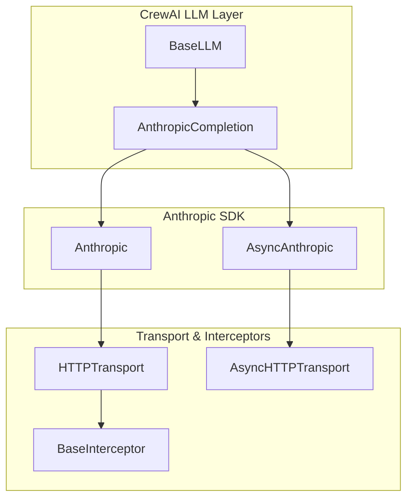
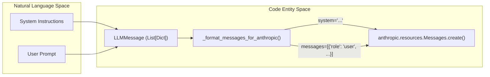

<!-- source: DeepWiki mcp.deepwiki.com · repo crewAIInc/crewAI · extra page Anthropic Provider · fetched 2026-11-09 -->

# Anthropic Provider

<details>
<summary>Relevant source files</summary>

The following files were used as context for generating this wiki page:

- [docs/edge/ar/concepts/llms.mdx](docs/edge/ar/concepts/llms.mdx)

</details>


## Purpose and Scope

The `AnthropicCompletion` class provides a native integration with Anthropic's Claude models through the `anthropic` Python SDK. This implementation handles the specific requirements of the Messages API, including system message extraction, mandatory `max_tokens` parameters, and specialized features like extended thinking (reasoning) and tool use blocks. This provider is designed to bypass the generic LiteLLM path for Claude models to support advanced features like thinking budgets and beta headers.

Sources: [lib/crewai/src/crewai/llms/providers/anthropic/completion.py:1-40](), [docs/edge/ar/concepts/llms.mdx:101-108]()

## Architecture Overview

The Anthropic provider is implemented in `lib/crewai/src/crewai/llms/providers/anthropic/completion.py` and inherits from `BaseLLM`. It manages both synchronous and asynchronous clients using the official Anthropic SDK.



**Diagram: Anthropic Provider Component Architecture**

Sources: [lib/crewai/src/crewai/llms/providers/anthropic/completion.py:146-151](), [lib/crewai/src/crewai/llms/base_llm.py:85-102](), [lib/crewai/src/crewai/llms/providers/anthropic/completion.py:20-32]()

## Initialization and Configuration

The `AnthropicCompletion` constructor requires `max_tokens` (default 4096) as it is a mandatory parameter for the Anthropic API [lib/crewai/src/crewai/llms/providers/anthropic/completion.py:154-154](). Users can initialize the provider directly via the `LLM` class by specifying the `anthropic/` prefix in the model string [docs/edge/ar/concepts/llms.mdx:75-88]().

| Entity | Class/Type | Purpose |
| :--- | :--- | :--- |
| **Thinking Config** | `AnthropicThinkingConfig` | Configures Claude's extended thinking (reasoning) capabilities and budget tokens. |
| **Tool Search** | `AnthropicToolSearchConfig` | Configures server-side tool discovery (regex or bm25) for deferred tool loading. |
| **Interceptor** | `BaseInterceptor` | Allows modifying HTTP requests/responses at the transport level for logging or security. |

Sources: [lib/crewai/src/crewai/llms/providers/anthropic/completion.py:125-145](), [lib/crewai/src/crewai/llms/providers/anthropic/completion.py:153-171](), [docs/edge/ar/concepts/llms.mdx:60-62]()

## Message Formatting and System Messages

Anthropic's Messages API requires a specific structure where the `system` message is passed as a top-level parameter, and the `messages` array must alternate between `user` and `assistant` roles.



**Diagram: Transformation from LLMMessage to Anthropic API Format**

The `_format_messages_for_anthropic` method performs the following:
1.  **System Extraction**: Iterates through the message list, extracts all messages with `role: "system"`, and joins them into a single string [lib/crewai/src/crewai/llms/providers/anthropic/completion.py:515-535]().
2.  **Role Normalization**: Ensures the first message is "user" and that roles alternate. If the first message is from the assistant, a dummy user message is prepended [lib/crewai/src/crewai/llms/providers/anthropic/completion.py:549-565]().
3.  **Tool Result Handling**: Converts "tool" role messages into `tool_result` content blocks within a "user" message, associating them with the correct `tool_use_id` [lib/crewai/src/crewai/llms/providers/anthropic/completion.py:567-585]().

Sources: [lib/crewai/src/crewai/llms/providers/anthropic/completion.py:515-585]()

## Tool Use and Structured Outputs

Anthropic supports native tool use via `tool_use` blocks. CrewAI maps its internal tool definitions to Anthropic's expected schema using `transform_schema` [lib/crewai/src/crewai/llms/providers/anthropic/completion.py:1370-1393]().

### Native Structured Outputs
For Claude 4.5+ models, the provider uses native structured outputs by adding the `anthropic-beta: structured-outputs-2025-11-13` header [lib/crewai/src/crewai/llms/providers/anthropic/completion.py:70-84](). The models identified as supporting native structured outputs are defined in `NATIVE_STRUCTURED_OUTPUT_MODELS` [lib/crewai/src/crewai/llms/providers/anthropic/completion.py:47-67]().

### Tool Search Configuration
The `AnthropicToolSearchConfig` allows Claude to dynamically discover tools marked with `defer_loading=True` [lib/crewai/src/crewai/llms/providers/anthropic/completion.py:130-145]().

| Type | Description |
| :--- | :--- |
| `regex` | Claude constructs regex patterns to search tool names/descriptions. |
| `bm25` | Claude uses natural language queries to search tools using the BM25 algorithm. |

Sources: [lib/crewai/src/crewai/llms/providers/anthropic/completion.py:47-84](), [lib/crewai/src/crewai/llms/providers/anthropic/completion.py:130-145](), [lib/crewai/src/crewai/llms/providers/anthropic/completion.py:1370-1393]()

## Extended Thinking Handling

When `thinking` is enabled via `AnthropicThinkingConfig`, the model produces `ThinkingBlock` objects. This allows the model to perform internal reasoning before generating the final response.

1.  **Extraction**: `_extract_thinking_block` identifies `ThinkingBlock` or `BetaThinkingBlock` in the response content [lib/crewai/src/crewai/llms/providers/anthropic/completion.py:487-513]().
2.  **Persistence**: Extracted thinking blocks are stored in `self.previous_thinking_blocks` to maintain state across turns [lib/crewai/src/crewai/llms/providers/anthropic/completion.py:589-599]().
3.  **Context Injection**: In multi-turn conversations, these blocks are prepended to the assistant's response in subsequent turns to maintain the model's chain of thought [lib/crewai/src/crewai/llms/providers/anthropic/completion.py:593-597]().

Sources: [lib/crewai/src/crewai/llms/providers/anthropic/completion.py:487-513](), [lib/crewai/src/crewai/llms/providers/anthropic/completion.py:589-599]()

## Files API Integration

The provider checks for `file_id` references in content blocks using `_contains_file_id_reference` [lib/crewai/src/crewai/llms/providers/anthropic/completion.py:102-122](). If found, it automatically injects the `files-api-2025-04-14` beta header into the request [lib/crewai/src/crewai/llms/providers/anthropic/completion.py:44]().

Sources: [lib/crewai/src/crewai/llms/providers/anthropic/completion.py:44](), [lib/crewai/src/crewai/llms/providers/anthropic/completion.py:102-122]()

## Token Usage and Caching

The `_extract_anthropic_token_usage` function maps Anthropic's `usage` object to CrewAI's internal tracking, specifically capturing cache hits and creation tokens [lib/crewai/src/crewai/llms/providers/anthropic/completion.py:1395-1411]().

```python
def _extract_anthropic_token_usage(self, response: Message) -> dict[str, int]:
    return {
        "prompt_tokens": response.usage.input_tokens,
        "completion_tokens": response.usage.output_tokens,
        "total_tokens": response.usage.input_tokens + response.usage.output_tokens,
        "cached_prompt_tokens": (
            getattr(response.usage, "cache_read_input_tokens", 0) +
            getattr(response.usage, "cache_creation_input_tokens", 0)
        ),
    }
```

Sources: [lib/crewai/src/crewai/llms/providers/anthropic/completion.py:1395-1411]()

---

