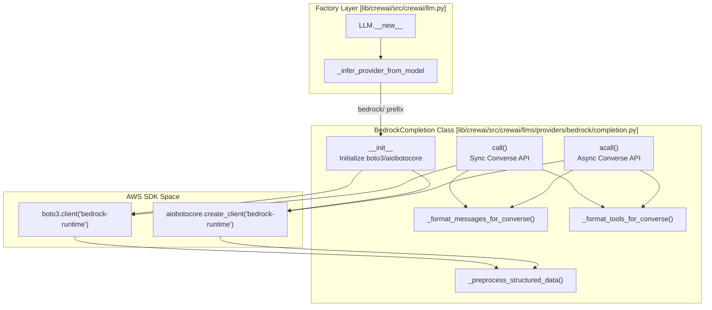
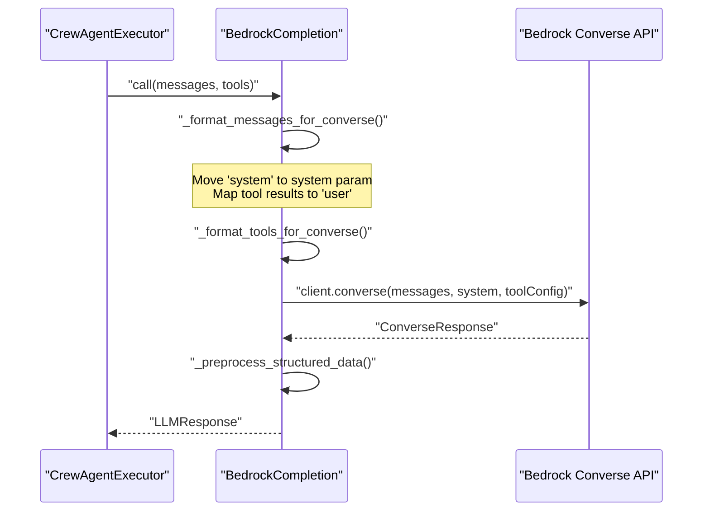

<!-- source: DeepWiki mcp.deepwiki.com · repo crewAIInc/crewAI · extra page Bedrock Provider · fetched 2026-11-09 -->

# Bedrock Provider

<details>
<summary>Relevant source files</summary>

The following files were used as context for generating this wiki page:

- [docs/edge/ar/concepts/llms.mdx](docs/edge/ar/concepts/llms.mdx)

</details>


## Purpose and Scope

The Bedrock provider is implemented via the `BedrockCompletion` class, which serves as a native integration with AWS Bedrock. It utilizes the modern **Converse API** to provide a unified interface across diverse model families including Anthropic Claude, Amazon Nova, and Meta Llama. This implementation manages complex message formatting requirements, provides deep integration with AWS Bedrock Guardrails, and implements specialized preprocessing for structured outputs to handle model-specific formatting quirks.

Sources: [lib/crewai/src/crewai/llms/providers/bedrock/completion.py:208-228]()

## BedrockCompletion Class Architecture

The `BedrockCompletion` class extends `BaseLLM` and manages both synchronous and asynchronous communication with the AWS Bedrock Runtime. It abstracts the underlying `boto3` (sync) and `aiobotocore` (async) client management.



**Bedrock Provider Entity Mapping**

Sources: [lib/crewai/src/crewai/llms/providers/bedrock/completion.py:208-343](), [lib/crewai/src/crewai/llm.py:354-442]()

## Authentication and Configuration

### AWS Credentials and Session

The class supports standard AWS authentication via the `boto3` credentials chain. If specific keys are provided during initialization, they override environment variables.

| Parameter | Environment Variable | Role |
|-----------|---------------------|------|
| `aws_access_key_id` | `AWS_ACCESS_KEY_ID` | Primary authentication key |
| `aws_secret_access_key` | `AWS_SECRET_ACCESS_KEY` | Secret key |
| `aws_session_token` | `AWS_SESSION_TOKEN` | Temporary session token |
| `region_name` | `AWS_DEFAULT_REGION` | AWS Region (e.g., `us-east-1`) |

Sources: [lib/crewai/src/crewai/llms/providers/bedrock/completion.py:231-343](), [.env.test:21-23]()

### Advanced Inference Parameters

The provider uses `EnhancedInferenceConfigurationTypeDef` to pass parameters to the Converse API. This includes `topK` support, which is critical for Anthropic models but often omitted in standard Bedrock type definitions.

Sources: [lib/crewai/src/crewai/llms/providers/bedrock/completion.py:133-158]()

## Converse API Implementation

### Message Formatting Logic

The `_format_messages_for_converse` method performs a critical transformation of CrewAI's internal `LLMMessage` list into the Converse API's strict structure.

1.  **System Message Extraction**: System messages are moved to a top-level `system` parameter [lib/crewai/src/crewai/llms/providers/bedrock/completion.py:910-915]().
2.  **Role Mapping**: CrewAI roles are mapped to `user` or `assistant`.
3.  **Tool Handling**: `tool_calls` are converted to `toolUse` blocks, and `tool_results` are converted to `toolResult` blocks within a `user` role message [lib/crewai/src/crewai/llms/providers/bedrock/completion.py:1012-1065]().



**Converse API Data Flow**

Sources: [lib/crewai/src/crewai/llms/providers/bedrock/completion.py:891-1074]()

### Tool Specification (toolSpec)

Tools are defined using the `toolSpec` TypedDict. The provider converts JSON schemas into the `inputSchema` format required by Bedrock.

Sources: [lib/crewai/src/crewai/llms/providers/bedrock/completion.py:166-172](), [lib/crewai/src/crewai/llms/providers/bedrock/completion.py:1076-1118]()

## Structured Output Preprocessing

Bedrock models occasionally return list-type data as Markdown strings (e.g., using bullet points) instead of JSON arrays. The `_preprocess_structured_data` function sanitizes this output before Pydantic validation by:
*   Detecting fields expected to be `list` types in the `response_model` [lib/crewai/src/crewai/llms/providers/bedrock/completion.py:78-85]().
*   Regex-stripping bullet points (`-`, `*`, `•`) and numbered list prefixes [lib/crewai/src/crewai/llms/providers/bedrock/completion.py:102-108]().

Sources: [lib/crewai/src/crewai/llms/providers/bedrock/completion.py:52-117]()

## Guardrail Integration

The provider natively supports **AWS Bedrock Guardrails**. If a `guardrail_config` is provided, it is injected into the Converse API request body, enabling automated PII redaction and content filtering.

```python
if self.guardrail_config:
    body["guardrailConfig"] = cast(
        "GuardrailConfigurationTypeDef",
        cast(object, self.guardrail_config),
    )
```

Sources: [lib/crewai/src/crewai/llms/providers/bedrock/completion.py:404-411](), [lib/crewai/src/crewai/llms/providers/bedrock/completion.py:189-189]()

## Streaming Architecture

Streaming is implemented via `_handle_streaming` (sync) and `_handle_async_streaming` (async). It processes the Bedrock `EventStream` and translates events into `LLMStreamChunkEvent`.

*   **contentBlockDelta**: Captured for both text and tool call increments [lib/crewai/src/crewai/llms/providers/bedrock/completion.py:702-740]().
*   **messageStop**: Used to identify the `stopReason` (e.g., `tool_use` or `end_turn`) [lib/crewai/src/crewai/llms/providers/bedrock/completion.py:754-765]().
*   **metadata**: Captures final token usage statistics [lib/crewai/src/crewai/llms/providers/bedrock/completion.py:767-785]().

Sources: [lib/crewai/src/crewai/llms/providers/bedrock/completion.py:670-849]()

---

