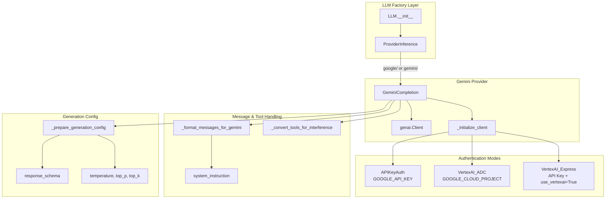
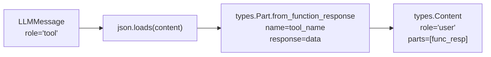

<!-- source: DeepWiki mcp.deepwiki.com · repo crewAIInc/crewAI · extra page Gemini Provider · fetched 2026-11-09 -->

# Gemini Provider

<details>
<summary>Relevant source files</summary>

The following files were used as context for generating this wiki page:

- [docs/edge/ar/concepts/llms.mdx](docs/edge/ar/concepts/llms.mdx)

</details>


## Purpose and Scope

This document covers the native Google Gemini provider implementation in CrewAI, including authentication mechanisms, message formatting requirements, tool calling, structured outputs, and streaming support. The Gemini provider offers direct integration with the Google Gen AI Python SDK (`genai.Client`) and supports both Gemini API and Vertex AI endpoints.

For general LLM provider architecture and routing logic, see [LLM Architecture and Providers](). For other provider implementations, see [Provider-Specific Implementations]().

Sources: [lib/crewai/src/crewai/llms/providers/gemini/completion.py:40-102]()

## Architecture Overview

The Gemini provider implements native integration with Google's Generative AI SDK, providing optimized support for Gemini models through the `GeminiCompletion` class (`lib/crewai/src/crewai/llms/providers/gemini/completion.py`). This provider is automatically selected by the factory layer when using model names prefixed with `google/`, `gemini/`, or matching Gemini model patterns.

### Gemini Provider Component Flow



Sources: [lib/crewai/src/crewai/llms/providers/gemini/completion.py:40-102](), [lib/crewai/src/crewai/llms/providers/gemini/completion.py:166-239](), [lib/crewai/src/crewai/llms/providers/gemini/completion.py:437-523]()

## Class Structure and Initialization

The `GeminiCompletion` class (`lib/crewai/src/crewai/llms/providers/gemini/completion.py`) is the main entry point for Gemini provider functionality. It extends `BaseLLM` and handles initialization, authentication, and API execution.

### Initialization Parameters

| Parameter | Type | Default | Description |
|-----------|------|---------|-------------|
| `model` | `str` | `"gemini-2.0-flash-001"` | Gemini model name |
| `api_key` | `str \| None` | `None` | API key for authentication (`GOOGLE_API_KEY` or `GEMINI_API_KEY`) |
| `project` | `str \| None` | `None` | Google Cloud project ID for Vertex AI with ADC |
| `location` | `str \| None` | `"us-central1"` | Google Cloud location for Vertex AI |
| `temperature` | `float \| None` | `None` | Sampling temperature (0-2) |
| `top_p` | `float \| None` | `None` | Nucleus sampling parameter |
| `top_k` | `int \| None` | `None` | Top-k sampling parameter |
| `max_output_tokens` | `int \| None` | `None` | Maximum tokens in response |
| `stop_sequences` | `list[str] \| None` | `None` | Stop sequences for generation |
| `stream` | `bool` | `False` | Enable streaming responses |
| `safety_settings` | `dict[str, Any] \| None` | `None` | Safety filter configuration |
| `use_vertexai` | `bool \| None` | `None` | Whether to use Vertex AI (`GOOGLE_GENAI_USE_VERTEXAI`) |
| `thinking_config` | `types.ThinkingConfig \| None` | `None` | Config for thinking models (Gemini 2.0+) |

Sources: [lib/crewai/src/crewai/llms/providers/gemini/completion.py:47-102]()

### Model Version Detection

The provider automatically inspects model versions via regex matching to enable version-specific behaviors such as tool support and structured output formatting:

```python
version_match = re.search(r"gemini-(\d+(?:\.\d+)?)", model.lower())
self.supports_tools = bool(
    version_match and float(version_match.group(1)) >= 1.5
)
self.is_gemini_2_0 = bool(
    version_match and float(version_match.group(1)) >= 2.0
)
```

Sources: [lib/crewai/src/crewai/llms/providers/gemini/completion.py:139-145]()

## Authentication Mechanisms

`GeminiCompletion` initializes the underlying `genai.Client` via `_initialize_client()` [lib/crewai/src/crewai/llms/providers/gemini/completion.py:166-239]() supporting three distinct authentication modes:

### Mode 1: API Key Authentication (Gemini API)
Uses `generativelanguage.googleapis.com` with API key authentication (`GOOGLE_API_KEY` or `GEMINI_API_KEY`). Selected by default when `use_vertexai` is not explicitly `True`.

Sources: [lib/crewai/src/crewai/llms/providers/gemini/completion.py:117-126](), [lib/crewai/src/crewai/llms/providers/gemini/completion.py:166-198]()

### Mode 2: Vertex AI with Application Default Credentials (ADC)
Uses Vertex AI endpoint (`aiplatform.googleapis.com`) with OAuth2/ADC. Requires `project` (or `GOOGLE_CLOUD_PROJECT`) and `use_vertexai=True`.

Sources: [lib/crewai/src/crewai/llms/providers/gemini/completion.py:120-126](), [lib/crewai/src/crewai/llms/providers/gemini/completion.py:200-212]()

### Mode 3: Vertex AI Express (API Key + Vertex AI)
Uses Vertex AI endpoint with API key authentication by setting `http_options` with `api_version="v1"` when combining an API key with `use_vertexai=True`.

Sources: [lib/crewai/src/crewai/llms/providers/gemini/completion.py:214-226]()

## Message Formatting

Gemini requires specific message formatting using `types.Content` and `types.Part` objects. The `_format_messages_for_gemini()` method performs this mapping [lib/crewai/src/crewai/llms/providers/gemini/completion.py:547-572]().

### Role Mapping and System Instructions
- **Assistant → Model**: Gemini expects assistant outputs under the `"model"` role.
- **System Instructions**: System messages are stripped from message lists and passed directly as `system_instruction` to `GenerateContentConfig`.

Sources: [lib/crewai/src/crewai/llms/providers/gemini/completion.py:547-572](), [lib/crewai/src/crewai/llms/providers/gemini/completion.py:662-668]()

### Tool Result Handling Flow

Tool results (`role="tool"`) are mapped to `types.Part.from_function_response()` objects via `_format_messages_for_gemini()`:



Sources: [lib/crewai/src/crewai/llms/providers/gemini/completion.py:601-623]()

## Tool Calling Support

Gemini supports function calling through `types.FunctionDeclaration` objects. The `_convert_tools_for_interference()` method transforms CrewAI tool definitions into Gemini tool declarations [lib/crewai/src/crewai/llms/providers/gemini/completion.py:525-545](). It leverages `safe_tool_conversion()` to extract name, description, and parameter JSON schemas.

Sources: [lib/crewai/src/crewai/llms/providers/gemini/completion.py:525-545]()

## Structured Output Support

Structured outputs are managed differently across Gemini versions [lib/crewai/src/crewai/llms/providers/gemini/completion.py:437-523]():
- **Gemini 1.5**: Configures `response_schema` with the target Pydantic model.
- **Gemini 2.0+**: Configures `response_json_schema` and injects `propertyOrdering` keys to guarantee deterministic adherence.
- **Tool Workaround**: When tools and response models are requested simultaneously, a pseudo-tool named `structured_output` is injected into the tool declarations.

Sources: [lib/crewai/src/crewai/llms/providers/gemini/completion.py:437-523](), [lib/crewai/src/crewai/llms/providers/gemini/completion.py:686-715]()

## Streaming Support and Thinking Models

Streaming is handled by invoking `client.models.generate_content_stream()` when `stream=True` [lib/crewai/src/crewai/llms/providers/gemini/completion.py:785-814](). Chunks are iterated and dispatched via `LLMStreamChunkEvent` [lib/crewai/src/crewai/llms/providers/gemini/completion.py:826-876](). For Gemini 2.0+, `ThinkingConfig` exposes reasoning blocks through `LLMThinkingChunkEvent` [lib/crewai/src/crewai/events/types/llm_events.py:91-97]().

Sources: [lib/crewai/src/crewai/llms/providers/gemini/completion.py:97-101](), [lib/crewai/src/crewai/llms/providers/gemini/completion.py:785-876](), [lib/crewai/src/crewai/events/types/llm_events.py:91-97]()

## Summary of Model Capabilities

| Feature | Gemini 1.5 | Gemini 2.0+ |
|---------|------------|-------------|
| Native Function Calling | ✓ | ✓ |
| response_schema | ✓ | ✗ (use json_schema) |
| response_json_schema | ✗ | ✓ |
| propertyOrdering | ✗ | Required |
| Thinking Support | ✗ | ✓ |

Sources: [lib/crewai/src/crewai/llms/providers/gemini/completion.py:139-153](), [lib/crewai/src/crewai/llms/providers/gemini/completion.py:437-523]()

---

