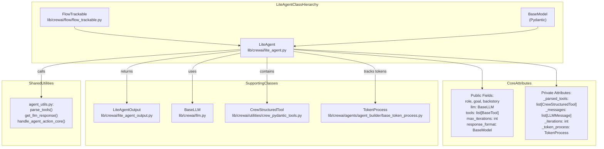
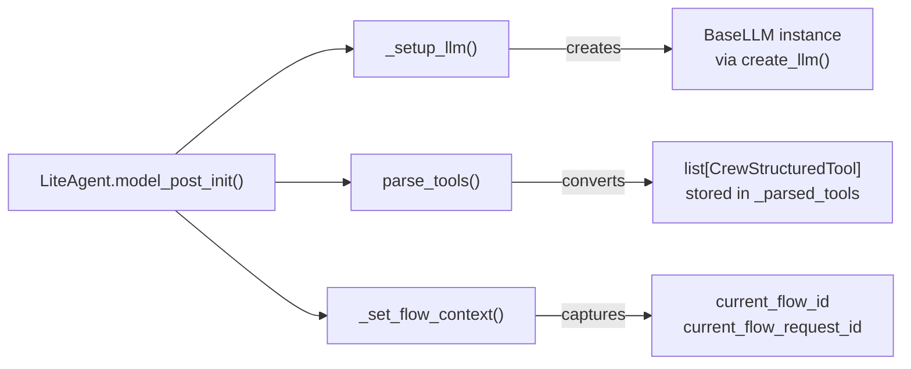
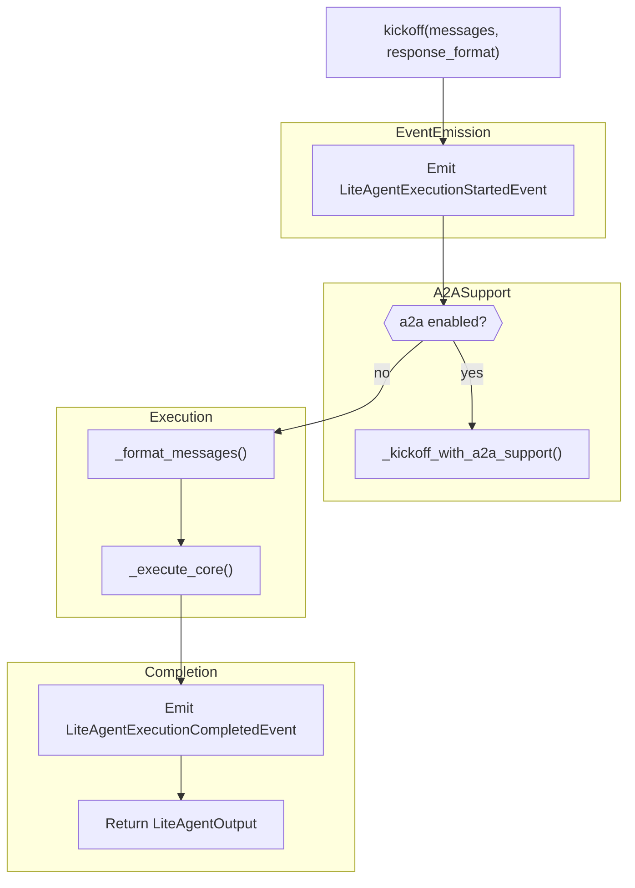
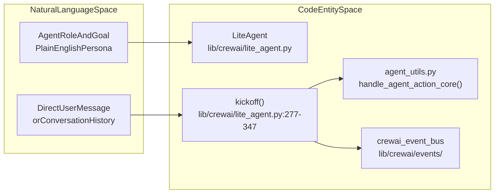

<!-- source: DeepWiki mcp.deepwiki.com · repo crewAIInc/crewAI · extra page LiteAgent · fetched 2026-11-09 -->

# LiteAgent

Relevant source files

The following files were used as context for generating this wiki page:

- [docs/edge/ar/concepts/agents.mdx](docs/edge/ar/concepts/agents.mdx)

## Purpose and Scope

`LiteAgent` is a specialized agent execution model designed for direct message processing without the full task orchestration overhead of the standard `Agent` class. It provides a lightweight alternative for scenarios where you need LLM-powered tool usage and message processing but don't require task delegation, crew coordination, or complex memory systems.

While `LiteAgent` exists as a standalone class in [lib/crewai/src/crewai/lite_agent.py:177-189](), it is also the underlying engine for the `Agent().kickoff(messages)` interface, which allows standard agents to perform lightweight, message-based interactions [lib/crewai/src/crewai/agent.py:448-468]().

Use `LiteAgent` (or `Agent.kickoff`) when you need:
- Direct message-to-response processing without creating a `Task`.
- Tool usage with LLM guidance in a simple loop [lib/crewai/src/crewai/lite_agent.py:348-430]().
- Lightweight agent execution within **Flows**.
- Low-overhead LLM interactions that still benefit from CrewAI's tool-calling logic and telemetry.

Sources: [lib/crewai/src/crewai/lite_agent.py:177-189](), [lib/crewai/src/crewai/lite_agent.py:102-174](), [lib/crewai/src/crewai/agent.py:448-468]()

---

## Architecture Overview

`LiteAgent` implements a streamlined execution model that bypasses the `CrewAgentExecutor` infrastructure while maintaining compatibility with the broader CrewAI ecosystem through shared utilities and event emission.

### Class Structure and Key Components

Title: LiteAgent Class Hierarchy and Data Flow

Sources: [lib/crewai/src/crewai/lite_agent.py:177-220](), [lib/crewai/src/crewai/lite_agent_output.py:1-25](), [lib/crewai/src/crewai/flow/flow_trackable.py:7-22](), [lib/crewai/src/crewai/utilities/agent_utils.py:1-20]()

---

## Initialization and Configuration

### Constructor and Field Validation

`LiteAgent` uses Pydantic validators to ensure proper configuration. It inherits from `FlowTrackable`, allowing it to automatically capture flow context if instantiated within a CrewAI Flow step [lib/crewai/src/crewai/lite_agent.py:177-189]().

| Field | Type | Default | Description |
|-------|------|---------|-------------|
| `id` | `UUID4` | auto-generated | Unique identifier (frozen). |
| `role` | `str` | required | Agent's role description. |
| `goal` | `str` | required | Agent's objective. |
| `backstory` | `str` | required | Agent's context/history. |
| `llm` | `BaseLLM` | `None` | Language model instance. |
| `tools` | `list[BaseTool]` | `[]` | Available tools for the agent. |
| `max_iterations` | `int` | 15 | Max tool usage cycles before forced stop. |
| `response_format` | `type[BaseModel]` | `None` | Structured output schema for the final answer. |
| `verbose` | `bool` | `False` | Enable detailed execution logging. |

### Model Initialization Flow

Title: LiteAgent Initialization Logic

Sources: [lib/crewai/src/crewai/lite_agent.py:202-230](), [lib/crewai/src/crewai/flow/flow_trackable.py:15-22](), [lib/crewai/src/crewai/utilities/agent_utils.py:83-86]()

---

## Execution Model

### Kickoff Interface

The `kickoff()` method is the primary entry point. It supports both raw string queries and structured `LLMMessage` lists, facilitating multi-turn conversations [lib/crewai/src/crewai/lite_agent.py:277-347]().

Title: LiteAgent Kickoff Data Flow

Sources: [lib/crewai/src/crewai/lite_agent.py:277-347](), [lib/crewai/src/crewai/lite_agent.py:102-174]()

### Core Execution Loop

The `_execute_core()` method implements a ReAct-style agent-tool interaction loop. It manages the iteration count and handles tool execution results through the `agent_utils` module [lib/crewai/src/crewai/lite_agent.py:348-430]().

| Step | Component | Action |
|------|-----------|--------|
| 1 | `_build_system_prompt` | Constructs system instructions including persona (role/goal/backstory) and tool definitions [lib/crewai/src/crewai/lite_agent.py:448-478](). |
| 2 | `get_llm_response` | Calls the LLM with current message history and system prompt [lib/crewai/src/crewai/utilities/agent_utils.py:71-86](). |
| 3 | `process_llm_response` | Parses the LLM response into an `AgentAction` (tool call) or `AgentFinish` (final answer). |
| 4 | `handle_agent_action_core`| Executes the requested tool and appends the observation to the message history. |
| 5 | `_convert_to_pydantic` | If `response_format` is provided, parses the final answer into the requested Pydantic model [lib/crewai/src/crewai/lite_agent.py:431-446](). |

Sources: [lib/crewai/src/crewai/lite_agent.py:348-478](), [lib/crewai/src/crewai/utilities/agent_utils.py:71-86](), [lib/crewai/src/crewai/lite_agent.py:431-446]()

---

## Natural Language to Code Mapping

Title: LiteAgent Execution and Natural Language Mapping

Sources: [lib/crewai/src/crewai/lite_agent.py:277-347](), [lib/crewai/src/crewai/utilities/agent_utils.py:1-20]()

---

## Tool Integration and Memory

While `LiteAgent` is a standalone class, when accessed via the `Agent().kickoff()` wrapper, it can utilize the framework's **Unified Memory** system through specific tools [lib/crewai/src/crewai/agent.py:448-468]().

### Unified Memory Access in Agent.kickoff()

When an `Agent` executes a lightweight kickoff, it can utilize `Memory` through specific tools injected into its toolset.

| Tool | Class | Description |
|------|-------|-------------|
| **Search memory** | `RecallMemoryTool` | Allows the agent to query the vector database for relevant past experiences [lib/crewai/src/crewai/tools/memory_tools.py:25-82](). |
| **Save to memory** | `RememberTool` | Allows the agent to explicitly persist facts or observations to the memory store [lib/crewai/src/crewai/tools/memory_tools.py:85-130](). |

Sources: [lib/crewai/src/crewai/tools/memory_tools.py:25-130](), [lib/crewai/src/crewai/memory/unified_memory.py:56-137]()

### Hierarchical Memory Scoping

Memories saved or retrieved during agent execution are automatically scoped. For example, a researcher agent in a specific crew will have its memories stored under a path like `/crew/research-crew/agent/researcher` [lib/crewai/src/crewai/memory/memory_scope.py:19-183]().

Sources: [lib/crewai/src/crewai/agents/agent_builder/base_agent_executor_mixin.py:29-67](), [lib/crewai/src/crewai/memory/memory_scope.py:19-183]()

---

## Comparison with Standard Agent Execution

| Feature | LiteAgent (`kickoff`) | Standard Agent (`execute_task`) |
|---------|-----------------------|---------------------------------|
| **Orchestration** | Direct message loop | Task-based via `CrewAgentExecutor` |
| **Memory** | Optional (via tools) | Native context injection and retrieval |
| **Delegation** | Limited (A2A only) | Full peer-to-peer delegation within Crew |
| **Output** | `LiteAgentOutput` | `TaskOutput` |
| **State** | Message history | Task status + Crew state + Memory |

Sources: [lib/crewai/src/crewai/lite_agent.py:177-200](), [lib/crewai/src/crewai/agents/agent_builder/base_agent_executor_mixin.py:19-28](), [lib/crewai/src/crewai/agent.py:448-468]()

---

## Telemetry and Events

`LiteAgent` is fully integrated into the `crewai_event_bus`. It emits specific events that allow for granular tracking of lightweight executions.

- **LiteAgentExecutionStartedEvent:** Triggered at the start of `kickoff()`, containing the initial messages and agent metadata [lib/crewai/src/crewai/lite_agent.py:295-303]().
- **LiteAgentExecutionCompletedEvent:** Triggered when the agent reaches an `AgentFinish` state, containing the final output and token usage [lib/crewai/src/crewai/lite_agent.py:340-346]().
- **LiteAgentExecutionErrorEvent:** Triggered if an unhandled exception occurs during the execution loop.

Sources: [lib/crewai/src/crewai/lite_agent.py:46-57](), [lib/crewai/src/crewai/lite_agent.py:295-303](), [lib/crewai/src/crewai/lite_agent.py:340-346]()

---

