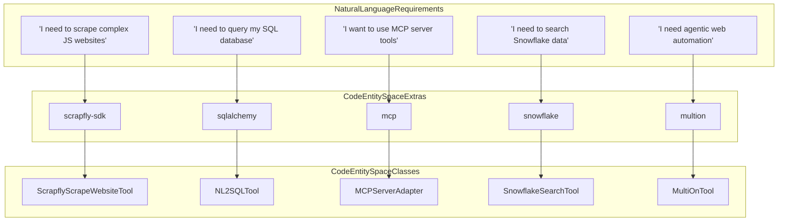
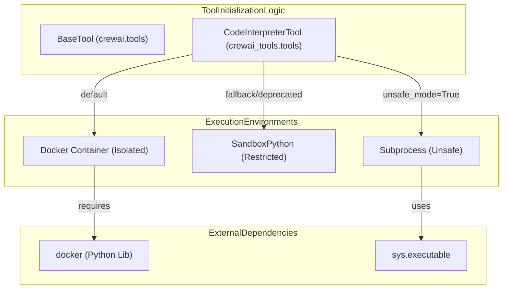

<!-- source: DeepWiki mcp.deepwiki.com · repo crewAIInc/crewAI · extra page Optional Tool Dependencies · fetched 2026-11-09 -->

# Optional Tool Dependencies

<details>
<summary>Relevant source files</summary>

The following files were used as context for generating this wiki page:

- [.env.test](.env.test)
- [docs/edge/ar/concepts/tools.mdx](docs/edge/ar/concepts/tools.mdx)

</details>


## Purpose and Scope

This page documents the optional dependency management system for the CrewAI tools ecosystem. Both the `crewai-tools` and `crewai` packages use modular optional dependencies to enable selective installation of features and integrations. This architecture allows users to maintain a minimal footprint by installing only the specific dependencies required for their use case, such as specialized scrapers (Scrapfly, Firecrawl), automation platforms (MultiOn, Composio), or specific LLM provider SDKs.

For information about the tools themselves and their capabilities, see [Tool Categories and Capabilities](5.2.1). For general package structure and core dependencies, see [Package Structure and Dependencies](1.2).

Sources: [lib/crewai-tools/pyproject.toml:1-150](), [docs/edge/ar/concepts/tools.mdx:43-50]()

## Dependency Architecture

The CrewAI ecosystem employs a minimal base installation strategy. The base `crewai` package includes core orchestration logic, while specialized tool capabilities are offloaded to `crewai-tools` and its various "extras" groups.

- **Minimal footprint**: Base installation includes only core dependencies like `pydantic`, `openai`, and `instructor` [lib/crewai/pyproject.toml:10-14]().
- **Selective feature enabling**: Users install only the dependencies needed for specific tools (e.g., `firecrawl-py` for web crawling) [lib/crewai-tools/pyproject.toml:39-41]().
- **Version stability**: Optional groups pin compatible versions to prevent dependency conflicts.
- **Organized modularity**: Dependencies are grouped by functional category (Scrapers, Databases, Vector Stores).

### Natural Language to Code Entity Space: Dependency Mapping
The following diagram maps high-level "Natural Language" requirements to specific "Code Entities" (Optional Groups and Classes).


**Diagram: Requirement to Code Entity Mapping**
Sources: [lib/crewai-tools/pyproject.toml:30-143](), [docs/edge/ar/concepts/tools.mdx:124-145]()

## Installation Patterns

Optional dependencies are installed using the pip/uv extras syntax. This is the standard method for enabling tools like `firecrawl`, `scrapfly`, and `composio`.

```bash
# Install crewai with the tools package included
pip install crewai[tools]

# Install specific tool dependencies for Scrapfly and Firecrawl
pip install crewai-tools[scrapfly-sdk,firecrawl-py]

# Install crewai with specific LLM provider support
pip install crewai[anthropic,google-genai]
```

Sources: [lib/crewai/pyproject.toml:55-111](), [docs/edge/ar/concepts/tools.mdx:43-50]()

## crewai-tools Optional Dependencies

The `crewai-tools` package defines over 30 optional dependency groups. Each group corresponds to a set of specialized tools that require external libraries not included in the base installation.

### Detailed Group Specifications

The following table provides the technical specifications for common tool integrations including `scrapfly`, `multion`, `firecrawl`, and `composio` as defined in `pyproject.toml`:

| Group Name | Dependencies | Version | Implementation Class |
| :--- | :--- | :--- | :--- |
| `scrapfly-sdk` | `scrapfly-sdk` | `>=0.8.19` | `ScrapflyScrapeWebsiteTool` |
| `multion` | `multion` | `>=1.1.0` | `MultiOnTool` |
| `firecrawl-py` | `firecrawl-py` | `>=1.8.0` | `FirecrawlScrapeWebsiteTool`, `FirecrawlSearchTool` |
| `composio-core` | `composio-core` | `>=0.6.11.post1` | `ComposioTool` |
| `mcp` | `mcp`, `mcpadapt` | `mcp>=1.6.0` | `MCPServerAdapter` |
| `selenium` | `selenium` | `>=4.27.1` | `SeleniumScrapingTool` |
| `github` | `gitpython`, `PyGithub` | `PyGithub==1.59.1` | `GithubSearchTool` |
| `rag` | `python-docx`, `lxml` | `lxml>=5.3.0,<5.4.0` | `RagTool` |
| `mongodb` | `pymongo` | `>=4.13` | `MongoDBVectorSearchTool` |
| `snowflake` | `snowflake-sqlalchemy` | `>=1.7.3` | `SnowflakeSearchTool` |

Sources: [lib/crewai-tools/pyproject.toml:29-143](), [docs/edge/ar/concepts/tools.mdx:124-145]()

## crewai Core Optional Dependencies

The core `crewai` package defines optional groups primarily for LLM provider SDKs and specialized framework features like advanced memory or file processing.

### LLM Provider and Feature Groups

| Group Name | Dependencies | Purpose |
| :--- | :--- | :--- |
| `anthropic` | `anthropic~=0.73.0` | Native Anthropic Claude support [lib/crewai/pyproject.toml:97-99]() |
| `google-genai` | `google-genai~=1.65.0` | Native Gemini support [lib/crewai/pyproject.toml:91-93]() |
| `bedrock` | `boto3~=1.40.45` | AWS Bedrock LLM support [lib/crewai/pyproject.toml:88-90]() |
| `docling` | `docling~=2.75.0` | Advanced document parsing [lib/crewai/pyproject.toml:69-71]() |
| `mem0` | `mem0ai~=0.1.94` | External memory provider [lib/crewai/pyproject.toml:68]() |
| `a2a` | `a2a-sdk`, `httpx-auth` | Agent-to-Agent communication [lib/crewai/pyproject.toml:100-105]() |
| `file-processing`| `crewai-files` | Multimodal file handling [lib/crewai/pyproject.toml:106-108]() |

Sources: [lib/crewai/pyproject.toml:55-111]()

## Tool Execution and Dependency Resolution

When a tool is initialized, the system relies on the presence of these optional dependencies. Some tools, like the `CodeInterpreterTool`, have complex internal logic for environment isolation.


**Diagram: CodeInterpreterTool Execution Flow and Dependencies**
Sources: [lib/crewai-tools/pyproject.toml:13-14](), [docs/edge/ar/concepts/tools.mdx:128-130]()

### Special Handling: CodeInterpreterTool
The `CodeInterpreterTool` requires the `docker` library (included in `crewai-tools` base dependencies) to run code in an isolated container. If `unsafe_mode` is enabled, it uses `subprocess.run` to execute code directly on the host system using the current `sys.executable`.

Sources: [lib/crewai-tools/pyproject.toml:10-15](), [docs/edge/ar/concepts/tools.mdx:128-130]()

## Configuration and Environment

Many optional tools require API keys configured in the environment to function correctly. These are often validated during tool execution or initialization.

| Tool | Required Environment Variable |
| :--- | :--- |
| `FirecrawlSearchTool` | `FIRECRAWL_API_KEY` [.env.test:52]() |
| `ScrapflyScrapeWebsiteTool` | `SCRAPFLY_API_KEY` [.env.test:76]() |
| `MultiOnTool` | `MULTION_API_KEY` [.env.test:83]() |
| `SerperDevTool` | `SERPER_API_KEY` [.env.test:49]() |

Sources: [.env.test:49-83]()

## Version Synchronization

The CrewAI ecosystem maintains strict version synchronization across its packages to ensure that optional tool dependencies remain compatible with the core framework.

- **Package Versioning**: `crewai`, `crewai-tools`, and `crewai-files` share coordinated version strings across releases.
- **Inter-dependency**: `crewai-tools` explicitly requires the matching version tier of `crewai`.
- **CLI Templates**: Generated projects via `crewai create` automatically pin the `crewai[tools]` extra to the current framework version.

Sources: [lib/crewai/pyproject.toml:57](), [lib/crewai-tools/pyproject.toml:14]()

---

