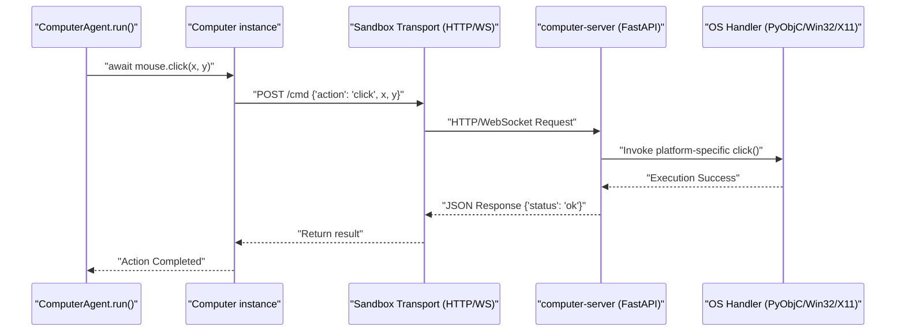

<!-- source: DeepWiki mcp.deepwiki.com · repo trycua/cua · page 1 Overview · fetched 2026-10-29 -->

# Overview

<details>
<summary>Relevant source files</summary>

The following files were used as context for generating this wiki page:

- [README.md](README.md)
- [blog/app-use.md](blog/app-use.md)
- [blog/bringing-computer-use-to-the-web.md](blog/bringing-computer-use-to-the-web.md)
- [blog/build-your-own-operator-on-macos-1.md](blog/build-your-own-operator-on-macos-1.md)
- [blog/build-your-own-operator-on-macos-2.md](blog/build-your-own-operator-on-macos-2.md)
- [blog/composite-agents.md](blog/composite-agents.md)
- [blog/cua-hackathon.md](blog/cua-hackathon.md)
- [blog/cua-vlm-router.md](blog/cua-vlm-router.md)
- [blog/hud-agent-evals.md](blog/hud-agent-evals.md)
- [blog/human-in-the-loop.md](blog/human-in-the-loop.md)
- [blog/introducing-cua-cli.md](blog/introducing-cua-cli.md)
- [blog/introducing-cua-cloud-containers.md](blog/introducing-cua-cloud-containers.md)
- [blog/lume-to-containerization.md](blog/lume-to-containerization.md)
- [blog/sandboxed-python-execution.md](blog/sandboxed-python-execution.md)
- [blog/training-computer-use-models-trajectories-1.md](blog/training-computer-use-models-trajectories-1.md)
- [blog/ubuntu-docker-support.md](blog/ubuntu-docker-support.md)
- [blog/windows-sandbox.md](blog/windows-sandbox.md)
- [docs/content/docs/cua-sdk/index.mdx](docs/content/docs/cua-sdk/index.mdx)
- [docs/content/docs/index.mdx](docs/content/docs/index.mdx)
- [docs/content/docs/meta.json](docs/content/docs/meta.json)
- [docs/content/docs/spaces/index.mdx](docs/content/docs/spaces/index.mdx)
- [img/card-cua-bench.gif](img/card-cua-bench.gif)
- [img/card-cua-bench.png](img/card-cua-bench.png)
- [img/card-cua-driver.gif](img/card-cua-driver.gif)
- [img/card-cua-driver.png](img/card-cua-driver.png)
- [img/card-cua-fleets.gif](img/card-cua-fleets.gif)
- [img/card-cua-fleets.png](img/card-cua-fleets.png)
- [img/card-cua-lume.gif](img/card-cua-lume.gif)
- [img/card-cua-lume.png](img/card-cua-lume.png)
- [img/card-cua-products.gif](img/card-cua-products.gif)
- [img/card-cua-products.png](img/card-cua-products.png)
- [img/card-cua-s1.gif](img/card-cua-s1.gif)
- [img/card-cua-spaces-wide.gif](img/card-cua-spaces-wide.gif)
- [img/cua-spaces-demo.mp4](img/cua-spaces-demo.mp4)

</details>


Cua is an open-source framework for building Computer-Use Agents (CUAs) — AI systems that autonomously interact with computer interfaces through visual understanding and action execution. The framework provides SDKs in Python and TypeScript for agent development, execution environment management, and integration with vision-language models (VLMs).

This page serves as a high-level technical introduction to the Cua architecture, its core components, execution environments, supported models, and repository structure. Additional design documents, sample applications, blog posts, and validation runs are organized in repository directories such as `blog/`, `rfcs/`, `samples/`, and `evidence/`.

Sources: [README.md:1-10](), [docs/content/docs/index.mdx:1-6]()

## What are Computer-Use Agents (Computer-Use 2.0)

Computer-Use Agents (CUAs) are AI systems that autonomously interact with desktop and browser computer interfaces by executing four iterative phases:

1. **Visual Understanding**: Capturing screenshots of the computer screen or reading accessibility trees (e.g., AT-SPI, UIA, AX).
2. **Action Reasoning**: Using vision-language models or specialist decision models to determine appropriate OS-level interactions.
3. **Action Execution**: Performing mouse, keyboard, and window operations (clicking, typing, scrolling, launching apps).
4. **Iterative Loop**: Repeating the process until task completion.

Unlike traditional automation tools that rely on brittle selectors, CUAs treat the GUI as a unified tool surface within an agent loop, alongside code, shell access, and files. This paradigm is designated as **Computer-Use 2.0**.

Sources: [docs/content/docs/index.mdx:6-6](), [README.md:67-67]()

## System Architecture & Code Entity Mapping

The Cua framework consists of comprehensive SDK layers, background daemons, execution environments, specialized models, fleet infrastructure, and benchmarking systems.

The diagram below bridges the conceptual platform components (“Natural Language Space”) to their implementation in code (“Code Entity Space”), mapping system names to specific code entities, classes, and directories.

### Platform to Code Mapping Diagram

```mermaid
graph TB
    %% SDK Layer
    subgraph "SDK Layer - libs/python"
        CA[/"ComputerAgent\nclass\n(libs/python/agent/agent.py)"/]
        Comp[/"Computer\nclass\n(libs/python/computer/computer.py)"/]
        SB[/"Sandbox\nclass\n(libs/python/core/sandbox.py)"/]
    end
    
    %% Infrastructure Layer
    subgraph "Infrastructure Layer"
        Driver["cua-driver Rust Daemon\n(libs/cua-driver)"]
        Server["computer-server FastAPI\n(libs/python/computer-server)"]
        LumeCtrl["Lume VM Controller\n(libs/lume)"]
    end
    
    %% Execution Environments
    subgraph "Execution Environments"
        CloudVM["Cua Cloud Sandboxes\n(Hosted Linux/Windows Android)"]
        LumeVM["Lume Local VMs\n(macOS/Linux via Virtualization.framework)"]
        DockerEnv["Docker XFCE Containers\n(trycua/lumier image)"]
        HostEnv["Localhost / Real Machine Direct Drive\n(via cua-driver)"]
    end

    %% Relations
    CA -->|“manages tasks & loops”| Comp
    Comp -->|“connects via WebSocket/HTTP”| Server
    Comp -->|“manages lifecycle/environment”| SB
    SB -->|“provision via Fleet/Cloud”| CloudVM
    SB -->|“provision via LumeProvider”| LumeVM
    
    Driver -->|“MCP protocol (multi-channel) to”| CA
    Driver -->|“background OS control”| HostEnv
```

Sources: [README.md:77-109](), [blog/build-your-own-operator-on-macos-2.md:7-8]()

## Core Framework Components

### 1. Agent SDK (`cua-agent`)

The Agent SDK provides the `ComputerAgent` class as an abstraction to run continuous agent loops interfacing with computers. It orchestrates tasks such as screenshot capture, model calls for reasoning with native or local models, safety checks, and tool execution.

- Supports models like Anthropic Claude, OpenAI `computer-use-preview`, UI-TARS, and local models via Ollama.
- Handles context management, retries, and multi-modal grounding with Set-Of-Marks (SoM).
- Integrates with the Model-Context-Protocol (MCP) to communicate with drivers and servers.

Sources: [blog/build-your-own-operator-on-macos-2.md:7-8](), [blog/cua-vlm-router.md:55-85]()

### 2. Computer SDK (`cua-computer`)

The Computer SDK exposes the `Computer` class, which offers a unified interface to manage and operate connections to execution environments (VMs, sandboxes, or local machines).

- Provides OS-level automation features: mouse moves, clicks, keyboard input, screen capture, clipboard, files.
- Abstracts over Windows (Win32/UIA), macOS (AX/SkyLight), Linux (AT-SPI/X11/Wayland).
- Connects through HTTP or WebSocket transports to the in-VM server or cloud instances.

Sources: [blog/build-your-own-operator-on-macos-1.md:11-11](), [blog/cua-vlm-router.md:57-68]()

### 3. Sandbox SDK (`cua-sandbox`)

The Sandbox SDK manages ephemeral or persistent sandbox environments, providing:

- `Sandbox` class to control container lifecycle and image creation.
- Support for multiple transport layers: cloud API, fleet, HTTP, WebSocket.
- Runtime backends including QEMU, Docker containers, and Lume macOS/Linux VMs.

Agents and tools use the Sandbox SDK to provision and connect to isolated environments for agent execution safely.

Sources: [README.md:77-84](), [docs/content/docs/index.mdx:32-35]()

### 4. Background Driver (`cua-driver`)

The `cua-driver` is a Rust-based background system running on user machines (macOS, Windows, Linux), enabling:

- Low-level OS automation with native accessibility APIs.
- Background input delivery without stealing focus or moving user cursors when supported.
- MCP protocol interfaces for tool registration and session management.
- SDKs and language bindings auto-generated with UniFFI for Python, TypeScript, Swift, Kotlin, and more.
- Support for recording interactions and trajectory capture.

Sources: [README.md:89-109](), [blog/bringing-computer-use-to-the-web.md:1-100]()

### 5. CUA-S1 Specialist Models (`libs/cua-s1`)

CUA-S1 provides small, specialized System-1 decision models optimized for rapid GUI decision-making and element grounding:

- Includes classifiers such as `cua-s1-nano-0.1` for option-attention, and LoRA adapters on base models like Qwen3.5-4B.
- Designed for low latency and accuracy in grounding pixel-level UI elements.
- Integrated into agent loops for composed or standalone decision-making.

Sources: [README.md:36-39](), [README.md:113-114]()

### 6. Fleet Infrastructure & Cyclops Backend

Fleet provides large-scale orchestration and management of isolated cloud desktops:

- Backend written in Go, managing pools of container sandboxes with signed claims (`OSGymSandboxClaim`), workspace pools (`OSGymWorkspacePool`).
- User authentication via Keycloak/OIDC, RBAC enforcement with Rego policies.
- Usage metering and billing integration with Stripe.
- SDK bindings in Rust and UniFFI for clients: Python, Kotlin, Swift, Ruby, Go, TypeScript.

This infrastructure allows users and agents to provision scalable cloud desktops.

Sources: [README.md:77-85](), [docs/content/docs/tutorials/your-first-cloud-fleet.mdx:1-10]()

### 7. Benchmarking (`cua-bench` and `cua-bench-s1`)

A comprehensive benchmarking framework designed to create, run, and evaluate computer-use agent tasks:

- Offers Gym-like environment interfaces (`make()`, `reset()`, `step()`) for task control.
- Integrates reinforcement learning tooling (GRPO training, dataloaders).
- Supports OSWorld integration, evaluation UIs, and closed-option GUI decision benchmarks (`cua-bench-s1`).

This system is essential for assessing agent capabilities and training strategies.

Sources: [README.md:53-56](), [docs/content/docs/concepts/what-is-cua-bench.mdx:1-10]()

## Execution Data Flow

The following sequence diagram illustrates how an agent's requested action is processed through the framework down to native OS execution inside a sandbox.



This flow covers agent task execution through software layers down to native input delivery.

Sources: [blog/build-your-own-operator-on-macos-1.md:78-86](), [blog/build-your-own-operator-on-macos-2.md:133-142]()

## Supported Platforms and Models

### Execution Environments

- **Cua Spaces (VM desktops)**: The native desktop app for macOS giving agents full desktop environments in VMs on local Macs or cloud.
- **Cloud Sandboxes**: Hosted Linux, Windows, and Android containers managed by Fleet.
- **Lume VMs**: Local macOS and Linux virtual machines managed via Lume utilizing Apple's Virtualization.framework.
- **Docker Containers**: Linux XFCE desktops via `trycua/lumier` images offering containerized environments.
- **Direct Host**: Running `cua-driver` on the host OS allowing background computer-use without VMs.

Sources: [README.md:48-51](), [docs/content/docs/index.mdx:6-7]()

### Supported Models & Providers

- **Anthropic Claude**: Claude 3.5 and Claude 4.5 Sonnet models with native computer-use tools integration.
- **OpenAI**: `computer-use-preview` model accessed via the Responses API.
- **Google Gemini**: Multimodal, tool-capable models integrated for computer-use.
- **Open Source & Specialist Models**: UI-TARS, Qwen3.5, GLM-4.5V, Fara, plus CUA-S1 decision classifiers.

Sources: [blog/build-your-own-operator-on-macos-2.md:145-151](), [blog/cua-vlm-router.md:37-45]()

## Repository Directory Structure & Additional Resources

The Cua repository is organized to centralize development resources, documentation, and examples:

| Directory     | Purpose                                                                                      |
|---------------|----------------------------------------------------------------------------------------------|
| `blog/`       | Developer tutorials, agent architecture deep dives, model routing, usage scenarios           |
| `rfcs/`        | Design proposals, protocol expansions, and architectural specification documents              |
| `samples/`    | Ready-to-run example applications and scripts demonstrating SDK and driver usage              |
| `evidence/`   | Benchmark runs, M1-Metal validation, trajectory captures, and empirical performance reports   |
| `skills/`     | Packs of skills and actions usable by agents, organized via capability manifests             |
| `docs/`       | User guides, API references, getting started instructions, and platform-specific documentation |

Sources: [blog/build-your-own-operator-on-macos-1.md:1-12](), [blog/build-your-own-operator-on-macos-2.md:5-7]()

---

This overview captures the essential architecture, key technical components, and development directions embodied by the Cua platform—enabling scalable, multimodal computer-use agents running on virtual and native environments with sophisticated model integration.

# End of Overview

---

