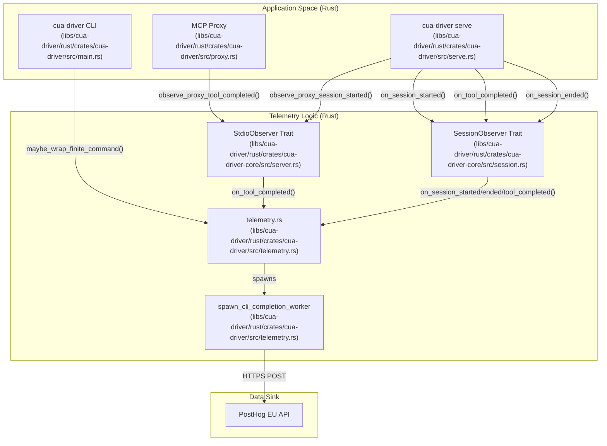
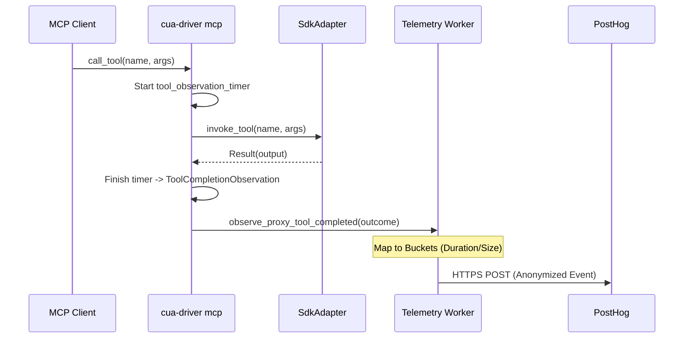

<!-- source: DeepWiki mcp.deepwiki.com · repo trycua/cua · page 10.1 Telemetry System · fetched 2026-10-29 -->

# Telemetry System

Relevant source files

The following files were used as context for generating this wiki page:

- [.github/scripts/tests/test_documented_cargo_targets.py](.github/scripts/tests/test_documented_cargo_targets.py)
- [TESTING.md](TESTING.md)
- [libs/cua-driver/rust/README.md](libs/cua-driver/rust/README.md)
- [libs/cua-driver/rust/crates/cua-driver-core/src/server.rs](libs/cua-driver/rust/crates/cua-driver-core/src/server.rs)
- [libs/cua-driver/rust/crates/cua-driver-core/src/session.rs](libs/cua-driver/rust/crates/cua-driver-core/src/session.rs)
- [libs/cua-driver/rust/crates/cua-driver/src/cli.rs](libs/cua-driver/rust/crates/cua-driver/src/cli.rs)
- [libs/cua-driver/rust/crates/cua-driver/src/main.rs](libs/cua-driver/rust/crates/cua-driver/src/main.rs)
- [libs/cua-driver/rust/crates/cua-driver/src/mcp_http.rs](libs/cua-driver/rust/crates/cua-driver/src/mcp_http.rs)
- [libs/cua-driver/rust/crates/cua-driver/src/proxy.rs](libs/cua-driver/rust/crates/cua-driver/src/proxy.rs)
- [libs/cua-driver/rust/crates/cua-driver/src/responsibility.rs](libs/cua-driver/rust/crates/cua-driver/src/responsibility.rs)
- [libs/cua-driver/rust/crates/cua-driver/src/serve.rs](libs/cua-driver/rust/crates/cua-driver/src/serve.rs)
- [libs/cua-driver/rust/crates/cua-driver/src/telemetry.rs](libs/cua-driver/rust/crates/cua-driver/src/telemetry.rs)
- [libs/cua-driver/rust/crates/platform-macos/src/tools/check_permissions.rs](libs/cua-driver/rust/crates/platform-macos/src/tools/check_permissions.rs)
- [libs/cua-driver/rust/examples/embedded-host-macos/ExampleAgentHarness.swift](libs/cua-driver/rust/examples/embedded-host-macos/ExampleAgentHarness.swift)
- [libs/python/agent/tests/conftest.py](libs/python/agent/tests/conftest.py)
- [libs/python/agent/tests/test_computer_agent.py](libs/python/agent/tests/test_computer_agent.py)
- [libs/python/agent/tests/test_telemetry_events.py](libs/python/agent/tests/test_telemetry_events.py)
- [libs/python/core/tests/conftest.py](libs/python/core/tests/conftest.py)
- [libs/python/core/tests/test_telemetry.py](libs/python/core/tests/test_telemetry.py)
- [scripts/docs-generators/python-sdk.ts](scripts/docs-generators/python-sdk.ts)
- [skills/gui-automation/SKILL.md](skills/gui-automation/SKILL.md)
- [skills/gui-automation/references/command-reference.md](skills/gui-automation/references/command-reference.md)

The Telemetry System provides privacy-focused, anonymized usage analytics for the Cua ecosystem. It tracks agent execution metrics, performance data, and usage patterns through PostHog integration while respecting user privacy controls. In the `cua-driver-rs` implementation, it specifically monitors background automation events, installation registration, and MCP session lifecycles.

## Purpose and Scope

The telemetry system serves three primary purposes:

1.  **Usage Analytics** - Track which models, providers, and features are used across the agent ecosystem.
2.  **Performance Monitoring** - Collect timing metrics, token usage, and error rates to identify bottlenecks.
3.  **Session Tracking** - Maintain session/run identifiers for correlating related events.

The system is **opt-in by default** (enabled unless explicitly disabled) but provides multiple mechanisms for users to disable telemetry entirely. All tracked data is content-free; it never receives prompts, tool arguments, screenshots, or raw errors [libs/cua-driver/rust/crates/cua-driver/src/telemetry.rs:9-12]().

## System Architecture

The telemetry system consists of core telemetry modules in Python, TypeScript, and Rust. The Rust implementation in `cua-driver` acts as a central hub for background computer-use telemetry, utilizing a dedicated worker model to ensure telemetry requests do not block the main execution loop.

### Code Entity Space to Natural Language Space

The following diagram maps code entities to their roles in the telemetry flow:

**Sources:** [libs/cua-driver/rust/crates/cua-driver/src/main.rs:106-116](), [libs/cua-driver/rust/crates/cua-driver/src/telemetry.rs:49-57](), [libs/cua-driver/rust/crates/cua-driver/src/proxy.rs:111-117](), [libs/cua-driver/rust/crates/cua-driver-core/src/server.rs:49-52](), [libs/cua-driver/rust/crates/cua-driver/src/telemetry.rs:25-26](), [libs/cua-driver/rust/crates/cua-driver-core/src/session.rs:183-200](), [libs/cua-driver/rust/crates/cua-driver/src/serve.rs:141-142]()

## Core Telemetry Infrastructure

The system uses the `posthog` ingest endpoints as the primary transport. It implements an `installation_id` persistence layer to track unique (but anonymous) installations across restarts.

### Installation ID and State Persistence
The Rust implementation stores telemetry state in a specific hierarchy under the user's home directory.

| File/Path | Purpose |
|:---|:---|
| `~/.cua-driver/.telemetry_id` | Stores the pseudonymous installation UUID [libs/cua-driver/rust/crates/cua-driver/src/telemetry.rs:36-36]() |
| `~/.cua-driver/config.json` | Stores the `telemetry_enabled` preference [libs/cua-driver/rust/crates/cua-driver/src/telemetry.rs:34-35]() |
| `~/.cua-driver/.installation_recorded` | Marker file to prevent duplicate registration events [libs/cua-driver/rust/crates/cua-driver/src/telemetry.rs:41-41]() |
| `~/.cua-driver/.release_installed/` | Directory tracking recorded version upgrades [libs/cua-driver/rust/crates/cua-driver/src/telemetry.rs:42-42]() |

**Sources:** [libs/cua-driver/rust/crates/cua-driver/src/telemetry.rs:32-42]()

## Implementation Details

### Rust Implementation (`cua-driver`)
The Rust implementation uses a "wrapped child" pattern for CLI commands. The parent process observes the exit of the child and delegates telemetry delivery to a detached, no-output worker, ensuring network latency never affects the foreground command [libs/cua-driver/rust/crates/cua-driver/src/main.rs:102-105]().

The `cua-driver` CLI includes a `telemetry` subcommand for managing telemetry settings [libs/cua-driver/rust/crates/cua-driver/src/cli.rs:155-155](). This subcommand allows users to `enable`, `disable`, `status`, `reset-id`, and `inspect` telemetry [libs/cua-driver/rust/crates/cua-driver/src/main.rs:147-169]().

### TypeScript Implementation (`@trycua/core`)
The TypeScript SDK also integrates with PostHog for telemetry. The `@trycua/core` package includes a `posthog-node` dependency and provides a `PostHogClient` for capturing events. This client is responsible for sending events to the configured PostHog instance.

### Stdio and Session Observation
The `cua-driver-core` crate defines the `StdioObserver` and `SessionObserver` traits. These allow the protocol adapters (like MCP) to report events without having direct knowledge of the telemetry implementation [libs/cua-driver/rust/crates/cua-driver-core/src/server.rs:49-52](), [libs/cua-driver/rust/crates/cua-driver-core/src/session.rs:183-200]().

## Tracked Events and Data Hierarchy

### Key Events (Rust)

| Event Name | Trigger | Bounded Properties |
|:---|:---|:---|
| `cua_driver_installation_registered` | First run after install | `install_channel` [libs/cua-driver/rust/crates/cua-driver/src/telemetry.rs:72-72]() |
| `cua_driver_release_installed` | New release installed | `install_channel`, `product_version` [libs/cua-driver/rust/crates/cua-driver/src/telemetry.rs:73-73]() |
| `cua_driver_serve` | `cua-driver serve` process start | None. `transport` is `daemon` [libs/cua-driver/rust/crates/cua-driver/src/telemetry.rs:74-74]() |
| `cua_driver_cli_completed` | CLI command exit | `command`, `exit_code`, `duration_ms`, `tool`, `computer_action`, `operation`, `client_kind`, `success`, `exit_class`, `duration_bucket` [libs/cua-driver/rust/crates/cua-driver/src/telemetry.rs:75-75]() |
| `cua_driver_mcp_startup_completed` | MCP daemon startup | `execution_path`, `daemon_state`, `success`, `duration_bucket`, `execution_mode` [libs/cua-driver/rust/crates/cua-driver/src/telemetry.rs:76-76]() |
| `cua_driver_mcp_session_started` | MCP session initiated | `client`, `protocol`, `capability_booleans`, `agent_context`, `execution_mode` [libs/cua-driver/rust/crates/cua-driver/src/telemetry.rs:77-77]() |
| `cua_driver_mcp_tool_completed` | MCP tool execution | `tool_name`, `success`, `duration_bucket`, `output_size`, `error_class`, `structured_refusal_code`, `execution_mode` [libs/cua-driver/rust/crates/cua-driver/src/telemetry.rs:78-78]() |
| `cua_driver_agent_session_started` | Agent session start | `declaration`, `revived`, `concurrent_session_bucket`, `entry_transport`, `client_kind`, `capture_scope`, `execution_mode` [libs/cua-driver/rust/crates/cua-driver/src/telemetry.rs:79-79]() |
| `cua_driver_agent_session_ended` | Agent session end | `end_reason`, `duration_bucket`, `count_bucket`, `browser_refusal_bucket`, `success_flags`, `feature_family_flags`, `multi_transport_flag`, `client_kind`, `capture_scope`, `auto_escalation_outcome`, `execution_mode` [libs/cua-driver/rust/crates/cua-driver/src/telemetry.rs:80-80]() |
| `cua_driver_permissions_gate_started` | Permissions gate displayed | `missing_permission_booleans` [libs/cua-driver/rust/crates/cua-driver/src/telemetry.rs:81-81]() |
| `cua_driver_permissions_gate_dismissed` | Permissions gate dismissed | `missing_permission_booleans`, `duration_bucket` [libs/cua-driver/rust/crates/cua-driver/src/telemetry.rs:82-82]() |
| `cua_driver_permissions_gate_completed` | Permissions gate completed | `missing_permission_booleans`, `panel_flags`, `dismissal_flags`, `resolution`, `duration_bucket` [libs/cua-driver/rust/crates/cua-driver/src/telemetry.rs:83-83]() |
| `cua_driver_update_checked` | Update check performed | `source`, `outcome`, `target_release_version`, `cache_hit` [libs/cua-driver/rust/crates/cua-driver/src/telemetry.rs:84-84]() |
| `cua_driver_update_apply_started` | Update apply started | `source`, `target_release_version` [libs/cua-driver/rust/crates/cua-driver/src/telemetry.rs:85-85]() |
| `cua_driver_update_apply_completed` | Update apply completed | `source`, `outcome`, `target_release_version`, `daemon_was_running`, `failure_class`, `duration_bucket` [libs/cua-driver/rust/crates/cua-driver/src/telemetry.rs:86-86]() |

**Sources:** [libs/cua-driver/rust/crates/cua-driver/src/telemetry.rs:71-87]()

### Common Client Event Properties
Every schema-v3 client event includes a fixed envelope with properties like `telemetry_schema_version`, `product_version`, `os_family`, `os_major`, `arch`, `is_ci`, `is_synthetic`, `transport`, `process_session_id`, and `id_persisted`. The installation UUID is used as the PostHog `distinct_id` for pseudonymous tracking.

### Duration and Size Bucketing
To preserve privacy, continuous values are converted into coarse buckets before transmission:
*   **Duration Buckets**: `lt_10ms`, `10_49ms`, `50_249ms`, `250_999ms`, `1000_4999ms`, `gte_5000ms` [libs/cua-driver/rust/crates/cua-driver-core/src/server.rs:64-83]().
*   **Output Size Buckets**: `0`, `lt_1kib`, `1_9kib`, `10_99kib`, `100_1023kib`, `gte_1mib` [libs/cua-driver/rust/crates/cua-driver-core/src/server.rs:111-131]().

## Privacy Controls

### Opt-Out Mechanisms
Users can control telemetry via the CLI or environment variables. Environment overrides take precedence over persisted preferences.

| Method | Command / Variable |
|:---|:---|
| **CLI** | `cua-driver telemetry disable` [libs/cua-driver/rust/crates/cua-driver/src/main.rs:145-151]() |
| **Env Var** | `CUA_DRIVER_RS_TELEMETRY_ENABLED=false` [libs/cua-driver/rust/crates/cua-driver/src/telemetry.rs:44-44]() |
| **Legacy Env** | `CUA_TELEMETRY_ENABLED=false` [libs/cua-driver/rust/crates/cua-driver/src/telemetry.rs:45-45]() |

**Sources:** [libs/cua-driver/rust/crates/cua-driver/src/telemetry.rs:44-46]()

### Data Flow for MCP Tool Observation

**Sources:** [libs/cua-driver/rust/crates/cua-driver/src/proxy.rs:86-117](), [libs/cua-driver/rust/crates/cua-driver-core/src/server.rs:94-117](), [libs/cua-driver/rust/crates/cua-driver/src/telemetry.rs:77-77]()

## Testing and Verification
*   **Rust Logic:** `libs/python/core/tests/test_telemetry.py` verifies enable/disable logic and ID generation [libs/python/core/tests/test_telemetry.py:15-55]().
*   **TypeScript Logic:** The TypeScript telemetry client is tested within its package.
*   **Event Inspection:** The CLI provides a command to inspect the exact JSON that would be sent for a given event: `cua-driver telemetry inspect <event_name> --json`.
*   **TCC Gate Telemetry:** The macOS permissions gate tracks start, dismissal, and completion events to measure UX friction [libs/cua-driver/rust/crates/platform-macos/src/tools/check_permissions.rs:1-186]().

**Sources:** [libs/cua-driver/rust/crates/platform-macos/src/tools/check_permissions.rs:1-186](), [libs/cua-driver/rust/crates/cua-driver/src/telemetry.rs:81-83](), [libs/python/core/tests/test_telemetry.py:15-55]()

---

