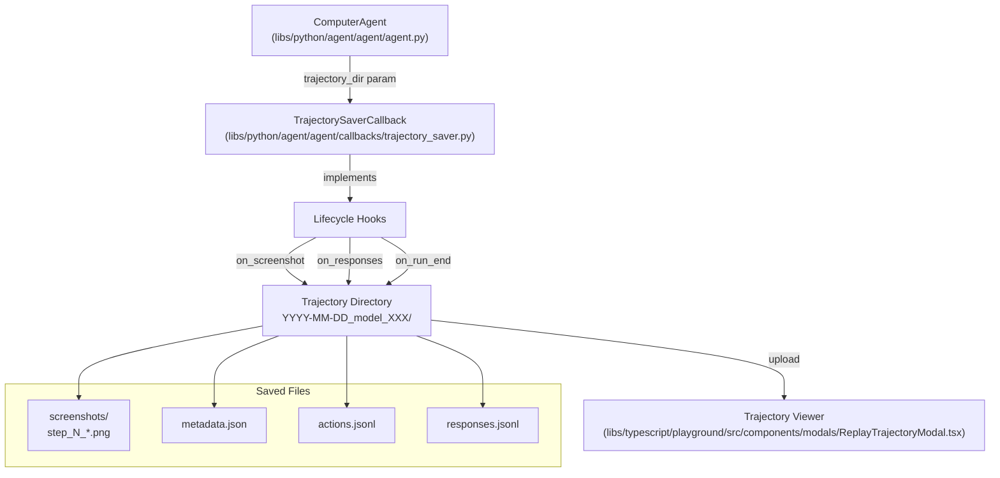
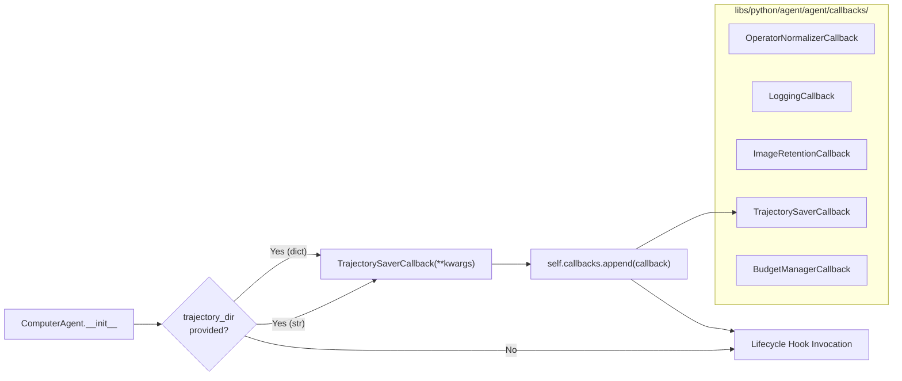
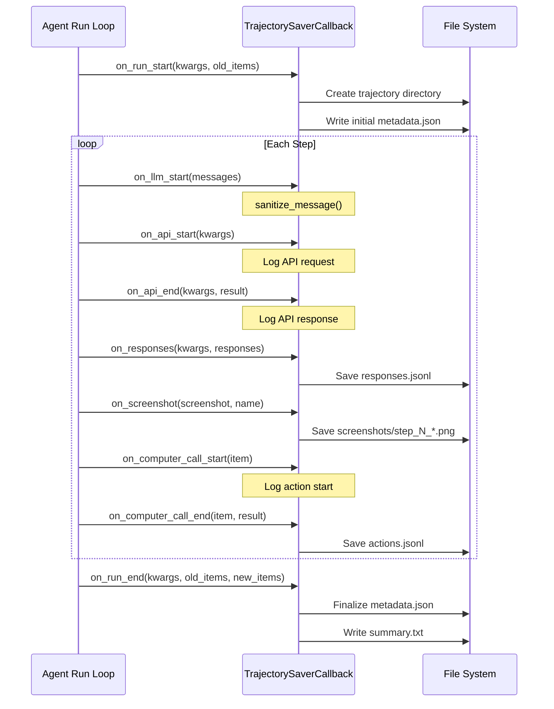
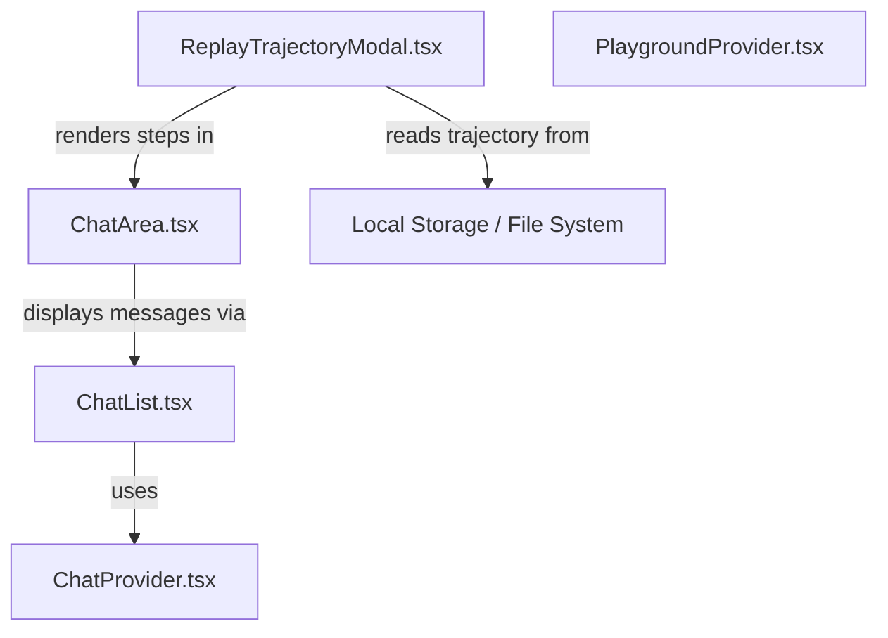
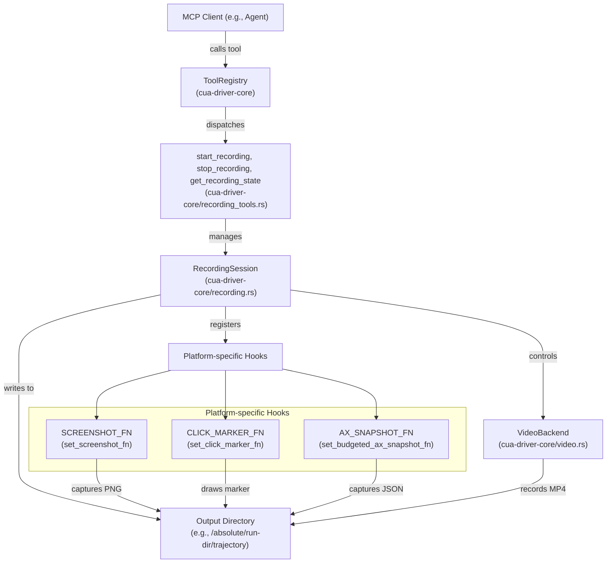

<!-- source: DeepWiki mcp.deepwiki.com · repo trycua/cua · page 10.2 Trajectory Recording · fetched 2026-10-29 -->

# Trajectory Recording

<details>
<summary>Relevant source files</summary>

The following files were used as context for generating this wiki page:

- [libs/cua-driver/rust/Skills/cua-driver/RECORDING.md](libs/cua-driver/rust/Skills/cua-driver/RECORDING.md)
- [libs/cua-driver/rust/crates/cua-driver-core/src/recording.rs](libs/cua-driver/rust/crates/cua-driver-core/src/recording.rs)
- [libs/cua-driver/rust/crates/cua-driver-core/src/recording_tools.rs](libs/cua-driver/rust/crates/cua-driver-core/src/recording_tools.rs)
- [libs/cua-driver/rust/crates/cua-driver-testkit/src/e2e.rs](libs/cua-driver/rust/crates/cua-driver-testkit/src/e2e.rs)
- [libs/cua-driver/rust/crates/cua-driver-testkit/src/sentinel.rs](libs/cua-driver/rust/crates/cua-driver-testkit/src/sentinel.rs)
- [libs/cua-driver/rust/crates/platform-linux/src/recording_hooks.rs](libs/cua-driver/rust/crates/platform-linux/src/recording_hooks.rs)
- [libs/cua-driver/rust/crates/platform-macos/src/recording_hooks.rs](libs/cua-driver/rust/crates/platform-macos/src/recording_hooks.rs)
- [libs/cua-driver/rust/crates/platform-windows/src/recording_hooks.rs](libs/cua-driver/rust/crates/platform-windows/src/recording_hooks.rs)

</details>


## Purpose and Scope

Trajectory Recording captures the complete execution history of a `ComputerAgent` run, including screenshots, LLM responses, computer actions, and metadata. This system enables debugging, analysis, and replay of agent behavior through the Cua trajectory viewer.

In addition to SDK-level recording, `cua-driver` provides platform-independent recording tools for capturing low-level OS interactions and accessibility state.

---

## Overview

The trajectory recording system automatically logs all steps of an agent execution when enabled. Recorded data includes:

- **Screenshots**: Before and after each action.
- **LLM API calls**: Request parameters and responses.
- **Computer actions**: Mouse clicks, keyboard input, scrolling.
- **Function calls**: Custom tool invocations.
- **Metadata**: Timestamps, model information, configuration.

Trajectories are saved to disk in a structured directory format and can be uploaded to the [Cua trajectory viewer](https://cua.ai/trajectory-viewer) for visual replay and analysis.

### Trajectory Recording Architecture



**Sources**: [libs/python/agent/agent/agent.py:177-253](), [libs/typescript/playground/src/components/modals/ReplayTrajectoryModal.tsx:1-50]()

---

## Enabling Trajectory Recording

Trajectory recording is enabled by passing the `trajectory_dir` parameter to `ComputerAgent`. This automatically instantiates and registers a `TrajectorySaverCallback`.

### Basic Usage

```python
from pathlib import Path
from agent import ComputerAgent

agent = ComputerAgent(
    model="openai/computer-use-preview",
    tools=[computer],
    trajectory_dir=str(Path("trajectories")),  # Enable recording
)
```

### Dictionary Configuration

For advanced configuration, pass a dictionary with callback parameters:

```python
agent = ComputerAgent(
    model="anthropic/claude-3-7-sonnet-20250219",
    tools=[computer],
    trajectory_dir={
        "directory": "trajectories",
        "save_screenshots": True,
        "save_metadata": True,
    },
)
```

The agent automatically creates a subdirectory with the format `YYYY-MM-DD_model-name_XXX` for each run [libs/python/agent/agent/agent.py:248-253]().

**Sources**: [libs/python/agent/agent/agent.py:177-253](), [libs/python/agent/agent/agent.py:248-253]()

---

## Callback Integration Architecture

The `TrajectorySaverCallback` extends `AsyncCallbackHandler` and hooks into the agent execution lifecycle. When `trajectory_dir` is specified, the callback is automatically added to the agent's callback list.

### Code Entity Space: Callback Registration



**Sources**: [libs/python/agent/agent/agent.py:231-254]()

---

## Callback Lifecycle Hooks

The `TrajectorySaverCallback` implements multiple lifecycle hooks to capture trajectory data at different execution stages.

### Hook Invocation Flow



**Sources**: [libs/python/agent/agent/agent.py:357-466]()

---

## Recorded Data Structure

Each trajectory run creates a timestamped directory with the following structure:

| File/Directory | Content | Example |
|----------------|---------|---------|
| `metadata.json` | Run configuration, model info, timestamps | `{"model": "openai/computer-use-preview", ...}` |
| `screenshots/` | PNG images for each step | `step_0_screenshot_before.png` |
| `actions.jsonl` | Line-delimited JSON of actions | `{"type": "computer_call", "action": {...}}` |
| `responses.jsonl` | Line-delimited JSON of LLM API responses | `{"output": [...], "usage": {...}}` |
| `summary.txt` | Human-readable summary | "Run completed in 45.3s, 12 steps" |

**Sources**: [libs/python/agent/agent/agent.py:357-466]()

---

## Image URL Sanitization

To prevent trajectory files from becoming excessively large, the `sanitize_message` function replaces base64-encoded image URLs in `computer_call_output` messages with a placeholder string [libs/python/agent/agent/agent.py:140-148]().

### Sanitization Logic

```python
def sanitize_message(msg: Any) -> Any:
    """Return a copy of the message with image_url omitted for computer_call_output messages."""
    if msg.get("type") == "computer_call_output":
        output = msg.get("output", {})
        if isinstance(output, dict):
            sanitized = msg.copy()
            sanitized["output"] = {**output, "image_url": "[omitted]"}
            return sanitized
    return msg
```

This function is called in the `on_llm_start` hook to preprocess messages before saving, while actual screenshot PNG files are saved separately via the `on_screenshot` hook [libs/python/agent/agent/agent.py:388-394]().

**Sources**: [libs/python/agent/agent/agent.py:140-148](), [libs/python/agent/agent/agent.py:388-394]()

---

## Screenshot Management

Screenshots are captured at multiple points during agent execution and saved to the `screenshots/` subdirectory within each trajectory.

### Screenshot Capture Points

| Hook | Timing | File Name Pattern | Purpose |
|------|--------|-------------------|---------|
| `on_screenshot(screenshot, "screenshot")` | Initial state | `step_N_screenshot.png` | Capture current screen state |
| `on_screenshot(screenshot, "screenshot_after")` | After computer action | `step_N_screenshot_after.png` | Verify action result |

The `_on_screenshot` method is invoked throughout the agent loop in `agent.py` [libs/python/agent/agent/agent.py:462-466](). The `screenshot_delay` parameter (default 0.5 seconds) controls the wait time before capturing post-action screenshots to allow UI updates to complete [libs/python/agent/agent/agent.py:523-526]().

**Sources**: [libs/python/agent/agent/agent.py:462-466](), [libs/python/agent/agent/agent.py:523-526]()

---

## Trajectory Viewer Integration

Trajectories saved to disk can be uploaded to the Cua trajectory viewer for visual replay and analysis. The viewer is implemented as a React component in the playground [libs/typescript/playground/src/components/modals/ReplayTrajectoryModal.tsx:1-100]().

### Viewer Component Space



The viewer displays:
- Step-by-step screenshot playback.
- LLM reasoning and decisions.
- Computer actions with coordinates.
- Token usage and timing information.

**Sources**: [libs/typescript/playground/src/components/modals/ReplayTrajectoryModal.tsx:1-100](), [libs/typescript/playground/src/context/PlaygroundProvider.tsx:1-50]()

---

## Advanced Configuration Options

The `TrajectorySaverCallback` supports additional configuration through the dictionary form of `trajectory_dir` [libs/python/agent/agent/agent.py:248-253]().

| Parameter | Type | Default | Description |
|-----------|------|---------|-------------|
| `directory` | `str` | Required | Base directory for trajectories. |
| `save_screenshots` | `bool` | `True` | Whether to save screenshot PNGs. |
| `save_metadata` | `bool` | `True` | Whether to write metadata.json. |
| `sanitize_images` | `bool` | `True` | Whether to sanitize image URLs in logs. |

**Sources**: [libs/python/agent/agent/agent.py:248-253]()

---

## Integration with Other Callbacks

Trajectory recording works alongside other callbacks in the agent lifecycle. The `TrajectorySaverCallback` is inserted at a position determined by when `trajectory_dir` is specified relative to other callback parameters [libs/python/agent/agent/agent.py:231-298](). It implements both preprocessing (`on_llm_start`) and postprocessing (`on_llm_end`) hooks to capture the complete request-response cycle.

**Sources**: [libs/python/agent/agent/agent.py:231-298]()

---

## `cua-driver` Recording

The `cua-driver` provides a platform-independent recording subsystem for capturing low-level desktop interactions and accessibility state. This is distinct from the `TrajectorySaverCallback` which operates at the `ComputerAgent` level. `cua-driver` recording is managed via specific tools: `start_recording`, `stop_recording`, and `get_recording_state` [libs/cua-driver/rust/crates/cua-driver-core/src/recording_tools.rs:1-15]().

### `cua-driver` Recording Architecture



**Sources**:
- [libs/cua-driver/rust/crates/cua-driver-core/src/recording_tools.rs:1-15]()
- [libs/cua-driver/rust/crates/cua-driver-core/src/recording.rs:56-72]()
- [libs/cua-driver/rust/crates/cua-driver-core/src/recording.rs:94-95]()
- [libs/cua-driver/rust/crates/cua-driver-core/src/recording.rs:157-161]()

### Recording Tools

The `cua-driver` exposes the following tools for managing recordings:

- `start_recording`: Enables trajectory recording to a specified `output_dir`. It can optionally capture video of the main display [libs/cua-driver/rust/crates/cua-driver-core/src/recording_tools.rs:47-123]().
- `stop_recording`: Disables recording and finalizes any active video file [libs/cua-driver/rust/crates/cua-driver-core/src/recording_tools.rs:15-16]().
- `get_recording_state`: Queries the current recording status [libs/cua-driver/rust/crates/cua-driver-core/src/recording_tools.rs:15-16]().
- `replay_trajectory`: Replays a previously recorded trajectory by invoking the recorded arguments in order [libs/cua-driver/rust/crates/cua-driver-core/src/recording_tools.rs:15-16]().

**Sources**: [libs/cua-driver/rust/crates/cua-driver-core/src/recording_tools.rs:1-15](), [libs/cua-driver/rust/crates/cua-driver-core/src/recording_tools.rs:47-123]()

### Directory Structure and Contents

When `start_recording` is active, each non-read-only, non-recording tool call creates a `turn-NNNNN/` folder within the specified `output_dir` [libs/cua-driver/rust/crates/cua-driver-core/src/recording.rs:3-6]().

Each `turn-NNNNN/` folder contains:

- `before_state.json` / `after_state.json`: JSON representation of the application's accessibility tree (AX/UIA/AT-SPI) state immediately before and after the action. These walks are bounded by `state_timeout_ms` [libs/cua-driver/rust/crates/cua-driver-core/src/recording_tools.rs:56-75]().
- `before.png` / `after.png`: Screenshots of the target window immediately before and after the action [libs/cua-driver/rust/crates/cua-driver-core/src/recording_tools.rs:57-58]().
- `evidence.json`: Provides capture status and classification if an expected artifact could not be captured [libs/cua-driver/rust/crates/cua-driver-core/src/recording_tools.rs:60-61]().
- `app_state.json`: Legacy alias for `after_state.json` [libs/cua-driver/rust/crates/cua-driver-core/src/recording_tools.rs:62-63]().
- `screenshot.png`: Legacy alias for `after.png` [libs/cua-driver/rust/crates/cua-driver-core/src/recording_tools.rs:63-64]().
- `action.json`: Contains the tool name, full input arguments, result summary, error flag, PID, click point (if applicable), and ISO-8601 timestamp [libs/cua-driver/rust/crates/cua-driver-core/src/recording_tools.rs:64-67]().
- `click.png`: For click-family actions, a copy of `before.png` with a red marker at the click point. If the driver refuses a click before target resolution, this file is absent and classified as not applicable [libs/cua-driver/rust/crates/cua-driver-core/src/recording_tools.rs:67-70]().

**Sources**:
- [libs/cua-driver/rust/crates/cua-driver-core/src/recording.rs:3-6]()
- [libs/cua-driver/rust/crates/cua-driver-core/src/recording_tools.rs:56-75]()
- [libs/cua-driver/rust/crates/cua-driver-core/src/recording_tools.rs:57-58]()
- [libs/cua-driver/rust/crates/cua-driver-core/src/recording_tools.rs:60-61]()
- [libs/cua-driver/rust/crates/cua-driver-core/src/recording_tools.rs:62-63]()
- [libs/cua-driver/rust/crates/cua-driver-core/src/recording_tools.rs:63-64]()
- [libs/cua-driver/rust/crates/cua-driver-core/src/recording_tools.rs:64-67]()
- [libs/cua-driver/rust/crates/cua-driver-core/src/recording_tools.rs:67-70]()
- [libs/cua-driver/rust/Skills/cua-driver/RECORDING.md:61-114]()

### Platform-Specific Capture Hooks

The `cua-driver` recording system relies on platform-specific hooks for capturing screenshots, marking clicks, and taking accessibility snapshots.

#### Screenshot Capture

The `SCREENSHOT_FN` static `OnceLock` stores a boxed function that captures a screenshot. This function takes an optional `window_id` and `pid` and returns `ScreenshotCapture`, which can contain PNG bytes or a classification for unavailability [libs/cua-driver/rust/crates/cua-driver-core/src/recording.rs:51-72]().

- **macOS**: Uses `ScreenCaptureKit` for video and `CGWindowListCreateImage` for screenshots.
- **Windows**: Uses `PrintWindow` for screenshots and `gdigrab` via `ffmpeg` for video [libs/cua-driver/rust/crates/cua-driver-core/src/recording_tools.rs:90-99](). The `screenshot_for_recording` function handles window-specific or display-wide captures, classifying unavailable captures (e.g., minimized windows) [libs/cua-driver/rust/crates/platform-windows/src/recording_hooks.rs:70-87]().
- **Linux**: For Wayland, it captures the complete rendered output of the compositor. For X11, it uses `x11grab` via `ffmpeg` for video [libs/cua-driver/rust/crates/cua-driver-core/src/recording_tools.rs:96-99](). The `screenshot_for_recording` function dispatches to Wayland or X11 capture mechanisms [libs/cua-driver/rust/crates/platform-linux/src/recording_hooks.rs:75-92]().

**Sources**:
- [libs/cua-driver/rust/crates/cua-driver-core/src/recording.rs:51-72]()
- [libs/cua-driver/rust/crates/cua-driver-core/src/recording_tools.rs:90-99]()
- [libs/cua-driver/rust/crates/platform-windows/src/recording_hooks.rs:70-87]()
- [libs/cua-driver/rust/crates/platform-linux/src/recording_hooks.rs:75-92]()

#### Click Marker

The `CLICK_MARKER_FN` stores a function to draw a red crosshair on a PNG image at specified coordinates, used for `click.png` [libs/cua-driver/rust/crates/cua-driver-core/src/recording.rs:90-95]().

#### Accessibility Snapshot

The `AX_SNAPSHOT_FN` stores a function to capture the application's accessibility state as JSON bytes. This function respects a `StateCaptureBudget` to prevent long-running or hung accessibility providers from blocking the recording [libs/cua-driver/rust/crates/cua-driver-core/src/recording.rs:141-161]().

- **macOS**: `app_state_json_for` uses `walk_tree_budgeted` from `crate::ax::tree` to capture AXUIElement data [libs/cua-driver/rust/crates/platform-macos/src/recording_hooks.rs:16-50]().
- **Windows**: `app_state_json_for` uses `crate::uia::walk_tree_budgeted` to capture UIA/MSAA state [libs/cua-driver/rust/crates/platform-windows/src/recording_hooks.rs:99-134]().
- **Linux**: `app_state_json_for` uses `crate::atspi::walk_tree_for_recording` or `walk_tree_bounded_within` to capture AT-SPI state [libs/cua-driver/rust/crates/platform-linux/src/recording_hooks.rs:7-72]().

**Sources**:
- [libs/cua-driver/rust/crates/cua-driver-core/src/recording.rs:90-95]()
- [libs/cua-driver/rust/crates/cua-driver-core/src/recording.rs:141-161]()
- [libs/cua-driver/rust/crates/platform-macos/src/recording_hooks.rs:16-50]()
- [libs/cua-driver/rust/crates/platform-windows/src/recording_hooks.rs:99-134]()
- [libs/cua-driver/rust/crates/platform-linux/src/recording_hooks.rs:7-72]()

### MP4 Video Rendering

When `record_video: true` is passed to `start_recording`, the `cua-driver` captures the main display to `<output_dir>/recording.mp4` [libs/cua-driver/rust/crates/cua-driver-core/src/recording_tools.rs:83-85]().

- **macOS**: Uses native `ScreenCaptureKit` (macOS 15.0+) [libs/cua-driver/rust/crates/cua-driver-core/src/recording_tools.rs:86-95]().
- **Windows + Linux**: Utilize an `ffmpeg` subprocess (`gdigrab` / `x11grab` + `libx264`). `ffmpeg` must be available on `PATH` [libs/cua-driver/rust/crates/cua-driver-core/src/recording_tools.rs:96-101]().

The video recording is automatically torn down when the MCP client disconnects, or explicitly by calling `stop_recording` [libs/cua-driver/rust/crates/cua-driver-core/src/recording_tools.rs:102-104]().

**Sources**:
- [libs/cua-driver/rust/crates/cua-driver-core/src/recording_tools.rs:83-85]()
- [libs/cua-driver/rust/crates/cua-driver-core/src/recording_tools.rs:86-95]()
- [libs/cua-driver/rust/crates/cua-driver-core/src/recording_tools.rs:96-101]()
- [libs/cua-driver/rust/crates/cua-driver-core/src/recording_tools.rs:102-104]()
- [libs/cua-driver/rust/Skills/cua-driver/RECORDING.md:49-58]()

### E2E Testkit Integration

The `cua-driver-testkit` uses the recording functionality for end-to-end (E2E) tests. The `ForegroundSentinel` can launch an Electron window to journal focus and input, and the `e2e` module defines contracts for test declarations and results [libs/cua-driver/rust/crates/cua-driver-testkit/src/e2e.rs:1-17](), [libs/cua-driver/rust/crates/cua-driver-testkit/src/sentinel.rs:18-24](). This allows for robust testing of driver behavior and ensures that recording captures expected interactions.

**Sources**:
- [libs/cua-driver/rust/crates/cua-driver-testkit/src/e2e.rs:1-17]()
- [libs/cua-driver/rust/crates/cua-driver-testkit/src/sentinel.rs:18-24]()

---

