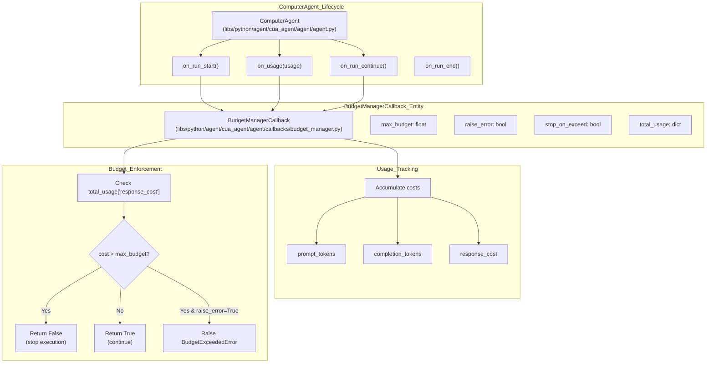
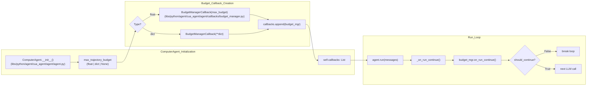
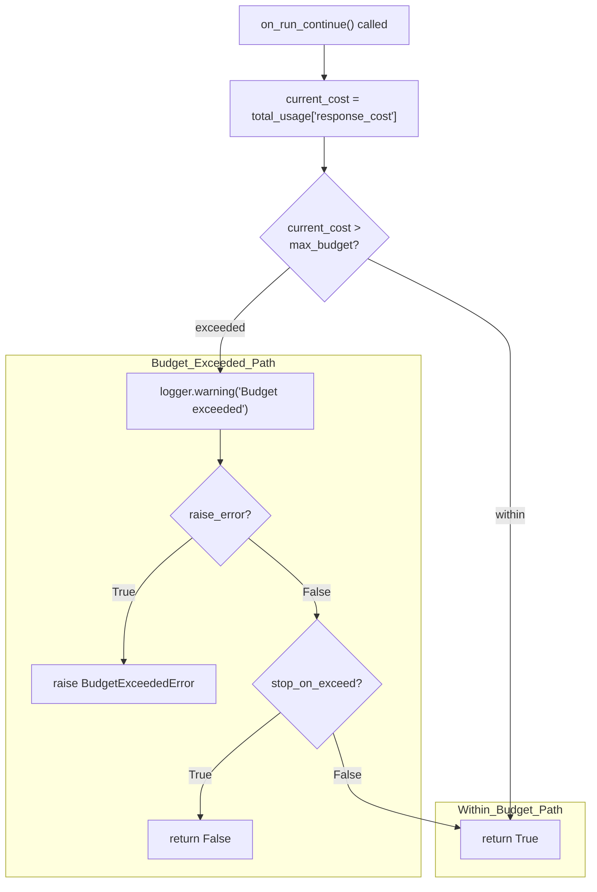

<!-- source: DeepWiki mcp.deepwiki.com · repo trycua/cua · page 10.3 Budget and Cost Management · fetched 2026-10-29 -->

# Budget and Cost Management

<details>
<summary>Relevant source files</summary>

The following files were used as context for generating this wiki page:

- [Makefile](Makefile)
- [libs/python/agent/.bumpversion.cfg](libs/python/agent/.bumpversion.cfg)
- [libs/python/agent/README.md](libs/python/agent/README.md)
- [libs/python/agent/pyproject.toml](libs/python/agent/pyproject.toml)
- [libs/python/core/.bumpversion.cfg](libs/python/core/.bumpversion.cfg)
- [libs/python/core/README.md](libs/python/core/README.md)
- [libs/python/core/pyproject.toml](libs/python/core/pyproject.toml)
- [libs/python/som/.bumpversion.cfg](libs/python/som/.bumpversion.cfg)
- [libs/python/som/README.md](libs/python/som/README.md)
- [libs/python/som/pyproject.toml](libs/python/som/pyproject.toml)

</details>


This document describes the budget tracking and cost management system in the Cua agent framework. The system monitors token usage and associated costs during agent execution and can automatically stop runs when budget limits are exceeded.

For information about usage tracking and telemetry, see [10.1 Telemetry System](). For trajectory recording and analysis, see [10.2 Trajectory Recording]().

## Overview

The budget management system provides cost control for AI agent operations through the `BudgetManagerCallback` class. This callback integrates with the `ComputerAgent` lifecycle to track cumulative costs across API calls and enforce spending limits. The system supports both soft warnings and hard stops when budgets are exceeded.

**Primary Components:**
- `BudgetManagerCallback`: Core callback handler for budget tracking [libs/python/agent/cua_agent/agent/callbacks/budget_manager.py:13-89]().
- Usage accumulation via `on_usage` lifecycle hook [libs/python/agent/cua_agent/agent/callbacks/budget_manager.py:39-52]().
- Budget enforcement via `on_run_continue` lifecycle hook [libs/python/agent/cua_agent/agent/callbacks/budget_manager.py:54-89]().
- Integration with LiteLLM's cost calculation [libs/python/agent/cua_agent/agent/agent.py:679-685]().

Sources: [libs/python/agent/cua_agent/agent/callbacks/budget_manager.py:1-89](), [libs/python/agent/cua_agent/agent/agent.py:266-271]()

## BudgetManagerCallback Architecture

The following diagram illustrates how the `BudgetManagerCallback` interfaces with the `ComputerAgent` execution loop and LiteLLM usage data.

### Cost Tracking and Enforcement Flow


**BudgetManagerCallback Class Structure**

The callback maintains state across the agent run and implements two key lifecycle hooks defined in the `AsyncCallbackHandler` base class:

| Hook | Purpose | Return Value |
|------|---------|--------------|
| `on_usage(usage)` | Accumulate token counts and costs from LiteLLM | `None` |
| `on_run_continue(kwargs, old_items, new_items)` | Check budget and decide whether to continue | `bool` |

Sources: [libs/python/agent/cua_agent/agent/callbacks/budget_manager.py:13-89](), [libs/python/agent/cua_agent/agent/callbacks/base.py:1-93]()

## Integration with ComputerAgent

The `ComputerAgent` class supports budget management through the `max_trajectory_budget` initialization parameter. This parameter automatically instantiates and registers a `BudgetManagerCallback`.

### Code Entity Space: Budget Initialization


**Initialization Logic:**

`ComputerAgent` defines the `max_trajectory_budget` parameter with type `Optional[float | dict]` in its constructor [libs/python/agent/cua_agent/agent/agent.py:185-186]().

The instantiation logic [libs/python/agent/cua_agent/agent/agent.py:266-271]() handles both simple float values and detailed configuration dictionaries:
```python
# Add budget manager if max_trajectory_budget is set
if max_trajectory_budget:
    if isinstance(max_trajectory_budget, dict):
        self.callbacks.append(BudgetManagerCallback(**max_trajectory_budget))
    else:
        self.callbacks.append(BudgetManagerCallback(max_trajectory_budget))
```

Sources: [libs/python/agent/cua_agent/agent/agent.py:185-186](), [libs/python/agent/cua_agent/agent/agent.py:266-271](), [libs/python/agent/cua_agent/agent/agent.py:376-388](), [libs/python/agent/cua_agent/agent/agent.py:653-657]()

## Budget Tracking and Cost Calculation

### Usage Accumulation

The `on_usage` callback receives usage dictionaries from the agent loop, which are typically sourced from LiteLLM after each API call. These dictionaries contain:

| Field | Type | Description |
|-------|------|-------------|
| `prompt_tokens` | int | Input tokens consumed |
| `completion_tokens` | int | Output tokens generated |
| `total_tokens` | int | Sum of prompt and completion tokens |
| `response_cost` | float | Estimated cost in USD |

**Implementation:**

[libs/python/agent/cua_agent/agent/callbacks/budget_manager.py:39-52]() implements the accumulation:
```python
async def on_usage(self, usage: Dict[str, Any]) -> None:
    """Accumulate usage from each API call."""
    self.total_usage["prompt_tokens"] += usage.get("prompt_tokens", 0)
    self.total_usage["completion_tokens"] += usage.get("completion_tokens", 0)
    self.total_usage["total_tokens"] += usage.get("total_tokens", 0)
    self.total_usage["response_cost"] += usage.get("response_cost", 0.0)
```

### Cost Calculation Flow

Costs are calculated by LiteLLM based on model pricing data. The `response_cost` field is passed through the agent loop to the callbacks:

[libs/python/agent/cua_agent/agent/agent.py:458-462]() shows the internal `_on_usage` dispatcher:
```python
async def _on_usage(self, usage: Dict[str, Any]) -> None:
    """Called when usage information is received."""
    for callback in self.callbacks:
        if hasattr(callback, "on_usage"):
            await callback.on_usage(get_json(usage))
```

Sources: [libs/python/agent/cua_agent/agent/callbacks/budget_manager.py:39-52](), [libs/python/agent/cua_agent/agent/agent.py:458-462](), [libs/python/agent/cua_agent/agent/agent.py:679-685]()

## Budget Enforcement Mechanisms

### Run Continuation Check

The `on_run_continue` hook is called at the start of each agent loop iteration before making a new LLM call. The budget manager uses this to enforce limits.



**Enforcement Logic:**

The check logic [libs/python/agent/cua_agent/agent/callbacks/budget_manager.py:54-89]() allows for graceful stopping or hard exceptions:
```python
async def on_run_continue(
    self, kwargs: Dict[str, Any], old_items: List[Dict[str, Any]], new_items: List[Dict[str, Any]]
) -> bool:
    """Check if budget has been exceeded."""
    current_cost = self.total_usage.get("response_cost", 0.0)
    
    if current_cost > self.max_budget:
        logger.warning(
            f"Budget exceeded: ${current_cost:.4f} > ${self.max_budget:.4f}"
        )
        
        if self.raise_error:
            raise BudgetExceededError(...)
        
        if self.stop_on_exceed:
            return False  # Signal to stop the run
    
    return True  # Continue execution
```

### Error Handling

When `raise_error=True`, the `BudgetExceededError` exception is raised, which terminates the agent run immediately. This exception is defined in [libs/python/agent/cua_agent/agent/callbacks/budget_manager.py:10-11]().

Sources: [libs/python/agent/cua_agent/agent/callbacks/budget_manager.py:54-89](), [libs/python/agent/cua_agent/agent/callbacks/budget_manager.py:10-11](), [libs/python/agent/cua_agent/agent/agent.py:653-657]()

## Configuration Options

### Constructor Parameters

The `BudgetManagerCallback` constructor accepts the following parameters [libs/python/agent/cua_agent/agent/callbacks/budget_manager.py:19-37]():

| Parameter | Type | Default | Description |
|-----------|------|---------|-------------|
| `max_budget` | float | Required | Maximum allowed cost in USD. |
| `raise_error` | bool | `False` | Whether to raise `BudgetExceededError` when exceeded. |
| `stop_on_exceed` | bool | `True` | Whether to stop run when budget exceeded (if not raising). |

### Integration Patterns

**1. Simple float budget:**
```python
agent = ComputerAgent(
    model="anthropic/claude-3-5-sonnet-20241022",
    max_trajectory_budget=5.0  # Stop at $5.00
)
```

**2. Dictionary for custom behavior:**
```python
agent = ComputerAgent(
    model="openai/computer-use-preview",
    max_trajectory_budget={
        "max_budget": 10.0,
        "raise_error": True
    }
)
```

**3. Direct callback registration:**
```python
from cua_agent.agent.callbacks.budget_manager import BudgetManagerCallback

budget_callback = BudgetManagerCallback(max_budget=2.5)
agent = ComputerAgent(model="...", callbacks=[budget_callback])
```

Sources: [libs/python/agent/cua_agent/agent/callbacks/budget_manager.py:19-37](), [libs/python/agent/cua_agent/agent/agent.py:266-271]()

## Callback Ordering and Priority

The `BudgetManagerCallback` is typically appended to the callbacks list after other built-in callbacks. The order is significant because it determines the sequence of execution for lifecycle hooks.

**Standard Registration Sequence:**

1.  **OperatorNormalizerCallback** (prepended at index 0): Normalizes actions before processing.
2.  **PromptInstructionsCallback**: Adds system instructions.
3.  **TelemetryCallback**: Records operational events.
4.  **LoggingCallback**: Handles console output.
5.  **ImageRetentionCallback**: Manages image history.
6.  **TrajectorySaverCallback**: Saves screenshot and action logs.
7.  **BudgetManagerCallback**: Enforces budget limits.

The budget manager's `on_run_continue` is called after other callbacks have processed the current state, ensuring it evaluates the budget against the most recent usage data recorded by LiteLLM.

Sources: [libs/python/agent/cua_agent/agent/agent.py:235-271](), [libs/python/agent/cua_agent/agent/agent.py:376-388](), [libs/python/agent/cua_agent/agent/callbacks/__init__.py:1-24]()

---

