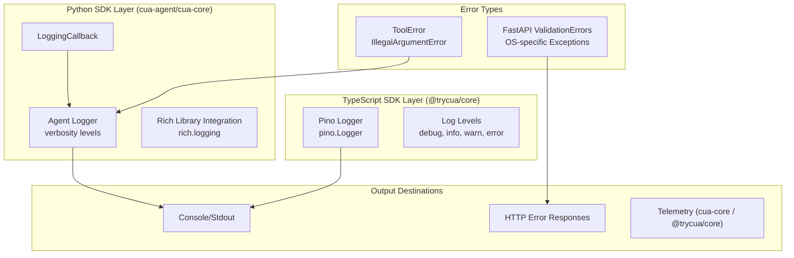
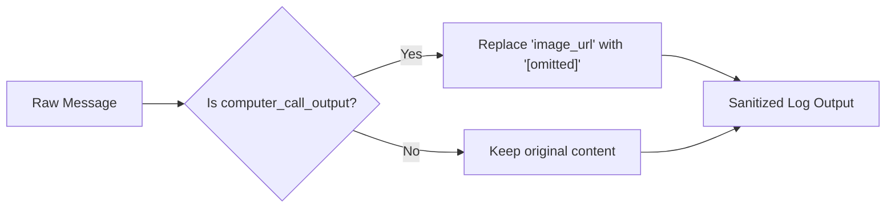
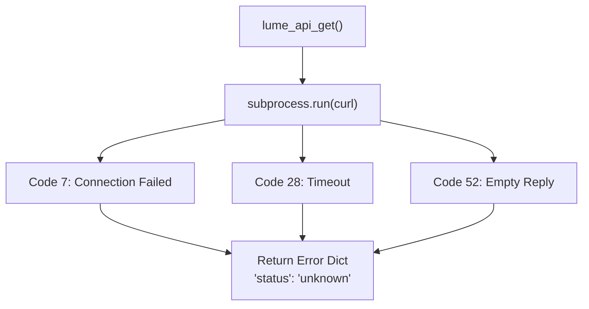
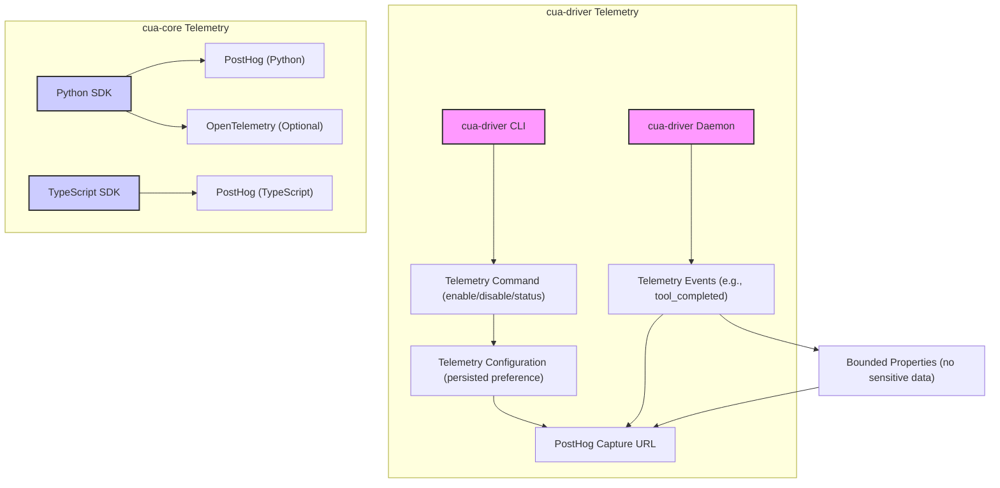

<!-- source: DeepWiki mcp.deepwiki.com · repo trycua/cua · page 10.4 Logging and Error Handling · fetched 2026-10-29 -->

# Logging and Error Handling

Relevant source files

The following files were used as context for generating this wiki page:

- [libs/cua-driver/rust/crates/cua-driver-core/src/health_report.rs](libs/cua-driver/rust/crates/cua-driver-core/src/health_report.rs)
- [libs/cua-driver/rust/crates/cua-driver-core/src/server.rs](libs/cua-driver/rust/crates/cua-driver-core/src/server.rs)
- [libs/cua-driver/rust/crates/cua-driver-core/src/session.rs](libs/cua-driver/rust/crates/cua-driver-core/src/session.rs)
- [libs/cua-driver/rust/crates/cua-driver-core/src/timestamp.rs](libs/cua-driver/rust/crates/cua-driver-core/src/timestamp.rs)
- [libs/cua-driver/rust/crates/cua-driver-e2e/tests/agent_cursor_windows_test.rs](libs/cua-driver/rust/crates/cua-driver-e2e/tests/agent_cursor_windows_test.rs)
- [libs/cua-driver/rust/crates/cua-driver-e2e/tests/computer_history_cross_platform_test.rs](libs/cua-driver/rust/crates/cua-driver-e2e/tests/computer_history_cross_platform_test.rs)
- [libs/cua-driver/rust/crates/cua-driver-e2e/tests/cross_platform_behavior_test.rs](libs/cua-driver/rust/crates/cua-driver-e2e/tests/cross_platform_behavior_test.rs)
- [libs/cua-driver/rust/crates/cua-driver-e2e/tests/harness_gtk3_test.rs](libs/cua-driver/rust/crates/cua-driver-e2e/tests/harness_gtk3_test.rs)
- [libs/cua-driver/rust/crates/cua-driver-e2e/tests/harness_libreoffice_test.rs](libs/cua-driver/rust/crates/cua-driver-e2e/tests/harness_libreoffice_test.rs)
- [libs/cua-driver/rust/crates/cua-driver-e2e/tests/harness_swiftui_test.rs](libs/cua-driver/rust/crates/cua-driver-e2e/tests/harness_swiftui_test.rs)
- [libs/cua-driver/rust/crates/cua-driver-e2e/tests/installed_app_textedit_macos_test.rs](libs/cua-driver/rust/crates/cua-driver-e2e/tests/installed_app_textedit_macos_test.rs)
- [libs/cua-driver/rust/crates/cua-driver/src/cli.rs](libs/cua-driver/rust/crates/cua-driver/src/cli.rs)
- [libs/cua-driver/rust/crates/cua-driver/src/main.rs](libs/cua-driver/rust/crates/cua-driver/src/main.rs)
- [libs/cua-driver/rust/crates/cua-driver/src/mcp_http.rs](libs/cua-driver/rust/crates/cua-driver/src/mcp_http.rs)
- [libs/cua-driver/rust/crates/cua-driver/src/proxy.rs](libs/cua-driver/rust/crates/cua-driver/src/proxy.rs)
- [libs/cua-driver/rust/crates/cua-driver/src/responsibility.rs](libs/cua-driver/rust/crates/cua-driver/src/responsibility.rs)
- [libs/cua-driver/rust/crates/cua-driver/src/serve.rs](libs/cua-driver/rust/crates/cua-driver/src/serve.rs)
- [libs/cua-driver/rust/crates/cua-driver/src/telemetry.rs](libs/cua-driver/rust/crates/cua-driver/src/telemetry.rs)
- [libs/cua-driver/rust/crates/platform-linux/src/input/mpx_owner.rs](libs/cua-driver/rust/crates/platform-linux/src/input/mpx_owner.rs)
- [libs/cua-driver/rust/crates/platform-linux/src/installed_apps.rs](libs/cua-driver/rust/crates/platform-linux/src/installed_apps.rs)
- [libs/cua-driver/rust/crates/platform-linux/src/proc_fs.rs](libs/cua-driver/rust/crates/platform-linux/src/proc_fs.rs)
- [libs/cua-driver/rust/crates/platform-macos/src/apps/mod.rs](libs/cua-driver/rust/crates/platform-macos/src/apps/mod.rs)
- [libs/cua-driver/rust/crates/platform-macos/src/apps/nsworkspace.rs](libs/cua-driver/rust/crates/platform-macos/src/apps/nsworkspace.rs)
- [libs/cua-driver/rust/crates/platform-macos/src/tools/check_permissions.rs](libs/cua-driver/rust/crates/platform-macos/src/tools/check_permissions.rs)
- [libs/cua-driver/rust/crates/platform-macos/src/tools/health_report.rs](libs/cua-driver/rust/crates/platform-macos/src/tools/health_report.rs)
- [libs/cua-driver/rust/crates/platform-macos/src/tools/launch_app.rs](libs/cua-driver/rust/crates/platform-macos/src/tools/launch_app.rs)
- [libs/cua-driver/rust/crates/platform-macos/src/tools/list_apps.rs](libs/cua-driver/rust/crates/platform-macos/src/tools/list_apps.rs)
- [libs/cua-driver/rust/crates/platform-windows/src/health_report.rs](libs/cua-driver/rust/crates/platform-windows/src/health_report.rs)
- [libs/cua-driver/rust/examples/embedded-host-macos/ExampleAgentHarness.swift](libs/cua-driver/rust/examples/embedded-host-macos/ExampleAgentHarness.swift)

This document covers the logging infrastructure and error handling patterns used throughout the Cua framework, including the Python Agent SDK, TypeScript SDK, and the Computer Server. The logging system provides visibility into agent execution and API interactions, while error handling ensures graceful failure modes and actionable error messages across both the agentic and infrastructure layers.

---

## Logging Architecture

The Cua framework employs multiple logging systems tailored to different components, ranging from high-level agent callbacks to low-level pino-based logging in TypeScript.

**Logging Architecture Overview**

The framework uses distinct logging mechanisms for Python and TypeScript components. The Python layer utilizes `rich` for formatted console output, while the TypeScript layer integrates `pino` for high-performance logging.

Sources: [libs/python/agent/pyproject.toml:19](), [libs/python/core/pyproject.toml:13-15]()

---

## Python Agent Logging System

### LoggingCallback and Verbosity

The agent logging system is primarily driven by the `LoggingCallback` within the Python SDK. It is initialized based on the `verbosity` parameter passed to the agent. The framework integrates `rich` for enhanced terminal output and `litellm` for tracking model interactions.

| Verbosity Level | Constant | Description |
|-----------------|----------|-------------|
| 10 | `logging.DEBUG` | Detailed diagnostic information including full message content and tool schemas. |
| 20 | `logging.INFO` | General informational messages about agent steps and tool selection. |
| 30 | `logging.WARNING` | Warning messages for unexpected but handled situations or retries. |
| 40 | `logging.ERROR` | Error messages for tool or LLM failures. |

The `cua-agent` package relies on `rich` for logging and `litellm` for model communication [libs/python/agent/pyproject.toml:19-23]().

### Message Sanitization

To prevent log bloat and protect privacy, the agent logging system includes built-in message sanitization. This specifically targets large data structures like base64-encoded screenshots in computer call outputs, which are often found in the `computer_call_output` item types.

**Message Sanitization Flow**

This prevents logs from being flooded with massive strings while preserving the logical flow of the agent's trajectory. Image processing utilities in `computer/utils.py` handle the underlying byte-to-base64 conversions for these logs [libs/python/computer/computer/utils.py:11-18]().

Sources: [libs/python/agent/pyproject.toml:24](), [libs/python/computer/computer/utils.py:11-18]()

---

## TypeScript SDK Logging

The TypeScript SDK utilizes the `pino` logger for consistent, structured logging across `@trycua/core`, `@trycua/computer`, and `@trycua/agent`.

- **Structured Logging**: Logs are output as JSON by default, making them suitable for ingestion by observability platforms.
- **Logger Injection**: Components like the `Computer` or `Sandbox` can accept a custom `pino.Logger` instance or use the default global logger.

---

## Computer SDK and Provider Error Handling

The `cua-computer` and its providers handle low-level interaction and API errors. These errors are propagated back to the agent loop to allow for error recovery or task termination.

### Provider API Error Recovery

When interacting with external VM providers like Lume, the SDK implements robust error mapping for `curl` exit codes. This is critical for handling transient network issues or VM startup delays.

**Lume API Error Mapping**

The `lume_api_get` function in `computer/providers/lume_api.py` maps common `curl` errors to helpful messages to aid in debugging provider-side issues [libs/python/computer/computer/providers/lume_api.py:80-96]().

Sources: [libs/python/computer/computer/providers/lume_api.py:26-106](), [libs/python/computer/computer/utils.py:112-131]()

### OS-Specific Exceptions

The server and local handlers map Python exceptions to actionable error states. OS-specific dependencies can throw low-level errors if permissions (TCC/Accessibility) are missing or if the display environment is unavailable.

| Dependency | Platform | Common Error Context |
|------------|----------|----------------------|
| `pillow` | Cross-platform | Image processing or format errors [libs/python/computer/pyproject.toml:14](). |
| `websocket-client` | Cross-platform | Connection drops to the computer-server [libs/python/computer/pyproject.toml:15](). |
| `mslex` | Windows | Command quoting and shell injection protection [libs/python/computer/computer/utils.py:7-128](). |

Sources: [libs/python/computer/pyproject.toml:14-21](), [libs/python/computer/computer/utils.py:126-131]()

---

## `cua-driver` Doctor and Diagnose Commands

The `cua-driver` Rust component includes diagnostic commands to help identify and resolve common issues, particularly on Windows and macOS. These commands are crucial for troubleshooting environment-specific problems that can prevent the driver from operating correctly.

### `cua-driver doctor`

The `doctor` command performs a series of checks to ensure the `cua-driver` can function properly in its environment. This includes verifying necessary permissions, checking for conflicting processes, and validating system configurations.

For example, on macOS, the `doctor` command checks for Accessibility and Screen Recording permissions, which are critical for the driver's operation [libs/cua-driver/rust/crates/platform-macos/src/tools/health_report.rs](). It also checks for the presence of the `cua-driver` daemon and its health [libs/cua-driver/rust/crates/cua-driver-core/src/health_report.rs]().

Sources: [libs/cua-driver/rust/crates/cua-driver/src/cli.rs:134-136](), [libs/cua-driver/rust/crates/cua-driver/src/doctor.rs](), [libs/cua-driver/rust/crates/platform-macos/src/tools/health_report.rs](), [libs/cua-driver/rust/crates/cua-driver-core/src/health_report.rs]()

### `cua-driver diagnose`

The `diagnose` command provides more in-depth information about the driver's state and the system it's running on. This can include details about:
- **MCP Proxy Lifecycle**: Checks for issues related to the MCP proxy's connection and recovery mechanisms. For example, tests exist to ensure the proxy can recover after being idle for a specified duration [libs/cua-driver/rust/crates/cua-driver-e2e/tests/protocol_proxy_recovery_test.rs](), [libs/cua-driver/rust/crates/cua-driver-e2e/tests/protocol_tools_call_test.rs]().
- **Windows UIA Worker**: Verifies the health and responsiveness of the UI Automation (UIA) worker, which is critical for interacting with Windows applications. This includes tests for bounded UIA worker regressions [libs/cua-driver/rust/crates/platform-windows/src/health_report.rs]().
- **Named Pipe Readiness**: Ensures that named pipes, used for inter-process communication, are not stalled and can be probed effectively [libs/cua-driver/rust/crates/cua-driver-e2e/tests/protocol_tools_call_test.rs]().
- **Extension Manager Security**: Checks for security regressions related to the extension manager, ensuring proper ACL hardening and preventing unauthorized access [libs/cua-driver/rust/crates/platform-windows/src/launch_uwp.rs]().
- **Deferred Text Publication**: Validates the reliability of text input and read-back mechanisms, particularly on Windows [libs/cua-driver/rust/crates/platform-windows/src/health_report.rs]().
- **Pixel Click Transport**: Tests the accuracy and reliability of pixel-based click delivery [libs/cua-driver/rust/crates/platform-windows/src/health_report.rs]().
- **Cursor Renderer**: Unit tests for the cross-platform cursor renderer [libs/cua-driver/rust/crates/platform-windows/src/health_report.rs]().
- **Windows Delivery Guidance**: Unit tests for input delivery mechanisms on Windows [libs/cua-driver/rust/crates/platform-windows/src/health_report.rs]().
- **Windows Installed App Discovery**: Unit tests for discovering installed applications on Windows [libs/cua-driver/rust/crates/platform-windows/src/win32/installed_apps.rs]().
- **macOS App Enumeration**: Verifies the ability to list running applications on macOS, including handling of background bundles and process table inconsistencies [libs/cua-driver/rust/crates/platform-macos/src/apps/mod.rs:46-68](), [libs/cua-driver/rust/crates/platform-macos/src/apps/nsworkspace.rs](), [libs/cua-driver/rust/crates/platform-macos/src/tools/list_apps.rs]().
- **Linux Process Information**: Checks the ability to retrieve process information from `/proc` filesystem [libs/cua-driver/rust/crates/platform-linux/src/proc_fs.rs]().
- **Linux Installed Apps**: Verifies the discovery of installed applications on Linux [libs/cua-driver/rust/crates/platform-linux/src/installed_apps.rs]().
- **Linux Input MPX Owner**: Checks the status of the MPX owner for input handling on Linux [libs/cua-driver/rust/crates/platform-linux/src/input/mpx_owner.rs]().

```mermaid
graph TD
    User["User"] --> CLIDoctor["cua-driver doctor"]
    CLIDoctor --> CheckPermissions["Check OS Permissions (e.g., TCC, Accessibility)"]
    CLIDoctor --> CheckConflicts["Check for conflicting processes"]
    CLIDoctor --> ReportHealth["Report System Health"]

    User --> CLIDiagnose["cua-driver diagnose"]
    CLIDiagnose --> CheckMCP["Check MCP Proxy Lifecycle"]
    CLIDiagnose --> CheckUIA["Check Windows UIA Worker"]
    CLIDiagnose --> CheckPipes["Check Named Pipe Readiness"]
    CLIDiagnose --> CheckSecurity["Check Extension Manager Security"]
    CLIDiagnose --> CheckTextPub["Check Deferred Text Publication"]
    CLIDiagnose --> CheckPixelClick["Check Pixel Click Transport"]
    CLIDiagnose --> CheckCursorRenderer["Check Cursor Renderer"]
    CLIDiagnose --> CheckInputDelivery["Check Windows Input Delivery"]
    CLIDiagnose --> CheckAppDiscovery["Check Windows App Discovery"]
    CLIDiagnose --> CheckMacOSApps["Check macOS App Enumeration"]
    CLIDiagnose --> CheckLinuxProc["Check Linux Process Info"]
    CLIDiagnose --> CheckLinuxApps["Check Linux Installed Apps"]
    CLIDiagnose --> CheckLinuxInput["Check Linux Input MPX Owner"]
    CLIDiagnose --> DetailedReport["Provide Detailed Diagnostic Report"]
```

**`cua-driver` Diagnostic Flow**

These commands are essential for debugging and ensuring the stability of the `cua-driver` across different operating systems.

Sources: [libs/cua-driver/rust/crates/cua-driver/src/cli.rs:137-138](), [libs/cua-driver/rust/crates/cua-driver/src/doctor.rs](), [libs/cua-driver/rust/crates/cua-driver-e2e/tests/protocol_proxy_recovery_test.rs](), [libs/cua-driver/rust/crates/cua-driver-e2e/tests/protocol_tools_call_test.rs](), [libs/cua-driver/rust/crates/platform-windows/src/health_report.rs](), [libs/cua-driver/rust/crates/platform-windows/src/launch_uwp.rs](), [libs/cua-driver/rust/crates/platform-windows/src/win32/installed_apps.rs](), [libs/cua-driver/rust/crates/platform-macos/src/apps/mod.rs:46-68](), [libs/cua-driver/rust/crates/platform-macos/src/apps/nsworkspace.rs](), [libs/cua-driver/rust/crates/platform-macos/src/tools/list_apps.rs](), [libs/cua-driver/rust/crates/platform-linux/src/proc_fs.rs](), [libs/cua-driver/rust/crates/platform-linux/src/installed_apps.rs](), [libs/cua-driver/rust/crates/platform-linux/src/input/mpx_owner.rs]()

---

## Operational Monitoring and Safety

### Telemetry System

The `cua-core` package provides the foundation for telemetry, integrating PostHog and optionally OpenTelemetry for operational metrics. The `cua-driver` also has its own telemetry system, which captures content-free product telemetry.

The `cua-driver` telemetry system is enabled by default and can be controlled via environment variables or CLI commands like `cua-driver telemetry enable` or `cua-driver telemetry disable` [libs/cua-driver/rust/crates/cua-driver/src/cli.rs:155-156](), [libs/cua-driver/rust/crates/cua-driver/src/main.rs:148-170](). It captures events such as `installation_registered`, `release_installed`, `cli_completed`, `mcp_session_started`, and `mcp_tool_completed` [libs/cua-driver/rust/crates/cua-driver/src/telemetry.rs:72-87]().

Telemetry events are carefully designed to be content-free, avoiding sensitive information like prompts, tool arguments, screenshots, or raw errors [libs/cua-driver/rust/crates/cua-driver/src/telemetry.rs:9-12]().

**Telemetry Data Flow**

The `cua-driver` also includes mechanisms for observing tool completion, capturing metrics like duration buckets, output types, and error classes, without exposing sensitive data [libs/cua-driver/rust/crates/cua-driver-core/src/server.rs:64-159]().

Sources: [libs/python/core/pyproject.toml:5-30](), [libs/cua-driver/rust/crates/cua-driver/src/cli.rs:155-156](), [libs/cua-driver/rust/crates/cua-driver/src/main.rs:148-170](), [libs/cua-driver/rust/crates/cua-driver/src/telemetry.rs:9-12](), [libs/cua-driver/rust/crates/cua-driver/src/telemetry.rs:72-87](), [libs/cua-driver/rust/crates/cua-driver-core/src/server.rs:64-159]()

### Budget Management as Error Prevention

The `BudgetManagerCallback` acts as a safety valve. If an agent enters an infinite loop of errors or repetitive actions (a "hallucination loop"), the budget manager terminates the run once token or cost limits are exceeded. This is facilitated by the `litellm` dependency in `cua-agent`, which provides standardized cost tracking across providers [libs/python/agent/pyproject.toml:23]().

Sources: [libs/python/agent/pyproject.toml:22-24]()

---

