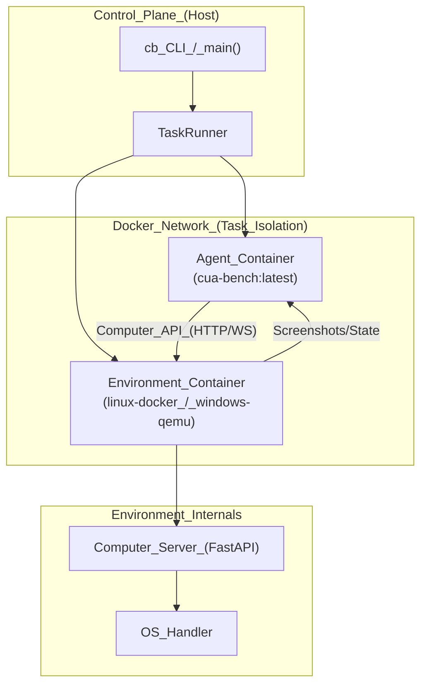
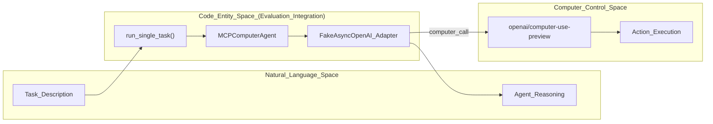
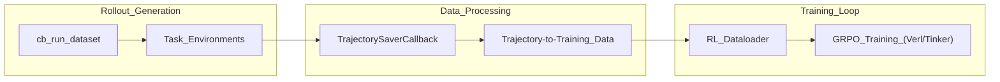

<!-- source: DeepWiki mcp.deepwiki.com · repo trycua/cua · page 11 Benchmarking and Evaluation · fetched 2026-10-29 -->

# Benchmarking and Evaluation

Relevant source files

The following files were used as context for generating this wiki page:

- [libs/cua-bench/.bumpversion.cfg](libs/cua-bench/.bumpversion.cfg)
- [libs/cua-bench/cua_bench/agents/base.py](libs/cua-bench/cua_bench/agents/base.py)
- [libs/cua-bench/cua_bench/cli/commands/run.py](libs/cua-bench/cua_bench/cli/commands/run.py)
- [libs/cua-bench/cua_bench/cli/main.py](libs/cua-bench/cua_bench/cli/main.py)
- [libs/cua-bench/cua_bench/environment.py](libs/cua-bench/cua_bench/environment.py)
- [libs/cua-bench/cua_bench/telemetry/README.md](libs/cua-bench/cua_bench/telemetry/README.md)
- [libs/cua-bench/cua_bench/telemetry/__init__.py](libs/cua-bench/cua_bench/telemetry/__init__.py)
- [libs/cua-bench/cua_bench/telemetry/events.py](libs/cua-bench/cua_bench/telemetry/events.py)
- [libs/cua-bench/pyproject.toml](libs/cua-bench/pyproject.toml)

This document covers the benchmarking and evaluation system for Computer-Use Agents (CUAs), focusing on the `cua-bench` framework, standardized benchmark integration (like OSWorld), and Reinforcement Learning (RL) evaluation workflows.

For information about the callback system used for trajectory recording, see [Callback System](#9.1). For details on budget management and cost tracking, see [Budget and Cost Management](#10.3).

## Overview

The Cua benchmarking system is built around the `cua-bench` toolkit, designed to provide verifiable, cross-platform environments for agent evaluation and training. It supports diverse platforms including Docker-based Linux containers, QEMU VMs (Windows, Linux, Android), and macOS via Lume.

**Core Components**:
- **cua-bench Framework**: A toolkit providing an `Environment` class with a gym-like interface (`make`, `reset`, `step`) for computer-use tasks [libs/cua-bench/pyproject.toml:4-17](), [libs/cua-bench/cua_bench/environment.py:44-95]().
- **Task Registry**: A collection of verifiable tasks with setup scripts, descriptions, and oracle solutions managed via the `cb` CLI [libs/cua-bench/cua_bench/cli/commands/run.py:1-13](), [libs/cua-bench/cua_bench/cli/main.py:147-150]().
- **Telemetry System**: Integrated tracking for task execution, success rates, and performance metrics via PostHog [libs/cua-bench/cua_bench/telemetry/events.py:1-25](), [libs/cua-bench/cua_bench/telemetry/README.md:1-29]().
- **RL Infrastructure**: Integration with training libraries like `torch` and `transformers` for GRPO and off-policy training workflows [libs/cua-bench/pyproject.toml:134-139]().

Sources: [libs/cua-bench/pyproject.toml:1-59](), [libs/cua-bench/cua_bench/environment.py:44-95](), [libs/cua-bench/cua_bench/telemetry/events.py:1-25](), [libs/cua-bench/cua_bench/telemetry/README.md:1-29]()

## cua-bench Framework

The `cua-bench` framework provides the infrastructure to run computer-use tasks in isolated environments. It utilizes a 2-container architecture where the **Agent** and the **Environment** run in separate, networked containers to ensure reproducibility and safety.

### System Architecture

**Key Framework Entities**:
- `TaskRunner`: Orchestrates the creation of Docker networks and containers for evaluation, managing CoW (Copy-on-Write) overlays to protect golden images [libs/cua-bench/cua_bench/runner/task_runner.py:79-111]().
- `Environment`: The primary abstraction for a task, handling `reset()` to clear session state and `create_sandbox()` to initialize providers [libs/cua-bench/cua_bench/environment.py:44-190]().
- `TaskResult`: Data structure capturing the success status, exit codes, and logs from both the agent and environment containers [libs/cua-bench/cua_bench/runner/task_runner.py:62-71]().
- `cb` CLI: The primary entry point for running tasks, datasets, and managing images [libs/cua-bench/cua_bench/cli/main.py:147-150]().

For details, see [cua-bench Framework](#11.1).

Sources: [libs/cua-bench/cua_bench/runner/task_runner.py:79-111](), [libs/cua-bench/cua_bench/environment.py:44-190](), [libs/cua-bench/cua_bench/cli/main.py:147-150](), [libs/cua-bench/cua_bench/runner/task_runner.py:62-71]()

## HUD Integration

Cua integrates with standardized evaluation interfaces to provide high-quality trajectory viewing and consistent agent testing.

### Message and Entity Mapping

The evaluation pipeline utilizes `BaseAgent` subclasses like `MCPComputerAgent` to bridge between task descriptions and environment actions [libs/cua-bench/cua_bench/agents/base.py:32-144](). It handles complex type conversions between external benchmark formats and the Cua Agent SDK's internal message formats. The `AgentResult` class tracks token consumption and failure modes such as `MAX_STEPS_EXCEEDED` or `API_ERROR` [libs/cua-bench/cua_bench/agents/base.py:23-30]().

For details, see [HUD Integration](#11.2).

Sources: [libs/cua-bench/cua_bench/agents/base.py:32-144](), [libs/cua-bench/cua_bench/agents/base.py:23-30](), [libs/cua-bench/pyproject.toml:83-86]()

## Benchmarks and Datasets

Cua-Bench includes a built-in registry of tasks and supports running large datasets in parallel.

### The Task Registry
The registry contains pre-built datasets. Each task consists of a setup script to initialize the environment, a test script to verify completion, and often an "oracle" reference solution.

| Command | Purpose |
|---------|---------|
| `cb run task <path>` | Execute a single task variant [libs/cua-bench/cua_bench/cli/commands/run.py:150-152]() |
| `cb run dataset <path>` | Execute a full dataset in parallel [libs/cua-bench/cua_bench/cli/commands/run.py:178-180]() |
| `cb run list` | List all previous runs and aggregated statistics [libs/cua-bench/cua_bench/cli/commands/run.py:65-67]() |

### Evaluation Telemetry
Every task execution is tracked using `track_task_execution_started` and `track_task_evaluation_completed`, capturing success rates, rewards, total steps, and duration [libs/cua-bench/cua_bench/telemetry/events.py:137-230](). Telemetry is routed through `cua-core`'s PostHog infrastructure [libs/cua-bench/cua_bench/telemetry/events.py:1-11]().

For details, see [OSWorld and Benchmarks](#11.3).

Sources: [libs/cua-bench/cua_bench/cli/commands/run.py:65-180](), [libs/cua-bench/cua_bench/telemetry/events.py:1-230]()

## RL Training with cua-bench

Beyond static evaluation, `cua-bench` serves as an infrastructure for Reinforcement Learning. It provides the necessary dependencies for training loops, including integration with `torch` and `transformers` [libs/cua-bench/pyproject.toml:134-139]().

### Training Data Pipeline

The system tracks token usage, costs, and success rewards to provide signals for RL optimization. The `cb run` command supports mounting local packages via the `--with` flag to test agent improvements in real-time [libs/cua-bench/cua_bench/cli/main.py:137-142](). Training runs can be monitored using `cb run watch` for live updates on rollout performance [libs/cua-bench/cua_bench/cli/commands/run.py:10]().

For details, see [RL Training with cua-bench](#11.4).

Sources: [libs/cua-bench/pyproject.toml:134-139](), [libs/cua-bench/cua_bench/cli/main.py:137-142](), [libs/cua-bench/cua_bench/cli/commands/run.py:10]()

## Bench UI and Evaluation Tooling

The `cua-bench-ui` package provides a graphical user interface for interacting with and visualizing `cua-bench` runs. This UI, typically built with `pywebview`, offers a more interactive way to monitor agent performance, review trajectories, and debug issues compared to the command-line interface.

Beyond the UI, `cua-bench` includes various supporting evaluation scripts and adapters. These tools facilitate integration with external systems and specific task types, such as the KiCad task example for electronic design automation or the WinArena adapter for Windows-specific benchmarks. The `cua-train` client is also part of this tooling, enabling interaction with the Cua Cloud RL API for managing and submitting training jobs.

For details, see [Bench UI and Evaluation Tooling](#11.5).

Sources: [libs/cua-bench/pyproject.toml:147-149]()

## cua-bench-s1: GUI Decision Benchmark

`libs/cua-bench-s1` introduces a specialized benchmark for closed-option GUI decision-making, known as CUA-S1. This benchmark is designed to evaluate an agent's ability to make precise decisions within a graphical user interface based on a limited set of predefined options.

The core of `cua-bench-s1` is the `CuaTask` schema, which defines the structure of a task, including the initial state, available options, and the expected outcome. Agents are evaluated based on their ability to select one of six defined action types. The benchmark also incorporates dataset content hashing for integrity, supports both text and multimodal evaluation runs, and includes chance-level calibration to establish baseline performance. Baselines like `jev`, `djev`, and `semif` are provided, along with published results for CUA-S1 checkpoints, offering a comprehensive framework for assessing GUI decision-making capabilities.

For details, see [cua-bench-s1: GUI Decision Benchmark](#11.6).

Sources: [libs/cua-bench/pyproject.toml:10-17]()

---

