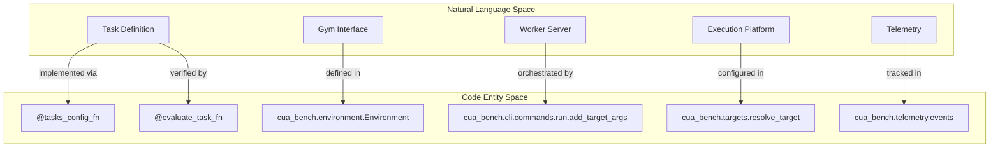
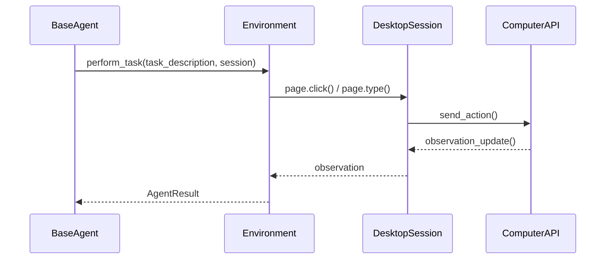

<!-- source: DeepWiki mcp.deepwiki.com · repo trycua/cua · page 11.1 cua-bench Framework · fetched 2026-10-29 -->

# cua-bench Framework

Relevant source files

The following files were used as context for generating this wiki page:

- [libs/cua-bench/.bumpversion.cfg](libs/cua-bench/.bumpversion.cfg)
- [libs/cua-bench/cua_bench/agents/base.py](libs/cua-bench/cua_bench/agents/base.py)
- [libs/cua-bench/cua_bench/cli/commands/run.py](libs/cua-bench/cua_bench/cli/commands/run.py)
- [libs/cua-bench/cua_bench/cli/main.py](libs/cua-bench/cua_bench/cli/main.py)
- [libs/cua-bench/cua_bench/environment.py](libs/cua-bench/cua_bench/environment.py)
- [libs/cua-bench/cua_bench/telemetry/README.md](libs/cua-bench/cua_bench/telemetry/README.md)
- [libs/cua-bench/cua_bench/telemetry/__init__.py](libs/cua-bench/cua_bench/telemetry/__init__.py)
- [libs/cua-bench/cua_bench/telemetry/events.py](libs/cua-bench/cua_bench/telemetry/events.py)
- [libs/cua-bench/pyproject.toml](libs/cua-bench/pyproject.toml)

`cua-bench` is a toolkit for building and evaluating computer-use agents in verifiable, cross-platform reinforcement learning (RL) environments. It provides a standardized interface for interacting with various operating systems (Windows, Linux, macOS, Android) through a Gym-like API, enabling automated evaluation, trajectory collection, and RL training.

Sources: [libs/cua-bench/pyproject.toml:1-58](), [libs/cua-bench/cua_bench/cli/main.py:72-74]()

## Architecture Overview

The framework operates on a multi-layered architecture that separates task definitions, environment execution, and agent logic. It uses a **2-container architecture** where the agent and the environment run in separate isolated containers communicating over a Docker network.

### Core Components
*   **Environment Class**: Implements the standard `make()`, `reset()`, `step()`, and `evaluate()` interface. [libs/cua-bench/cua_bench/environment.py:44-95]()
*   **Task Runner**: Orchestrates the lifecycle of the 2-container setup, including network creation and overlay management. [libs/cua-bench/cua_bench/cli/commands/run.py:171-172]()
*   **App Registry**: A decorator-based system for registering platform-specific application installers and launchers used within tasks.
*   **Worker Manager**: Distributed execution model that handles parallel task runs across multiple Docker containers, managed via the `run dataset` command. [libs/cua-bench/cua_bench/cli/commands/run.py:6-12]()

### Code Entity Mapping: NL to Code

This diagram maps high-level conceptual components to their specific implementation classes and file locations.

**Entity Relationship Diagram**

Sources: [libs/cua-bench/cua_bench/environment.py:72-83](), [libs/cua-bench/cua_bench/cli/commands/run.py:60-124](), [libs/cua-bench/cua_bench/telemetry/events.py:1-25](), [libs/cua-bench/cua_bench/targets.py:1-50]()

---

## The Gym Interface

`cua-bench` exposes a standardized API for agents to interact with computer environments, mirroring the OpenAI Gym pattern.

### Key Methods
*   **`make_from_module(module, env_path)`**: Initializes the environment by discovering decorated functions within a task module. [libs/cua-bench/cua_bench/environment.py:104-139]()
*   **`reset()`**: Restores the environment to its initial state, typically involving fresh sandbox creation and task setup. [libs/cua-bench/cua_bench/environment.py:197-206]()
*   **`step(action)`**: Executes a `Action` (click, type, etc.) via the `bot` and returns the new observation. [libs/cua-bench/cua_bench/environment.py:59-61]()
*   **`evaluate()`**: Invokes the task-specific evaluation logic to return a reward signal. [libs/cua-bench/cua_bench/environment.py:75-83]()

### Action and Observation Flow
The flow of data between the agent and the environment is mediated by the `Environment` class and the `DesktopSession`.

**Action/Observation Sequence**

Sources: [libs/cua-bench/cua_bench/agents/base.py:124-144](), [libs/cua-bench/cua_bench/environment.py:184-191](), [libs/cua-bench/cua_bench/computers.py:1-10]()

---

## Task Lifecycle and Variants

Each task in `cua-bench` follows a strict lifecycle:
1.  **Configuration**: Defined via `@tasks_config_fn`, providing task metadata and variant parameters. [libs/cua-bench/cua_bench/environment.py:86]()
2.  **Setup**: The `reset()` phase where `DesktopSession` is initialized inside the sandbox. [libs/cua-bench/cua_bench/environment.py:197-206]()
3.  **Solution**: The agent executes actions against the `step()` interface. [libs/cua-bench/cua_bench/environment.py:59-61]()
4.  **Evaluation**: Defined via `@evaluate_task_fn`, checking the final state of the filesystem, UI, or process list to calculate a reward. [libs/cua-bench/cua_bench/environment.py:89]()

The **Variant System** allows a single task definition to spawn multiple instances with different initial conditions (e.g., different file names, URLs, or starting applications), indexed by `variant_id`. [libs/cua-bench/cua_bench/cli/commands/run.py:155-160]()

Sources: [libs/cua-bench/cua_bench/environment.py:44-95](), [libs/cua-bench/cua_bench/cli/commands/run.py:150-160]()

---

## Worker Infrastructure

For parallel RL training and large-scale benchmarking, `cua-bench` uses a distributed worker model. The `server` optional dependency, which previously contained the environment worker server, has been moved to the `cua-bench-rl` package. [libs/cua-bench/pyproject.toml:94-96]()

### Worker Management
The `cb run` command handles the orchestration of sandboxes for task execution.
1.  **Isolation**: Each task variant gets a `cua-sandbox` sandbox. [libs/cua-bench/cua_bench/cli/commands/run.py:9-12]()
2.  **Resource Allocation**: Configurable CPU and memory per sandbox. [libs/cua-bench/cua_bench/cli/commands/run.py:98-99]()
3.  **Cloud Integration**: Supports running sandboxes on local machines or in the cloud via Fleet. [libs/cua-bench/cua_bench/cli/commands/run.py:68-75]()

### RL Training Integration
The framework includes specific support for RL training via the `rl` optional dependency, which has also been moved to the `cua-bench-rl` package. [libs/cua-bench/pyproject.toml:150-152]()

Sources: [libs/cua-bench/cua_bench/cli/commands/run.py:9-12](), [libs/cua-bench/cua_bench/cli/commands/run.py:68-75](), [libs/cua-bench/pyproject.toml:94-96](), [libs/cua-bench/pyproject.toml:150-152]()

---

## The `cb` CLI

The `cb` (or `cua-bench`) command-line interface is the primary entry point for interacting with the framework.

### Core Commands

| Command | Purpose | Implementation |
| :--- | :--- | :--- |
| `cb run task` | Executes a single task variant with an agent or oracle. | [libs/cua-bench/cua_bench/cli/commands/run.py:6-12]() |
| `cb run dataset` | Runs an entire dataset in parallel across multiple workers. | [libs/cua-bench/cua_bench/cli/commands/run.py:6-12]() |
| `cb run list` | Lists all previous and current runs with aggregated statistics. | [libs/cua-bench/cua_bench/cli/commands/run.py:6-12]() |
| `cb image` | Manages base images (e.g., `linux`, `windows`, `macos`). | [libs/cua-bench/cua_bench/cli/main.py:14]() |
| `cb trace` | Manages and views agent execution trajectories. | [libs/cua-bench/cua_bench/cli/main.py:21]() |
| `cb interact` | Launch an interactive session with a sandbox. | [libs/cua-bench/cua_bench/cli/main.py:15]() |
| `cb platform` | Provides information about supported platforms and their capabilities. | [libs/cua-bench/cua_bench/cli/main.py:17]() |

### Command Execution Flow
When a user runs `cb run task`, the CLI parses arguments and hands off to the `run` command handler.

**CLI Command Flow**

```mermaid
graph LR
    subgraph "CLI Layer"
        CLI["main:main()"] --> NORMALIZE["main:normalize_argv()"]
        NORMALIZE --> PARSE["main:build_parser().parse_args()"]
        PARSE --> DISPATCH["main:main() command dispatch"]
    end

    subgraph "Run Command"
        DISPATCH -- "command == 'run'" --> RUN_CMD["commands/run:cmd_run()"]
        RUN_CMD --> TARGET_RES["commands/run:target_from_args()"]
        TARGET_RES --> RESOLVE_TARGET["targets:resolve_target()"]
    end

    subgraph "Sandbox Orchestration"
        RESOLVE_TARGET --> OPEN_SANDBOX["sandboxes:open_sandbox()"]
        OPEN_SANDBOX --> DESKTOP_SESSION["computers:get_session()"]
    end
```

Sources: [libs/cua-bench/cua_bench/cli/main.py:96-107](), [libs/cua-bench/cua_bench/cli/main.py:82-95](), [libs/cua-bench/cua_bench/cli/commands/run.py:149-164](), [libs/cua-bench/cua_bench/targets.py:1-50](), [libs/cua-bench/cua_bench/sandboxes.py:1-50](), [libs/cua-bench/cua_bench/computers.py:1-10]()

---

## Platform Support and Images

`cua-bench` supports multiple execution platforms, each with specialized setup scripts for the `computer-server`:

*   **Linux Container**: Uses `cua-sandbox` to provision containers. [libs/cua-bench/pyproject.toml:51]()
*   **Windows/macOS/Android VMs**: Utilizes `cua-sandbox` for VM management. [libs/cua-bench/pyproject.toml:51]()

The `target_from_args` function [libs/cua-bench/cua_bench/cli/commands/run.py:149-164]() resolves the execution target based on CLI arguments like `--on`, `--kind`, and `--runtime`. This determines whether a local container (e.g., `gvisor`, `runc`), local VM (e.g., `qemu`, `lume`), or cloud-based sandbox (e.g., Fleet) is used. The `--image` argument allows specifying an OS alias (e.g., `linux`, `windows`, `macos:tahoe`), a registry reference, or a Fleet pool name. [libs/cua-bench/cua_bench/cli/commands/run.py:92-96]()

Sources: [libs/cua-bench/cua_bench/cli/commands/run.py:60-124](), [libs/cua-bench/cua_bench/cli/commands/run.py:149-164](), [libs/cua-bench/pyproject.toml:51]()

---

## Telemetry and Monitoring

The framework includes a built-in telemetry system to track task performance and CLI usage.

*   **Events**: Tracks `cb_command_invoked`, `cb_task_execution_started`, and `cb_task_evaluation_completed`. [libs/cua-bench/cua_bench/telemetry/events.py:47-65]()
*   **Anonymity**: Collects anonymous usage statistics (OS version, Python version) while excluding sensitive data like API keys or screenshots. [libs/cua-bench/cua_bench/telemetry/README.md:1-38]()
*   **Opt-out**: Can be disabled by setting `CUA_TELEMETRY=0` or `DO_NOT_TRACK=1`. [libs/cua-bench/cua_bench/telemetry/README.md:9-10]()
*   **Availability**: Telemetry is conditionally imported and used, ensuring the framework functions even if telemetry dependencies are not installed. [libs/cua-bench/cua_bench/cli/main.py:24-33](), [libs/cua-bench/cua_bench/environment.py:18-27]()

Sources: [libs/cua-bench/cua_bench/telemetry/events.py:1-221](), [libs/cua-bench/cua_bench/telemetry/README.md:1-73](), [libs/cua-bench/cua_bench/cli/main.py:24-33](), [libs/cua-bench/cua_bench/environment.py:18-27]()

---

