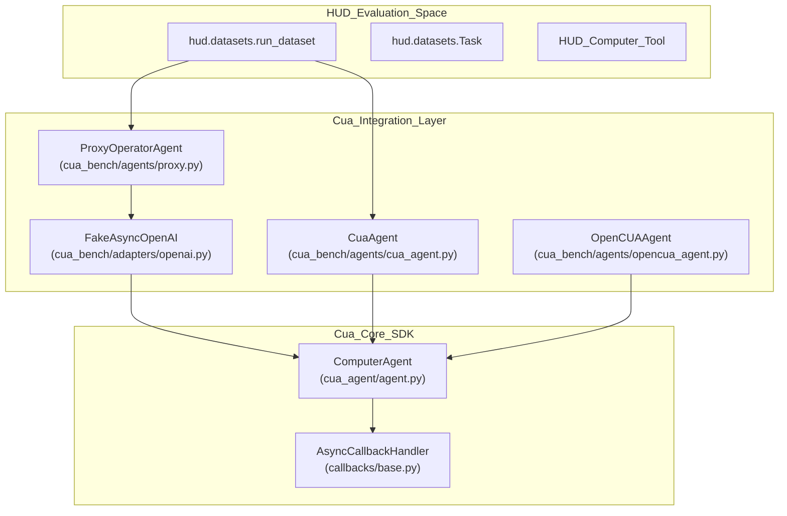
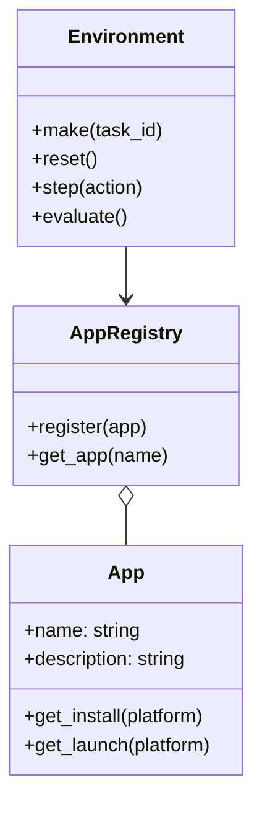

<!-- source: DeepWiki mcp.deepwiki.com · repo trycua/cua · page 11.2 HUD Integration · fetched 2026-10-29 -->

# HUD Integration

<details>
<summary>Relevant source files</summary>

The following files were used as context for generating this wiki page:

- [Makefile](Makefile)
- [libs/python/agent/.bumpversion.cfg](libs/python/agent/.bumpversion.cfg)
- [libs/python/agent/README.md](libs/python/agent/README.md)
- [libs/python/agent/pyproject.toml](libs/python/agent/pyproject.toml)
- [libs/python/core/.bumpversion.cfg](libs/python/core/.bumpversion.cfg)
- [libs/python/core/README.md](libs/python/core/README.md)
- [libs/python/core/pyproject.toml](libs/python/core/pyproject.toml)
- [libs/python/som/.bumpversion.cfg](libs/python/som/.bumpversion.cfg)
- [libs/python/som/README.md](libs/python/som/README.md)
- [libs/python/som/pyproject.toml](libs/python/som/pyproject.toml)

</details>


The HUD integration enables benchmarking and evaluation of Cua's `ComputerAgent` using the [HUD framework](https://www.hud.ai/). This integration allows agents to be tested against standardized datasets like **OSWorld-Verified**, providing automated scoring, trajectory logging, and parallel execution through specialized adapters like `ProxyOperatorAgent`, `FakeAsyncOpenAI`, and MCP type conversions.

## Architecture Overview

The integration architecture bridges the HUD evaluation environment with the Cua Agent SDK. It primarily utilizes adapter patterns to map HUD's internal environment control to Cua's `ComputerAgent` tool definitions.

### Integration Data Flow



**Architecture Overview**
Sources: [libs/python/agent/pyproject.toml:1-133]()

## Computer Session Wrapping

The integration wraps HUD's desktop session into a computer-handler dictionary compatible with `ComputerAgent`. This shim allows the agent to control the HUD environment by translating Cua tool calls into HUD-specific `Action` types.

### Implementation in `CuaAgent` and `OpenCUAAgent`

Both `CuaAgent` and `OpenCUAAgent` implement a `_create_custom_computer` method that maps Cua-style tool calls to HUD's `DesktopSession` execution logic.

```python
# Implementation detail from CuaAgent
def _create_custom_computer(self, session: "DesktopSession") -> Dict[str, Any]:
    from ..types import ClickAction, TypeAction, ScrollAction # HUD types

    async def screenshot():
        screenshot_bytes = await session.screenshot()
        return base64.b64encode(screenshot_bytes).decode("utf-8")

    async def click(x: int, y: int, button: str = "left"):
        if button == "left":
            action = ClickAction(x=x, y=y)
        # ... mapping logic
        await session.execute_action(action)

    return {
        "screenshot": screenshot,
        "click": click,
        "type": type_text,
        "keypress": keypress,
    }
```

Sources: [libs/python/agent/pyproject.toml:83-86]()

## Agent Performance and Retries

The integration includes logic to handle transient API errors during evaluation. The `_is_retryable_api_error` function identifies exceptions from `litellm` (e.g., `RateLimitError`, `ServiceUnavailableError`) to determine if a task step should be retried. `litellm` is a core dependency of `cua-agent`.

| Error Type | Source | Retryable |
| :--- | :--- | :--- |
| `asyncio.TimeoutError` | Python Stdlib | Yes |
| `RateLimitError` | `litellm.exceptions` | Yes |
| `InternalServerError` | `litellm.exceptions` | Yes |
| Connection Timeout | String match ("timeout") | Yes |

Sources: [libs/python/agent/pyproject.toml:24-24]()

## Dataset Evaluation Functions

Cua provides high-level utilities in `cua-bench` to run benchmarks at scale, supporting parallel execution and detailed result reporting.

### Run Command and Monitoring
The `cb run` command is the primary entry point for executing benchmark tasks. It supports both single tasks and full datasets.

| Subcommand | Functionality |
| :--- | :--- |
| `cb run task <path>` | Execute a single task using a 2-container setup. |
| `cb run dataset <path>` | Execute an entire dataset with parallel containers. |
| `cb run list` | List all runs with aggregated statistics (reward, status). |
| `cb run watch <id>` | Provide live updates for a running evaluation. |

Sources: [libs/python/agent/pyproject.toml:1-133]()

### Evaluation Metrics
During evaluation, `cua-bench` tracks session statuses and rewards. The `DockerProvider` is used to retrieve logs and extract evaluation results, typically formatted as `✓ Evaluation result: [reward]`.

Sources: [libs/python/agent/pyproject.toml:1-133]()

## Application Registry and Instrumentation

To support complex benchmarks, `cua-bench` includes an application registry that defines how to install and launch software within the evaluation environment.

### App Registry Pattern
The registry system handles platform-specific logic and environment setup for benchmark targets.



**Benchmarking Entity Relationships**
Sources: [libs/python/agent/pyproject.toml:1-133]()

## Setup and Configuration

### Installation
The benchmarking suite requires `cua-agent` with the `hud` optional dependency.

```bash
# Install cua-agent with HUD integration
pip install "cua-agent[hud]"
```

Sources: [libs/python/agent/pyproject.toml:83-86]()

### Environment and Runtime
The integration supports multiple execution backends, including Docker and Cloud providers, to provide isolated environments for benchmarks.

| Component | Role |
| :--- | :--- |
| `DockerProvider` | Manages local container lifecycles and log extraction. |
| `cua-computer` | Provides the underlying CUI framework for agent interaction. |
| `cua-agent` | The core agent logic being evaluated. |
| `fastmcp` | Used for MCP server and type conversions in HUD contexts. |

Sources: [libs/python/agent/pyproject.toml:83-86]()

---

