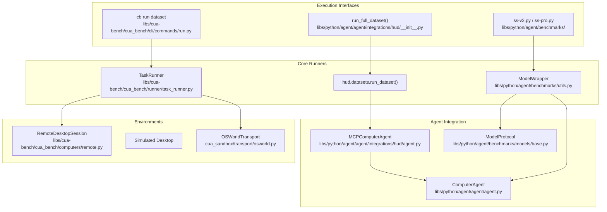
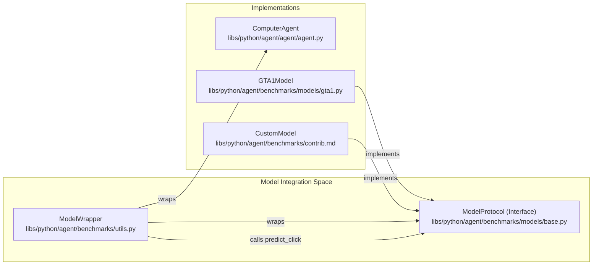

<!-- source: DeepWiki mcp.deepwiki.com · repo trycua/cua · page 11.3 OSWorld and Benchmarks · fetched 2026-10-29 -->

# OSWorld and Benchmarks

<details>
<summary>Relevant source files</summary>

The following files were used as context for generating this wiki page:

- [docs/content/docs/cua-sdk/reference/runtime-support.mdx](docs/content/docs/cua-sdk/reference/runtime-support.mdx)
- [libs/cua-bench/cua_bench/images.py](libs/cua-bench/cua_bench/images.py)
- [libs/images/bench/osworld/evidence/containerdisk-local-amd64-capabilities.json](libs/images/bench/osworld/evidence/containerdisk-local-amd64-capabilities.json)
- [libs/images/bench/osworld/evidence/containerdisk-local-amd64-doctor.json](libs/images/bench/osworld/evidence/containerdisk-local-amd64-doctor.json)
- [libs/images/bench/osworld/evidence/containerdisk-local-amd64.json](libs/images/bench/osworld/evidence/containerdisk-local-amd64.json)
- [libs/images/bench/osworld/evidence/rootfs-local-amd64-capabilities.json](libs/images/bench/osworld/evidence/rootfs-local-amd64-capabilities.json)
- [libs/images/bench/osworld/evidence/rootfs-local-amd64-doctor.json](libs/images/bench/osworld/evidence/rootfs-local-amd64-doctor.json)
- [libs/images/bench/osworld/evidence/rootfs-local-amd64.json](libs/images/bench/osworld/evidence/rootfs-local-amd64.json)
- [libs/images/bench/osworld/lock.json](libs/images/bench/osworld/lock.json)
- [libs/python/cua-sandbox/CHANGELOG.md](libs/python/cua-sandbox/CHANGELOG.md)
- [libs/python/cua-sandbox/README.md](libs/python/cua-sandbox/README.md)
- [libs/python/cua-sandbox/VERSION](libs/python/cua-sandbox/VERSION)
- [libs/python/cua-sandbox/cua_sandbox/__init__.py](libs/python/cua-sandbox/cua_sandbox/__init__.py)
- [libs/python/cua-sandbox/cua_sandbox/pool.py](libs/python/cua-sandbox/cua_sandbox/pool.py)
- [libs/python/cua-sandbox/cua_sandbox/sandbox.py](libs/python/cua-sandbox/cua_sandbox/sandbox.py)
- [libs/python/cua-sandbox/cua_sandbox/sync/__init__.py](libs/python/cua-sandbox/cua_sandbox/sync/__init__.py)
- [libs/python/cua-sandbox/cua_sandbox/transport/fleet.py](libs/python/cua-sandbox/cua_sandbox/transport/fleet.py)
- [libs/python/cua-sandbox/cua_sandbox/transport/fleet_cloud.py](libs/python/cua-sandbox/cua_sandbox/transport/fleet_cloud.py)
- [libs/python/cua-sandbox/pyproject.toml](libs/python/cua-sandbox/pyproject.toml)
- [libs/python/cua-sandbox/tests/test_fleet_cloud_client.py](libs/python/cua-sandbox/tests/test_fleet_cloud_client.py)
- [libs/python/cua-sandbox/tests/test_fleet_cloud_transport.py](libs/python/cua-sandbox/tests/test_fleet_cloud_transport.py)
- [libs/python/cua-sandbox/tests/test_fleet_sdk_distribution.py](libs/python/cua-sandbox/tests/test_fleet_sdk_distribution.py)
- [libs/python/cua-sandbox/tests/test_fleet_sdk_packaging.py](libs/python/cua-sandbox/tests/test_fleet_sdk_packaging.py)
- [libs/python/cua-sandbox/tests/test_fleet_transport.py](libs/python/cua-sandbox/tests/test_fleet_transport.py)
- [libs/python/cua-sandbox/tests/test_pool.py](libs/python/cua-sandbox/tests/test_pool.py)
- [libs/python/cua-sandbox/tests/test_sandbox_fleet_lifecycle.py](libs/python/cua-sandbox/tests/test_sandbox_fleet_lifecycle.py)
- [libs/python/cua-sandbox/tests/test_vm_cleanup.py](libs/python/cua-sandbox/tests/test_vm_cleanup.py)
- [libs/python/cua-sandbox/uv.lock](libs/python/cua-sandbox/uv.lock)

</details>


This page documents running benchmarks on the OSWorld-Verified dataset using the HUD framework integration and the `cua-bench` framework. It covers the dataset structure, benchmark execution functions, model selection, and result interpretation.

## Purpose and Scope

OSWorld-Verified is a curated subset of real-world desktop tasks spanning Chrome, LibreOffice, GIMP, VS Code, and other applications. The Cua framework provides two main pathways for benchmarking:

1.  **HUD Integration**: High-level functions for running the OSWorld-Verified dataset via the HUD evaluation framework.
2.  **cua-bench Framework**: A toolkit for computer-use RL environments and benchmarks, providing CLI tools for task and dataset execution in isolated Docker containers [libs/python/cua-sandbox/pyproject.toml:1-17]().
3.  **Grounding Benchmarks**: Specialized scripts in `libs/python/agent/benchmarks/` for evaluating visual grounding (click prediction) accuracy on datasets like ScreenSpot.

Sources: [libs/python/cua-sandbox/pyproject.toml:1-17]()

## OSWorld-Verified Dataset

The OSWorld-Verified dataset is hosted on HuggingFace (`hud-evals/OSWorld-Verified`). Each task contains a prompt, setup script, and verification script to calculate a success reward (0.0-1.0).

| Field | Type | Description |
| :--- | :--- | :--- |
| `id` | int | Unique task identifier |
| `prompt` | str | Task description for the agent |
| `environment` | str | OS environment (typically "linux") |
| `setup_script` | str | Script to prepare the environment |
| `verification_script` | str | Script to check task completion |
| `reward_function` | callable | Function that calculates success (0.0-1.0) |

## Benchmark Execution Architecture



**Diagram: OSWorld and Grounding Benchmark Execution Flow**

The system supports multiple execution paths. The `cua-bench` path focuses on containerized RL environments using `RemoteDesktopSession`, while the grounding benchmarks evaluate visual precision using `ModelWrapper`. The OSWorld environment can be run locally via QEMU or on Fleet, communicating via its Flask server [libs/python/cua-sandbox/cua_sandbox/transport/osworld.py:1-9]().

Sources: [libs/python/cua-sandbox/cua_sandbox/transport/osworld.py:1-9]()

## cua-bench: Task and Dataset Runner

The `cua-bench` package provides the `cb` CLI for executing tasks. It uses a 2-container architecture where the agent and environment communicate via a Docker network.

### Key Commands

- `cb run task <path>`: Executes a single task variant.
- `cb run dataset <path>`: Executes an entire dataset in parallel.
- `cb run list`: Lists all runs with status and rewards.
- `cb interact <path>`: Runs a task interactively with a visible browser/VNC.

### Task Runner Configuration
The `TaskRunner` orchestrates the lifecycle of environment and agent containers. It supports several environment types:
- **linux-docker**: Stateless container execution.
- **QEMU-based VMs**: `linux-qemu`, `windows-qemu`, and `android-qemu` using QCOW2 overlays via `_create_task_overlay` to protect the golden image.

### Environment Lifecycle
The `Environment` class handles the gym-like interface for benchmarks.
- `reset()`: Closes existing sessions, resets step counters, and prepares the task setup.
- `create_sandbox()`: Initializes the `DesktopSession` provider (e.g., `webtop`).

Sources: [libs/python/cua-sandbox/cua_sandbox/sandbox.py:1-45]()

## OSWorld Transport and Fleet-Hosted OSWorld Runs

The `cua-sandbox` library provides specific support for OSWorld environments, both locally via QEMU and on Fleet. The `cua-sandbox` package itself is defined in [libs/python/cua-sandbox/pyproject.toml:1-17]().

### OSWorld Image Preparation
The `BENCH_OSWORLD` image is specifically designed for OSWorld-Verified desktop tasks [libs/cua-bench/cua_bench/images.py:33-37](). This image is pinned to a specific digest, e.g., `ghcr.io/trycua/bench-osworld@sha256:e55cf3a314793f89be7efbffdc043aab29bf85990c6213a9ebbb204825504439` [libs/cua-bench/cua_bench/images.py:37](). The image is built from `libs/images/bench/osworld/lock.json`.

To run OSWorld on Fleet, the official OSWorld Ubuntu disk needs to be augmented with the Cua Driver MCP server. This involves:
1.  Downloading the base OSWorld Ubuntu QCOW2 image.
2.  Adding the Cua Driver and its dependencies (like `supergateway`, `netplan`, `udev` rules) to the image using `virt-customize` within a Docker helper container.
3.  Publishing the modified QCOW2 as an OCI containerDisk to a registry.

### `Image` Configuration for OSWorld
When creating a `cua_sandbox.Image` for OSWorld, the `agent_type="osworld"` parameter is crucial. This tells the `Sandbox` to expect the OSWorld Flask server on port 5000 instead of the default `computer-server` on port 8000.

The `expose()` calls ensure that necessary ports for the OSWorld server (5000), Cua Driver MCP (3000), VLC (8080), and Chrome CDP (9222) are mapped and accessible.

### OSWorld Transport Implementation
The `OSWorldOverServiceMixin` is used by `FleetCloudTransport` to handle OSWorld-specific service requests [libs/python/cua-sandbox/cua_sandbox/transport/fleet_cloud.py:26](). This mixin allows routing OSWorld Flask API calls (e.g., for screenshots, screen size, command execution) through the Fleet service proxy. The `OSWORLD_SERVER_PORT` is defined as 5000 [libs/python/cua-sandbox/cua_sandbox/transport/osworld.py:10]().

```mermaid
graph TD
    A[Sandbox.create(Image.osworld(), ...)] --> B{FleetCloudTransport}
    B -- "Uses OSWorldOverServiceMixin" --> C[OSWorld Flask Server (Guest VM)]
    C -- "API Calls (e.g., /screenshot)" --> D[OSWorldTransport]
    D -- "Routes via Fleet Gateway" --> B
    B -- "Handles OSWorld_SERVER_PORT (5000)" --> C
```
**Diagram: OSWorld Transport Flow in Fleet**

The `FleetCloudTransport` is responsible for creating and managing sandboxes on the Fleet infrastructure [libs/python/cua-sandbox/cua_sandbox/transport/fleet_cloud.py:1-189](). It constructs `CreateTemplateRequest` and `CreatePoolRequest` objects for Fleet [libs/python/cua-sandbox/tests/test_fleet_cloud_transport.py:58-75](). The `VmTemplateBuilder` is used to define the VM configuration, including the `container_disk_image` and exposed services [libs/python/cua-sandbox/tests/test_fleet_cloud_transport.py:40-46](). For Windows images, it sets the firmware to `Firmware.EFI` [libs/python/cua-sandbox/tests/test_fleet_cloud_transport.py:113-116]().

The `FleetTransport` class handles the communication with a bound Fleet claim. It routes named services through the Fleet gateway using `CyclopsClient.service_request` and computer interfaces (like `screen`, `mouse`, `shell`) to `cua-spacesd` on the claim's `env` service [libs/python/cua-sandbox/cua_sandbox/transport/fleet.py:1-13](). The `OSWORLD_SERVICE` is defined as "server" for legacy adapter compatibility [libs/python/cua-sandbox/cua_sandbox/transport/fleet.py:30]().

### Running OSWorld Tasks
The `3_osworld_fleet.py` sample script demonstrates claiming an OSWorld image, taking a screenshot via the OSWorld server, and then interacting with the Cua Driver MCP endpoint baked into the image.
- It uses `Sandbox.ephemeral` to create and manage the sandbox lifecycle [libs/python/cua-sandbox/cua_sandbox/sandbox.py:30-31]().
- The script interacts with the OSWorld server via `sb.get_dimensions()`, `sb.shell.run()`, and `sb.screenshot()`.
- It also shows how to interact with the Cua Driver MCP server running inside the OSWorld VM via a custom `Mcp` client, demonstrating calls like `initialize`, `tools/list`, `get_screen_size`, `list_apps`, `launch_app`, and `list_windows`.

Sources: [libs/cua-bench/cua_bench/images.py:33-37](), [libs/images/bench/osworld/lock.json](), [libs/python/cua-sandbox/cua_sandbox/transport/fleet_cloud.py:26](), [libs/python/cua-sandbox/cua_sandbox/transport/osworld.py:10](), [libs/python/cua-sandbox/cua_sandbox/transport/fleet_cloud.py:1-189](), [libs/python/cua-sandbox/tests/test_fleet_cloud_transport.py:58-75](), [libs/python/cua-sandbox/tests/test_fleet_cloud_transport.py:40-46](), [libs/python/cua-sandbox/tests/test_fleet_cloud_transport.py:113-116](), [libs/python/cua-sandbox/cua_sandbox/transport/fleet.py:1-13](), [libs/python/cua-sandbox/cua_sandbox/transport/fleet.py:30](), [libs/python/cua-sandbox/cua_sandbox/sandbox.py:30-31]()

## Grounding Benchmarks (ScreenSpot)

Grounding benchmarks measure a model's ability to map a natural language instruction to precise pixel coordinates on a screenshot.

### Model Selection and Wrapper
The `ModelWrapper` class in `libs/python/agent/benchmarks/utils.py` provides a unified interface for both `ComputerAgent` strings (e.g., `openai/computer-use-preview`) and custom local models.

- **Loading**: `load_model()` initializes the `ComputerAgent` or custom `ModelProtocol` implementation.
- **Prediction**: `predict_click()` handles image conversion to base64 and coordinate extraction.

### Benchmark Scripts
- **ScreenSpot-v2 (`ss-v2.py`)**: Standard GUI grounding benchmark. It converts `[x, y, w, h]` bounding boxes from the dataset to `[x1, y1, x2, y2]` for evaluation.
- **ScreenSpot-Pro (`ss-pro.py`)**: High-resolution grounding benchmark evaluating models on `lmms-lab/ScreenSpot-Pro`.
- **Interactive Testing (`interactive.py`)**: Allows real-time testing by taking live screenshots and visualizing model predictions with crosshairs.

### Contributing Custom Models
To add a new model for benchmarking, developers must implement the `ModelProtocol`. This involves defining `load_model`, `unload_model`, and `predict_click`. The model is then registered in `utils.py` via `get_available_models()`.



**Diagram: Model Integration for Benchmarking**

## Result Interpretation and Telemetry

### Metrics
Benchmark scripts calculate the following metrics:
- **Accuracy**: Calculated via `is_click_in_bbox`, checking if the predicted `(x, y)` falls within the ground truth `[x1, y1, x2, y2]`.
- **Prediction Time**: Tracked using `time.time()` around the `predict_click` call to determine avg, median, min, and max latency.
- **VRAM Usage**: Monitored via `torch.cuda` or `nvidia-smi` to track `vram_max_mb` and `vram_avg_mb`.

### Telemetry Tracking
`cua-bench` integrates with `cua-core` telemetry to track benchmark progress.
- `track_task_execution_started`: Logs when a task begins, including model and provider info.
- `track_task_evaluation_completed`: Logs final rewards, step counts, and duration.
- `track_batch_job_started`: Tracks parallel dataset execution metrics.

### Output Formats
- **Markdown Reports**: Detailed tables saved as `*_results.md` containing sample IDs, instructions, and correctness.
- **Visualizations**: Annotated screenshots in the `output/` directory showing the target box vs. the model's predicted point.

---

