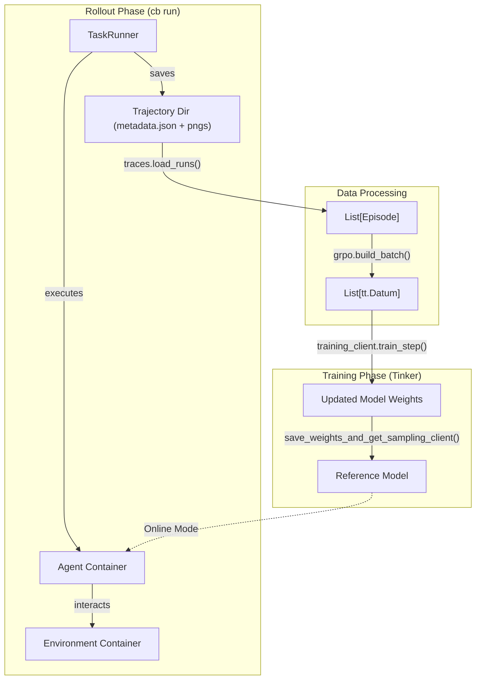
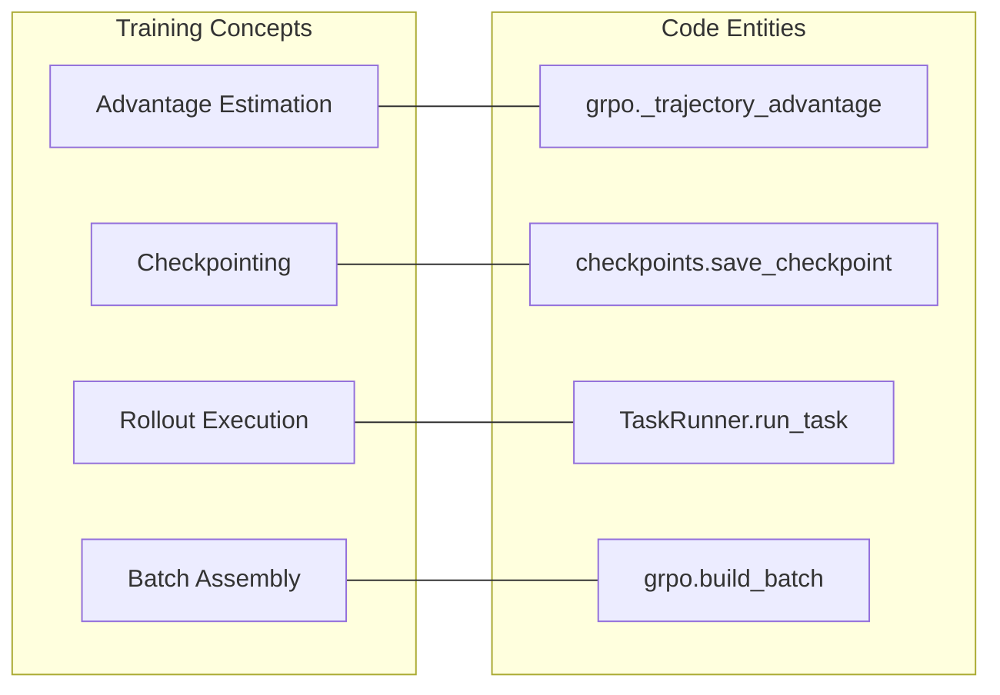
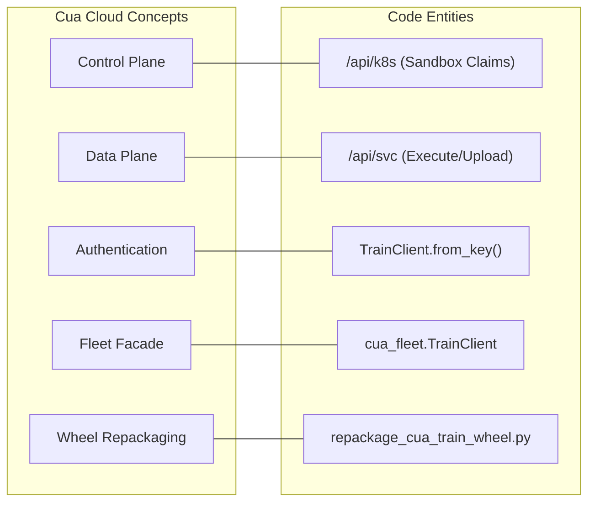

<!-- source: DeepWiki mcp.deepwiki.com · repo trycua/cua · page 11.4 RL Training with cua-bench · fetched 2026-10-29 -->

# RL Training with cua-bench

<details>
<summary>Relevant source files</summary>

The following files were used as context for generating this wiki page:

- [examples/streaming/typescript-node/package-lock.json](examples/streaming/typescript-node/package-lock.json)
- [examples/streaming/typescript-web/package-lock.json](examples/streaming/typescript-web/package-lock.json)
- [libs/cua-bench-rl/uv.lock](libs/cua-bench-rl/uv.lock)
- [libs/cua-bench/.bumpversion.cfg](libs/cua-bench/.bumpversion.cfg)
- [libs/cua-bench/cua_bench/agents/base.py](libs/cua-bench/cua_bench/agents/base.py)
- [libs/cua-bench/cua_bench/cli/commands/run.py](libs/cua-bench/cua_bench/cli/commands/run.py)
- [libs/cua-bench/cua_bench/cli/main.py](libs/cua-bench/cua_bench/cli/main.py)
- [libs/cua-bench/cua_bench/environment.py](libs/cua-bench/cua_bench/environment.py)
- [libs/cua-bench/cua_bench/telemetry/README.md](libs/cua-bench/cua_bench/telemetry/README.md)
- [libs/cua-bench/cua_bench/telemetry/__init__.py](libs/cua-bench/cua_bench/telemetry/__init__.py)
- [libs/cua-bench/cua_bench/telemetry/events.py](libs/cua-bench/cua_bench/telemetry/events.py)
- [libs/cua-bench/pyproject.toml](libs/cua-bench/pyproject.toml)
- [libs/cua-bench/uv.lock](libs/cua-bench/uv.lock)
- [libs/cua/python/uv.lock](libs/cua/python/uv.lock)
- [libs/python/cua-sandbox-apps/uv.lock](libs/python/cua-sandbox-apps/uv.lock)
- [samples/openkoalabot-example-ts/package-lock.json](samples/openkoalabot-example-ts/package-lock.json)
- [uv.lock](uv.lock)

</details>


The `cua-bench` framework provides a comprehensive reinforcement learning (RL) workflow specifically designed for Computer-Use Agents. It supports off-policy training, rollout collection using a 2-container architecture, and integration with the Tinker training loop for Group Relative Policy Optimization (GRPO).

## RL Workflow Overview

The RL pipeline in `cua-bench` bridges the gap between high-level agent tasks and low-level token-based training. The data flow typically moves from environment interaction (rollouts) to trajectory storage, then to a specialized dataloader that prepares multi-modal datums for training.

### Trajectory-to-Training Pipeline

The system uses a structured pipeline to convert agent interactions into training data:

1.  **Rollout Collection**: The `cb run` command (or `TaskRunner.run_task`) executes tasks using an agent and environment [libs/cua-bench/cua_bench/cli/commands/run.py:1-13]().
2.  **Trajectory Storage**: Results are saved as traces containing screenshots, actions, and terminal rewards in a directory determined by `_get_run_output_dir` [libs/cua-bench/cua_bench/cli/commands/run.py:47-49]().
3.  **Episode Loading**: The `traces.load_runs` function parses these directories into `Episode` objects.
4.  **Batch Construction**: `grpo.build_batch` converts episodes into Tinker `Datum` objects, calculating advantages and masking observation tokens.

### RL Data Flow Diagram

The following diagram illustrates the flow from environment execution to the training step.

**RL Training Data Flow**

Sources: [libs/cua-bench/cua_bench/cli/commands/run.py:1-13](), [libs/cua-bench/cua_bench/cli/commands/run.py:47-49]()

## Training Configuration

Training is governed by the `TrainingConfig` class, which supports both **online** (collecting new rollouts each epoch) and **offline** (reusing existing run IDs) modes.

### TrainingConfig Key Parameters
| Parameter | Description | Default |
| :--- | :--- | :--- |
| `mode` | `online` or `offline` training | `online` |
| `base_model` | The starting VLM (e.g., Qwen3-8B) | `Qwen/Qwen3-8B` |
| `num_rollouts` | Rollouts per task per epoch (GRPO requires $\ge 2$) | `2` |
| `max_steps_per_episode` | Limit on agent steps per task | `50` |
| `grpo` | Instance of `GRPOConfig` for hyperparameters | `GRPOConfig()` |

Sources: [libs/cua-bench/pyproject.toml:150-152]()

## GRPO Implementation

`cua-bench` implements **Group Relative Policy Optimization (GRPO)**, which is particularly effective for RL with discrete rewards (like task success/failure) without requiring a separate value function.

### Advantage Estimation
The advantage for a trajectory is calculated relative to other trajectories for the same task:
$A_{i} = R_{i} - \text{mean}(\{R_{j} \text{ for task } T\})$

### Multi-turn Datum Construction
Unlike standard supervised fine-tuning (SFT), the RL dataloader must handle:
1.  **Image Retention**: Keeping only the latest $N$ screenshots to manage context window.
2.  **Token Masking**: Ensuring the model only learns from action tokens. Observation and system prompt tokens are assigned an advantage of `0.0`.
3.  **Reference Logprobs**: Comparing current policy logprobs against a reference model to prevent catastrophic forgetting.

**Entity Mapping: Training Space to Code Space**

Sources: [libs/cua-bench/pyproject.toml:150-152]()

## Rollout Collection via `cb run`

The `cb run` command is the primary interface for collecting RL data. It utilizes a 2-container architecture where the **Agent** and **Environment** are isolated [libs/cua-bench/cua_bench/cli/commands/run.py:1-13]().

### Execution Workflow
1.  **Network Setup**: Creates an isolated Docker network per task.
2.  **Overlay Creation**: For QEMU environments (Windows/Linux/Android), it creates a Copy-on-Write (CoW) overlay to protect the "golden" disk image.
3.  **Parallelization**: `cb run dataset` supports `--max-parallel` execution to speed up rollout collection [libs/cua-bench/cua_bench/cli/main.py:185-189]().

### CLI Commands for RL
*   **Collect Dataset**: `cb run dataset <path> --agent <name> --model <vllm_endpoint>` [libs/cua-bench/cua_bench/cli/main.py:178-183]().
*   **List Run Stats**: `cb run list` aggregates rewards across all sessions in a run, calculating `avg_reward` for the group [libs/cua-bench/cua_bench/cli/commands/run.py:65-72]().

Sources: [libs/cua-bench/cua_bench/cli/main.py:178-189](), [libs/cua-bench/cua_bench/cli/commands/run.py:65-72]()

## Cua Cloud RL API (`cua-train` and `cua-fleet`)

The `cua-train` package provides an authenticated client for interacting with the Cua Cloud RL infrastructure. It handles both the **Control Plane** (claiming VM pools for training) and the **Data Plane** (executing commands and retrieving data from those VMs). The `cua-fleet` package acts as a facade over `cua-train` to provide unified access to fleet orchestration.

### TrainClient
The `TrainClient` manages authentication using per-user keys (`ukey-...`) and transparently refreshes bearer tokens via Keycloak. The `cua-fleet` package depends on `cua-train` with a pinned version, ensuring compatibility. The `cd-py-fleet.yml` workflow promotes pre-built `cua-fleet` wheels, which are repackaged `cua-train` wheels. This repackaging process ensures that only distribution metadata is changed, while the underlying native bindings and code remain identical to the verified `cua-train` wheel.

**Entity Mapping: Cloud RL Infrastructure**

Sources: [libs/cua/python/uv.lock:43-50](), [libs/cua-bench/uv.lock:19-24](), [uv.lock:57-64]()

### Usage Example
The client is used to claim sandboxes and execute commands within a training pool:

```python
from cua_train import TrainClient

client = TrainClient.from_key(
    client_id="ukey-...",
    client_secret="..."
)

# Access the authenticated httpx client
await client.get_async_httpx_client()

# Control plane: claim a VM
# await http.post("/api/k8s/apis/osgym.cua.ai/v1alpha1/namespaces/pool/osgymsandboxclaims", json={...})

# Data plane: execute command in VM
# await http.post("/api/svc/pool/sandbox-server/execute", json={"command": "echo RL_READY"})
```
Sources: [libs/cua/python/uv.lock:43-50](), [libs/cua-bench/uv.lock:19-24](), [uv.lock:57-64]()

---

