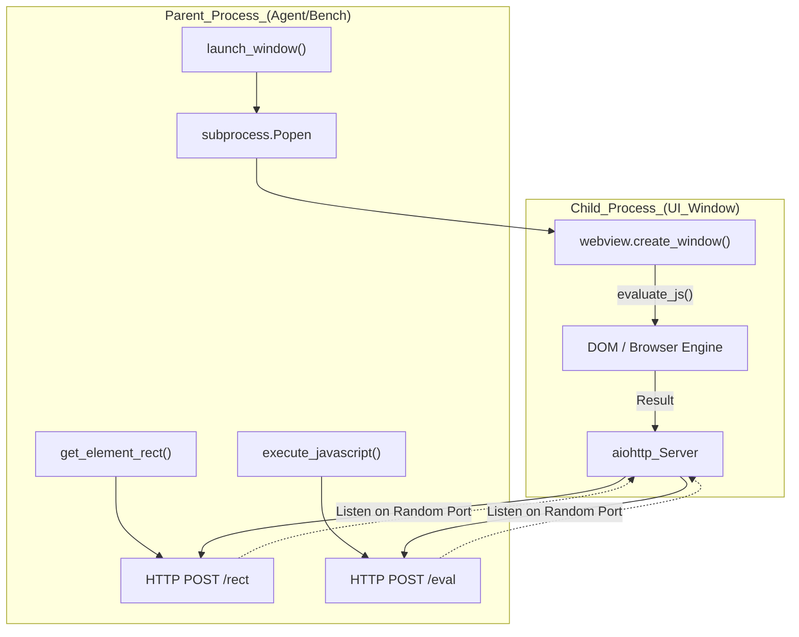
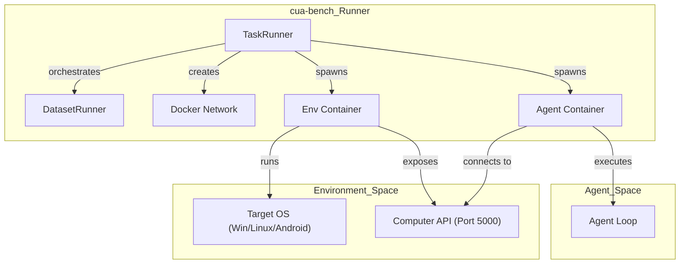

<!-- source: DeepWiki mcp.deepwiki.com · repo trycua/cua · page 11.5 Bench UI and Evaluation Tooling · fetched 2026-10-29 -->

# Bench UI and Evaluation Tooling

Relevant source files

The following files were used as context for generating this wiki page:

- [blog/cloud-windows-ga-macos-preview.md](blog/cloud-windows-ga-macos-preview.md)
- [blog/computer-use-agents-for-growth-hacking.md](blog/computer-use-agents-for-growth-hacking.md)
- [blog/inside-macos-window-internals.md](blog/inside-macos-window-internals.md)
- [libs/cua-bench/tasks/winarena_adapter/infra/docs/Development-Tips.md](libs/cua-bench/tasks/winarena_adapter/infra/docs/Development-Tips.md)
- [libs/python/bench-ui/.bumpversion.cfg](libs/python/bench-ui/.bumpversion.cfg)
- [libs/python/bench-ui/README.md](libs/python/bench-ui/README.md)
- [libs/python/bench-ui/bench_ui/__init__.py](libs/python/bench-ui/bench_ui/__init__.py)
- [libs/python/bench-ui/bench_ui/api.py](libs/python/bench-ui/bench_ui/api.py)
- [libs/python/bench-ui/bench_ui/child.py](libs/python/bench-ui/bench_ui/child.py)
- [libs/python/bench-ui/examples/output_overlay.png](libs/python/bench-ui/examples/output_overlay.png)
- [libs/python/bench-ui/examples/simple_example.py](libs/python/bench-ui/examples/simple_example.py)
- [libs/python/bench-ui/pyproject.toml](libs/python/bench-ui/pyproject.toml)
- [libs/python/bench-ui/tests/test_port_detection.py](libs/python/bench-ui/tests/test_port_detection.py)

This section documents the specialized tooling provided by Cua for evaluating agents, managing lightweight user interfaces in benchmarking environments, and interacting with the Cua Cloud infrastructure. These tools bridge the gap between raw agent execution and structured performance measurement.

## cua-bench-ui

The `cua-bench-ui` package is a lightweight, `pywebview`-based window controller designed for bench environments where a full desktop environment might be overkill or where precise programmatic control over a web-based UI is required [libs/python/bench-ui/pyproject.toml:6-8](). It allows developers to spawn isolated windows, execute JavaScript, and retrieve element coordinates in screen space for visual grounding.

### Architecture and Data Flow

`cua-bench-ui` operates using a parent-child process model to ensure that the UI event loop (which often requires the main thread) does not block the agent's execution logic.

1.  **Parent Process**: Uses the `api.py` module to call `launch_window` [libs/python/bench-ui/bench_ui/api.py:62-75]().
2.  **Child Process**: Runs `bench_ui.child`, which initializes a `webview` window and starts a background `aiohttp` server on a randomly assigned free port [libs/python/bench-ui/bench_ui/child.py:150-152]().
3.  **Control Plane**: The parent process communicates with the child's internal HTTP server to query state or manipulate the DOM [libs/python/bench-ui/bench_ui/api.py:130-138]().

### Bench UI Process Bridge

**Sources:** [libs/python/bench-ui/bench_ui/api.py:62-122](), [libs/python/bench-ui/bench_ui/child.py:21-126]()

### Key Functions

*   **`launch_window`**: Spawns the child process using `subprocess.Popen` [libs/python/bench-ui/bench_ui/api.py:109-114](). It can load a `url`, raw `html` strings, or serve a local `folder` [libs/python/bench-ui/bench_ui/api.py:78-85](). It writes configuration to a temporary JSON file which the child process reads [libs/python/bench-ui/bench_ui/api.py:103-105]().
*   **`get_element_rect`**: Injects JavaScript into the window to calculate the `getBoundingClientRect()` of a CSS selector. It supports `space="screen"`, which attempts to translate window-relative coordinates into absolute screen coordinates using window metrics like `window.screenX`, `window.screenLeft`, and `window.outerHeight` [libs/python/bench-ui/bench_ui/child.py:47-60](), [libs/python/bench-ui/bench_ui/api.py:130-141]().
*   **`execute_javascript`**: Runs arbitrary JS code in the window context via `window.evaluate_js()` and returns the result [libs/python/bench-ui/bench_ui/api.py:158-162](), [libs/python/bench-ui/bench_ui/child.py:94]().
*   **`_detect_port_for_pid`**: A utility using `psutil` to find the listening port of a child process by scanning `net_connections` if the initial handshake mapping is lost [libs/python/bench-ui/bench_ui/api.py:37-59]().

**Sources:** [libs/python/bench-ui/bench_ui/api.py:37-181](), [libs/python/bench-ui/bench_ui/child.py:45-126]()

## cua-bench Evaluation Tooling

The `cua-bench` package provides the core infrastructure for running agent benchmarks and RL training loops.

### Task Execution Architecture

The `TaskRunner` orchestrates the lifecycle of a single evaluation task.

1.  **Isolation**: Creates a dedicated Docker network per task.
2.  **State Protection**: For QEMU-based environments, it creates a Copy-on-Write (CoW) overlay to protect the "golden" base image.
3.  **Execution**: Starts the environment container (e.g., Windows or Linux) and then the agent container which connects via the internal network.

### Task Execution Entity Map

**Sources:** [libs/python/bench-ui/examples/simple_example.py:40-49]()

### CLI and Monitoring

The `cb` (or `cua-bench`) CLI is the primary interface for evaluation.

*   **`cb run task <path>`**: Executes a single task variant.
*   **`cb run dataset <path>`**: Runs multiple tasks in parallel (default 4).
*   **`cb run list`**: Displays a table of all runs, showing the agent, model, status (e.g., completed, failed), and average reward extracted from logs.
*   **Telemetry**: The framework tracks batch job starts and task completions/failures via a telemetry module.

### Specialized Evaluation Tasks

*   **KiCad Task**: Supported via the `spice` optional dependency (`PySpice`) to evaluate netlist correctness generated by agents in EDA environments.
*   **WinArena Adapter**: The `winarena_adapter` provides infrastructure for developing and testing initialization scripts and Python servers within Windows 11 VMs running on Docker [libs/cua-bench/tasks/winarena_adapter/infra/docs/Development-Tips.md:1-3](). It supports a `dev` mode for shared folder mounting between the Docker host and the VM, facilitating rapid iteration on setup scripts and server code [libs/cua-bench/tasks/winarena_adapter/infra/docs/Development-Tips.md:3-17](). This allows for interactive debugging and testing of the Python server and VM accessibility [libs/cua-bench/tasks/winarena_adapter/infra/docs/Development-Tips.md:45-77]().

**Sources:** [libs/cua-bench/tasks/winarena_adapter/infra/docs/Development-Tips.md:1-77]()

---

