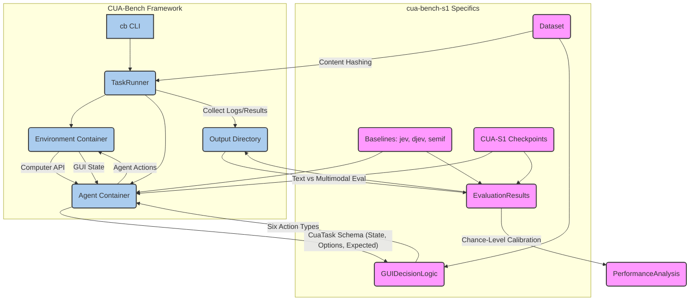
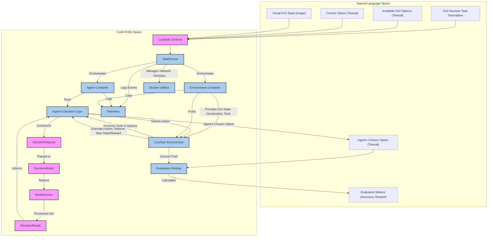

<!-- source: DeepWiki mcp.deepwiki.com · repo trycua/cua · page 11.6 cua-bench-s1: GUI Decision Benchmark · fetched 2026-10-29 -->

# cua-bench-s1: GUI Decision Benchmark

Relevant source files

The following files were used as context for generating this wiki page:

- [.github/scripts/tests/test_ci_cua_s1_weights_workflow.py](.github/scripts/tests/test_ci_cua_s1_weights_workflow.py)
- [.github/workflows/ci-cua-s1-weights.yml](.github/workflows/ci-cua-s1-weights.yml)
- [.github/workflows/ci-cua-s1.yml](.github/workflows/ci-cua-s1.yml)
- [libs/cua-driver/examples/jev-use/decision-models.md](libs/cua-driver/examples/jev-use/decision-models.md)
- [libs/cua-driver/examples/jev-use/fixtures/jev-choice-negative-v1.json](libs/cua-driver/examples/jev-use/fixtures/jev-choice-negative-v1.json)
- [libs/cua-driver/examples/jev-use/fixtures/jev-choice-negative-v1.png](libs/cua-driver/examples/jev-use/fixtures/jev-choice-negative-v1.png)
- [libs/cua-driver/examples/jev-use/fixtures/jev-choice-request-v1.png](libs/cua-driver/examples/jev-use/fixtures/jev-choice-request-v1.png)
- [libs/cua-driver/examples/jev-use/python/choose_action.py](libs/cua-driver/examples/jev-use/python/choose_action.py)
- [libs/cua-driver/examples/jev-use/python/choose_decision.py](libs/cua-driver/examples/jev-use/python/choose_decision.py)
- [libs/cua-driver/examples/jev-use/python/decision_models.py](libs/cua-driver/examples/jev-use/python/decision_models.py)
- [libs/cua-driver/examples/jev-use/python/tests/test_action_policy.py](libs/cua-driver/examples/jev-use/python/tests/test_action_policy.py)
- [libs/cua-driver/examples/jev-use/python/tests/test_decision_models.py](libs/cua-driver/examples/jev-use/python/tests/test_decision_models.py)
- [libs/cua-driver/examples/jev-use/typescript/choose_action.ts](libs/cua-driver/examples/jev-use/typescript/choose_action.ts)
- [libs/cua-driver/examples/jev-use/typescript/tasks.ts](libs/cua-driver/examples/jev-use/typescript/tasks.ts)
- [libs/cua-driver/examples/jev-use/verify_decision_cli.py](libs/cua-driver/examples/jev-use/verify_decision_cli.py)
- [libs/cua-driver/rust/crates/cua-driver-e2e/tests/perception_s1_decision_loop_test.rs](libs/cua-driver/rust/crates/cua-driver-e2e/tests/perception_s1_decision_loop_test.rs)
- [libs/cua-s1/MODEL_CARD.md](libs/cua-s1/MODEL_CARD.md)
- [libs/cua-s1/README.md](libs/cua-s1/README.md)
- [libs/cua-s1/ci/fetch_pinned_weights.py](libs/cua-s1/ci/fetch_pinned_weights.py)
- [libs/cua-s1/python/pyproject.toml](libs/cua-s1/python/pyproject.toml)
- [libs/cua-s1/python/tests/test_pdf.py](libs/cua-s1/python/tests/test_pdf.py)
- [libs/cua-s1/python/tests/test_training.py](libs/cua-s1/python/tests/test_training.py)
- [libs/cua-s1/python/uv.lock](libs/cua-s1/python/uv.lock)
- [libs/cua-s1/training/train.py](libs/cua-s1/training/train.py)
- [skills/jev-use/SKILL.md](skills/jev-use/SKILL.md)

This page documents `libs/cua-bench-s1`, a specialized benchmark designed for evaluating closed-option GUI decision-making in Computer-Use Agents (CUAs). It details the `CuaTask` schema, the six action types, dataset content hashing, evaluation methodologies, and baseline results for CUA-S1 checkpoints.

## Purpose and Scope

`cua-bench-s1` is a benchmark within the broader `cua-bench` framework [libs/cua-bench/pyproject.toml:1-30]() focused on assessing an agent's ability to make precise decisions within a graphical user interface (GUI) context. Unlike open-ended tasks, `cua-bench-s1` presents agents with a limited set of predefined options, requiring them to select the correct one based on visual and contextual information. This benchmark is crucial for evaluating the "System 1" capabilities of agents, which involve fast, intuitive, and often visually-driven decision-making.

## CuaTask Schema

The `CuaTask` schema for `cua-bench-s1` defines the structure of each task, encompassing the initial state, available options, and the expected correct action. This structured approach allows for automated evaluation and consistent benchmarking.

### State
The `state` component of a `CuaTask` captures the visual and contextual information presented to the agent at the beginning of a decision-making step. This typically includes a screenshot of the GUI and any relevant textual descriptions or instructions.

### Options
`options` represent the set of discrete choices available to the agent. In `cua-bench-s1`, these are closed-set options, meaning the agent must select one from the provided list. Each option is usually associated with a specific GUI element or a conceptual action.

### Expected
The `expected` field specifies the ground truth—the correct option the agent should choose given the `state` and `options`. This allows for direct comparison and scoring of agent performance.

Sources:
- [libs/cua-bench/pyproject.toml:1-30]()

## Six Action Types

`cua-bench-s1` focuses on six fundamental GUI interaction action types, which are common in many computer-use scenarios. These actions are designed to test an agent's ability to perceive, understand, and interact with various GUI elements.

1.  **Click**: Selecting a button, link, or other clickable element.
2.  **Type**: Entering text into an input field.
3.  **Scroll**: Navigating content within a scrollable area.
4.  **Drag**: Moving an element from one position to another.
5.  **Select**: Choosing an item from a dropdown or list.
6.  **Hover**: Placing the cursor over an element to reveal tooltips or additional information.

These action types are implemented and evaluated within the `cua-bench` framework, which provides the necessary environment and tooling for agent interaction.

Sources:
- [libs/cua-bench/pyproject.toml:1-30]()

## Dataset Content Hashing

To ensure the integrity and reproducibility of benchmark results, `cua-bench-s1` employs content hashing for its datasets. This means that each task and its associated data (screenshots, options, expected actions) are hashed. Any modification to the dataset content will result in a different hash, providing a robust mechanism to verify that agents are evaluated against the exact same tasks. This is critical for comparing results across different runs and research efforts.

## Text vs. Multimodal Evaluation Runs

The benchmark supports two primary modes of evaluation:

*   **Text-based Evaluation**: In this mode, the agent receives a textual description of the GUI state and the available options. This tests the agent's ability to reason and make decisions based solely on symbolic information.
*   **Multimodal Evaluation**: Here, the agent is provided with both a visual representation (screenshot) of the GUI and textual descriptions. This mode assesses the agent's visual grounding capabilities and its ability to integrate information from different modalities to make a decision.

The choice between text and multimodal evaluation depends on the specific capabilities being tested and the nature of the agent being evaluated. Multimodal evaluation is particularly relevant for agents designed to interact with real-world GUIs, where visual perception is paramount.

## Chance-Level Calibration

To establish a baseline for performance, `cua-bench-s1` includes chance-level calibration. This involves determining the expected accuracy if an agent were to guess randomly among the available options. By comparing agent performance against this chance level, it's possible to ascertain whether the agent is making meaningful decisions or simply performing at random. This calibration helps in interpreting results and understanding the true effectiveness of an agent.

## Baselines and Published Results

`cua-bench-s1` provides several baselines for comparison, including:

*   **jev**: A simple baseline that might represent a basic heuristic or rule-based approach. The `jev-use` example demonstrates how to integrate with TypeSafe Jev for bounded decision-making [libs/cua-driver/examples/jev-use/decision-models.md:1-11]().
*   **djev**: A more advanced heuristic or a small, specialized model.
*   **semif**: Potentially a semi-supervised or more complex rule-based system.

These baselines serve as reference points to gauge the performance of new agents and models. The benchmark also publishes results for various CUA-S1 checkpoints, which are specific versions of the CUA-S1 specialist models [libs/cua-s1/README.md:36-38](). These published results allow researchers to track progress and compare their work against established benchmarks.

### CUA-S1 Checkpoints

The CUA-S1 specialist model family includes:
*   `cua-s1-nano-0.1`: A from-scratch, ~855K-parameter option-attention classifier that scores every candidate (element, action) option for a screen state in a single forward pass [libs/cua-s1/README.md:10-11]().
*   `cua-s1-form-v0`: A finetuned, text-only variant of `cua-s1-nano-0.1` specialized for form-oriented user-interface tasks [libs/cua-s1/README.md:9]().
*   `cua-s1-4b-0.1`: A LoRA fine-tune on top of the frozen, open-weight `Qwen/Qwen3.5-4B` model for general computer-use element/action decisions [libs/cua-s1/README.md:12-13]().
*   `cua-s1-4b-0.2`: A separately trained pair of LoRA adapters on the same frozen `Qwen/Qwen3.5-4B` base, covering both the text and the multimodal modality [libs/cua-s1/README.md:14-16]().

These models are specifically designed for computer-use decisions and are evaluated against the `cua-bench-s1` benchmark. The `cua-s1` Python package provides the model, synthetic-data, training, and evaluation code [libs/cua-s1/README.md:29-30]().

Sources:
- [libs/cua-s1/README.md:9-16]()
- [libs/cua-s1/README.md:29-30]()
- [libs/cua-s1/README.md:36-38]()
- [libs/cua-driver/examples/jev-use/decision-models.md:1-11]()

## Architecture of `cua-bench-s1` within `cua-bench`

The `cua-bench-s1` benchmark is integrated into the broader `cua-bench` framework. The `cua-bench` framework provides the core infrastructure for running tasks, managing environments, and evaluating agents.

The following diagram illustrates the high-level interaction:

Title: `cua-bench-s1` Integration with `cua-bench`
Sources:
- [libs/cua-bench/cua_bench/cli/main.py:70-75]()
- [libs/cua-bench/cua_bench/runner/task_runner.py:77-90]()

The `cb` CLI tool [libs/cua-bench/cua_bench/cli/main.py:148-152]() is used to initiate runs, either for a single task or an entire dataset [libs/cua-bench/cua_bench/cli/main.py:177-183](). The `TaskRunner` [libs/cua-bench/cua_bench/runner/task_runner.py:77-90]() orchestrates the execution, setting up isolated Docker containers for the environment and the agent. The environment container hosts the GUI, while the agent container runs the decision-making logic. Communication between these containers occurs over a Docker network [libs/cua-bench/cua_bench/runner/task_runner.py:83-84]().

## Code Entities and Data Flow

The core components involved in `cua-bench-s1` evaluation are:

Title: `cua-bench-s1` Code Entity and Data Flow
Sources:
- [libs/cua-bench/cua_bench/runner/task_runner.py:62-71]()
- [libs/cua-bench/cua_bench/runner/task_runner.py:147-182]()
- [libs/cua-bench/cua_bench/cli/commands/run.py:30-38]()
- [libs/cua-driver/examples/jev-use/python/decision_models.py:23-35]()
- [libs/cua-driver/examples/jev-use/python/decision_models.py:72-75]()
- [libs/cua-driver/examples/jev-use/python/decision_models.py:79-88]()

The `TaskRunner` class [libs/cua-bench/cua_bench/runner/task_runner.py:77-90]() is central to orchestrating the benchmark. It manages the lifecycle of the agent and environment containers, including network setup, port allocation [libs/cua-bench/cua_bench/runner/docker_utils.py:26](), and cleanup [libs/cua-bench/cua_bench/runner/docker_utils.py:31]().

The `run_task` method [libs/cua-bench/cua_bench/runner/task_runner.py:147-182]() in `TaskRunner` is responsible for executing a single `CuaTask`. It takes parameters such as `env_path`, `task_index`, `env_type`, `agent`, `model`, and `max_steps`. It also handles optional debugging features like VNC and API port mapping [libs/cua-bench/cua_bench/runner/task_runner.py:166-167]().

Within the agent's decision logic, the `DecisionRequest` dataclass [libs/cua-driver/examples/jev-use/python/decision_models.py:23-35]() encapsulates the goal, capture ID, visual regions, history, and candidate options. This request is passed to a `DecisionModel` [libs/cua-driver/examples/jev-use/python/decision_models.py:102-105](), which scores the candidates and returns `ModelScores` [libs/cua-driver/examples/jev-use/python/decision_models.py:72-75](). The `choose` function [libs/cua-driver/examples/jev-use/python/decision_models.py:108-163]() then processes these scores into a `DecisionResult` [libs/cua-driver/examples/jev-use/python/decision_models.py:79-88](), which indicates whether an option was selected, if reobservation is needed, or if the model abstained or encountered an error. This structured output ensures that the application retains control over action execution and verification [libs/cua-driver/examples/jev-use/decision-models.md:17-26]().

Telemetry is integrated to track command invocations and task completion [libs/cua-bench/cua_bench/cli/main.py:23-30](), providing insights into benchmark usage and performance.

Sources:
- [libs/cua-bench/cua_bench/cli/commands/run.py:30-38]()
- [libs/cua-bench/cua_bench/cli/main.py:23-30]()
- [libs/cua-bench/cua_bench/cli/main.py:70-75]()
- [libs/cua-bench/cua_bench/runner/docker_utils.py:26]()
- [libs/cua-bench/cua_bench/runner/docker_utils.py:31]()
- [libs/cua-bench/cua_bench/runner/task_runner.py:62-71]()
- [libs/cua-bench/cua_bench/runner/task_runner.py:77-90]()
- [libs/cua-bench/cua_bench/runner/task_runner.py:147-182]()
- [libs/cua-driver/examples/jev-use/decision-models.md:17-26]()
- [libs/cua-driver/examples/jev-use/python/decision_models.py:23-35]()
- [libs/cua-driver/examples/jev-use/python/decision_models.py:72-75]()
- [libs/cua-driver/examples/jev-use/python/decision_models.py:79-88]()
- [libs/cua-driver/examples/jev-use/python/decision_models.py:102-105]()
- [libs/cua-driver/examples/jev-use/python/decision_models.py:108-163]()

---

