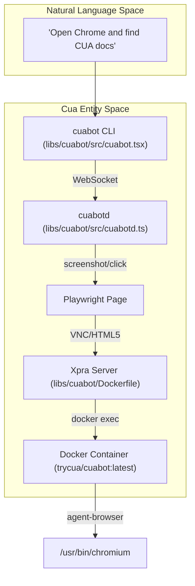
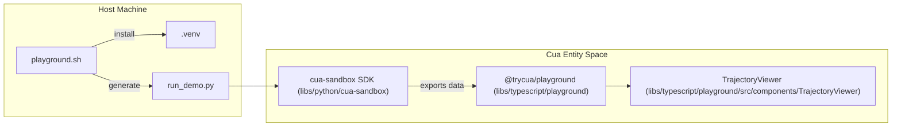

<!-- source: DeepWiki mcp.deepwiki.com · repo trycua/cua · page 12 User Interfaces · fetched 2026-10-29 -->

# User Interfaces

Relevant source files

The following files were used as context for generating this wiki page:

- [README.md](README.md)
- [img/card-cua-bench.gif](img/card-cua-bench.gif)
- [img/card-cua-bench.png](img/card-cua-bench.png)
- [img/card-cua-driver.gif](img/card-cua-driver.gif)
- [img/card-cua-driver.png](img/card-cua-driver.png)
- [img/card-cua-fleets.gif](img/card-cua-fleets.gif)
- [img/card-cua-fleets.png](img/card-cua-fleets.png)
- [img/card-cua-lume.gif](img/card-cua-lume.gif)
- [img/card-cua-lume.png](img/card-cua-lume.png)
- [img/card-cua-products.gif](img/card-cua-products.gif)
- [img/card-cua-products.png](img/card-cua-products.png)
- [img/card-cua-s1.gif](img/card-cua-s1.gif)
- [img/card-cua-spaces-wide.gif](img/card-cua-spaces-wide.gif)
- [img/cua-spaces-demo.mp4](img/cua-spaces-demo.mp4)

This page documents the user interfaces provided by CUA for interacting with Computer instances and `ComputerAgent` workflows. These interfaces range from interactive web UIs and command-line tools to programmatic SDK access and specialized "co-op" tools like `cuabot`.

For details on the underlying logic, see [Computer SDK](#3.1) and [ComputerAgent SDK](#3.3).

## Overview

CUA provides multiple user interface options to accommodate different workflows:

| Interface Type | Best For | Implementation |
|---|---|---|
| **cuabot** | Co-op computer-use, local sandboxes | [libs/cuabot/src/cuabot.tsx:1-4]() |
| **Python CLI** | Unified management, skills, MCP | [libs/python/cua-cli/pyproject.toml:75-78]() |
| **TypeScript CLI** | Cloud sandbox management | `libs/typescript/cua-cli/src/cli.ts` |
| **Gradio Web UI** | Visual agent monitoring, demos | `agent.ui.gradio.ui_components` |
| **Playground UI** | Trajectory replay and VNC viewing | [libs/typescript/playground/package.json:1-5]() |
| **Fleet Web Dashboard** | Cloud sandbox fleet management | `libs/fleet/src` |

## Command Line Interface (CLI)

CUA maintains two primary CLI implementations: a Python-based unified CLI (`cua-cli`) and a TypeScript-based management CLI (`@trycua/cli`).

### Python CLI (`cua-cli`)
The `cua-cli` package [libs/python/cua-cli/pyproject.toml:2-3]() is the primary entry point for Python users. It provides the `cua` command [libs/python/cua-cli/pyproject.toml:78]() which handles:
- **Authentication**: Managing OAuth tokens via the `auth` command group, utilizing `keyring` for OS-backed storage [libs/python/cua-cli/pyproject.toml:39-40](). The `cua-cli` also supports workload identity federation (WIF) by reading the `FLEETS_TOKEN` environment variable for authentication with Fleet [libs/python/cua-cli/cua_cli/auth/workload.py:6-9]().
- **Sandbox Management**: Creating, listing, and controlling environments via the `sb` (sandbox) command group.
- **Skills & MCP**: Recording user demonstrations via `skills record` and serving MCP servers via `serve-mcp`.

### TypeScript CLI (`@trycua/cli`)
This CLI focuses on cloud sandbox management and is used for authentication and environment provisioning within TypeScript workflows.

For details, see [Command Line Interface](#12.1).

Sources: [libs/python/cua-cli/pyproject.toml:1-118](), [libs/python/cua-cli/cua_cli/__init__.py:1-3](), [libs/python/cua-cli/cua_cli/auth/workload.py:6-9](), [libs/python/cua-cli/tests/auth/test_workload.py:13-16]()

## cuabot: Co-op Computer-Use

`cuabot` is a specialized interface designed for "co-op" computer-use. It allows agents (like Claude Code) to run inside sandboxed GUI environments while providing the user with visual monitoring and control. It is distributed as a Node.js package.

### Architecture

`cuabot` consists of a CLI frontend and a daemon (`cuabotd`) that manages a Docker-based sandbox running Xpra.

CUA bridges the gap between natural language agent commands and code execution through the following architecture:

**System Component Bridge**

Sources: [libs/cuabot/src/cuabot.tsx:1-182](), [libs/cuabot/src/cuabotd.ts:1-205](), [libs/cuabot/Dockerfile:1-165]()

**Features:**
- **Onboarding:** Interactive React/Ink setup for Docker, Xpra, and agent aliases via `runOnboarding`.
- **Interactive Shell:** WebSocket-based terminal access into the sandbox via `runCommand`.
- **Automated Control:** HTTP API for screenshots, clicks, and typing via Playwright's `Page` object.
- **Session Management:** Supports named sessions via `--name` to allow multiple isolated instances.

For details, see [cuabot: Co-op Computer-Use](#12.3).

Sources: [libs/cuabot/src/cuabot.tsx:1-182](), [libs/cuabot/src/cuabotd.ts:1-205](), [libs/cuabot/package.json:1-41](), [libs/cuabot/src/onboarding.tsx:1-205](), [libs/cuabot/src/settings.ts:18-49](), [libs/cuabot/Dockerfile:1-165]()

## Gradio Web UI

The Gradio UI provides a high-level web interface for the `ComputerAgent`. It is primarily used for demonstrations and monitoring agent execution in real-time.

### Components
- **Model Selection:** Dropdown for selecting agent loops (Anthropic, OpenAI, etc.).
- **Execution Monitoring:** Live screenshot gallery and JSON trajectory logs.
- **Provider Toggle:** Switch between Cloud, Lume, or Docker providers.

For details, see [Gradio Web UI](#12.2).

## Playground and Demo Apps

The `@trycua/playground` package provides a reusable React-based UI component for viewing trajectories and interacting with sandboxes.

**Playground Execution Flow**

Sources: [libs/typescript/playground/package.json:1-40]()

- **Playground Scripts:** `playground.sh` and `playground-docker.sh` automate the initial environment setup, installing CUA packages and configuring environment variables.
- **Trajectory Viewer:** A React component that allows users to replay agent sessions, inspect logs, and view screenshots.
- **Adapters:** Supports multiple backends including `CloudAdapter` and `LocalAdapter` for connecting the UI to different execution environments.

For details, see [Playground, Samples and Demo Apps](#12.4).

Sources: [libs/typescript/playground/package.json:1-40]()

## Fleet Web Dashboard

The Fleet Web Dashboard is a React Single Page Application (SPA) located in `libs/fleet/src`. It provides a comprehensive interface for managing Cua's cloud infrastructure. This includes:
- **Pool, Claim, and Instance Pages**: For managing pools of sandboxes, claiming instances, and monitoring individual sandbox instances.
- **Settings and Billing**: User settings, billing usage, and management of user API keys.
- **Feature Flags**: Configuration and management of feature flags.
- **Chat Threads**: Interface for interacting with agents and reviewing chat history.
- **Authentication**: Integration with an authentication provider.
- **Internationalization (i18n)**: Support for multiple languages.
- **Nginx Serving Config**: Configuration for serving the SPA.
- **Playwright E2E Tests**: End-to-end tests for the dashboard functionality.

For details, see [Fleet Web Dashboard](#12.5).

Sources: `libs/fleet/src`

---

