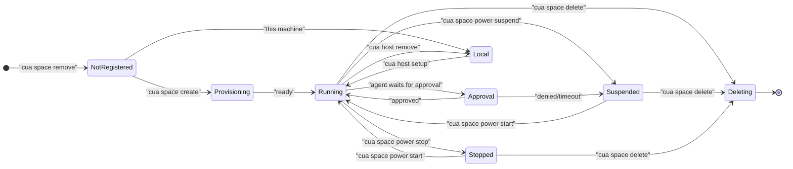
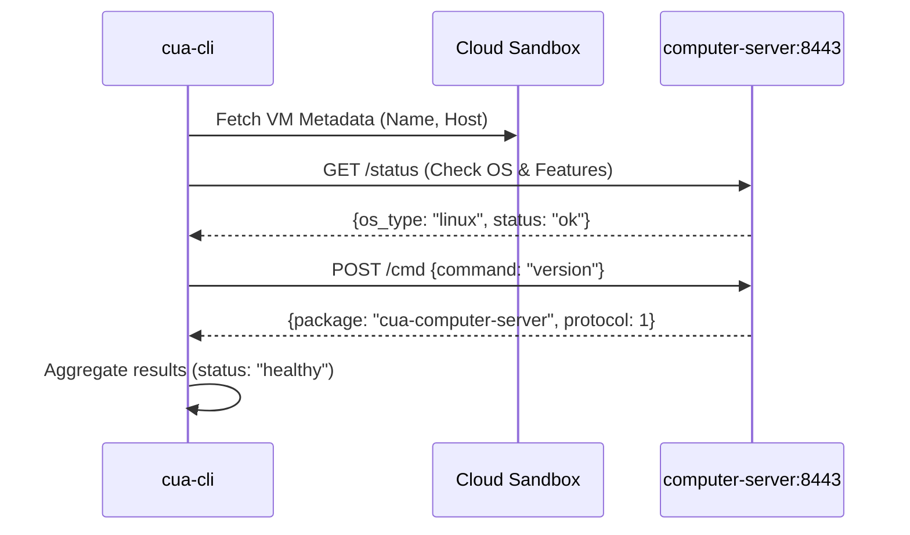

<!-- source: DeepWiki mcp.deepwiki.com · repo trycua/cua · page 12.1 Command Line Interface · fetched 2026-10-29 -->

# Command Line Interface

<details>
<summary>Relevant source files</summary>

The following files were used as context for generating this wiki page:

- [apps/cua-spaces-macos/Sources/CuaSpacesMacKit/Views/ThisMachineView.swift](apps/cua-spaces-macos/Sources/CuaSpacesMacKit/Views/ThisMachineView.swift)
- [apps/cua-spaces-macos/Tests/CuaSpacesMacTests/Snapshots/this-machine.png](apps/cua-spaces-macos/Tests/CuaSpacesMacTests/Snapshots/this-machine.png)
- [apps/cua-spaces-macos/Tests/CuaSpacesMacTests/ViewModelTests.swift](apps/cua-spaces-macos/Tests/CuaSpacesMacTests/ViewModelTests.swift)
- [libs/cua-spacesd/crates/cua-spacesd-desktop/src/grpc/computer.rs](libs/cua-spacesd/crates/cua-spacesd-desktop/src/grpc/computer.rs)
- [libs/cua-spacesd/crates/cua-spacesd-server/src/access_log.rs](libs/cua-spacesd/crates/cua-spacesd-server/src/access_log.rs)
- [libs/cua-spacesd/crates/cua-spacesd-server/src/auth.rs](libs/cua-spacesd/crates/cua-spacesd-server/src/auth.rs)
- [libs/cua-spacesd/crates/cua-spacesd-server/tests/access_log.rs](libs/cua-spacesd/crates/cua-spacesd-server/tests/access_log.rs)
- [libs/cua/CHANGELOG.md](libs/cua/CHANGELOG.md)
- [libs/cua/VERSION](libs/cua/VERSION)
- [libs/cua/crates/cua-cli/src/host.rs](libs/cua/crates/cua-cli/src/host.rs)
- [libs/cua/crates/cua-host/src/access.rs](libs/cua/crates/cua-host/src/access.rs)
- [libs/cua/crates/cua-host/src/host.rs](libs/cua/crates/cua-host/src/host.rs)
- [libs/cua/crates/cua-host/src/tests.rs](libs/cua/crates/cua-host/src/tests.rs)
- [libs/cua/crates/cua-spaces-app-core/src/host.rs](libs/cua/crates/cua-spaces-app-core/src/host.rs)
- [libs/cua/crates/cua-spaces-ffi/src/app_core_types.rs](libs/cua/crates/cua-spaces-ffi/src/app_core_types.rs)
- [libs/cua/crates/cua-spaces/src/spaces.rs](libs/cua/crates/cua-spaces/src/spaces.rs)
- [libs/cua/crates/cua-spaces/src/thumbnails.rs](libs/cua/crates/cua-spaces/src/thumbnails.rs)
- [libs/cua/crates/cua-spaces/tests/relay.rs](libs/cua/crates/cua-spaces/tests/relay.rs)
- [libs/cua/python/pyproject.toml](libs/cua/python/pyproject.toml)
- [libs/cua/python/src/cua/__init__.py](libs/cua/python/src/cua/__init__.py)
- [libs/cua/typescript/package-lock.json](libs/cua/typescript/package-lock.json)
- [libs/cua/typescript/package.json](libs/cua/typescript/package.json)
- [libs/spaces-app-swift/Sources/CuaSpacesFFI/CuaSpacesFFI.swift](libs/spaces-app-swift/Sources/CuaSpacesFFI/CuaSpacesFFI.swift)

</details>


The Cua framework provides command-line tools to manage the lifecycle of Computer-Use Agents (CUAs) and their execution environments. The primary interface is the Rust-based `cua` CLI, with Python (`cua-cli`) and TypeScript (`@trycua/cli`) SDKs providing programmatic access and additional CLI functionalities.

---

## Overview

The Cua CLI acts as the central control plane for developers, bridging local development with remote or sandboxed execution.

**Key Capabilities**:
- **Authentication**: OIDC and API key management for Cua Cloud.
- **Space Management**: Provisioning and lifecycle control (create, list, delete, connect) for Linux, Windows, and macOS VMs [libs/cua/crates/cua-cli/src/spaces.rs:168-171]().
- **Host Management**: Setting up a machine as a Cua host to share its desktop or provide Spaces [libs/cua/crates/cua-cli/src/host.rs:18-82]().
- **Image Management**: Parsing and launching specific OS images (e.g., `macos:sequoia`, `ubuntu:24.04`) across local and cloud providers.
- **One-Shot Automation**: Direct execution of OS-level actions (click, type, screenshot) via `cua do`.
- **MCP Integration**: Serving agents as Model Context Protocol servers for integration with tools like Claude Code.
- **Data Operations**: Recording human demonstration "skills" and managing agent "trajectories" for evaluation.

Sources: [libs/cua/crates/cua-cli/src/host.rs:18-82](), [libs/cua/crates/cua-cli/src/spaces.rs:168-171]()

---

## Installation

### Rust CLI (Primary)
The `cua` CLI is the primary command-line interface, built in Rust. It is part of the `libs/cua` workspace [libs/cua/crates/cua-cli/Cargo.toml:1-3]().

```bash
# Install via cargo
cargo install cua-cli
```

### Python CLI
The Python CLI (`cua-cli`) provides a Pythonic interface to the Cua SDK. It is built using `hatchling` [libs/cua/python/pyproject.toml:65]() and supports Python 3.12 and 3.13 [libs/cua/python/pyproject.toml:27]().

```bash
pip install cua-cli
```

**Optional Features**:
- `mcp`: Adds `fastmcp` for agent server capabilities [libs/cua/python/pyproject.toml:49-51]().
- `skills`: Adds `litellm` for demonstration captioning [libs/cua/python/pyproject.toml:53-55]().

### TypeScript CLI
The TypeScript CLI (`@trycua/cli`) provides a TypeScript interface to the Cua SDK.

```bash
# Using npm
npm install -g @trycua/cli
```

Sources: [libs/cua/crates/cua-cli/Cargo.toml:1-3](), [libs/cua/python/pyproject.toml:27-55](), [libs/cua/typescript/package.json:1-3]()

---

## Command Architecture

The CLI uses a modular registration pattern. The `runCli` function in the TypeScript CLI initializes `yargs` and registers commands from various modules [libs/cua/typescript/src/cli.ts:26-166](). The Python CLI uses a similar approach with `argparse`. The Rust `cua` CLI uses `clap` for command parsing [libs/cua/crates/cua-cli/src/main.rs:1-5]().

### Command Dispatch Pipeline
The diagram below illustrates how a command like `cua space create` flows from the entry point to the cloud API or local runtime.

"Command Dispatch and Execution Flow"

```mermaid
graph TD
    subgraph "Entry & Parsing"
        EntryRust["main()<br/>libs/cua/crates/cua-cli/src/main.rs"]
        EntryPY["main()<br/>libs/cua/python/src/cua_cli/main.py"]
        EntryTS["runCli()<br/>libs/cua/typescript/src/cli.ts"]
        Clap["clap parser"]
        Argparse["argparse parser"]
        Yargs["yargs parser"]
        Dispatch["Subcommand Dispatcher"]
    end

    subgraph "Command Logic Modules (Rust)"
        AuthRust["cua-cli::auth"]
        SpaceRust["cua-cli::spaces"]
        HostRust["cua-cli::host"]
        SandboxRust["cua-cli::sandbox"]
        ImageRust["cua-cli::image"]
    end

    subgraph "Command Logic Modules (Python)"
        AuthPY["cua_cli.commands.auth"]
        SBPY["cua_cli.commands.sandbox"]
        ImagePY["cua_cli.commands.image"]
        SkillsPY["cua_cli.commands.skills"]
        MCPPY["cua_cli.commands.mcp"]
        TrajectoryPY["cua_cli.commands.trajectory"]
        WorkspacePY["cua_cli.commands.workspace"]
        DoPY["cua_cli.commands.do"]
    end

    subgraph "Command Logic Modules (TypeScript)"
        AuthTS["registerAuthCommands()<br/>src/commands/auth.ts"]
        SBTS["registerSandboxCommands()<br/>src/commands/sandbox.ts"]
        ImageTS["registerImageCommands()<br/>src/commands/image.ts"]
        SkillsTS["registerSkillsCommands()<br/>src/commands/skills.ts"]
        ServeMCPTS["registerServeMcpCommands()<br/>src/commands/serve-mcp.ts"]
    end

    subgraph "Execution & Telemetry"
        CloudAPI["Cua Cloud API<br/>(via http/aiohttp/reqwest)"]
        LocalRT["Local Runtime<br/>(Lume/Docker/QEMU)"]
        Tele["record_event()<br/>cua_core.telemetry"]
    end

    EntryRust --> Clap
    EntryPY --> Argparse
    EntryTS --> Yargs
    Clap --> Dispatch
    Argparse --> Dispatch
    Yargs --> Dispatch

    Dispatch --> AuthRust
    Dispatch --> SpaceRust
    Dispatch --> HostRust
    Dispatch --> SandboxRust
    Dispatch --> ImageRust

    Dispatch --> AuthPY
    Dispatch --> SBPY
    Dispatch --> ImagePY
    Dispatch --> SkillsPY
    Dispatch --> MCPPY
    Dispatch --> TrajectoryPY
    Dispatch --> WorkspacePY
    Dispatch --> DoPY
    
    Dispatch --> AuthTS
    Dispatch --> SBTS
    Dispatch --> ImageTS
    Dispatch --> SkillsTS
    Dispatch --> ServeMCPTS

    AuthRust --> CloudAPI
    SpaceRust --> CloudAPI
    SpaceRust --> LocalRT
    HostRust --> CloudAPI
    HostRust --> LocalRT
    SandboxRust --> CloudAPI
    SandboxRust --> LocalRT
    ImageRust --> CloudAPI
    ImageRust --> LocalRT

    AuthPY --> CloudAPI
    SBPY --> CloudAPI
    SBPY --> LocalRT
    ImagePY --> CloudAPI
    ImagePY --> LocalRT
    SkillsPY --> CloudAPI
    MCPPY --> LocalRT
    TrajectoryPY --> CloudAPI
    WorkspacePY --> CloudAPI
    DoPY --> LocalRT

    AuthTS --> CloudAPI
    SBTS --> CloudAPI
    ImageTS --> CloudAPI
    SkillsTS --> CloudAPI

    EntryRust -.-> Tele
    EntryPY -.-> Tele
    EntryTS -.-> Tele
```


Sources: [libs/cua/crates/cua-cli/src/main.rs:1-5](), [libs/cua/python/src/cua_cli/main.py:1-10](), [libs/cua/typescript/src/cli.ts:26-166]()

---

## Authentication and Credentials

Authentication manages the `CUA_API_KEY` used for cloud operations.

### Credential Storage
- **Rust**: Uses the `cua-auth` crate for credential management, which interacts with the OS keychain or a local file system store [libs/cua/crates/cua-auth/src/lib.rs:1-10]().
- **Python**: Uses the `keyring` library to store tokens in the OS-backed credential store [libs/cua/python/pyproject.toml:38]().
- **TypeScript**: Stores keys in a local SQLite database at `~/.cua/cli.sqlite` [libs/cua/typescript/src/storage.ts:1-10]().

### Authentication Flow
The `cua auth login` command triggers a browser-based OAuth flow [libs/cua/crates/cua-cli/src/auth.rs:1-10](). Once authenticated, the `cua auth env` command can be used to export the key to a local `.env` file for SDK use.

Sources: [libs/cua/crates/cua-auth/src/lib.rs:1-10](), [libs/cua/crates/cua-cli/src/auth.rs:1-10](), [libs/cua/python/pyproject.toml:38](), [libs/cua/typescript/src/storage.ts:1-10]()

---

## Space Management (`space` / `spaces`)

The `space` (or `spaces`) commands manage Cua Spaces, which are full desktop environments. These commands are primarily handled by the Rust `cua` CLI.

| Command | Description | Code Pointer |
|:---|:---|:---|
| `create` | Provision a new Space (VM or container) | [libs/cua/crates/cua-spaces/src/spaces.rs:29-88]() |
| `list` | View all registered Spaces and their status | [libs/cua/crates/cua-cli/src/spaces.rs:173-184]() |
| `connect` | Connect to a Space, opening a viewer | [libs/cua/crates/cua-cli/src/spaces.rs:186-200]() |
| `add` | Add an existing machine as a Space by address | [libs/cua/crates/cua-spaces/src/spaces.rs:1-4]() |
| `remove` | Forget a Space without touching it | [libs/cua/crates/cua-spaces/src/spaces.rs:1-4]() |
| `delete` | Delete a Space | [libs/cua/crates/cua-spaces/src/spaces.rs:1-4]() |
| `power` | Control Space power state (suspend, stop, start) | [libs/cua/crates/cua-spaces-ffi/src/app_core_types.rs:112-137]() |

### Space Creation Options
The `SpaceCreate` struct defines the options for creating a Space, including image, location (`on`), kind, runtime, name, CPU, memory, disk, and services [libs/cua/crates/cua-spaces/src/spaces.rs:29-88](). Progress updates during creation are reported via a `ProgressSink` [libs/cua/crates/cua-spaces/src/spaces.rs:90-105]().

### Space Status and Power Control
Spaces have various statuses like `Local`, `Running`, `Approval`, `Suspended`, `Provisioning`, and `Deleting` [libs/cua/crates/cua-spaces-ffi/src/app_core_types.rs:24-40](). Power control allows suspending or stopping a Space [libs/cua/crates/cua-spaces-ffi/src/app_core_types.rs:112-137]().

"Space Lifecycle and Power States"


Sources: [libs/cua/crates/cua-spaces/src/spaces.rs:29-105](), [libs/cua/crates/cua-spaces-ffi/src/app_core_types.rs:24-40](), [libs/cua/crates/cua-spaces-ffi/src/app_core_types.rs:112-137]()

---

## Host Management (`host`)

The `host` commands configure the current machine to act as a Cua host, allowing it to share its desktop or provide Spaces for other devices.

| Command | Description | Code Pointer |
|:---|:---|:---|
| `setup` | Set up the machine for unattended access (relay or direct) | [libs/cua/crates/cua-cli/src/host.rs:23-82]() |
| `config` | Show or change sharing settings (desktop, provided Spaces) | [libs/cua/crates/cua-cli/src/host.rs:86-103]() |
| `status` | Show host setup status and connected clients | [libs/cua/crates/cua-cli/src/host.rs:107-108]() |
| `stop` | Stop sharing and refuse new connections | [libs/cua/crates/cua-cli/src/host.rs:112-113]() |
| `start` | Start sharing again after `stop` | [libs/cua/crates/cua-cli/src/host.rs:117-118]() |
| `share` | Share a relay machine with other accounts | [libs/cua/crates/cua-cli/src/host.rs:122-137]() |
| `unshare` | Stop sharing a relay machine with accounts | [libs/cua/crates/cua-cli/src/host.rs:141-152]() |
| `remove` | Unregister from the relay, uninstall service, delete config | [libs/cua/crates/cua-cli/src/host.rs:156-164]() |

### Host Setup Stages
The `Host::setup_staged` function in `cua-host` defines the stages of host setup: `Preflight`, `Token`, `Register`, `Download`, and `Service` [libs/cua/crates/cua-host/src/host.rs:14-26]().

### Host Policy
The `HostPolicy` struct defines how a machine is shared, including owner, allowed accounts, viewer settings, and whether to share the desktop or provide Spaces [libs/cua/crates/cua-host/src/host.rs:134-175](). This policy is enforced by `cua-spacesd` [libs/cua/crates/cua-host/src/host.rs:131-132]().

"Host Setup and Policy Enforcement"
```mermaid
graph TD
    User["User (cua host setup)"]
    HostCLI["cua-cli (Rust)"]
    CuaHostCrate["cua-host crate"]
    CuaSpacesd["cua-spacesd daemon"]
    Relay["Cua Relay Service"]
    OSServiceMgr["OS Service Manager<br/>(systemd, launchd, Windows Task Scheduler)"]

    User --> HostCLI: "cua host setup --relay <URL>"
    HostCLI --> CuaHostCrate: SetupOptions (Relay mode)
    CuaHostCrate --> Relay: Register machine, get tokens
    CuaHostCrate --> OSServiceMgr: Install/Start cua-spacesd service
    OSServiceMgr --> CuaSpacesd: Launch cua-spacesd
    CuaSpacesd --> Relay: Join relay, enforce HostPolicy
    CuaSpacesd --> CuaHostCrate: Report status

    User --> HostCLI: "cua host setup --direct <IP:PORT>"
    HostCLI --> CuaHostCrate: SetupOptions (Direct mode)
    CuaHostCrate --> OSServiceMgr: Install/Start cua-spacesd service
    OSServiceMgr --> CuaSpacesd: Launch cua-spacesd
    CuaSpacesd --> CuaHostCrate: Report status

    subgraph "Host Policy Enforcement"
        CuaSpacesd -- "Reads host.json" --> HostPolicyFile[<home>/host/host.json]
        CuaSpacesd -- "Authenticates clients" --> AuthLayer[Auth Layer<br/>(cua-spacesd-server::auth)]
        AuthLayer -- "Checks permissions" --> HostPolicy[HostPolicy struct]
        AuthLayer -- "Logs access" --> AccessLog[Access Log<br/>(cua-spacesd-server::access_log)]
    end
```

Sources: [libs/cua/crates/cua-cli/src/host.rs:23-164](), [libs/cua/crates/cua-host/src/host.rs:14-26](), [libs/cua/crates/cua-host/src/host.rs:134-175](), [libs/cua-spacesd/crates/cua-spacesd-server/src/auth.rs:1-10](), [libs/cua-spacesd/crates/cua-spacesd-server/src/access_log.rs:1-7]()

---

## Sandbox Management (`sb`)

The `sandbox` (alias `sb`) commands manage both remote and local execution environments. This is primarily handled by the Python and TypeScript CLIs, leveraging the underlying Rust SDK.

| Command | Description | Code Pointer |
|:---|:---|:---|
| `launch` | Provision a new VM or container (supports `--local` and `--vm`) | [libs/cua/python/src/cua_cli/commands/sandbox.py:1-10]() |
| `list` | View all sandboxes and their status | [libs/cua/typescript/src/commands/sandbox.ts:144-158]() |
| `vnc` | Open the remote desktop in a browser | [libs/cua/typescript/src/commands/sandbox.ts:316-328]() |
| `get` | Fetch health details and server version | [libs/cua/typescript/src/commands/sandbox.ts:9-141]() |
| `create` | Provision a new sandbox with specified OS, size, and region | [libs/cua/typescript/src/commands/sandbox.ts:160-217]() |
| `delete` | Permanently delete a sandbox | [libs/cua/typescript/src/commands/sandbox.ts:219-226]() |
| `start` | Start a stopped sandbox | [libs/cua/typescript/src/commands/sandbox.ts:240-247]() |
| `stop` | Stop a running sandbox (preserves disk) | [libs/cua/typescript/src/commands/sandbox.ts:261-268]() |
| `restart` | Restart/reboot a sandbox | [libs/cua/typescript/src/commands/sandbox.ts:282-289]() |
| `suspend` | Suspend a sandbox (preserves memory) | [libs/cua/typescript/src/commands/sandbox.ts:303-310]() |

### Image Parsing Logic
The Python CLI includes a robust `_parse_image` function to convert human-readable strings into `cua_sandbox.Image` objects.

- **Aliases**: Supports `mac`, `win`, `ubuntu`, `android`.
- **Registry**: Automatically detects registry hosts like `ghcr.io` or `quay.io`.

### Sandbox Health Probing
When `cua sb get` is called, the CLI probes the `computer-server` inside the VM to verify its health and version [libs/cua/typescript/src/commands/sandbox.ts:61-138]().

"Sandbox Probe Sequence"


Sources: [libs/cua/typescript/src/commands/sandbox.ts:9-141](), [libs/cua/typescript/src/util.ts:15-28]()

---

## Image Management (`image` / `img`)

The `image` (alias `img`) commands are used to manage VM images in cloud storage.

| Command | Description | Code Pointer |
|:---|:---|:---|
| `list` | View all images in your workspace | [libs/cua/typescript/src/commands/image.ts:14-28]() |
| `push` | Push a VM image to cloud storage | [libs/cua/typescript/src/commands/image.ts:30-50]() |
| `pull` | Pull a VM image from cloud storage | [libs/cua/typescript/src/commands/image.ts:52-72]() |
| `delete` | Delete an image version | [libs/cua/typescript/src/commands/image.ts:74-91]() |

Sources: [libs/cua/typescript/src/commands/image.ts:14-91]()

---

## Skills Management (`skills`)

The `skills` commands are used to create and manage demonstration skills.

| Command | Description | Code Pointer |
|:---|:---|:---|
| `record` | Record a demonstration and create a skill | [libs/cua/typescript/src/commands/skills.ts:14-34]() |
| `list` | View all saved skills | [libs/cua/typescript/src/commands/skills.ts:36-50]() |
| `read` | Read a skill as JSON or Markdown | [libs/cua/typescript/src/commands/skills.ts:52-72]() |
| `replay` | Open the video recording for a skill | [libs/cua/typescript/src/commands/skills.ts:74-91]() |
| `delete` | Delete a skill | [libs/cua/typescript/src/commands/skills.ts:93-110]() |
| `clean` | Delete all skills (with confirmation) | [libs/cua/typescript/src/commands/skills.ts:112-129]() |

Sources: [libs/cua/typescript/src/commands/skills.ts:14-129]()

---

## Automation and MCP

### `cua do`
The `do` command provides a quick way to interact with a computer without writing code. It uses `cua-auto` for local host control [libs/cua/python/pyproject.toml:34]().
- **Example**: `cua do click --x 100 --y 200`
- **Example**: `cua do screenshot --output ./screen.png`

### `cua serve-mcp`
Starts an MCP server that allows agents (like Claude) to use the Cua computer-use tools. It leverages `fastmcp` to expose the `Computer` SDK methods as tools [libs/cua/python/pyproject.toml:49-51]().

Sources: [libs/cua/python/pyproject.toml:34](), [libs/cua/python/pyproject.toml:49-51]()

---

## Release and Versioning

The CLI follows semantic versioning. The release process is automated via GitHub Actions and local scripts.

- **Rust Versioning**: Managed via `libs/cua/VERSION` [libs/cua/VERSION:1]() and `CHANGELOG.md` [libs/cua/CHANGELOG.md:1-63]().
- **Python Versioning**: Managed via `.bumpversion.cfg`, which synchronizes `pyproject.toml` and `cua_cli/__init__.py` [libs/cua/python/.bumpversion.cfg:1-14]().
- **TypeScript Versioning**: Managed via `bumpp` in `package.json` [libs/cua/typescript/package.json:33]() and `.bumpversion.cfg` [libs/cua/typescript/.bumpversion.cfg:1-10]().
- **Telemetry**: The CLI records command usage (duration, status, exit codes) to PostHog if telemetry is enabled [libs/cua/CHANGELOG.md:25]().

Sources: [libs/cua/VERSION:1](), [libs/cua/CHANGELOG.md:1-63](), [libs/cua/python/.bumpversion.cfg:1-14](), [libs/cua/typescript/package.json:33](), [libs/cua/typescript/.bumpversion.cfg:1-10](), [libs/cua/CHANGELOG.md:25]()

---

