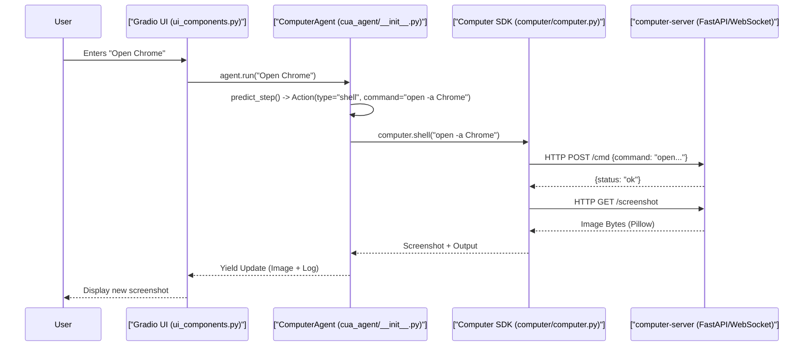

<!-- source: DeepWiki mcp.deepwiki.com · repo trycua/cua · page 12.2 Gradio Web UI · fetched 2026-10-29 -->

# Gradio Web UI

<details>
<summary>Relevant source files</summary>

The following files were used as context for generating this wiki page:

- [Makefile](Makefile)
- [libs/python/agent/.bumpversion.cfg](libs/python/agent/.bumpversion.cfg)
- [libs/python/agent/README.md](libs/python/agent/README.md)
- [libs/python/agent/pyproject.toml](libs/python/agent/pyproject.toml)
- [libs/python/core/.bumpversion.cfg](libs/python/core/.bumpversion.cfg)
- [libs/python/core/README.md](libs/python/core/README.md)
- [libs/python/core/pyproject.toml](libs/python/core/pyproject.toml)
- [libs/python/som/.bumpversion.cfg](libs/python/som/.bumpversion.cfg)
- [libs/python/som/README.md](libs/python/som/README.md)
- [libs/python/som/pyproject.toml](libs/python/som/pyproject.toml)

</details>


The Gradio Web UI provides an interactive web-based interface for controlling `ComputerAgent` instances through a chat-like experience. This page documents the UI's architecture, implementation details, and the dependencies required to bootstrap the visual interface.

---

## Overview and Architecture

The Gradio Web UI serves as a browser-based frontend for the Cua agent system. It bridges natural language commands from the user to the underlying `ComputerAgent` and `Computer` SDKs.

### System Flow
The UI flow typically involves capturing a user prompt, selecting a model (via `AsyncAgentConfig` registration), and executing the agent loop which communicates with a `Computer` provider (Cloud, Lume, Docker, etc.).

**Natural Language to Code Entity Space: UI Flow**

```mermaid
graph TB
    subgraph "Browser Space"
        ["Gradio Web Interface<br/>(localhost:7860)"]
    end
    
    subgraph "cua-agent Space"
        UIComp["create_gradio_ui()<br/>cua_agent.ui.gradio.ui_components"]
        Agent["ComputerAgent<br/>libs/python/agent/cua_agent/__init__.py"]
        Loops["Agent Loops<br/>libs/python/agent/cua_agent/loops/"]
    end
    
    subgraph "cua-computer Space"
        CompSDK["Computer Class<br/>libs/python/computer/computer"]
        Providers["VMProviderFactory<br/>libs/python/computer/providers"]
    end
    
    ["Gradio Web Interface<br/>(localhost:7860)"] -->|"User Prompt"| UIComp
    UIComp -->|"Instantiates"| Agent
    Agent -->|"Selects Loop"| Loops
    Agent -->|"Controls"| CompSDK
    CompSDK -->|"API Calls"| Providers
```

Sources: [libs/python/agent/pyproject.toml:76-79]()

---

## Implementation Details

### Core Entry Point
The primary way to instantiate the interface is via the `create_gradio_ui` function. This function assembles the Gradio `Blocks` layout, including chat history, image previews, and configuration panels.

**Usage Pattern:**
```python
from cua_agent.ui.gradio.ui_components import create_gradio_ui

app = create_gradio_ui()
app.launch(share=False, inbrowser=True)
```

### Component Dependencies
The UI functionality is packaged as an optional dependency. To use the Gradio interface, the `ui` extra must be installed. The UI specifically requires `gradio>=6.0.0` for the agent package.

| Package | Extra | Dependencies |
| :--- | :--- | :--- |
| `cua-agent` | `ui` | `gradio>=6.0.0`, `python-dotenv>=1.0.1` |

Sources: [libs/python/agent/pyproject.toml:76-79]()

---

## UI Components and Features

The Gradio interface is designed to provide real-time feedback during agent execution.

### 1. Model Selection
Users can select between different supported LLM providers. The UI dynamically adjusts based on the available `AsyncAgentConfig` implementations. Supported models include:
- **Anthropic & OpenAI**: Integrated via `litellm==1.86.2` [libs/python/agent/pyproject.toml:24-24]().
- **Gemini**: Supported via `google-genai>=1.41.0` [libs/python/agent/pyproject.toml:88-90]().
- **Local Models**: Support for `UITARS` (via `mlx-vlm` on macOS or `transformers` on HF) and `Qwen-VL` [libs/python/agent/pyproject.toml:35-51]().

### 2. Execution Monitoring
As the `ComputerAgent` executes its loop, the UI displays:
- **Thought/Reasoning**: The agent's internal logic for the next step.
- **Action Logs**: Specific commands sent to the computer (e.g., `click`, `type`, `key`).
- **Screenshots**: Visual feedback from the computer's frame buffer, often processed through the `cua-som` (Set-of-Mark) library for visual grounding. Note that `cua-som` is deprecated and unmaintained [libs/python/agent/README.md:7-8](), [libs/python/som/README.md:19-20]().

### 3. Provider Configuration
The UI allows switching between different execution environments defined in the Computer SDK:
- **Cloud**: Connects to the Cua Cloud Sandbox.
- **Lume**: Interfaces with local macOS `Virtualization.framework` via the `lume` extra.
- **Docker/Lumier**: Connects to containers running `computer-server`.

Sources: [libs/python/agent/pyproject.toml:35-75](), [libs/python/agent/pyproject.toml:102-125](), [libs/python/som/pyproject.toml:6-10](), [libs/python/agent/README.md:7-8](), [libs/python/som/README.md:19-20]()

---

## Data Flow: From UI to Execution

The following diagram illustrates how a user interaction in the Gradio UI triggers a sequence of calls across the SDKs.

**Natural Language to Code Entity Space: Execution Flow**



Sources: [libs/python/agent/pyproject.toml:13-25](), [libs/python/agent/pyproject.toml:114-116]()

---

## Configuration Management

The UI and underlying packages rely on a standardized versioning and requirement system.

### Versioning
Versions for the UI components are managed via `.bumpversion.cfg` across the packages:
- `cua-agent`: [libs/python/agent/.bumpversion.cfg:2-2]() (Current: 0.9.0)
- `cua-core`: [libs/python/core/.bumpversion.cfg:2-2]() (Current: 0.3.2)
- `cua-som`: [libs/python/som/.bumpversion.cfg:2-2]() (Current: 0.1.4)

### Requirements
The UI and agent components require modern Python versions:
- `cua-agent`: `python >=3.11, <3.14` [libs/python/agent/pyproject.toml:27-27]().
- `cua-core`: `python >=3.11, <3.14` [libs/python/core/pyproject.toml:17-17]().
- `cua-som`: `python >=3.12, <3.14` [libs/python/som/pyproject.toml:27-27]().

Sources: [libs/python/agent/pyproject.toml:27-27](), [libs/python/core/pyproject.toml:17-17](), [libs/python/som/pyproject.toml:27-27](), [libs/python/agent/.bumpversion.cfg:2-2](), [libs/python/core/.bumpversion.cfg:2-2](), [libs/python/som/.bumpversion.cfg:2-2]()

---

