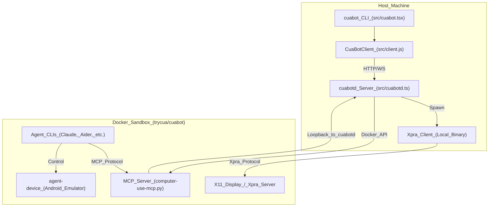
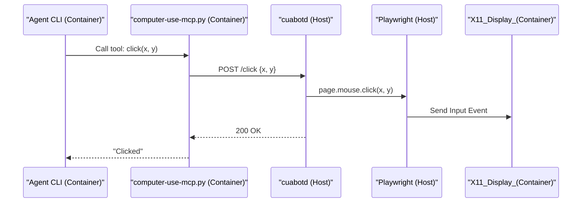

<!-- source: DeepWiki mcp.deepwiki.com · repo trycua/cua · page 12.3 cuabot: Co-op Computer-Use · fetched 2026-10-29 -->

# cuabot: Co-op Computer-Use

Relevant source files

The following files were used as context for generating this wiki page:

- [.github/workflows/cd-container-cuabot.yml](.github/workflows/cd-container-cuabot.yml)
- [.github/workflows/cd-ts-cuabot.yml](.github/workflows/cd-ts-cuabot.yml)
- [.github/workflows/ci-container-cuabot.yml](.github/workflows/ci-container-cuabot.yml)
- [docs/public/img/cuabot-screenshot.png](docs/public/img/cuabot-screenshot.png)
- [img/cuabot-screenshot.png](img/cuabot-screenshot.png)
- [libs/cuabot/.bumpversion.cfg](libs/cuabot/.bumpversion.cfg)
- [libs/cuabot/.npmignore](libs/cuabot/.npmignore)
- [libs/cuabot/Dockerfile](libs/cuabot/Dockerfile)
- [libs/cuabot/README.md](libs/cuabot/README.md)
- [libs/cuabot/bin/cuabot.js](libs/cuabot/bin/cuabot.js)
- [libs/cuabot/package.json](libs/cuabot/package.json)
- [libs/cuabot/pnpm-lock.yaml](libs/cuabot/pnpm-lock.yaml)
- [libs/cuabot/src/cuabot.tsx](libs/cuabot/src/cuabot.tsx)
- [libs/cuabot/src/cuabotd.ts](libs/cuabot/src/cuabotd.ts)
- [libs/cuabot/src/mcp/computer-use-mcp.py](libs/cuabot/src/mcp/computer-use-mcp.py)
- [libs/cuabot/src/mcp/overlay-cursor.py](libs/cuabot/src/mcp/overlay-cursor.py)
- [libs/cuabot/src/onboarding.tsx](libs/cuabot/src/onboarding.tsx)
- [libs/cuabot/src/prompts/SYSTEM.md](libs/cuabot/src/prompts/SYSTEM.md)
- [libs/cuabot/src/scripts/agent-device-wrapper.sh](libs/cuabot/src/scripts/agent-device-wrapper.sh)
- [libs/cuabot/src/scripts/entrypoint.sh](libs/cuabot/src/scripts/entrypoint.sh)
- [libs/cuabot/src/settings.ts](libs/cuabot/src/settings.ts)
- [libs/cuabot/src/telemetry.ts](libs/cuabot/src/telemetry.ts)
- [libs/cuabot/src/utils.ts](libs/cuabot/src/utils.ts)

`cuabot` is a CLI and daemon system designed to run computer-use agents (such as Claude Code) inside sandboxed, graphical environments [libs/cuabot/package.json:2-5](). It provides a "co-op" experience by allowing human users to observe and interact with the same desktop environment the agent is controlling via Xpra integration [libs/cuabot/src/cuabotd.ts:3-7]().

## Architecture Overview

The system consists of three primary layers:
1.  **cuabot CLI**: The user-facing entry point for session management and agent execution [libs/cuabot/src/cuabot.tsx:1-4]().
2.  **cuabotd (Daemon)**: A background HTTP/WebSocket server that manages the Docker lifecycle, Xpra sessions, and browser-based automation for the sandbox [libs/cuabot/src/cuabotd.ts:3-7]().
3.  **Sandboxed Environment**: A Docker container running X11/Xpra, pre-configured with agent CLIs (Claude, Gemini, etc.) and an MCP server for computer control [libs/cuabot/src/cuabotd.ts:38-40]().

### System Component Relationship

The following diagram maps the high-level functional areas to their implementation entities in the codebase.

Title: cuabot Component Mapping

Sources: [libs/cuabot/src/cuabot.tsx:83-88](), [libs/cuabot/src/cuabotd.ts:3-7](), [libs/cuabot/src/cuabotd.ts:38-40](), [libs/cuabot/Dockerfile:69-72]()

---

## cuabotd: The Control Daemon

`cuabotd` is the central orchestrator. It handles the complexity of Docker container management and provides an HTTP API for computer control tools [libs/cuabot/src/cuabotd.ts:3-7]().

### Key Functions
- **`ensureContainer()`**: Checks if a session-specific container exists and is running. If not, it pulls the `trycua/cuabot:latest` image and starts a new container with appropriate volume mounts for config persistence, specifically mounting Claude and Android SDK directories [libs/cuabot/src/cuabotd.ts:207-211](), [libs/cuabot/src/cuabotd.ts:120-132]().
- **`startServer()`**: Initializes the HTTP server (default port 7842), sets up telemetry via `initTelemetry()`, and starts the Xpra client process to attach the host GUI to the container [libs/cuabot/src/cuabotd.ts:33](), [libs/cuabot/src/cuabotd.ts:230-231](), [libs/cuabot/src/telemetry.ts:184-187]().
- **`runCommand()`**: Manages WebSocket connections for interactive shell sessions, using `@lydell/node-pty` to bridge the host terminal to the containerized bash shell [libs/cuabot/src/cuabot.tsx:90-118](), [libs/cuabot/package.json:27]().

### Session Management
`cuabot` supports named sessions via the `--name` or `-n` flag [libs/cuabot/src/cuabot.tsx:45-60](). Each named session creates a unique Docker container (e.g., `cuabot-xpra-mysession`) and a unique PID/port file in `~/.cuabot/` [libs/cuabot/src/cuabotd.ts:85-99]().

Sources: [libs/cuabot/src/cuabotd.ts:33-50](), [libs/cuabot/src/cuabotd.ts:85-99](), [libs/cuabot/src/cuabotd.ts:207-211]()

---

## Sandbox Implementation

The sandbox environment is defined in a `Dockerfile` based on Ubuntu 24.04 [libs/cuabot/Dockerfile:4]().

### Included Tooling and Capabilities
- **Xpra**: Version 6+ (checked at build time) is installed for seamless window forwarding [libs/cuabot/Dockerfile:28-35]().
- **Android Support**: The image includes `agent-device`, OpenJDK 17, and Android SDK command-line tools for mobile agent automation. A specialized `agent-device-wrapper.sh` handles system image downloads [libs/cuabot/Dockerfile:55-99](), [libs/cuabot/src/scripts/agent-device-wrapper.sh]().
- **Browsers**: Chromium is installed via the xtradeb PPA and wrapped to run with `--no-sandbox` inside the container [libs/cuabot/Dockerfile:108-116]().
- **Agent CLIs**: The image pre-installs `claude` (Claude Code), `uv`, and lazy-install wrappers for `aider`, `gemini`, `codex`, `openclaw`, and `vibe` [libs/cuabot/Dockerfile:151-164]().

### The MCP Bridge
Inside the container, a self-contained Python MCP server `computer-use-mcp.py` (run via `uv`) exposes tools to the agents [libs/cuabot/src/mcp/computer-use-mcp.py:1-10](). These tools (like `screenshot`, `click`, and `type_text`) make HTTP requests back to the host's `cuabotd` server (configured via `CUABOT_HOST`) [libs/cuabot/src/mcp/computer-use-mcp.py:20-30]().

Title: Computer-Use Tool Flow

Sources: [libs/cuabot/src/cuabotd.ts:3-7](), [libs/cuabot/src/mcp/computer-use-mcp.py:95-114](), [libs/cuabot/Dockerfile:151-164]()

---

## Onboarding and Setup

The `cuabot` CLI includes an interactive onboarding flow built with `ink` and `React` [libs/cuabot/src/onboarding.tsx:6-7]().

### Initialization Steps
1.  **Dependency Check**: Verifies Docker, Xpra, and Playwright are installed [libs/cuabot/src/onboarding.tsx:8-14]().
2.  **Image Preparation**: Pulls the `trycua/cuabot:latest` Docker image if missing [libs/cuabot/src/onboarding.tsx:13-14]().
3.  **Alias Configuration**: Attempts to add `alias cuabot="npx -y cuabot"` to the user's shell profile (`.zshrc`, `.bashrc`, or PowerShell profile) to ensure the command is globally available [libs/cuabot/src/onboarding.tsx:83-110]().
4.  **Settings**: Configures the default agent (e.g., `claude`, `aider`, `gemini`) and telemetry preferences [libs/cuabot/src/settings.ts:18-49](), [libs/cuabot/src/onboarding.tsx:241-250]().

Sources: [libs/cuabot/src/onboarding.tsx:38-50](), [libs/cuabot/src/onboarding.tsx:83-110](), [libs/cuabot/src/settings.ts:5-16]()

---

## Telemetry and Monitoring

`cuabot` implements a telemetry system powered by PostHog to track usage and improve agent performance [libs/cuabot/src/telemetry.ts]().

- **CLI Telemetry**: `sendCliTelemetry` tracks CLI invocations, arguments, and environment metadata [libs/cuabot/src/cuabot.tsx:71-81]().
- **MCP Tool Tracking**: The `log_mcp_tool_call` function in the MCP server filters out large data (like screenshots) and sends tool usage events to the host `cuabotd` [libs/cuabot/src/mcp/computer-use-mcp.py:36-51]().
- **Daemon Integration**: `CuabotTelemetry` (in `cuabotd`) manages the connection to PostHog, recording startup, shutdown, and proxied events [libs/cuabot/src/telemetry.ts:61-68](), [libs/cuabot/src/telemetry.ts:127-148]().
- **History Scraping**: The system can scrape `history.jsonl` from Claude Code to track `prompt_change` events [libs/cuabot/src/telemetry.ts:224-251]().

Sources: [libs/cuabot/src/cuabot.tsx:71-81](), [libs/cuabot/src/settings.ts:86-101](), [libs/cuabot/src/mcp/computer-use-mcp.py:36-51](), [libs/cuabot/src/telemetry.ts:15-21]()

---

