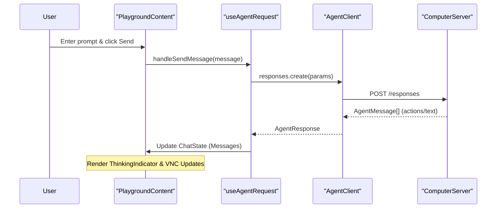
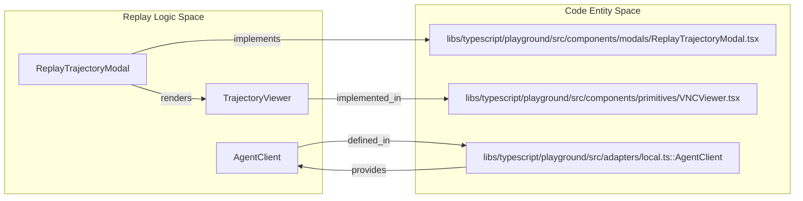

<!-- source: DeepWiki mcp.deepwiki.com · repo trycua/cua · page 12.4 Playground, Samples and Demo Apps · fetched 2026-10-29 -->

# Playground, Samples and Demo Apps

<details>
<summary>Relevant source files</summary>

The following files were used as context for generating this wiki page:

- [.github/workflows/cd-ts-playground.yml](.github/workflows/cd-ts-playground.yml)
- [apps/cua-spaces-macos/CHANGELOG.md](apps/cua-spaces-macos/CHANGELOG.md)
- [apps/cua-spaces-macos/Support/Info.plist](apps/cua-spaces-macos/Support/Info.plist)
- [apps/cua-spaces-macos/VERSION](apps/cua-spaces-macos/VERSION)
- [apps/cua-spaces/package.json](apps/cua-spaces/package.json)
- [apps/cua-spaces/src-tauri/Cargo.lock](apps/cua-spaces/src-tauri/Cargo.lock)
- [apps/cua-spaces/src-tauri/Cargo.toml](apps/cua-spaces/src-tauri/Cargo.toml)
- [apps/cua-spaces/src-tauri/tauri.conf.json](apps/cua-spaces/src-tauri/tauri.conf.json)
- [libs/cua-driver/examples/jev-use/README.md](libs/cua-driver/examples/jev-use/README.md)
- [libs/cua-driver/examples/jev-use/python/capture_window_state.py](libs/cua-driver/examples/jev-use/python/capture_window_state.py)
- [libs/cua-driver/examples/jev-use/python/native.py](libs/cua-driver/examples/jev-use/python/native.py)
- [libs/cua-driver/examples/jev-use/python/native_tasks.py](libs/cua-driver/examples/jev-use/python/native_tasks.py)
- [libs/cua-driver/examples/jev-use/python/run_native.py](libs/cua-driver/examples/jev-use/python/run_native.py)
- [libs/cua-driver/examples/jev-use/python/tests/test_native_canvas.py](libs/cua-driver/examples/jev-use/python/tests/test_native_canvas.py)
- [libs/cua-driver/examples/jev-use/python/tests/test_native_platforms.py](libs/cua-driver/examples/jev-use/python/tests/test_native_platforms.py)
- [libs/cua-driver/examples/jev-use/typescript/native.ts](libs/cua-driver/examples/jev-use/typescript/native.ts)
- [libs/cua-driver/examples/jev-use/typescript/native_canvas.test.ts](libs/cua-driver/examples/jev-use/typescript/native_canvas.test.ts)
- [libs/cua-driver/examples/jev-use/typescript/native_platforms.test.ts](libs/cua-driver/examples/jev-use/typescript/native_platforms.test.ts)
- [libs/cua-driver/examples/jev-use/typescript/native_tasks.ts](libs/cua-driver/examples/jev-use/typescript/native_tasks.ts)
- [libs/cua-driver/examples/jev-use/typescript/run_native.ts](libs/cua-driver/examples/jev-use/typescript/run_native.ts)
- [libs/cua-driver/examples/jev-use/verify_native.py](libs/cua-driver/examples/jev-use/verify_native.py)
- [libs/typescript/playground/.bumpversion.cfg](libs/typescript/playground/.bumpversion.cfg)
- [libs/typescript/playground/package.json](libs/typescript/playground/package.json)
- [libs/typescript/playground/src/adapters/index.ts](libs/typescript/playground/src/adapters/index.ts)
- [libs/typescript/playground/src/adapters/local.ts](libs/typescript/playground/src/adapters/local.ts)
- [libs/typescript/playground/src/adapters/types.ts](libs/typescript/playground/src/adapters/types.ts)
- [libs/typescript/playground/src/components/Playground.tsx](libs/typescript/playground/src/components/Playground.tsx)
- [libs/typescript/playground/src/components/composed/ChatArea.tsx](libs/typescript/playground/src/components/composed/ChatArea.tsx)
- [libs/typescript/playground/src/components/composed/ChatContent.tsx](libs/typescript/playground/src/components/composed/ChatContent.tsx)
- [libs/typescript/playground/src/components/composed/ChatList.tsx](libs/typescript/playground/src/components/composed/ChatList.tsx)
- [libs/typescript/playground/src/components/composed/ChatSidebar.tsx](libs/typescript/playground/src/components/composed/ChatSidebar.tsx)
- [libs/typescript/playground/src/components/composed/EmptyState.tsx](libs/typescript/playground/src/components/composed/EmptyState.tsx)
- [libs/typescript/playground/src/components/composed/PlaygroundContent.tsx](libs/typescript/playground/src/components/composed/PlaygroundContent.tsx)
- [libs/typescript/playground/src/components/modals/ReplayTrajectoryModal.tsx](libs/typescript/playground/src/components/modals/ReplayTrajectoryModal.tsx)
- [libs/typescript/playground/src/components/modals/index.ts](libs/typescript/playground/src/components/modals/index.ts)
- [libs/typescript/playground/src/components/primitives/ChatInput.tsx](libs/typescript/playground/src/components/primitives/ChatInput.tsx)
- [libs/typescript/playground/src/components/primitives/VNCIframe.tsx](libs/typescript/playground/src/components/primitives/VNCIframe.tsx)
- [libs/typescript/playground/src/components/primitives/VNCViewer.tsx](libs/typescript/playground/src/components/primitives/VNCViewer.tsx)
- [libs/typescript/playground/src/context/ChatProvider.tsx](libs/typescript/playground/src/context/ChatProvider.tsx)
- [libs/typescript/playground/src/context/PlaygroundProvider.tsx](libs/typescript/playground/src/context/PlaygroundProvider.tsx)
- [libs/typescript/playground/src/hooks/index.ts](libs/typescript/playground/src/hooks/index.ts)
- [libs/typescript/playground/src/hooks/useAgentRequest.ts](libs/typescript/playground/src/hooks/useAgentRequest.ts)
- [libs/typescript/playground/src/index.ts](libs/typescript/playground/src/index.ts)
- [libs/typescript/playground/src/styles.css](libs/typescript/playground/src/styles.css)
- [rfcs/4268-jev-use-native-candidates.md](rfcs/4268-jev-use-native-candidates.md)
- [samples/openkoalabot-example-tauri/src-tauri/Cargo.lock](samples/openkoalabot-example-tauri/src-tauri/Cargo.lock)

</details>


## Purpose and Scope

This document describes the `@trycua/playground` component, playground scripts, and the `samples/` tree. These components provide automated setup for running the Cua Gradio web interface, a reusable React-based playground for building custom agent interfaces, and various demo applications showcasing Cua's capabilities across different platforms and languages. The scripts handle environment creation, dependency installation, API key management, and VM provider setup.

For information about the Gradio UI itself, see [Gradio Web UI](12.2). For execution environment details, see [Execution Environments](4).

## Overview

Cua provides two primary playground setup scripts, a specialized TypeScript package, and a collection of sample applications:

| Component | Purpose | Environment | Target Users |
|-----------|---------|-------------|--------------|
| `playground.sh` | Standalone Python setup | Isolated venv in `~/.cua-demo` | End users wanting a simple demo |
| `playground-docker.sh` | Docker-based dev setup | Docker container with full repo | Developers and advanced users |
| `@trycua/playground` | Reusable UI Components | React/TypeScript applications | Frontend developers building agent UIs |
| `samples/` tree | Demo applications | Various (TS, Swift, Tauri, iOS, macOS) | Developers exploring Cua's SDKs |

Sources: [libs/typescript/playground/package.json:2-5](), [libs/typescript/playground/src/index.ts:4-5]()

## Setup Scripts Architecture

```mermaid
graph TB
    subgraph "playground.sh Flow"
        Start1["User runs playground.sh"]
        Choice1["Choose provider:<br/>1. Cloud<br/>2. macOS VM"]
        Cloud1["Cloud Setup:<br/>- Request CUA_API_KEY<br/>- Check existing .env.local"]
        Mac1["macOS Setup:<br/>- Verify Apple Silicon<br/>- Verify macOS 15+<br/>- Install Lume CLI<br/>- Pull macos-sequoia-cua"]
        Venv1["Create venv at<br/>~/.cua-demo/venv"]
        Install1["pip install:<br/>- cua-computer<br/>- cua-agent[all]"]
        Generate1["Generate:<br/>- run_demo.py<br/>- start_ui.sh<br/>- .env.local"]
        Launch1["Launch Gradio UI"]
        
        Start1 --> Choice1
        Choice1 --> Cloud1
        Choice1 --> Mac1
        Cloud1 --> Venv1
        Mac1 --> Venv1
        Venv1 --> Install1
        Install1 --> Generate1
        Generate1 --> Launch1
    end
    
    subgraph "playground-docker.sh Flow"
        Start2["User runs<br/>playground-docker.sh"]
        Choice2["Choose provider:<br/>1. Cloud<br/>2. macOS VM<br/>3. Windows VM"]
        Repo2["Clone or update repo<br/>to ~/.cua/cua"]
        Cloud2["Cloud Setup:<br/>- Request CUA_API_KEY"]
        Mac2["macOS Setup:<br/>- Verify Apple Silicon<br/>- Install Lume<br/>- Pull/start VM"]
        Win2["Windows Setup:<br/>- Verify Windows 10/11"]
        Docker2["Build cua-dev-image<br/>if not exists"]
        Generate2["Generate:<br/>- start_ui.sh<br/>- .env.local"]
        Launch2["Run agent_ui_examples.py<br/>in Docker container"]
        
        Start2 --> Choice2
        Choice2 --> Repo2
        Repo2 --> Cloud2
        Repo2 --> Mac2
        Repo2 --> Win2
        Cloud2 --> Docker2
        Mac2 --> Docker2
        Win2 --> Docker2
        Docker2 --> Generate2
        Generate2 --> Launch2
    end
```



## TypeScript Playground Component

The `@trycua/playground` package provides a high-level `Playground` component that orchestrates agent interaction, sandbox management, and visual feedback. It is built using React and Tailwind CSS [libs/typescript/playground/src/styles.css:1-55]().

### Core Architecture: Data Flow

The playground uses a provider-based architecture where the UI communicates with sandboxes via `AgentClient` and specialized hooks.



Sources: [libs/typescript/playground/src/components/Playground.tsx:105-141](), [libs/typescript/playground/src/hooks/useAgentRequest.ts:189-215](), [libs/typescript/playground/src/hooks/useAgentRequest.ts:54-105]()

### Key Components

*   **Playground**: The root entry point that wraps the application in `PlaygroundProvider` and `ChatProvider` [libs/typescript/playground/src/components/Playground.tsx:5-6](). It handles initial loading and error states [libs/typescript/playground/src/components/Playground.tsx:164-184]().
*   **PlaygroundContent**: Orchestrates the main business logic, handles mobile responsiveness, and manages chat creation with auto-selected models [libs/typescript/playground/src/components/composed/PlaygroundContent.tsx:96-156]().
*   **ChatContent**: Provides the main interaction area, including `ChatArea` for message history and `ChatInput` for user commands [libs/typescript/playground/src/components/composed/ChatContent.tsx:75-182]().
*   **VNCViewer**: Provides real-time visual feedback from the remote sandbox using `VNCIframe` [libs/typescript/playground/src/components/primitives/VNCIframe.tsx:1-5]().
*   **TrajectoryViewer**: A specialized component for replaying agent sessions and analyzing step-by-step actions [libs/typescript/playground/src/index.ts:98-98](). It uses specific layout styles to handle display/sidebar splits [libs/typescript/playground/src/styles.css:7-27]().

### Replay and Trajectory Persistence

The playground supports session persistence and trajectory analysis. The `ReplayTrajectoryModal` fetches session data and generates temporary `File` objects representing the trajectory structure (screenshots and JSON responses) to be consumed by the `TrajectoryViewer` [libs/typescript/playground/src/components/modals/ReplayTrajectoryModal.tsx:133-201]().



Sources: [libs/typescript/playground/src/index.ts:91-98](), [libs/typescript/playground/src/hooks/useAgentRequest.ts:32-105](), [libs/typescript/playground/src/components/modals/index.ts:1-6](), [libs/typescript/playground/src/components/modals/ReplayTrajectoryModal.tsx:42-57]()

## Agent Communication (AgentClient)

The `AgentClient` class handles the low-level HTTP communication with the computer-use agent server [libs/typescript/playground/src/hooks/useAgentRequest.ts:32-105]().

*   **Health Checks**: It uses the `/cmd` endpoint to verify server reachability [libs/typescript/playground/src/hooks/useAgentRequest.ts:38-52]().
*   **Response Generation**: The `responses.create` method sends the model, message history, and environment variables to the `/responses` endpoint [libs/typescript/playground/src/hooks/useAgentRequest.ts:54-104]().
*   **Retries**: It supports configurable retries (defaulting to 3) for robust communication over unstable networks [libs/typescript/playground/src/hooks/useAgentRequest.ts:61-65]().

Sources: [libs/typescript/playground/src/hooks/useAgentRequest.ts:32-105]()

## Ghost Typing and UX

The `ChatInput` component features a "ghost typing" hook to provide users with prompt inspiration when the input is empty [libs/typescript/playground/src/components/primitives/ChatInput.tsx:17-75]().

*   **Prompt Rotation**: It cycles through a set of predefined prompts like "Describe my screen" or "Type ls in terminal" [libs/typescript/playground/src/components/primitives/ChatInput.tsx:17-23]().
*   **Typing Animation**: It simulates real typing and deleting behavior with configurable timeouts [libs/typescript/playground/src/components/primitives/ChatInput.tsx:48-69]().

Sources: [libs/typescript/playground/src/components/primitives/ChatInput.tsx:17-75](), [libs/typescript/playground/src/components/primitives/ChatInput.tsx:174-175]()

## Samples and Demo Applications

The `samples/` directory contains various demo applications showcasing Cua's capabilities across different platforms and programming languages. These examples serve as practical guides for integrating with the Cua SDKs and demonstrating specific features.

### `openkoalabot` Examples

The `openkoalabot` examples demonstrate how to build agents using TypeScript, Swift, and Tauri.

*   **TypeScript**: Provides a basic agent implementation using the TypeScript SDK.
*   **Swift**: Showcases agent development in Swift, often integrating with macOS-specific features.
*   **Tauri**: The `openkoalabot-example-tauri` application [samples/openkoalabot-example-tauri/src-tauri/Cargo.lock]() demonstrates building cross-platform desktop applications with a web frontend and Rust backend, leveraging Cua's capabilities.

### `cua-bots` iOS/macOS

These samples focus on building Cua-powered applications for Apple platforms. They demonstrate integration with iOS and macOS native features, potentially including UI automation and system interactions.

### `infinite-canvas-swift`

This Swift-based sample likely explores advanced graphical interactions or a specialized canvas environment, demonstrating Cua's ability to interact with complex visual interfaces.

### `driver` Demos

The `libs/cua-driver/examples/` directory contains various demos for the `cua-driver`, focusing on background computer-use and interaction with native applications.

#### `jev-use` Example

The `jev-use` example [libs/cua-driver/examples/jev-use/README.md:1-549]() demonstrates how to use TypeSafe Jev with Cua Driver for bounded decision loops in browser and native desktop applications.

*   **Purpose**: Proves deterministic execution of browser and native tasks without credentials or network access to Jev, and verifies the same loop against a live Jev service if an API key is available [libs/cua-driver/examples/jev-use/README.md:34-37]().
*   **Architecture**:
    *   Uses a persistent `cua-driver mcp` connection [libs/cua-driver/examples/jev-use/README.md:45-45]().
    *   Creates isolated Chromium profiles with `browser_prepare` [libs/cua-driver/examples/jev-use/README.md:46-46]().
    *   Navigates to loopback fixtures using typed browser tools [libs/cua-driver/examples/jev-use/README.md:47-47]().
    *   Captures browser snapshots before actions [libs/cua-driver/examples/jev-use/README.md:48-48]().
    *   Constructs immutable candidates, including `reobserve` and `abstain` choices [libs/cua-driver/examples/jev-use/README.md:49-50]().
    *   Uses fresh page references for typing and semantic clicking, or validated visual regions for `Submit` [libs/cua-driver/examples/jev-use/README.md:51-53]().
    *   Verifies success via the fixture's `/state` endpoint, not action response or screenshots [libs/cua-driver/examples/jev-use/README.md:54-55]().
*   **Candidate Sources**:
    *   `BrowserSemanticSource`: Reads `get_browser_state` snapshots and acts through page references [libs/cua-driver/examples/jev-use/README.md:63-64]().
    *   `VisualRegionSource`: Reads validated `parse_visual_regions` and acts through capture-bound clicks [libs/cua-driver/examples/jev-use/README.md:64-65]().
    *   `NativeAccessibilitySource`: Builds candidates from native accessibility elements returned by `get_window_state` [libs/cua-driver/examples/jev-use/README.md:77-78](). This is detailed in [RFC #4268](rfcs/4268-jev-use-native-candidates.md) [libs/cua-driver/examples/jev-use/README.md:77-77]().
*   **Native Desktop Tasks**:
    *   Supports macOS AX, Windows UIA, and Linux AT-SPI roles, mapping them to a closed set of role classes (e.g., `button`, `text_input`) [libs/cua-driver/examples/jev-use/README.md:82-85]().
    *   Candidates are derived from role class, label, and actionable-ancestor path, ensuring stability across snapshots [libs/cua-driver/examples/jev-use/README.md:87-88]().
    *   Visual regions from OmniParser are used as a fallback when the accessibility tree is empty or lacks a declared visual target [libs/cua-driver/examples/jev-use/README.md:103-106]().
*   **Verification**: The `verify_native.py` script [libs/cua-driver/examples/jev-use/verify_native.py:1-370]() is used to verify native `jev-use` tasks against repository harnesses (AppKit, WPF, WinUI3, GTK3, or a visual-only canvas fixture). It launches a fresh harness, runs the native runner, and checks the harness state against expected end states [libs/cua-driver/examples/jev-use/verify_native.py:1-18]().

```mermaid
graph TD
    subgraph "jev-use System"
        User["User/Agent"]
        CuaDriver["Cua Driver"]
        JevService["TypeSafe Jev Service (Optional)"]
        BrowserApp["Browser Application"]
        NativeApp["Native Desktop Application"]
        TaskOracle["Task Oracle (/state endpoint)"]
    end

    subgraph "Candidate Generation"
        BrowserSemanticSource["BrowserSemanticSource<br/>(get_browser_state)"]
        VisualRegionSource["VisualRegionSource<br/>(parse_visual_regions)"]
        NativeAccessibilitySource["NativeAccessibilitySource<br/>(get_window_state)"]
    end

    User --> CuaDriver: "Request action"
    CuaDriver --> BrowserApp: "Observe DOM"
    CuaDriver --> NativeApp: "Observe Accessibility Tree"
    CuaDriver --> BrowserSemanticSource
    CuaDriver --> VisualRegionSource
    CuaDriver --> NativeAccessibilitySource

    BrowserSemanticSource --> Candidates["Candidates (id, description, tool)"]
    VisualRegionSource --> Candidates
    NativeAccessibilitySource --> Candidates

    Candidates --> JevService: "Bounded choice request"
    JevService --> CuaDriver: "Selected ID"
    CuaDriver --> BrowserApp: "Perform action"
    CuaDriver --> NativeApp: "Perform action"
    CuaDriver --> TaskOracle: "Verify result"
    TaskOracle --> CuaDriver: "Success/Failure"
```
Sources: [libs/cua-driver/examples/jev-use/README.md:1-113](), [libs/cua-driver/examples/jev-use/python/native_tasks.py:1-1](), [libs/cua-driver/examples/jev-use/typescript/native_tasks.ts:1-1](), [libs/cua-driver/examples/jev-use/python/run_native.py:1-1](), [libs/cua-driver/examples/jev-use/typescript/run_native.ts:1-1](), [libs/cua-driver/examples/jev-use/python/tests/test_native_canvas.py:1-1](), [libs/cua-driver/examples/jev-use/typescript/native_canvas.test.ts:1-1](), [libs/cua-driver/examples/jev-use/typescript/native_platforms.test.ts:1-1](), [libs/cua-driver/examples/jev-use/python/tests/test_native_platforms.py:1-1](), [libs/cua-driver/examples/jev-use/python/native.py:1-1](), [libs/cua-driver/examples/jev-use/typescript/native.ts:1-1](), [libs/cua-driver/examples/jev-use/python/capture_window_state.py:1-1]()

### `examples/streaming` Clients

The `examples/streaming` directory contains client implementations for the Cua media streaming stack in Rust, Swift, Kotlin, Python, and TypeScript. These clients demonstrate how to consume low-latency desktop video and audio streams from Cua Spaces.

## Development and Release

The TypeScript playground package is managed with `pnpm` and uses `tsdown` for builds [libs/typescript/playground/package.json:4-69]().

*   **Versioning**: Managed via `bumpp` in the release script [libs/typescript/playground/package.json:73](). The current version is `0.3.0` [libs/typescript/playground/.bumpversion.cfg:2]().
*   **CI/CD**: Automatic releases are handled by GitHub Actions when versions are bumped, specifically by the `cd-ts-playground.yml` workflow [libs/typescript/playground/package.json:73]().

Sources: [libs/typescript/playground/package.json:66-76](), [libs/typescript/playground/.bumpversion.cfg:2](), [.github/workflows/cd-ts-playground.yml:1-1]()

---

