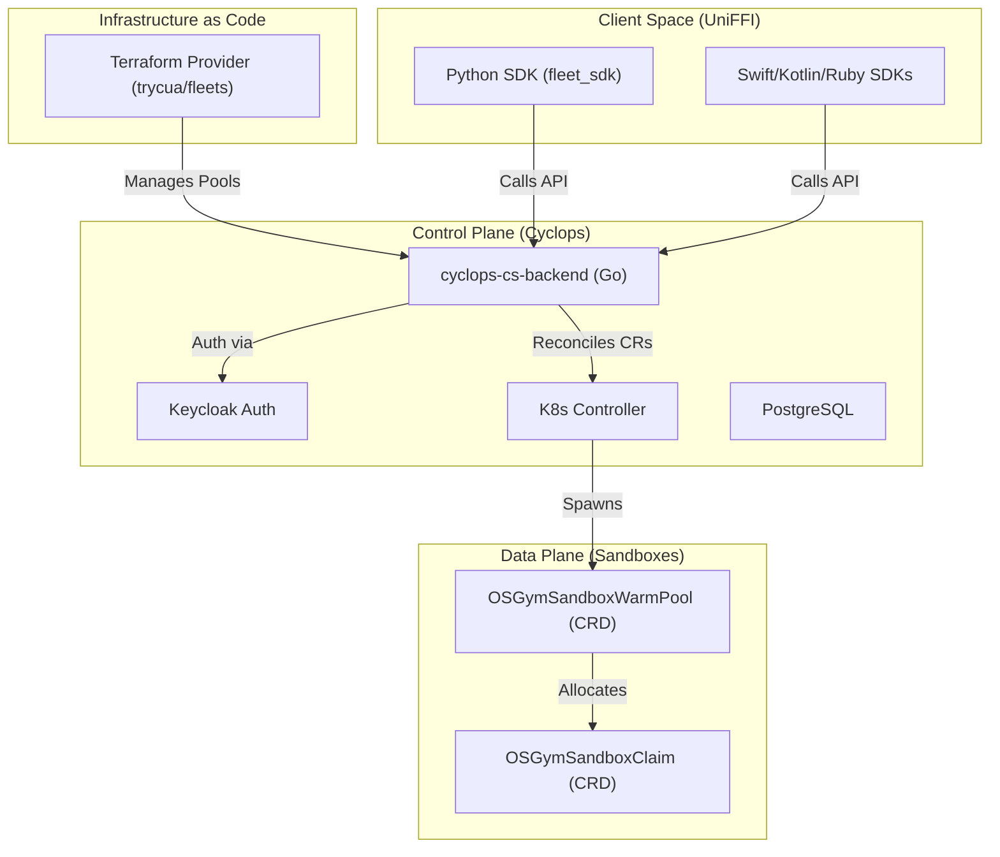
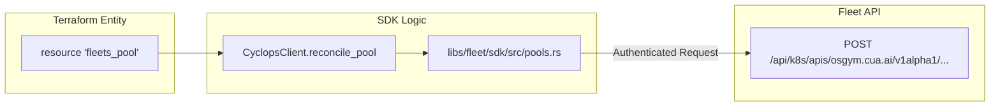

<!-- source: DeepWiki mcp.deepwiki.com · repo trycua/cua · page 13 Fleet and Cloud Infrastructure · fetched 2026-10-29 -->

# Fleet and Cloud Infrastructure

<details>
<summary>Relevant source files</summary>

The following files were used as context for generating this wiki page:

- [libs/fleet/backend/auth/auth.go](libs/fleet/backend/auth/auth.go)
- [libs/fleet/backend/auth/authz.rego](libs/fleet/backend/auth/authz.rego)
- [libs/fleet/backend/auth/authz_test.rego](libs/fleet/backend/auth/authz_test.rego)
- [libs/fleet/backend/config/config.go](libs/fleet/backend/config/config.go)
- [libs/fleet/backend/config/config_test.go](libs/fleet/backend/config/config_test.go)
- [libs/fleet/backend/githubtrust/store.go](libs/fleet/backend/githubtrust/store.go)
- [libs/fleet/backend/githubtrust/store_pg_test.go](libs/fleet/backend/githubtrust/store_pg_test.go)
- [libs/fleet/backend/githubtrust/types.go](libs/fleet/backend/githubtrust/types.go)
- [libs/fleet/backend/go.mod](libs/fleet/backend/go.mod)
- [libs/fleet/backend/go.sum](libs/fleet/backend/go.sum)
- [libs/fleet/backend/handlers/handlers.go](libs/fleet/backend/handlers/handlers.go)
- [libs/fleet/backend/main.go](libs/fleet/backend/main.go)
- [libs/fleet/backend/main_test.go](libs/fleet/backend/main_test.go)
- [libs/fleet/backend/metrics/metrics.go](libs/fleet/backend/metrics/metrics.go)

</details>


The Fleet and Cloud Infrastructure system provides the orchestration layer for managing large-scale pools of computer-use sandboxes. It enables the transition from running a single agent on a local machine to managing "fleets" of agents across distributed cloud resources. This infrastructure is composed of a Go-based backend (Cyclops), a suite of multi-language SDKs generated via UniFFI, and a Terraform provider for Infrastructure-as-Code (IaC) management of sandbox pools.

### Fleet System Context

The following diagram illustrates how the Fleet infrastructure bridges the gap between high-level orchestration (Terraform/SDKs) and the low-level sandbox execution environments.

**Fleet Orchestration Logic**

Sources: [libs/fleet/backend/main.go:1-14](), [libs/fleet/sdk/src/pools.rs:18-21](), [libs/fleet/sdk/src/lib.rs:1-10]()

## Fleet Architecture and Cyclops Backend

The core of the fleet system is the **Cyclops** backend service (`cyclops-cs-backend`). It acts as the central control plane, managing the lifecycle of `OSGymSandboxWarmPool` and `OSGymSandboxClaim` Custom Resources (CRs) within a Kubernetes environment.

Key responsibilities include:
*   **Backend API**: The `cyclops-cs-backend` is a Go application that provides the main API endpoints for managing fleet resources [libs/fleet/backend/main.go:1-14](). It uses a standard `Trace → Log → TokenAuth → OPA → handler` pipeline for authenticated routes [libs/fleet/backend/main.go:3-6]().
*   **Configuration**: The backend's behavior is controlled by the `config.Configuration` struct, which loads settings from command-line flags, environment variables, and hardcoded defaults [libs/fleet/backend/config/config.go:30-44]().
*   **Handlers**: The `handlers` package defines the HTTP request handlers for various API endpoints, including those for configuration, authentication, and resource management [libs/fleet/backend/handlers/handlers.go:1-28]().
*   **OSGymSandboxClaim CRs**: All pool operations within the Cyclops backend leverage `OSGymSandboxClaim` Custom Resources (CRs) for managing sandbox allocations [libs/fleet/backend/main.go:14-14]().
*   **Pool Lifecycle**: The backend manages the entire lifecycle of sandbox pools, from creation to termination, ensuring resources are provisioned and de-provisioned efficiently.
*   **Signed URLs**: The system supports database-backed signed capability URLs, enabling secure, time-limited access to resources [libs/fleet/backend/config/config.go:118-126]().
*   **Metrics**: Prometheus metrics are collected for various aspects of the backend, including HTTP request duration, Keycloak interactions, and database readiness [libs/fleet/backend/metrics/metrics.go:34-135]().
*   **Control/Data Plane Separation**: The Cyclops backend primarily functions as a control plane, orchestrating resources, while the sandboxes themselves form the data plane where agents execute.

For details, see [Fleet Architecture and Cyclops Backend](#13.1).

Sources: [libs/fleet/backend/main.go:1-163](), [libs/fleet/backend/config/config.go:1-126](), [libs/fleet/backend/handlers/handlers.go:1-212](), [libs/fleet/backend/metrics/metrics.go:1-148]()

## Fleet Authentication, Authorization and Billing

The Fleet infrastructure implements robust mechanisms for user authentication, authorization, and usage-based billing.

*   **Keycloak/OIDC Authentication**: Authentication is handled via Keycloak and OpenID Connect (OIDC). The backend uses Keycloak for user authentication and managing service-account clients [libs/fleet/backend/main.go:9-10](). The `auth.Init` function fetches and refreshes JWKS from the configured issuer [libs/fleet/backend/auth/auth.go:137-184]().
*   **Middlewares**: A series of Go middlewares (`Trace`, `Log`, `TokenAuth`, `RouteContext`, `RouteMiddleware`) process incoming requests, handling tracing, logging, token validation, and policy enforcement [libs/fleet/backend/main.go:117-127]().
*   **Rego Policy Bundles**: Authorization is enforced using Open Policy Agent (OPA) with Rego policy bundles. These policies govern access to Kubernetes resources (`authz_k8s`), pool admission, and image rollout. The `authz.rego` module defines the principal vocabulary, including `is_admin` and token family predicates [libs/fleet/backend/auth/authz.rego:1-120]().
*   **Route-Authorization Tables**: The `auth.RouteMiddleware` looks up routes in a route-to-surface table to select the appropriate policy for authorization [libs/fleet/backend/main.go:82-86]().
*   **Workload Identity Federation**: The system supports workload identity federation, allowing OSGym pool VMs to obtain tenant-scoped OIDC tokens from a dedicated Keycloak workload realm [libs/fleet/backend/config/config.go:75-87]().
*   **Attribution and Product Analytics**: Product analytics are captured to track user activity and feature usage, with an option to enable/disable this functionality [libs/fleet/backend/config/config.go:159-166]().
*   **Usage Metering and Stripe Billing**: The system integrates with Stripe for billing, handling webhooks, checkout flows, and customer portal management [libs/fleet/backend/config/config.go:95-101](). Usage metering is enabled when a database URL is configured [libs/fleet/backend/config/config.go:131-132]().
*   **Postgres Migrator**: A PostgreSQL database is used for storing various backend data, including GitHub OIDC trust policies and signed service URLs [libs/fleet/backend/config/config.go:106-107](). The `auth.GitHubTrustPolicy` struct defines the schema for these policies [libs/fleet/backend/auth/auth.go:65-71]().

For details, see [Fleet Authentication, Authorization and Billing](#13.2).

Sources: [libs/fleet/backend/main.go:1-163](), [libs/fleet/backend/config/config.go:1-173](), [libs/fleet/backend/main_test.go:1-159](), [libs/fleet/backend/auth/auth.go:1-195](), [libs/fleet/backend/auth/authz.rego:1-120](), [libs/fleet/backend/auth/authz_test.rego:1-85](), [libs/fleet/backend/config/config_test.go:1-203](), [libs/fleet/backend/githubtrust/types.go:1-79]()

## Fleet SDK and Client Libraries

Cua provides multi-language support for interacting with the Fleet API through the `cyclops-sdk`. The core logic is implemented in Rust and exported to other languages using **UniFFI**.

| Package | Language | Source Implementation |
| :--- | :--- | :--- |
| `fleet_sdk` | Python | `libs/fleet/sdk-bindings/python/fleet_sdk/_sdk.py` |
| `CyclopsSdk` | Swift | `libs/fleet/sdk-bindings/swift/CyclopsSdk.swift` |
| `ai.cua.cyclops.sdk` | Kotlin | `libs/fleet/sdk-bindings/kotlin/ai/cua/cyclops/sdk/fleet_sdk.kt` |
| `FleetSdk` | Ruby | `libs/fleet/sdk-bindings/ruby/cyclops_sdk/sdk.rb` |

### Code Entity Association: Rust Core to Bindings
The Rust core defines the `CyclopsClient` and methods like `create_pool` [libs/fleet/sdk/src/pools.rs:18-21](). UniFFI then generates the low-level FFI boilerplate (e.g., `RustBuffer`, `ForeignBytes`) to bridge these calls into the target language runtimes.

```rust
// libs/fleet/sdk/src/pools.rs
#[uniffi::export]
impl CyclopsClient {
    pub async fn create_pool(
        self: Arc<Self>,
        request: CreatePoolRequest,
    ) -> Result<Pool, SdkError> { ... }
}
```
The `cyclops-sdk` Rust crate serves as the foundation for these bindings. It defines the core client logic and data structures for interacting with the Cyclops backend. Binding generation scripts automate the creation of language-specific wrappers. The `@trycua/fleet` client provides a TypeScript interface, while `cua-fleet`/`cua-train` offer Python facades. The `fleet_cloud` transport in `cua-sandbox` enables sandboxes to connect to the Fleet infrastructure.

For details, see [Fleet SDK and Client Libraries](#13.3).

Sources: [libs/fleet/sdk/src/pools.rs:16-70](), [libs/fleet/sdk-bindings/swift/CyclopsSdk.swift:1-42](), [libs/fleet/sdk-bindings/python/fleet_sdk/_sdk.py:1-115]()

## Terraform Provider for Fleets

The `trycua/fleets` Terraform provider allows developers to define their agent infrastructure as code. It is used to manage `OSGymWorkspacePool` resources, which represent clusters of sandboxes ready for agent execution.

**Provider Entity Mapping**

Sources: [libs/fleet/sdk/src/pools.rs:90-104](), [libs/fleet/sdk/tests/pool_flow.rs:15-18]()

Key features of the provider:
*   **Managing OSGymWorkspacePool resources**: The Terraform provider interacts with the Cyclops backend to create, update, and delete `OSGymWorkspacePool` resources, which define the desired state of sandbox pools.
*   **Generated Pool Resource Code**: The provider leverages generated code for pool resources, ensuring consistency and reducing manual effort.
*   **OAuth2 Credentials**: Authentication with the Cyclops backend typically uses OAuth2 credentials, managed by the `CyclopsClient` [libs/fleet/sdk/src/pools.rs:186-190]().
*   **Release Contract Tests**: The provider includes contract tests to ensure its compatibility and correctness with the Cyclops API.
*   **Local Installation**: Until official Registry publication, the provider can be installed locally for development and testing.

For details, see [Terraform Provider for Fleets](#13.4).

Sources: [libs/fleet/sdk/src/pools.rs:1-136](), [libs/fleet/sdk/tests/pool_flow.rs:20-49]()

---

