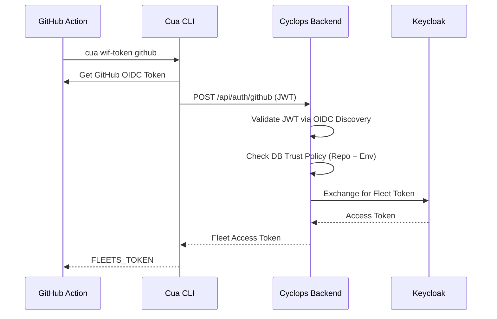

<!-- source: DeepWiki mcp.deepwiki.com · repo trycua/cua · page 13.1 Fleet Architecture and Cyclops Backend · fetched 2026-10-29 -->

# Fleet Architecture and Cyclops Backend

<details>
<summary>Relevant source files</summary>

The following files were used as context for generating this wiki page:

- [libs/fleet/backend/auth/auth.go](libs/fleet/backend/auth/auth.go)
- [libs/fleet/backend/auth/authz.rego](libs/fleet/backend/auth/authz.rego)
- [libs/fleet/backend/auth/authz_test.rego](libs/fleet/backend/auth/authz_test.rego)
- [libs/fleet/backend/auth/pool_admission.rego](libs/fleet/backend/auth/pool_admission.rego)
- [libs/fleet/backend/auth/pool_admission_test.rego](libs/fleet/backend/auth/pool_admission_test.rego)
- [libs/fleet/backend/config/config.go](libs/fleet/backend/config/config.go)
- [libs/fleet/backend/config/config_test.go](libs/fleet/backend/config/config_test.go)
- [libs/fleet/backend/githubtrust/store.go](libs/fleet/backend/githubtrust/store.go)
- [libs/fleet/backend/githubtrust/store_pg_test.go](libs/fleet/backend/githubtrust/store_pg_test.go)
- [libs/fleet/backend/githubtrust/types.go](libs/fleet/backend/githubtrust/types.go)
- [libs/fleet/backend/go.mod](libs/fleet/backend/go.mod)
- [libs/fleet/backend/go.sum](libs/fleet/backend/go.sum)
- [libs/fleet/backend/handlers/handlers.go](libs/fleet/backend/handlers/handlers.go)
- [libs/fleet/backend/main.go](libs/fleet/backend/main.go)
- [libs/fleet/backend/main_test.go](libs/fleet/backend/main_test.go)
- [libs/fleet/backend/metrics/metrics.go](libs/fleet/backend/metrics/metrics.go)
- [libs/fleet/sdk-bindings/go-uniffi/cyclops_sdk_schema/cyclops_sdk_schema.go](libs/fleet/sdk-bindings/go-uniffi/cyclops_sdk_schema/cyclops_sdk_schema.go)
- [libs/fleet/sdk-bindings/kotlin/ai/cua/cyclops/sdk/schema/cyclops_sdk_schema.kt](libs/fleet/sdk-bindings/kotlin/ai/cua/cyclops/sdk/schema/cyclops_sdk_schema.kt)
- [libs/fleet/sdk-bindings/python/fleet_sdk/_schema.py](libs/fleet/sdk-bindings/python/fleet_sdk/_schema.py)
- [libs/fleet/sdk-bindings/ruby/cyclops_sdk/schema.rb](libs/fleet/sdk-bindings/ruby/cyclops_sdk/schema.rb)
- [libs/fleet/sdk-bindings/swift/CyclopsSdkSchema.swift](libs/fleet/sdk-bindings/swift/CyclopsSdkSchema.swift)
- [libs/fleet/sdk-bindings/swift/CyclopsSdkSchemaFFI.h](libs/fleet/sdk-bindings/swift/CyclopsSdkSchemaFFI.h)
- [libs/fleet/sdk-bindings/ts-uniffi-browser/ts/cyclops_sdk_schema.ts](libs/fleet/sdk-bindings/ts-uniffi-browser/ts/cyclops_sdk_schema.ts)
- [libs/fleet/sdk-bindings/ts-uniffi/cyclops_sdk_schema.ts](libs/fleet/sdk-bindings/ts-uniffi/cyclops_sdk_schema.ts)
- [libs/fleet/sdk-schema/src/lib.rs](libs/fleet/sdk-schema/src/lib.rs)
- [libs/fleet/sdk-schema/src/warmpool.rs](libs/fleet/sdk-schema/src/warmpool.rs)
- [libs/fleet/sdk-schema/tests/claim_crds.rs](libs/fleet/sdk-schema/tests/claim_crds.rs)
- [libs/fleet/sdk-schema/tests/ffi_models.rs](libs/fleet/sdk-schema/tests/ffi_models.rs)

</details>


The Fleet infrastructure, powered by the **Cyclops** backend, provides a legacy-compatible and high-performance orchestration layer for managing pools of computer-use sandboxes at scale. It enables the management of execution environments across distributed Kubernetes clusters, providing a unified control plane for agent workloads.

## System Architecture

The Fleet system is architected with a strict separation between the **Control Plane** (Cyclops Backend) and the **Data Plane** (Sandboxes).

### High-Level Components

*   **Cyclops Backend (`cyclops-cs-backend`)**: A Go-based service providing Keycloak-authenticated key management, service proxies, and namespace management [libs/fleet/backend/main.go:1-20]().
*   **Keycloak**: The central identity provider managing interactive user JWTs (for the Dashboard and CLI) and Service Account clients (for API keys) [libs/fleet/backend/main.go:12-19]().
*   **PostgreSQL**: Stores application state, specifically GitHub Actions OIDC trust policies and potentially billing data [libs/fleet/backend/config/config.go:95-99]().
*   **Open Policy Agent (OPA)**: Integrated via `go-rego` to provide fine-grained, attribute-based access control (ABAC) for every API route [libs/fleet/backend/main.go:3-6]().
*   **Dashboard**: A React-based Single Page Application (SPA) using `@cloudscape-design` components for fleet management [libs/fleet/docs/browser-agent.md:1-3]().

### Control Plane Middleware Pipeline

Every authenticated request to the backend traverses a standardized middleware chain:
`Trace` → `Log` → `TokenAuth` → `OPA Policy` → `Handler` [libs/fleet/backend/main.go:3-10]().

### Architecture Diagram

```mermaid
graph TD
    subgraph "Control_Plane"
        SPA_Dashboard[SPA Dashboard] -- "REST API" --> Cyclops_CS_Backend[Cyclops CS Backend (Go)]
        Cyclops_CS_Backend -- "OIDC Admin API" --> Keycloak[Keycloak]
        Cyclops_CS_Backend -- "SQL" --> PostgreSQL_DB[PostgreSQL DB]
        Cyclops_CS_Backend -- "Rego Query" --> OPA_Engine[OPA Engine]
        Cyclops_CS_Backend -- "Signed URLs" --> S3[AWS S3 (Image Uploads)]
    end

    subgraph "Kubernetes_Cluster"
        Cyclops_CS_Backend -- "Proxy API" --> K8s_API_Server[K8s API Server]
        K8s_API_Server -- "Reconcile" --> OSGymSandboxClaim_CR[OSGymSandboxClaim CR]
        OSGymSandboxClaim_CR -- "Provision" --> Sandbox_VM_Container[Sandbox VM/Container]
    end

    subgraph "Client_Space"
        Agent_SDK[Agent SDK] -- "1. Claim Sandbox" --> Cyclops_CS_Backend
        Agent_SDK -- "2. Direct Data Stream" --> Sandbox_VM_Container
    end
```
**Sources:** [libs/fleet/backend/main.go:1-20](), [libs/fleet/backend/config/config.go:1-33](), [libs/fleet/backend/signedurls/signedurls.go](), [libs/fleet/backend/config/config.go:168-174]()

## Cyclops Backend (`cyclops-cs-backend`)

The backend is implemented in Go and utilizes `cobra` for the CLI entry point and `viper` for configuration management [libs/fleet/backend/config/config.go:1-20]().

### Configuration and Identity
The system differentiates between identity types via client-id prefixes:
*   `key-`: Prefix for pool or gateway client-id service accounts [libs/fleet/backend/config/config.go:55-55]().
*   `ukey-`: Prefix for per-user API keys used for automation [libs/fleet/backend/config/config.go:56-56]().

### Authorization Surfaces (OPA)
Authorization logic is decoupled into "surfaces," with OPA policies embedded directly into the Go binary. The `auth.RouteMiddleware` function looks up the route in a route-to-surface table to select the appropriate policy [libs/fleet/backend/main.go:80-88]().

| Surface Name | Rego File | Description |
| :--- | :--- | :--- |
| `authz-keys` | `authz_keys.rego` | Management of Keycloak service accounts. |
| `authz-namespaces` | `authz_namespaces.rego` | RBAC for Kubernetes namespaces. |
| `authz-github-trust` | `authz_github_trust.rego` | Policies for OIDC federation with GitHub. |
| `authz-orch` | `authz_orch.rego` | Proxying requests to the orchestrator. |
| `pool_admission` | `pool_admission.rego` | Admission control for `OSGymSandboxWarmPool` and `OSGymSandboxTemplate` resources. |

**Sources:** [libs/fleet/backend/main.go:80-88](), [libs/fleet/backend/auth/pool_admission.rego:1-5](), [libs/fleet/backend/auth/pool_admission_test.rego:1-8]()

## Sandbox Lifecycle Management

Lifecycle management utilizes `OSGymSandboxClaim` (and legacy `OSGymWorkspacePool`) Custom Resources. The OPA policy `pool_admission.rego` enforces security boundaries on these resources:

*   **Image Allowlisting**: Only verified ECR repository prefixes (e.g., `public.ecr.aws/k5j5w0x5/cua-ubuntu-24.04`) are allowed for non-admin users [libs/fleet/backend/auth/pool_admission.rego:9-18]().
*   **Resource Restrictions**: Features like `nestedVirtualization` or native `MacOS` runtimes are restricted to users with `is_admin` flags [libs/fleet/backend/auth/pool_admission.rego:159-196]().
*   **Claim Lifecycle**: Claims support `shutdownTime`, `shutdownPolicy`, and `autoRenew` fields to manage ephemeral costs. These fields are defined in the `ClaimLifecycle` struct in the SDK schema [libs/fleet/sdk-bindings/ts-uniffi-browser/ts/cyclops_sdk_schema.ts:52-56]().

### Pool Lifecycle Diagram

```mermaid
graph TD
    User[User/Terraform] -- "Create fleets_pool resource" --> TerraformProvider[Terraform Provider for Fleets]
    TerraformProvider -- "CreatePool(OSGymSandboxWarmPool)" --> CyclopsBackend[Cyclops Backend]
    CyclopsBackend -- "CreateTemplate(OSGymSandboxTemplate)" --> CyclopsBackend
    CyclopsBackend -- "K8s API (Impersonated)" --> K8sAPI[Kubernetes API Server]
    K8sAPI -- "Create OSGymSandboxWarmPool CR" --> K8sController[K8s Controller (Fleet)]
    K8sAPI -- "Create OSGymSandboxTemplate CR" --> K8sController
    K8sController -- "Reconcile" --> SandboxVM[Sandbox VM/Container]

    subgraph "OSGymSandboxWarmPool"
        direction LR
        StaticPool[Static Pool (replicas)]
        AutoscaledPool[Autoscaled Pool (autoscaling)]
    end

    TerraformProvider -- "ValidateConfig" --> PoolValidation[Pool Scaling Mode Validation]
    PoolValidation -- "Exactly one of replicas or autoscaling" --> TerraformProvider

    SandboxVM -- "Ready" --> Metrics[Prometheus Metrics]
    SandboxVM -- "Usage" --> Billing[Stripe Billing]
```
**Sources:** [libs/fleet/terraform-provider-fleets/docs/resources/pool.md:11-38](), [libs/fleet/terraform-provider-fleets/internal/provider/pool_resource.go:78-98](), [libs/fleet/backend/auth/pool_admission.rego:159-196](), [libs/fleet/sdk-bindings/ts-uniffi-browser/ts/cyclops_sdk_schema.ts:52-56]()

## Signed URLs

The Cyclops backend supports database-backed signed capability URLs. This feature requires a `BaseURL` and an `HMAC secret` (either directly or from a file) to be configured. If these are not set, the feature is disabled, and routes requiring it will return 503 errors [libs/fleet/backend/config/config.go:118-126]().

The `signedurls` package in the backend handles the creation and validation of these URLs [libs/fleet/backend/signedurls/signedurls.go]().

## GitHub Actions Integration (WIF)

The backend supports Workload Identity Federation (WIF) with GitHub Actions. This allows CI workflows to authenticate with Fleet without static secrets.

1.  **Trust Policy**: Users define a `GitHubTrustPolicy` in the dashboard, mapping a GitHub repository and OIDC issuer to allowed namespaces. The `GitHubTrustPolicy` struct is defined in [libs/fleet/backend/auth/auth.go:65-70]().
2.  **Token Exchange**: The Cua CLI performs a token exchange via `cua wif-token github`.
3.  **Authentication**: The backend validates the inbound GitHub JWT against the `GitHubOIDCIssuer` [libs/fleet/backend/config/config.go:60-61]() and the stored trust policies in the database [libs/fleet/backend/githubtrust/store.go]().


**Sources:** [libs/fleet/backend/config/config.go:59-65](), [libs/fleet/backend/githubtrust/store.go](), [libs/fleet/backend/auth/auth.go:65-70]()

## Monitoring and Metrics

The backend exports Prometheus metrics on a dedicated port (`:9091` by default) to keep `/metrics` traffic away from the main application API [libs/fleet/backend/metrics/metrics.go:13-15]().

Key Metrics:
*   `cyclops_cs_http_requests_total`: Total HTTP requests handled by the backend, labeled by method, normalized path, and status code [libs/fleet/backend/metrics/metrics.go:34-37]().
*   `cyclops_cs_http_request_duration_seconds`: Latency of HTTP requests [libs/fleet/backend/metrics/metrics.go:40-44]().
*   `cyclops_cs_active_requests`: Number of HTTP requests currently being processed [libs/fleet/backend/metrics/metrics.go:47-49]().
*   `cyclops_cs_namespace_create_phase_duration_seconds`: Latency of bounded phases in namespace creation [libs/fleet/backend/metrics/metrics.go:52-56]().
*   `cyclops_cs_keycloak_requests_total`: Total Keycloak admin API requests [libs/fleet/backend/metrics/metrics.go:59-62]().
*   `cyclops_cs_upstream_proxy_requests_total`: Total requests proxied to upstream services (e.g., K8s API) [libs/fleet/backend/metrics/metrics.go:70-73]().
*   `cyclops_cs_billing_webhook_events_total`: Stripe billing webhook events [libs/fleet/backend/metrics/metrics.go:75-78]().
*   `cyclops_cs_product_analytics_events_total`: Fleet product analytics events [libs/fleet/backend/metrics/metrics.go:80-83]().
*   `cyclops_cs_database_features_ready`: A gauge indicating if the PostgreSQL-backed features initialized successfully at startup [libs/fleet/backend/metrics/metrics.go:95-98]().
*   `cyclops_cs_state_query_ready`: A gauge for the Kubernetes state query executor behind `/api/state/query` [libs/fleet/backend/metrics/metrics.go:126-129]().

**Sources:** [libs/fleet/backend/metrics/metrics.go:1-135]()

---

