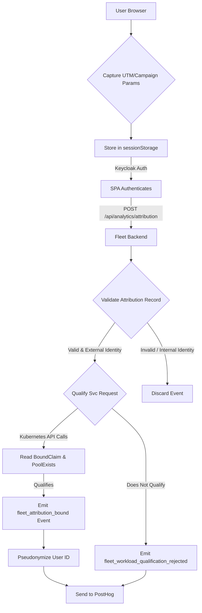

<!-- source: DeepWiki mcp.deepwiki.com · repo trycua/cua · page 13.2 Fleet Authentication, Authorization and Billing · fetched 2026-10-29 -->

# Fleet Authentication, Authorization and Billing

<details>
<summary>Relevant source files</summary>

The following files were used as context for generating this wiki page:

- [libs/fleet/backend/auth/authz_k8s.rego](libs/fleet/backend/auth/authz_k8s.rego)
- [libs/fleet/backend/auth/authz_k8s_test.rego](libs/fleet/backend/auth/authz_k8s_test.rego)
- [libs/fleet/backend/auth/authz_ownership.rego](libs/fleet/backend/auth/authz_ownership.rego)
- [libs/fleet/backend/auth/custom_resource_creation_admission.rego](libs/fleet/backend/auth/custom_resource_creation_admission.rego)
- [libs/fleet/backend/auth/custom_resource_creation_admission_test.rego](libs/fleet/backend/auth/custom_resource_creation_admission_test.rego)
- [libs/fleet/backend/auth/flags_test.go](libs/fleet/backend/auth/flags_test.go)
- [libs/fleet/backend/auth/image_admission.rego](libs/fleet/backend/auth/image_admission.rego)
- [libs/fleet/backend/auth/middlewares.go](libs/fleet/backend/auth/middlewares.go)
- [libs/fleet/backend/auth/ownership.go](libs/fleet/backend/auth/ownership.go)
- [libs/fleet/backend/auth/policy_characterization_test.go](libs/fleet/backend/auth/policy_characterization_test.go)
- [libs/fleet/backend/auth/policy_middleware.go](libs/fleet/backend/auth/policy_middleware.go)
- [libs/fleet/backend/auth/policy_ownership_test.go](libs/fleet/backend/auth/policy_ownership_test.go)
- [libs/fleet/backend/auth/policy_routes.go](libs/fleet/backend/auth/policy_routes.go)
- [libs/fleet/backend/auth/policy_test.go](libs/fleet/backend/auth/policy_test.go)
- [libs/fleet/backend/auth/testdata/k8s-route-plan.txt](libs/fleet/backend/auth/testdata/k8s-route-plan.txt)
- [libs/fleet/backend/auth/testdata/route-authorization-table.txt](libs/fleet/backend/auth/testdata/route-authorization-table.txt)
- [libs/fleet/backend/chat/postgres_store.go](libs/fleet/backend/chat/postgres_store.go)
- [libs/fleet/backend/cmd/db-migrate/main.go](libs/fleet/backend/cmd/db-migrate/main.go)
- [libs/fleet/backend/database/migrations/000003_usage_claimed_sandbox_pool.sql](libs/fleet/backend/database/migrations/000003_usage_claimed_sandbox_pool.sql)
- [libs/fleet/backend/database/migrations/000004_filter_invalid_usage_sandbox_events.sql](libs/fleet/backend/database/migrations/000004_filter_invalid_usage_sandbox_events.sql)
- [libs/fleet/backend/database/migrations/000006_chat_conversations.sql](libs/fleet/backend/database/migrations/000006_chat_conversations.sql)
- [libs/fleet/backend/database/migrations/000007_metabase_hourly_reservation_usage.sql](libs/fleet/backend/database/migrations/000007_metabase_hourly_reservation_usage.sql)
- [libs/fleet/backend/database/migrations/000008_metabase_hourly_reservation_usage_excluding_tenants.sql](libs/fleet/backend/database/migrations/000008_metabase_hourly_reservation_usage_excluding_tenants.sql)
- [libs/fleet/backend/database/migrations/000009_extend_metabase_revenue_tenant_exclusions.sql](libs/fleet/backend/database/migrations/000009_extend_metabase_revenue_tenant_exclusions.sql)
- [libs/fleet/backend/database/migrations/000010_grant_metabase_billing_meter_access.sql](libs/fleet/backend/database/migrations/000010_grant_metabase_billing_meter_access.sql)
- [libs/fleet/backend/database/migrations/000013_stripe_usage_submission.sql](libs/fleet/backend/database/migrations/000013_stripe_usage_submission.sql)
- [libs/fleet/backend/database/migrator.go](libs/fleet/backend/database/migrator.go)
- [libs/fleet/backend/database/migrator_pg_test.go](libs/fleet/backend/database/migrator_pg_test.go)
- [libs/fleet/backend/database/migrator_test.go](libs/fleet/backend/database/migrator_test.go)
- [libs/fleet/backend/database/test-setup.sh](libs/fleet/backend/database/test-setup.sh)
- [libs/fleet/backend/docs/docs.go](libs/fleet/backend/docs/docs.go)
- [libs/fleet/backend/docs/swagger.json](libs/fleet/backend/docs/swagger.json)
- [libs/fleet/backend/docs/swagger.yaml](libs/fleet/backend/docs/swagger.yaml)
- [libs/fleet/backend/handlers/analytics_attribution.go](libs/fleet/backend/handlers/analytics_attribution.go)
- [libs/fleet/backend/handlers/analytics_attribution_test.go](libs/fleet/backend/handlers/analytics_attribution_test.go)
- [libs/fleet/backend/handlers/analytics_test.go](libs/fleet/backend/handlers/analytics_test.go)
- [libs/fleet/backend/handlers/attribution.go](libs/fleet/backend/handlers/attribution.go)
- [libs/fleet/backend/handlers/attribution_lookup.go](libs/fleet/backend/handlers/attribution_lookup.go)
- [libs/fleet/backend/handlers/attribution_lookup_test.go](libs/fleet/backend/handlers/attribution_lookup_test.go)
- [libs/fleet/backend/handlers/attribution_test.go](libs/fleet/backend/handlers/attribution_test.go)
- [libs/fleet/backend/handlers/attribution_transport_test.go](libs/fleet/backend/handlers/attribution_transport_test.go)
- [libs/fleet/backend/handlers/billing_facts_test.go](libs/fleet/backend/handlers/billing_facts_test.go)
- [libs/fleet/backend/handlers/chat.go](libs/fleet/backend/handlers/chat.go)
- [libs/fleet/backend/handlers/chat_test.go](libs/fleet/backend/handlers/chat_test.go)
- [libs/fleet/backend/productanalytics/client.go](libs/fleet/backend/productanalytics/client.go)
- [libs/fleet/backend/productanalytics/client_test.go](libs/fleet/backend/productanalytics/client_test.go)
- [libs/fleet/backend/productanalytics/events.go](libs/fleet/backend/productanalytics/events.go)
- [libs/fleet/backend/productanalytics/events_test.go](libs/fleet/backend/productanalytics/events_test.go)
- [libs/fleet/backend/productanalytics/middleware.go](libs/fleet/backend/productanalytics/middleware.go)
- [libs/fleet/backend/productanalytics/middleware_test.go](libs/fleet/backend/productanalytics/middleware_test.go)
- [libs/fleet/backend/usage/postgres.go](libs/fleet/backend/usage/postgres.go)
- [libs/fleet/backend/usage/postgres_test.go](libs/fleet/backend/usage/postgres_test.go)
- [libs/fleet/backend/usage/provider_test.go](libs/fleet/backend/usage/provider_test.go)
- [libs/fleet/backend/usage/types.go](libs/fleet/backend/usage/types.go)
- [libs/fleet/docs/fleet-attribution-phase1.md](libs/fleet/docs/fleet-attribution-phase1.md)
- [libs/fleet/src/auth/fleet-attribution.ts](libs/fleet/src/auth/fleet-attribution.ts)
- [libs/fleet/tests/fleet-attribution-doc.test.mjs](libs/fleet/tests/fleet-attribution-doc.test.mjs)
- [libs/fleet/tests/fleet-attribution.test.ts](libs/fleet/tests/fleet-attribution.test.ts)

</details>


This page details the authentication, authorization, and billing mechanisms within the Cua Fleet infrastructure. It covers Keycloak/OIDC authentication, the use of Rego policy bundles for authorization (e.g., `authz_k8s`, `pool_admission`, `image_rollout`), route-authorization tables, workload identity federation, attribution and product analytics, usage metering, Stripe billing integration, and the PostgreSQL migrator.

## Authentication with Keycloak/OIDC

The Fleet backend uses Keycloak for OpenID Connect (OIDC) authentication. This involves validating JSON Web Tokens (JWTs) issued by Keycloak. The `auth` package [libs/fleet/backend/auth/auth.go:1-37]() is responsible for this.

The `Init` function [libs/fleet/backend/auth/auth.go:138-184]() in the `auth` package fetches and caches JSON Web Key Sets (JWKS) from the configured Keycloak and GitHub OIDC endpoints. These JWKS are used to verify the signatures of incoming JWTs. The `keyfunc` library is used for this purpose, with refresh intervals and error handling configured.

The system supports three primary token families:
1.  **Exact interactive clients**: For direct user interaction.
2.  **Per-key clients**: For API keys with specific prefixes.
3.  **User-key clients**: For individual user API keys.

Additionally, it handles principals whose `azp` (authorized party) cannot be enumerated, such as `oauth2-proxy` sessions and dynamically registered MCP clients.

Sources:
* [libs/fleet/backend/auth/auth.go]()

## Authorization with Rego Policy Bundles

Authorization in the Fleet backend is handled by Open Policy Agent (OPA) using Rego policies. These policies are embedded directly into the Go backend and are composed rather than monolithic.

### Policy Structure and Evaluation

Every authenticated route executes an authorization check composed of `All(BasePolicy(), <its surface>)` [libs/fleet/backend/auth/policy_routes.go:27-31]().
*   `BasePolicy()` [libs/fleet/backend/auth/policy_routes.go:41-46]() ensures a non-empty subject, a fundamental requirement for all authenticated routes.
*   `<its surface>` refers to a specific Rego module tailored for a group of routes, such as `authz_keys.rego`, `authz_k8s.rego`, or `authz_svc.rego`.

The `auth` package embeds various Rego policy files [libs/fleet/backend/auth/middlewares.go:45-102]():
*   `authz.rego`: The shared principal vocabulary.
*   `pool_admission.rego`: Restricts pool creation.
*   `custom_resource_creation_admission.rego`: Controls custom resource creation.
*   `sandbox_services_admission.rego`: Restricts modifications to `spec.vmTemplate.services` during sandbox updates.
*   `image_admission.rego`: Policies for image management.
*   `image_rollout.rego`: Policies related to image rollout.
*   `authz_ownership.rego`: Defines the namespace-ownership boundary.

These policies are loaded and compiled into `rego.PreparedEvalQuery` objects during application startup [libs/fleet/backend/auth/middlewares.go:34-40]().

### Key Policy Bundles

#### `authz_k8s`
The `authz_k8s.rego` policy [libs/fleet/backend/auth/middlewares.go:95]() governs access to Kubernetes resources exposed via the `/api/k8s` endpoint. It ensures that users can only interact with resources within their authorized namespaces and according to their roles. An example of its application can be seen in `libs/fleet/backend/auth/testdata/k8s-route-plan.txt` [libs/fleet/backend/auth/testdata/k8s-route-plan.txt:4-5](), where it prevents direct service writes.

#### `pool_admission`
The `pool_admission.rego` policy [libs/fleet/backend/auth/middlewares.go:49]() is applied to requests for creating or modifying resource pools. It reads the request body to enforce constraints on pool configuration, such as resource limits, image selection, and user permissions [libs/fleet/backend/auth/testdata/k8s-route-plan.txt:17]().

#### `image_rollout`
The `image_rollout.rego` policy [libs/fleet/backend/auth/middlewares.go:66]() manages the rollout of new images. It ensures that image updates adhere to defined safety and compatibility rules, preventing unauthorized or disruptive changes to the fleet's sandbox images [libs/fleet/backend/auth/testdata/k8s-route-plan.txt:6]().

### Route-Authorization Tables

The mapping between API routes and their corresponding Rego policies is defined in `policy_routes.go` [libs/fleet/backend/auth/policy_routes.go:1-7](). This file contains functions that construct `Node` objects representing the policy tree for each route.

**Policy Tree Example (`NamespacesRoutePolicy`)**:
The `NamespacesRoutePolicy` [libs/fleet/backend/auth/policy_routes.go:137-142]() for `/api/namespaces` combines the `BasePolicy`, `authz-namespaces` surface policy, and `NamespaceOwnershipPolicy`.

```go
// libs/fleet/backend/auth/policy_routes.go
func NamespacesRoutePolicy() Node {
	return All(
		BasePolicy(),
		surfaceLeaf("authz-namespaces", "data.authz_namespaces.allow"),
		NamespaceOwnershipPolicy(),
	)
}
```

The `NamespaceOwnershipPolicy` [libs/fleet/backend/auth/policy_routes.go:110-129]() is a crucial conjunct that enforces tenancy boundaries for routes that include a namespace in their path. It uses a lazy evaluation strategy to minimize expensive Kubernetes RBAC probes.

```go
// libs/fleet/backend/auth/policy_routes.go
func NamespaceOwnershipPolicy() Node {
	leaf := func(query string, options ...PolicyOption) Node {
		return Policy(
			Modules(
				Registered("authz"),
				Registered("authz-ownership"),
			),
			append([]PolicyOption{Query(query)}, options...)...,
		)
	}
	return Any(
		leaf("data.authz_ownership.claim_allow"),
		All(
			leaf("data.authz_ownership.probe_eligible"),
			leaf(
				"data.authz_ownership.rbac_allow",
				WithFacts(NamespaceRBACFactNamespace, RegisteredFacts(NamespaceRBACFactProvider)),
			),
		),
	)
}
```

This policy uses `Any` and `All` combinators to efficiently check claims and RBAC permissions. The `WithFacts` option [libs/fleet/backend/auth/policy_routes.go:126]() indicates that the `rbac_allow` leaf requires facts from the `NamespaceRBACFactProvider`, which involves a Kubernetes API call.

### Authorization Flow Diagram

```mermaid
graph TD
    A[HTTP Request] --> B{Authentication Middleware};
    B -- Valid JWT --> C{Policy Middleware};
    C -- Route Policy Tree --> D{OPA Rego Engine};
    D -- BasePolicy() --> D1{Subject Exists?};
    D1 -- Yes --> D2{Surface Policy (e.g., authz-k8s)};
    D2 -- Yes --> D3{Admission Policy (e.g., pool_admission) / Ownership Policy (e.g., authz_ownership)};
    D3 -- Yes --> E[Request Allowed];
    D3 -- No --> F[403 Forbidden];
    D2 -- No --> F;
    D1 -- No --> F;
    B -- Invalid JWT --> G[401 Unauthorized];

    subgraph "OPA Rego Engine"
        D1 -- "input.user.id != null" --> D1_check["data.authz_base.allow"];
        D2 -- "input.route, input.method" --> D2_check["data.<surface>.allow"];
        D3 -- "input.request.body" --> D3_check_admission["data.pool_admission.allow"];
        D3 -- "input.params.namespace, input.user" --> D3_check_ownership["data.authz_ownership.claim_allow / rbac_allow"];
    end
```
**Diagram: Authorization Flow**

Sources:
* [libs/fleet/backend/auth/auth.go]()
* [libs/fleet/backend/auth/middlewares.go]()
* [libs/fleet/backend/auth/policy_routes.go]()
* [libs/fleet/backend/auth/policy_test.go]()
* [libs/fleet/backend/auth/testdata/k8s-route-plan.txt]()

## Workload Identity Federation

Workload identity federation allows external identities, such as GitHub OIDC tokens, to authenticate and authorize against the Fleet backend. The `auth` package supports GitHub OIDC by fetching and caching its JWKS [libs/fleet/backend/auth/auth.go:161-182]().

The `GitHubTrustPolicy` struct [libs/fleet/backend/auth/auth.go:65-71]() defines the structure for policies that govern GitHub trust, including the owner subject, repository, and allowed namespaces. The `GitHubTrustRoutePolicy` [libs/fleet/backend/auth/policy_routes.go:145-146]() uses the `authz-github-trust` Rego module to enforce these policies.

Sources:
* [libs/fleet/backend/auth/auth.go]()
* [libs/fleet/backend/auth/policy_routes.go]()

## Attribution and Product Analytics

The Fleet backend integrates with product analytics to track user behavior and attribute actions to specific campaigns. This is managed by the `productanalytics` package [libs/fleet/backend/productanalytics/events.go:1-12]().

### Browser Capture
Before Keycloak authentication, the Single Page Application (SPA) captures first-touch campaign parameters from the URL (e.g., `utm_source`, `utm_medium`, `utm_campaign`, `campaign_id`, `content_id`) [libs/fleet/docs/fleet-attribution-phase1.md:6-7](). These values are validated, stored in `sessionStorage`, and limited in size and character set.

### Binding and Qualification
After successful Keycloak authentication, the SPA submits the validated attribution record to the `/api/analytics/attribution` endpoint [libs/fleet/docs/fleet-attribution-phase1.md:19-20](). The backend re-validates the record and processes it for external identities.

The `QualifySvcRequest` function [libs/fleet/backend/handlers/attribution.go:166-168]() determines if a service request qualifies for attribution. This involves:
1.  **Authenticated Namespace Authorization**: The user must be authorized for the requested namespace.
2.  **Persisted Bound Claim**: A `BoundClaim` must exist, linking the sandbox to a claim.
3.  **Service Identity Match**: The requested service name must match the sandbox's identity (e.g., `<sandbox>-server`).
4.  **Exact Namespace Pool**: The sandbox must belong to an exact namespace pool.
5.  **2xx Upstream Response**: The upstream service request must return a successful HTTP status.

The `fleetAttributionFactsReader` [libs/fleet/backend/handlers/attribution.go:40]() is responsible for reading Kubernetes state to determine `BoundClaim` and `PoolExists` information.

### Identity Classification
User identities are classified as `internal`, `external`, or `unknown` [libs/fleet/backend/productanalytics/events.go:17-39]():
*   **Internal**: Verified `@trycua.com` email or trusted admin-owner membership.
*   **External**: Non-admin identities without verified company-domain evidence.
*   **Unknown**: Unauthenticated identities, identities without a stable user ID, or unresolved admin membership.

Only external identities are eligible for the `fleet_attribution_bound` event.

### Pseudonymization
User IDs are pseudonymized using HMAC-SHA256 before being sent to PostHog, ensuring privacy [libs/fleet/backend/productanalytics/events.go:41-48]().

### Product Analytics Events
The system emits various product analytics events, such as `fleet_login_succeeded`, `fleet_pool_create`, `fleet_claim_create`, and `fleet_qualifying_workload_succeeded` [libs/fleet/backend/productanalytics/events.go:71-83](). These events include properties like `outcome`, `source`, `principal_type`, and `status_code`. The `LoginObserver` middleware [libs/fleet/backend/productanalytics/middleware.go:81-109]() captures successful CLI authentications, while `RouteObserver` [libs/fleet/backend/productanalytics/middleware.go:112-185]() tracks events for specific routes.


**Diagram: Attribution and Product Analytics Flow**

Sources:
* [libs/fleet/backend/handlers/attribution.go]()
* [libs/fleet/backend/productanalytics/events.go]()
* [libs/fleet/backend/productanalytics/middleware.go]()
* [libs/fleet/docs/fleet-attribution-phase1.md]()

## Usage Metering and Stripe Billing

The Fleet backend includes mechanisms for usage metering and integration with Stripe for billing.

### Usage Metering
Usage data, such as vCPU-hours and memory GiB-hours, is metered and stored. The `usage` package [libs/fleet/backend/usage/postgres.go]() interacts with a PostgreSQL database to record this information. Pricing for these resources is configured via feature flags [libs/fleet/backend/auth/middlewares.go:188-189]().

### Stripe Billing
The `billing` package [libs/fleet/backend/billing/service.go]() handles interactions with Stripe. This includes:
*   **Payment Method Management**: Users can add and manage payment methods.
*   **Subscription Management**: Handling user subscriptions and billing cycles.
*   **Payment Gates**: Certain actions, like custom resource creation, may require a payment method. The `cardAdmissionFlag` [libs/fleet/backend/auth/middlewares.go:183]() controls this behavior. If a payment method is required but missing, a `fleet_payment_gate_shown` event is emitted [libs/fleet/backend/productanalytics/events.go:71](). The `custom_resource_creation_admission.rego` policy [libs/fleet/backend/auth/custom_resource_creation_admission.rego]() and its corresponding `customResourceCreationAdmissionPolicy` [libs/fleet/backend/auth/middlewares.go:52]() enforce these payment requirements.

The `BillingRoutePolicy` [libs/fleet/backend/auth/policy_routes.go:79-82]() governs access to Stripe-hosted billing routes.

Sources:
* [libs/fleet/backend/auth/custom_resource_creation_admission.rego]()
* [libs/fleet/backend/auth/middlewares.go]()
* [libs/fleet/backend/auth/policy_routes.go]()
* [libs/fleet/backend/billing/service.go]()
* [libs/fleet/backend/productanalytics/events.go]()
* [libs/fleet/backend/usage/postgres.go]()

## Postgres Migrator

The Fleet backend uses a PostgreSQL database, and schema changes are managed through a migrator tool. The `database` package [libs/fleet/backend/database/migrator.go:1-19]() contains the logic for applying database migrations.

### Migration Files
Migration files are embedded into the Go binary [libs/fleet/backend/database/migrator.go:21-22]() and are SQL scripts named with a version prefix (e.g., `000001_initial_schema.sql`). The `embeddedMigrations` function [libs/fleet/backend/database/migrator.go:174-217]() reads and sorts these files, ensuring a correct application order and checking for version gaps. Examples of migration files include `000003_usage_claimed_sandbox_pool.sql` [libs/fleet/backend/database/migrations/000003_usage_claimed_sandbox_pool.sql]() and `000010_grant_metabase_billing_meter_access.sql` [libs/fleet/backend/database/migrations/000010_grant_metabase_billing_meter_access.sql]().

### Migration Process
The `Run` function [libs/fleet/backend/database/migrator_pg_test.go:70]() applies pending migrations. It records applied migrations in a ledger table (`cyclops_migrations.applied_migrations`) [libs/fleet/backend/database/migrator.go:170-172](), including their SHA256 hash to detect tampering [libs/fleet/backend/database/migrator.go:219-226]().

The migrator also manages PostgreSQL roles and their permissions, ensuring that application roles (e.g., `cyclops_app`, `k8s_state_writer`) have the correct privileges and settings [libs/fleet/backend/database/migrator_pg_test.go:27-41](). This includes enforcing contracts on role attributes like `LOGIN`, `INHERIT`, `CONNECTION LIMIT`, and `VALID UNTIL` [libs/fleet/backend/database/migrator.go:91-99]().

### Dockerfile Integration
The backend's Dockerfile includes steps to build and copy the `cyclops-db-migrate` command, ensuring it's available within the container for applying migrations [libs/fleet/backend/database/migrator_test.go:20-61](). The `cmd/db-migrate/main.go` [libs/fleet/backend/cmd/db-migrate/main.go]() is the entry point for this migration tool.

Sources:
* [libs/fleet/backend/cmd/db-migrate/main.go]()
* [libs/fleet/backend/database/migrator.go]()
* [libs/fleet/backend/database/migrator_pg_test.go]()
* [libs/fleet/backend/database/migrator_test.go]()
* [libs/fleet/backend/database/migrations/000003_usage_claimed_sandbox_pool.sql]()
* [libs/fleet/backend/database/migrations/000010_grant_metabase_billing_meter_access.sql]()

---

