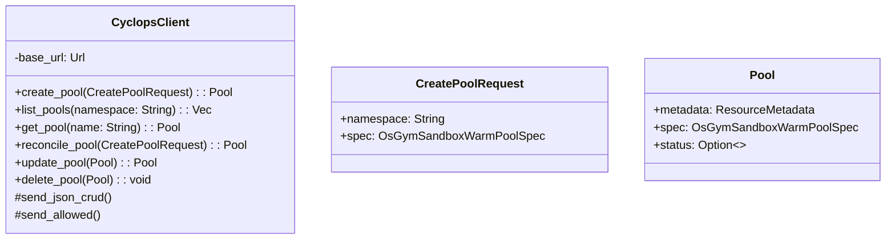
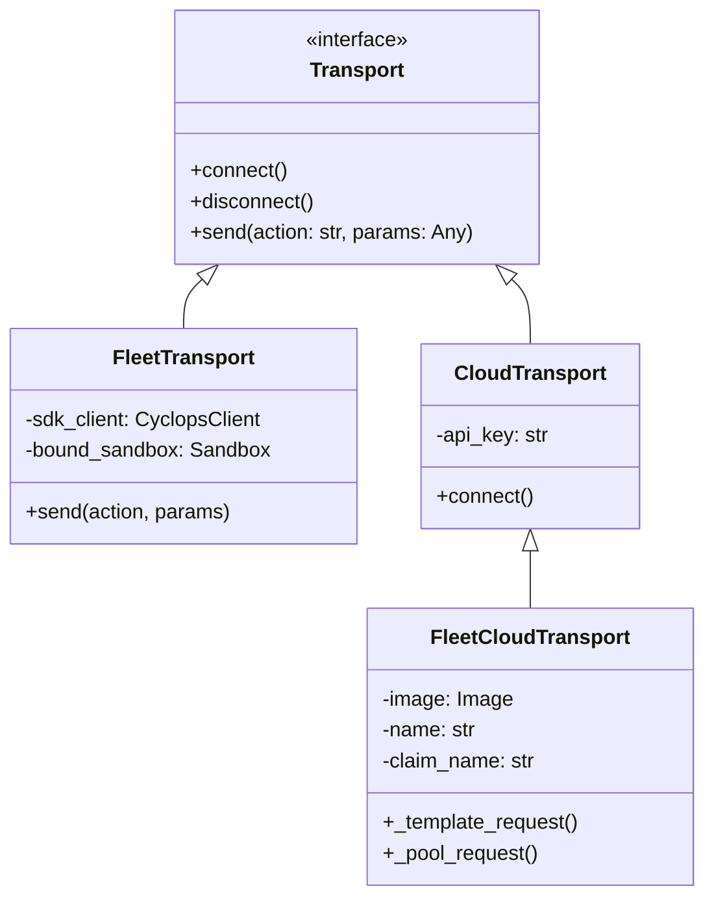
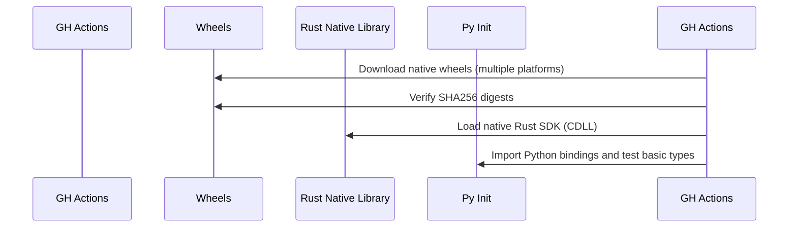

<!-- source: DeepWiki mcp.deepwiki.com · repo trycua/cua · page 13.3 Fleet SDK and Client Libraries · fetched 2026-10-29 -->

# Fleet SDK and Client Libraries

<details>
<summary>Relevant source files</summary>

The following files were used as context for generating this wiki page:

- [.github/scripts/tests/test_cua_fleet_release_wiring.py](.github/scripts/tests/test_cua_fleet_release_wiring.py)
- [.github/scripts/tests/test_driver_script_encoding.py](.github/scripts/tests/test_driver_script_encoding.py)
- [.github/workflows/cd-py-fleet.yml](.github/workflows/cd-py-fleet.yml)
- [.github/workflows/cd-ts-fleet.yml](.github/workflows/cd-ts-fleet.yml)
- [.github/workflows/ci-py-cli-fleets-wif-smoke.yml](.github/workflows/ci-py-cli-fleets-wif-smoke.yml)
- [.github/workflows/infra-fleets-wif-smoke.yml](.github/workflows/infra-fleets-wif-smoke.yml)
- [infra/fleets-wif-smoke/README.md](infra/fleets-wif-smoke/README.md)
- [infra/fleets-wif-smoke/main.tf](infra/fleets-wif-smoke/main.tf)
- [libs/fleet/playwright.config.ts](libs/fleet/playwright.config.ts)
- [libs/fleet/scripts/check_sdk_binding_contract_sources.py](libs/fleet/scripts/check_sdk_binding_contract_sources.py)
- [libs/fleet/scripts/ensure-browser-sdk-binding.sh](libs/fleet/scripts/ensure-browser-sdk-binding.sh)
- [libs/fleet/scripts/generate-sdk-bindings.sh](libs/fleet/scripts/generate-sdk-bindings.sh)
- [libs/fleet/scripts/test-generate-sdk-bindings.sh](libs/fleet/scripts/test-generate-sdk-bindings.sh)
- [libs/fleet/sdk-bindings/README.md](libs/fleet/sdk-bindings/README.md)
- [libs/fleet/sdk-bindings/examples/kotlin/AppControlled.kt](libs/fleet/sdk-bindings/examples/kotlin/AppControlled.kt)
- [libs/fleet/sdk-bindings/examples/ruby/app_controlled.rb](libs/fleet/sdk-bindings/examples/ruby/app_controlled.rb)
- [libs/fleet/sdk-bindings/kotlin/ai/cua/cyclops/sdk/fleet_sdk.kt](libs/fleet/sdk-bindings/kotlin/ai/cua/cyclops/sdk/fleet_sdk.kt)
- [libs/fleet/sdk-bindings/kotlin/tests/TestAsyncClient.kt](libs/fleet/sdk-bindings/kotlin/tests/TestAsyncClient.kt)
- [libs/fleet/sdk-bindings/python/contract_fixture.py](libs/fleet/sdk-bindings/python/contract_fixture.py)
- [libs/fleet/sdk-bindings/python/fleet_sdk/__init__.py](libs/fleet/sdk-bindings/python/fleet_sdk/__init__.py)
- [libs/fleet/sdk-bindings/python/fleet_sdk/_sdk.py](libs/fleet/sdk-bindings/python/fleet_sdk/_sdk.py)
- [libs/fleet/sdk-bindings/ruby/cyclops_sdk/sdk.rb](libs/fleet/sdk-bindings/ruby/cyclops_sdk/sdk.rb)
- [libs/fleet/sdk-bindings/ruby/tests/test_async_client.rb](libs/fleet/sdk-bindings/ruby/tests/test_async_client.rb)
- [libs/fleet/sdk-bindings/swift/CyclopsSdk.swift](libs/fleet/sdk-bindings/swift/CyclopsSdk.swift)
- [libs/fleet/sdk-bindings/swift/CyclopsSdkFFI.h](libs/fleet/sdk-bindings/swift/CyclopsSdkFFI.h)
- [libs/fleet/sdk-bindings/swift/tests/TestAsyncClient.swift](libs/fleet/sdk-bindings/swift/tests/TestAsyncClient.swift)
- [libs/fleet/sdk-bindings/ts-uniffi-browser/ts/fleet_sdk.ts](libs/fleet/sdk-bindings/ts-uniffi-browser/ts/fleet_sdk.ts)
- [libs/fleet/sdk-schema/src/claim.rs](libs/fleet/sdk-schema/src/claim.rs)
- [libs/fleet/sdk/src/claims.rs](libs/fleet/sdk/src/claims.rs)
- [libs/fleet/sdk/src/lib.rs](libs/fleet/sdk/src/lib.rs)
- [libs/fleet/sdk/src/pools.rs](libs/fleet/sdk/src/pools.rs)
- [libs/fleet/sdk/src/services.rs](libs/fleet/sdk/src/services.rs)
- [libs/fleet/sdk/src/templates.rs](libs/fleet/sdk/src/templates.rs)
- [libs/fleet/sdk/src/types.rs](libs/fleet/sdk/src/types.rs)
- [libs/fleet/sdk/tests/binding_generation.rs](libs/fleet/sdk/tests/binding_generation.rs)
- [libs/fleet/sdk/tests/claim_flow.rs](libs/fleet/sdk/tests/claim_flow.rs)
- [libs/fleet/sdk/tests/pool_flow.rs](libs/fleet/sdk/tests/pool_flow.rs)
- [libs/fleet/sdk/tests/public_api.rs](libs/fleet/sdk/tests/public_api.rs)
- [libs/fleet/sdk/tests/service_flow.rs](libs/fleet/sdk/tests/service_flow.rs)
- [libs/fleet/sdk/tests/template_flow.rs](libs/fleet/sdk/tests/template_flow.rs)
- [libs/fleet/src/i18n/I18nProvider.tsx](libs/fleet/src/i18n/I18nProvider.tsx)
- [libs/fleet/src/i18n/translations.ts](libs/fleet/src/i18n/translations.ts)
- [libs/python/cua-sandbox/cua_sandbox/interfaces/__init__.py](libs/python/cua-sandbox/cua_sandbox/interfaces/__init__.py)
- [libs/python/cua-sandbox/cua_sandbox/interfaces/services.py](libs/python/cua-sandbox/cua_sandbox/interfaces/services.py)
- [libs/python/cua-sandbox/cua_sandbox/sandbox_state.py](libs/python/cua-sandbox/cua_sandbox/sandbox_state.py)
- [libs/python/cua-sandbox/cua_sandbox/transport/base.py](libs/python/cua-sandbox/cua_sandbox/transport/base.py)
- [libs/python/cua-sandbox/tests/test_exposed_ports_state.py](libs/python/cua-sandbox/tests/test_exposed_ports_state.py)
- [libs/typescript/fleet/.bumpversion.cfg](libs/typescript/fleet/.bumpversion.cfg)
- [libs/typescript/fleet/LICENSE](libs/typescript/fleet/LICENSE)
- [libs/typescript/fleet/README.md](libs/typescript/fleet/README.md)
- [libs/typescript/fleet/package.json](libs/typescript/fleet/package.json)
- [libs/typescript/fleet/scripts/build.mjs](libs/typescript/fleet/scripts/build.mjs)
- [libs/typescript/fleet/tests/fetch-http-client.test.mjs](libs/typescript/fleet/tests/fetch-http-client.test.mjs)
- [tests/test_public_containerdisk_refs.py](tests/test_public_containerdisk_refs.py)

</details>


The Cua Fleet system provides a comprehensive programmatic interface for managing large-scale pools of sandboxed environments. This page details the Cyclops Rust SDK, the UniFFI-generated multi-language bindings (Python, Kotlin, Swift, Ruby, Go, TypeScript), the generation scripts, the TypeScript `@trycua/fleet` SDK, and the various transport layers that integrate the `cua-sandbox` with the Cyclops backend infrastructure.

---

## Overview of Client Libraries

The Fleet client libraries span multiple languages and layers, from core Rust SDK logic to language-specific bindings and transport layers that connect to backend servers.

| Package / Component                | Language      | Role                                                                                       | Relevant Files / Lines                         |
|---------------------------------- |-------------- |------------------------------------------------------------------------------------------|-----------------------------------------------|
| `cyclops-sdk` (core Rust SDK)     | Rust          | Core SDK implements REST CRUD and operations for pools, claims, templates, and config   | `libs/fleet/sdk/src/lib.rs:1-30` <br> `libs/fleet/sdk/src/pools.rs:1-192`      |
| UniFFI Bindings                   | Multi         | Auto-generated native bindings for multiple languages, wrapping `cyclops-sdk`            | `libs/fleet/scripts/generate-sdk-bindings.sh:1-1114` <br> binding source files e.g. [swift/CyclopsSdk.swift](), [ruby/sdk.rb](), [kotlin/fleet_sdk.kt]() |
| `cua-fleet` (Python facade)       | Python        | High-level Python wrapper re-exporting `cua-train`, providing Fleet management API        | `libs/python/cua-fleet/pyproject.toml:2-4` <br> `libs/python/cua-fleet/cua_fleet/__init__.py:3-3` |
| `FleetCloudTransport` (cua-sandbox transport) | Python        | Transport layer for lifecycle and command dispatch over Fleet service                    | `libs/python/cua-sandbox/cua_sandbox/transport/fleet_cloud.py:25-48`, `libs/python/cua-sandbox/cua_sandbox/transport/fleet_cloud.py:119-128`  |
| `@trycua/fleet`                   | TypeScript    | Official TypeScript SDK for Fleet sandbox lifecycle management in browser and Node      | `libs/typescript/fleet/package.json:2-3`      |

---

## Data Flow and System Architecture

### High-Level Client Interaction

User applications and scripts use abstractions like `Sandbox.create()`, `Pool.apply()`, or `Pool.claim()` to interact with the Fleet cloud and orchestrate sandboxed environments. The SDK libraries handle request shaping, transport, authentication, and response processing.

```mermaid
graph TD
    subgraph "User / Application Space"
        UserCode[User Code (Python / TS / Swift / Ruby)]
        SandboxCreate["Sandbox.create() / Pool.claim()"]
    end

    subgraph "SDK Facade Layer (Python / TS)"
        SandboxCreate -->|calls| FleetCloudTransport[FleetCloudTransport]
        FleetCloudTransport --> fleet_sdk_native[fleet_sdk (Native UniFFI Bindings)]
    end

    subgraph "Native SDK Layer (Rust)"
        fleet_sdk_native --> CyclopsAPI[Cyclops REST/gRPC API]
    end

    subgraph "Backend Infrastructure (Cyclops)"
        CyclopsAPI --> OSGymWorkspacePool[OSGymWorkspacePool CR]
        CyclopsAPI --> OSGymSandboxClaim[OSGymSandboxClaim CR]
    end
```

- User Code calls high-level Python or TypeScript SDK functions.
- The SDK wraps transports; e.g., `FleetCloudTransport` manages authentication and lifecycle.
- Native UniFFI bindings wrap the Rust `cyclops-sdk`.
- The Rust SDK itself communicates with the Cyclops backend API managing pools and claims.

Sources:  
- Python transport lifecycle and auth: `libs/python/cua-sandbox/cua_sandbox/transport/fleet_cloud.py:25-48,119-128`  
- Pool management calls: `libs/python/cua-sandbox/cua_sandbox/pool.py:9-17`  
- Rust SDK pool management API: `libs/fleet/sdk/src/pools.rs:1-192`  

---

## Cyclops Rust SDK

The core is a Rust library implementing Fleet API objects and CRUD operations against Cyclops REST endpoints. It uses asynchronous functions and serializes resources for API operations.

### Key Structs and Functions

- **`CyclopsClient`**: Main entry point for API operations, maintaining base URL, authentication, and sending HTTP requests.
- **Pool management** methods:
  - `create_pool(CreatePoolRequest)` — Create a pool resource.
  - `list_pools(namespace)` — List pools in a namespace.
  - `get_pool(name)` — Retrieve a specific pool.
  - `reconcile_pool(CreatePoolRequest)` — Create or update a pool based on existence.
  - `update_pool(Pool)` — Update an existing Pool resource.
  - `delete_pool(Pool)` — Delete a Pool resource.

### Internal Helpers

- URL routes for resources (e.g., pool collection, pool item).
- Namespace lifecycle guards to ensure resource lifecycles are consistent.
- JSON serialization and HTTP request construction helpers.



Sources: [`libs/fleet/sdk/src/pools.rs:1-192`]()

---

## UniFFI Bindings for Multi-Language Support

To serve client libraries in Python, Swift, Kotlin, Ruby, Go, and TypeScript, the Rust SDK is wrapped by UniFFI-generated bindings.

### Binding Generation Pipeline

The multi-language bindings are fully generated using the `generate-sdk-bindings.sh` script, which:

1. Builds the Rust `cyclops-sdk` crate with Cargo.
2. Runs `uniffi-bindgen` to generate FFI headers and language bindings.
3. Writes language-specific code for Python, Kotlin, Swift, Ruby, Go, and TypeScript clients.

```mermaid
graph TD
    A[Rust `cyclops-sdk` crate] --> B(Build with Cargo)
    B --> C(Compiled Native Library).
    C --> D[`uniffi-bindgen` Tool]
    D --> E[FFI Header: `CyclopsSdkFFI.h`]
    D --> F[Python Bindings: `fleet_sdk/_sdk.py`]
    D --> G[Kotlin Bindings: `fleet_sdk.kt`]
    D --> H[Swift Bindings: `CyclopsSdk.swift`]
    D --> I[Ruby Bindings: `sdk.rb`]
    D --> J[Go Bindings: `fleet_sdk.go`]
    D --> K[TypeScript Bindings: `fleet_sdk.ts`]
```

The generated bindings preserve close correspondence to the Rust types and functions, allowing idiomatic usage in the target language.

### Notable Binding Details

- Swift binding (`CyclopsSdk.swift`) manages memory with `RustBuffer` wrappers and uses helper protocols (`FfiConverter`).
- Ruby binding (`sdk.rb`) uses `ffi` gem with synchronization for handle maps, direct Rust buffer allocation, and streaming.
- The generated bindings also manage error handling, memory safety, and asynchronous futures where applicable.

Sources:  
- Binding generation script: [`libs/fleet/scripts/generate-sdk-bindings.sh:1-1114`]  
- Swift binding sample: [`libs/fleet/sdk-bindings/swift/CyclopsSdk.swift:1-187`]  
- Ruby binding sample: [`libs/fleet/sdk-bindings/ruby/cyclops_sdk/sdk.rb:1-249`]  

---

## Python Facade: `cua-fleet`

This package simplifies usage of the Fleet SDK in Python by re-exporting `cua-train` and bundling Fleet management abstractions for common workflows.

### Key Features

- Pins versions explicitly (`0.1.17` wheel) for controlled deployments.
- Exposes pool and claim lifecycle management through high-level APIs.
- Utilizes the native UniFFI bindings for direct SDK calls.

Example:

```python
from cua_sandbox import Pool, Image

# Create a pool with 2 replicas, 4 CPUs, and 8 GB RAM
pool = await Pool.apply(
    Image.desktop("ubuntu"),
    name="my-pool",
    replicas=2,
    cpu=4,
    memory_mb=8192
)

# Claim a sandbox instance for job "worker1"
async with pool.claim(name="worker1") as sb:
    await sb.shell.run("whoami")
```

Sources:  
- `cua-fleet` pyproject and init: [`libs/python/cua-fleet/pyproject.toml:2-4`], [`libs/python/cua-fleet/cua_fleet/__init__.py:3-3`]  
- Pool and claim operations: [`libs/python/cua-sandbox/cua_sandbox/pool.py:207-220`]  

---

## Fleet Transports in `cua-sandbox`

`FleetCloudTransport` is a specialized transport implementation blending high-level cloud lifecycle management with command execution delegation.

### Transport Architecture



- **`FleetCloudTransport`** handles claim creation, renewal, and shutdown grace periods.
- **`FleetTransport`** sends commands once the sandbox is bound.
- Supports autoscaling pools by mapping pool spec attributes to Fleet API.

### Special Features

- **Deterministic Claim Naming**: Names are DNS-compatible, truncated for length limits, and include suffixes to avoid collisions.
- **Workload Identity Handling**: Supports refreshing tokens automatically with GitHub Actions OIDC for secure Fleet token management on 401 errors.
- **Deadline Renewal**: Keeps claims alive during long-running tasks using deadlines and keep-alive pings to Cyclops.
- **Autoscaling Support**: Exposes autoscaling configurations from the `WarmPoolAutoscaling` schema, enabling dynamic pool sizing.

Sources:  
- Fleet transport in Python: [`libs/python/cua-sandbox/cua_sandbox/transport/fleet_cloud.py:28-48`], [`libs/python/cua-sandbox/cua_sandbox/transport/fleet_cloud.py:119-128`], [`libs/python/cua-sandbox/cua_sandbox/sandbox.py:126-149`]  
- Transport base classes: [`libs/python/cua-sandbox/cua_sandbox/transport/fleet.py:24-30`]  
- CloudTransport base: [`libs/python/cua-sandbox/cua_sandbox/transport/cloud.py:27-35`]  

---

## TypeScript `@trycua/fleet` Package

The Fleet ecosystem provides a TypeScript SDK for browser and Node.js contexts, located in `libs/typescript/fleet`.

- Package metadata:
  - Version: `0.1.2`
  - Main: `./dist/node.js`
  - Browser: `./dist/browser.js`
  - Dependencies include `@ubjs/core`
- Build system uses `esbuild` and `typescript`.
- Exposes Fleet lifecycle management APIs compatible with browser and NodeJS environments.

```json
{
  "name": "@trycua/fleet",
  "version": "0.1.2",
  "description": "Browser and WebAssembly SDK for Cua Fleet sandbox lifecycle management",
  "main": "./dist/node.js",
  "module": "./dist/node.js",
  "types": "./dist/node.d.ts",
  "dependencies": {
    "@ubjs/core": "0.31.0-3"
  }
}
```

Sources: [`libs/typescript/fleet/package.json:1-67`]()

---

## Continuous Delivery and Release Workflow

The `cua-fleet` Python package, including native wheels and SDK bindings, is released via a GitHub Actions workflow defined in `.github/workflows/cd-py-fleet.yml`.

- Supports multiple OS architectures: Linux x86_64 and aarch64, macOS x86_64 and arm64, Windows x86_64.
- Downloads native wheels pinned to version `0.1.17` and verifies SHA256 integrity.
- Loads and tests native Rust libraries (`libcyclops_sdk.so`, `libcyclops_sdk.dylib`, `cyclops_sdk.dll`).
- Verifies presence of key Rust types in the native library (`CyclopsClient`, `CreatePoolRequest`, etc.).
- Exercises example code paths without credentials to validate basic runtime functionality.



Sources:  
- Release workflow YAML: [.github/workflows/cd-py-fleet.yml:3-199]  
- Release regression test: [.github/scripts/tests/test_cua_fleet_release_wiring.py:12-27]  

---

# Summary

The Fleet SDK and client libraries provide a multi-language, high-performance, and asynchronous interface to the Cyclops backend infrastructure. The system uses:

- A robust Rust SDK implementing the core API.
- UniFFI to generate idiomatic bindings for Python, Kotlin, Swift, Ruby, Go, and TypeScript.
- High-level Python facades to ease common workflows.
- Transport abstractions in the sandbox SDKs to manage cloud lifecycle, authentication, and autoscaling.
- A TypeScript browser SDK for Fleet client applications.
- A continuous integration and delivery workflow that ensures multi-platform native wheels are properly built, tested, and released.

Together, this foundation supports large-scale orchestration of sandbox environments to enable human and agent computer-use with reliability and efficiency.

---

## Sources

- libs/fleet/sdk/src/pools.rs:1-192  
- libs/fleet/sdk/src/lib.rs:1-30  
- libs/fleet/scripts/generate-sdk-bindings.sh:1-1114  
- libs/fleet/sdk-bindings/python/fleet_sdk/_sdk.py (referenced)  
- libs/fleet/sdk-bindings/swift/CyclopsSdk.swift:1-187  
- libs/fleet/sdk-bindings/ruby/cyclops_sdk/sdk.rb:1-249  
- libs/fleet/sdk-bindings/kotlin/ai/cua/cyclops/sdk/fleet_sdk.kt (referenced)  
- libs/python/cua-sandbox/cua_sandbox/transport/fleet_cloud.py:25-48,119-128  
- libs/python/cua-sandbox/cua_sandbox/pool.py:9-17,207-220  
- libs/python/cua-sandbox/cua_sandbox/transport/fleet.py:24-30  
- libs/python/cua-sandbox/cua_sandbox/transport/cloud.py:27-35  
- libs/python/cua-sandbox/cua_sandbox/sandbox.py:126-149  
- libs/typescript/fleet/package.json:1-67  
- .github/workflows/cd-py-fleet.yml:3-199  
- .github/scripts/tests/test_cua_fleet_release_wiring.py:12-27

---

