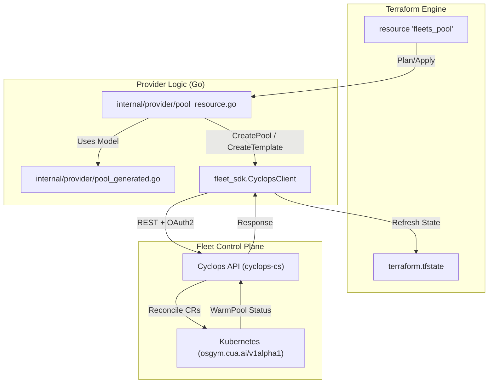
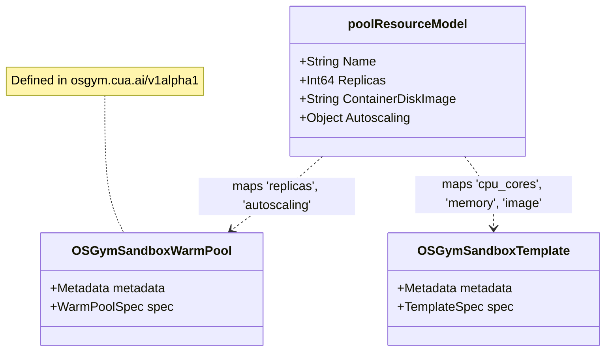
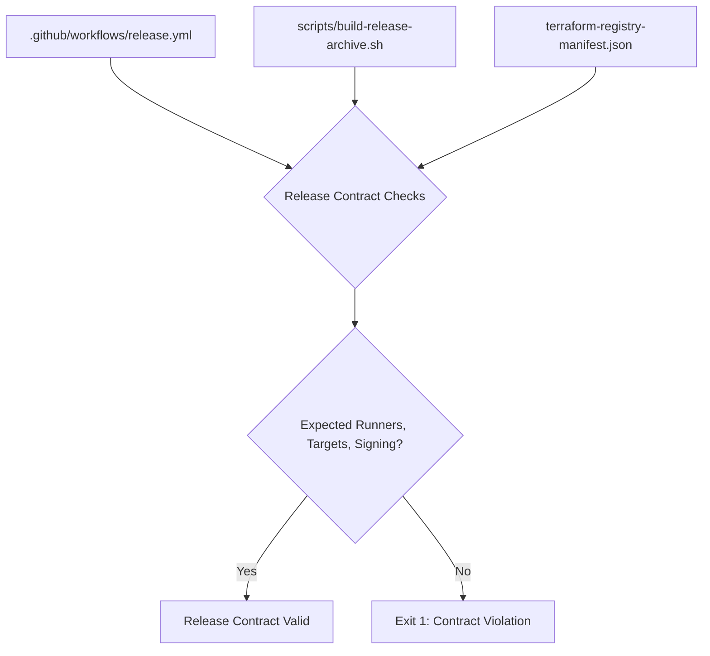

<!-- source: DeepWiki mcp.deepwiki.com · repo trycua/cua · page 13.4 Terraform Provider for Fleets · fetched 2026-10-29 -->

# Terraform Provider for Fleets

<details>
<summary>Relevant source files</summary>

The following files were used as context for generating this wiki page:

- [libs/fleet/terraform-provider-fleets/.github/workflows/registry-e2e.yml](libs/fleet/terraform-provider-fleets/.github/workflows/registry-e2e.yml)
- [libs/fleet/terraform-provider-fleets/.github/workflows/release.yml](libs/fleet/terraform-provider-fleets/.github/workflows/release.yml)
- [libs/fleet/terraform-provider-fleets/BOOTSTRAP.md](libs/fleet/terraform-provider-fleets/BOOTSTRAP.md)
- [libs/fleet/terraform-provider-fleets/MIGRATION.md](libs/fleet/terraform-provider-fleets/MIGRATION.md)
- [libs/fleet/terraform-provider-fleets/README.md](libs/fleet/terraform-provider-fleets/README.md)
- [libs/fleet/terraform-provider-fleets/RELEASING.md](libs/fleet/terraform-provider-fleets/RELEASING.md)
- [libs/fleet/terraform-provider-fleets/cmd/generate-pool-resource/main.go](libs/fleet/terraform-provider-fleets/cmd/generate-pool-resource/main.go)
- [libs/fleet/terraform-provider-fleets/cmd/generate-pool-resource/main_test.go](libs/fleet/terraform-provider-fleets/cmd/generate-pool-resource/main_test.go)
- [libs/fleet/terraform-provider-fleets/docs/index.md](libs/fleet/terraform-provider-fleets/docs/index.md)
- [libs/fleet/terraform-provider-fleets/docs/resources/pool.md](libs/fleet/terraform-provider-fleets/docs/resources/pool.md)
- [libs/fleet/terraform-provider-fleets/examples/resources/fleets_pool/resource.tf](libs/fleet/terraform-provider-fleets/examples/resources/fleets_pool/resource.tf)
- [libs/fleet/terraform-provider-fleets/internal/provider/generate/pool_mapping.json](libs/fleet/terraform-provider-fleets/internal/provider/generate/pool_mapping.json)
- [libs/fleet/terraform-provider-fleets/internal/provider/pool_generated.go](libs/fleet/terraform-provider-fleets/internal/provider/pool_generated.go)
- [libs/fleet/terraform-provider-fleets/internal/provider/pool_resource.go](libs/fleet/terraform-provider-fleets/internal/provider/pool_resource.go)
- [libs/fleet/terraform-provider-fleets/internal/provider/pool_resource_acc_test.go](libs/fleet/terraform-provider-fleets/internal/provider/pool_resource_acc_test.go)
- [libs/fleet/terraform-provider-fleets/internal/provider/pool_sdk_test.go](libs/fleet/terraform-provider-fleets/internal/provider/pool_sdk_test.go)
- [libs/fleet/terraform-provider-fleets/internal/provider/pool_validation_test.go](libs/fleet/terraform-provider-fleets/internal/provider/pool_validation_test.go)
- [libs/fleet/terraform-provider-fleets/internal/provider/provider.go](libs/fleet/terraform-provider-fleets/internal/provider/provider.go)
- [libs/fleet/terraform-provider-fleets/scripts/build-release-archive.sh](libs/fleet/terraform-provider-fleets/scripts/build-release-archive.sh)
- [libs/fleet/terraform-provider-fleets/scripts/test-release-contract.sh](libs/fleet/terraform-provider-fleets/scripts/test-release-contract.sh)
- [libs/fleet/terraform-provider-fleets/terraform-registry-manifest.json](libs/fleet/terraform-provider-fleets/terraform-registry-manifest.json)

</details>


The `trycua/fleets` Terraform provider is an infrastructure-as-code tool designed to manage Fleet computer-use pools. It enables developers to programmatically define, deploy, and scale pools of sandboxed environments for computer-use agents.

## Purpose and Scope

The provider serves as the bridge between Terraform configuration and the **Cyclops** backend API. It manages the lifecycle of `OSGymSandboxWarmPool` resources and the `OSGymSandboxTemplate` objects they reference. Each pool resource also implicitly manages a Kubernetes namespace of the same name [libs/fleet/terraform-provider-fleets/README.md:43-43]().

### Key Capabilities
*   **Resource Lifecycle**: Manages the creation and destruction of warm pools, templates, and namespaces as a single unit [libs/fleet/terraform-provider-fleets/docs/resources/pool.md:7-10]().
*   **Automated Schema Generation**: The provider's internal models, validators, and nested types are generated deterministically from the production CRD bundle [libs/fleet/terraform-provider-fleets/README.md:59-63]().
*   **OAuth2 Authentication**: Supports secure communication using the same client credentials and tenant-scoped authorization as the Fleet Python SDK [libs/fleet/terraform-provider-fleets/README.md:1-4]().

Sources: [libs/fleet/terraform-provider-fleets/README.md:1-4](), [libs/fleet/terraform-provider-fleets/README.md:43-43](), [libs/fleet/terraform-provider-fleets/README.md:59-63](), [libs/fleet/terraform-provider-fleets/docs/resources/pool.md:7-10]()

---

## Provider Architecture

The provider is built using the `terraform-plugin-framework`. It utilizes a hybrid approach where the resource schema is generated from Kubernetes Custom Resource Definitions (CRDs), while the business logic for CRUD operations, namespace ownership, and API error handling is handwritten in `pool_resource.go` [libs/fleet/terraform-provider-fleets/README.md:67-70]().

### Data Flow: Resource Creation
The provider translates HCL configurations into SDK calls that interact with the Fleet backend.

**Pool Provisioning Flow**

Sources: [libs/fleet/terraform-provider-fleets/README.md:43-43](), [libs/fleet/terraform-provider-fleets/internal/provider/pool_resource.go:117-152]()

---

## Pool Resource Configuration

The primary resource is `fleets_pool`. It supports two sizing modes: static and autoscaled. One and only one of these modes must be configured [libs/fleet/terraform-provider-fleets/internal/provider/pool_resource.go:28-32]().

### Configuration Modes

| Mode | Attribute | Description |
| :--- | :--- | :--- |
| **Static** | `replicas` | A fixed number of pre-warmed sandboxes [libs/fleet/terraform-provider-fleets/docs/resources/pool.md:43-43](). |
| **Autoscaled** | `autoscaling` | Defines `min_pool_size`, `initial_pool_size`, and `max_pool_size` for claim-driven scaling [libs/fleet/terraform-provider-fleets/docs/resources/pool.md:52-55](). |

### Core Attributes
*   `name`: DNS label for the pool and namespace; triggers replacement if changed [libs/fleet/terraform-provider-fleets/internal/provider/pool_generated.go:55-55]().
*   `runtime`: Backend runtime: `kubevirt` (default), `macos`, or `gvisor` [libs/fleet/terraform-provider-fleets/internal/provider/pool_generated.go:62-62]().
*   `container_disk_image`: OCI image used for the sandbox disk/runtime [libs/fleet/terraform-provider-fleets/docs/resources/pool.md:46-46]().
*   `cpu_cores` / `memory`: Resource limits allocated per sandbox [libs/fleet/terraform-provider-fleets/docs/resources/pool.md:44-45]().

Sources: [libs/fleet/terraform-provider-fleets/docs/resources/pool.md:12-55](), [libs/fleet/terraform-provider-fleets/internal/provider/pool_generated.go:51-83]()

---

## Implementation Details: Code Generation

The provider uses a dedicated generator in `cmd/generate-pool-resource` to maintain parity with the underlying Kubernetes CRDs [libs/fleet/terraform-provider-fleets/internal/provider/pool_resource.go:3-3]().

### Mapping and Generation
The generator reads `crd.yaml` and a `pool_mapping.json` file. Each Terraform attribute is mapped to a specific CR (`warmpool` or `template`) and a path within that CR's spec [libs/fleet/terraform-provider-fleets/README.md:59-63]().

**Entity Mapping Space**


Key functions in the provider implementation:
*   `toSDKCreatePoolRequest`: Converts the Terraform model into the SDK structure for pool creation [libs/fleet/terraform-provider-fleets/internal/provider/pool_sdk_test.go:39-43]().
*   `validatePoolScalingModeDuringPlan`: Ensures that the user hasn't provided both `replicas` and `autoscaling` during the planning phase [libs/fleet/terraform-provider-fleets/internal/provider/pool_resource.go:78-86]().
*   `refresh`: Updates the Terraform state with live data from both the WarmPool and the Template [libs/fleet/terraform-provider-fleets/internal/provider/pool_resource.go:147-147]().

Sources: [libs/fleet/terraform-provider-fleets/internal/provider/pool_generated.go:19-37](), [libs/fleet/terraform-provider-fleets/internal/provider/pool_resource.go:128-146](), [libs/fleet/terraform-provider-fleets/internal/provider/pool_resource.go:147-147](), [libs/fleet/terraform-provider-fleets/internal/provider/pool_resource.go:78-86](), [libs/fleet/terraform-provider-fleets/internal/provider/pool_sdk_test.go:39-43]()

---

## Installation and Development

### Registry Installation
The provider is published to the Terraform Registry as `trycua/fleets`.

```hcl
terraform {
  required_providers {
    fleets = {
      source  = "trycua/fleets"
      version = "0.2.0"
    }
  }
}
```

### Authentication
Authentication is configured via the provider block or environment variables [libs/fleet/terraform-provider-fleets/README.md:49-56]().

*   `CYCLOPS_ENDPOINT`: The Fleet API URL.
*   `CYCLOPS_ACCESS_TOKEN`: An optional access token for short-lived workflows.
*   `CYCLOPS_CLIENT_ID` / `CYCLOPS_CLIENT_SECRET`: OAuth2 credentials.
*   `CYCLOPS_TOKEN_URL`: The OAuth2 token issuance endpoint.

### Build and Release
The release process is automated via GitHub Actions, which builds binaries for `linux`, `darwin`, and `windows` (AMD64 and ARM64) [libs/fleet/terraform-provider-fleets/.github/workflows/release.yml:47-75](). The build script `build-release-archive.sh` statically links the `cyclops-sdk` Rust library into the Go provider binary using CGO [libs/fleet/terraform-provider-fleets/scripts/build-release-archive.sh:146-155]().

The `test-release-contract.sh` script [libs/fleet/terraform-provider-fleets/scripts/test-release-contract.sh:1-2]() ensures that the release workflow (`.github/workflows/release.yml`) and the build script (`scripts/build-release-archive.sh`) adhere to a specific contract, verifying expected runners, Rust targets, LLVM-Mingw versions, and GPG signing steps [libs/fleet/terraform-provider-fleets/scripts/test-release-contract.sh:32-78]().

**Release Contract Test Flow**

Sources: [libs/fleet/terraform-provider-fleets/README.md:5-18](), [libs/fleet/terraform-provider-fleets/README.md:49-56](), [libs/fleet/terraform-provider-fleets/.github/workflows/release.yml:47-75](), [libs/fleet/terraform-provider-fleets/scripts/build-release-archive.sh:146-155](), [libs/fleet/terraform-provider-fleets/scripts/test-release-contract.sh:1-2](), [libs/fleet/terraform-provider-fleets/scripts/test-release-contract.sh:32-78]()

---

