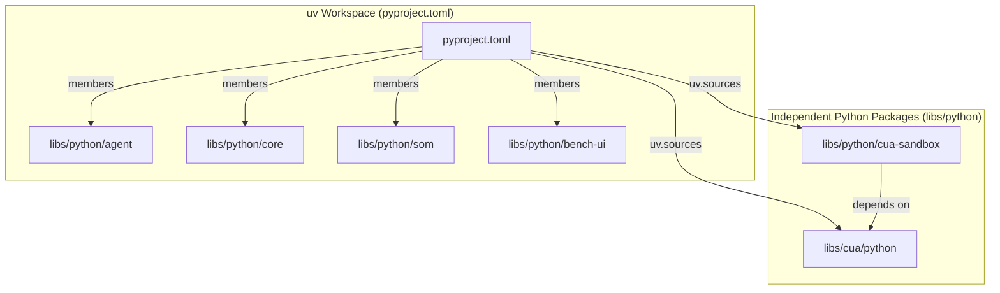
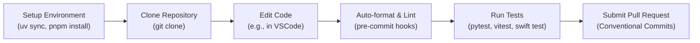

<!-- source: DeepWiki mcp.deepwiki.com · repo trycua/cua · page 14 Development Guide · fetched 2026-10-29 -->

# Development Guide

<details>
<summary>Relevant source files</summary>

The following files were used as context for generating this wiki page:

- [.editorconfig](.editorconfig)
- [.pre-commit-config.yaml](.pre-commit-config.yaml)
- [.prettierignore](.prettierignore)
- [.prettierrc.yaml](.prettierrc.yaml)
- [.vscode/extensions.json](.vscode/extensions.json)
- [.vscode/settings.json](.vscode/settings.json)
- [CONTRIBUTING.md](CONTRIBUTING.md)
- [Development.md](Development.md)
- [nix/cua-driver/compositor/cua_compositor_patch.py](nix/cua-driver/compositor/cua_compositor_patch.py)
- [package.json](package.json)
- [pnpm-lock.yaml](pnpm-lock.yaml)
- [pyproject.toml](pyproject.toml)

</details>


This guide is for contributors who want to develop the Cua codebase itself. If you're looking to use Cua in your projects, see the [Getting Started](#2) section instead.

## Overview

The Cua repository is a monorepo containing multiple SDK packages across Python, TypeScript, Rust, and Swift. The development environment uses modern tooling to ensure code quality and streamline the development workflow:

| Tool | Purpose | Usage |
|------|---------|-------|
| **uv** | Python dependency management and workspace | `uv sync`, `uv run` |
| **pnpm** | TypeScript package management | `pnpm install` |
| **pre-commit** | Automated code quality checks | `uv run pre-commit install` |
| **Rust / Cargo** | Cross-platform driver development | `cargo build` |
| **Swift / Xcode** | macOS virtualization (Lume) | `swift build` |
| **Nix** | Reproducible Linux builds for `cua-driver` | `nix build` |

Sources: [Development.md:34-51](), [pyproject.toml:60-77](), [package.json:9](), [libs/lume/Development.md:7-11]()

## Repository Structure

The repository is organized into the following main packages:

**Python Packages (uv workspace)**

Cua uses a `uv` workspace to manage dependencies and internal package linking. The root `pyproject.toml` defines the workspace members. Other Python packages under `libs/python` are independent.



Sources: [pyproject.toml:64-81](), [Development.md:58-61]()

**Component Toolchains**

Different components require specific environments as defined in the contributor map:

| Area | Main paths | Toolchain |
| :--- | :--- | :--- |
| **cua SDK and `cua` CLI** | `libs/cua` (Rust crates, `proto/`, `python/`, `typescript/`, `swift/`, `kotlin/`) | Rust, `protoc`, `buf`; Node, `uv`, Swift |
| **cua-spacesd** | `libs/cua-spacesd` | Rust, `protoc`; Docker for Linux lanes |
| **Cua Spaces app** | `apps/cua-spaces` | Node.js, `pnpm`, Rust, Tauri 2 |
| **cua-driver** | `libs/cua-driver/rust`, `libs/cua-driver/python` | Rust, platform SDKs, Nix on Linux |
| **Python SDKs and services** | `libs/python` (incl. `cua-sandbox`), `libs/cua-bench` | Python 3.12, `uv` |
| **TypeScript SDKs** | `libs/typescript` | Node.js, `pnpm` |
| **CuaBot** | `libs/cuabot` | Node.js, `pnpm` |
| **Lume** | `libs/lume` | Swift, Xcode command-line tools |
| **Sandbox and container images** | `libs/images`, `libs/kasm`, `libs/lumier`, `libs/qemu-docker`, `libs/xfce`, `libs/xfce-cua` | Docker plus the component toolchain |
| **Cross-language E2E** | `tests/e2e/cua-sdk`, `tests/e2e/local-runtimes` | Rust, `uv`, Node.js, Go, Docker |
| **Public documentation** | `docs/content/docs` | Node.js, `pnpm`, Fumadocs |
| **Samples and examples** | `samples`, `examples` | Depends on the sample |

Sources: [Development.md:9-22]()

## Development Workflow

The typical development workflow follows these steps:

**Development Cycle**



Sources: [Development.md:40-45](), [Development.md:65-69](), [CONTRIBUTING.md:75-83]()

**Code Quality Pipeline**

The repository enforces code quality through automated tooling defined in `pyproject.toml` and `.pre-commit-config.yaml`.

| Stage | Tools | Configuration |
|-------|-------|---------------|
| **Formatting** | `prettier` (TS/JS/JSON/MD/YAML), `black` (Python), `isort` (Python) | `.prettierrc.yaml` [Development.md:93-95](), `[tool.black]` [pyproject.toml:87-89](), `[tool.isort]` [pyproject.toml:122-124]() |
| **Linting** | `ruff` (Python) | `[tool.ruff]` [pyproject.toml:91-110]() |
| **Type Checking** | `mypy` (Python), `pnpm -C libs/typescript typecheck` (TypeScript) | `[tool.mypy]` [pyproject.toml:112-120](), `.pre-commit-config.yaml:14-19]() |

Sources: [pyproject.toml:87-124](), [.pre-commit-config.yaml:1-43]()

## Quick Start

To get started with development:

1.  **Clone the repository**
    ```bash
    git clone https://github.com/trycua/cua.git
    cd cua
    ```
    Sources: [Development.md:42-45]()

2.  **Install dependencies**
    ```bash
    # Sync Python workspace and install dev dependencies
    uv sync --group dev
    
    # Install root pnpm dependencies (for Prettier)
    pnpm install
    ```
    Note that `pnpm install` inside specific TypeScript components like `libs/typescript` or `apps/cua-spaces` is required for their dependencies.
    Sources: [Development.md:52-63]()

3.  **Install pre-commit hooks**
    ```bash
    uv run pre-commit install
    ```
    Sources: [Development.md:74-76]()

4.  **Configure environment variables**
    API keys are not required for ordinary builds and deterministic tests. For tests or examples that explicitly call an external provider, add credentials to a `.env.local` file in the project root. Never commit this file.
    Sources: [Development.md:65-68](), [.prettierignore:16-17]()

## Common Development Tasks

**Python Development**
For details, see [Python Package Development](#14.2).

| Task | Command |
|------|---------|
| **Sync workspace** | `uv sync` |
| **Run formatting** | `uv run pre-commit run --all-files` |
| **Run tests** | `uv run pytest` |

Sources: [Development.md:77-83](), [pyproject.toml:127-130]()

**TypeScript Development**
For details, see [TypeScript Package Development](#14.3).

| Task | Command |
|------|---------|
| **Install deps** | `pnpm install` (in component directory, e.g., `libs/typescript`) |
| **Check formatting** | `pnpm prettier:check` (from root) |
| **Type check** | `pnpm -C libs/typescript typecheck` |

Sources: [package.json:3](), [Development.md:62-63](), [.pre-commit-config.yaml:14-19]()

**macOS Virtualization (Lume) Development**
For details, see [Lume Architecture](#5.1).

| Task | Command |
|------|---------|
| **Build Lume** | `swift build` |
| **Run Lume tests** | `swift test` |
| **Open Workspace** | `code .vscode/lume.code-workspace` |

Sources: [Development.md:18]()

## Child Pages
- [Development Environment Setup](#14.1) — Detailed environment configuration, toolchain installation (uv, pnpm, Rust, Swift), and VSCode workspace setup.
- [Python Package Development](#14.2) — Workflow for `libs/python/` packages, dependency management with `uv` workspaces, and editable installs.
- [TypeScript Package Development](#14.3) — Workflow for `libs/typescript/` packages, `pnpm` workspace management, and the `tsdown` build system.
- [Testing and Code Quality](#14.4) — Detailed guide on `pytest` configuration, `vitest` setup, and root pre-commit hook validation.
- [CI/CD and Release Process](#14.5) — Automation for publishing to PyPI, npm, and Docker Hub, including Conventional Commit requirements.
- [Nix Packaging and NixOS Integration](#14.6) — Working with the Nix flake for `cua-driver`, NixOS modules, and Wayland/portal-libei support.
- [Documentation Site and Generators](#14.7) — The Next.js/Fumadocs documentation site under `docs/`: content structure, MDX components, and the `scripts/docs-generators` pipeline.

---

