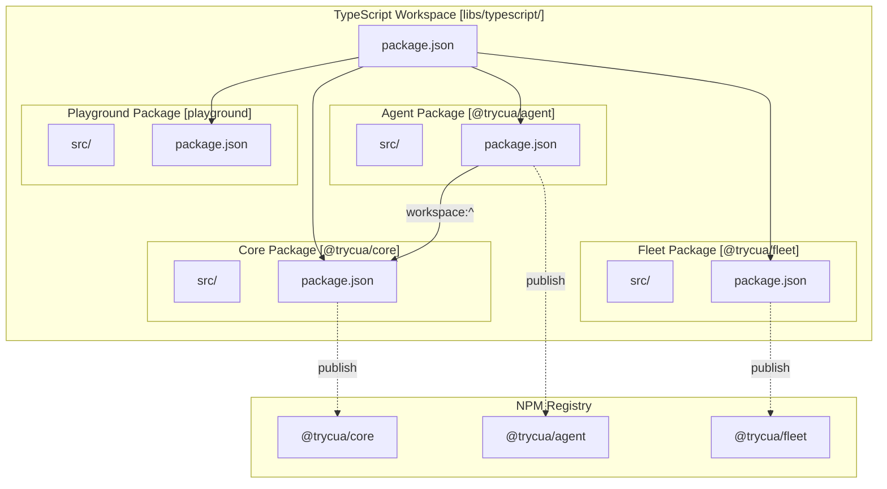
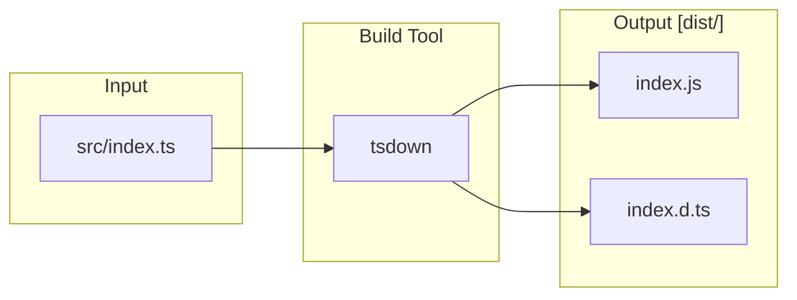
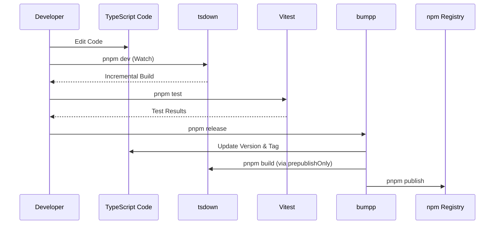

<!-- source: DeepWiki mcp.deepwiki.com · repo trycua/cua · page 14.3 TypeScript Package Development · fetched 2026-10-29 -->

# TypeScript Package Development

<details>
<summary>Relevant source files</summary>

The following files were used as context for generating this wiki page:

- [.github/workflows/ci-ts-fleet.yml](.github/workflows/ci-ts-fleet.yml)
- [.vscode/libs-ts.code-workspace](.vscode/libs-ts.code-workspace)
- [libs/typescript/.gitignore](libs/typescript/.gitignore)
- [libs/typescript/README.md](libs/typescript/README.md)
- [libs/typescript/agent/README.md](libs/typescript/agent/README.md)
- [libs/typescript/agent/examples/README.md](libs/typescript/agent/examples/README.md)
- [libs/typescript/agent/examples/playground-example.html](libs/typescript/agent/examples/playground-example.html)
- [libs/typescript/agent/package.json](libs/typescript/agent/package.json)
- [libs/typescript/agent/src/client.ts](libs/typescript/agent/src/client.ts)
- [libs/typescript/agent/src/index.ts](libs/typescript/agent/src/index.ts)
- [libs/typescript/agent/src/types.ts](libs/typescript/agent/src/types.ts)
- [libs/typescript/agent/tests/client.test.ts](libs/typescript/agent/tests/client.test.ts)
- [libs/typescript/agent/tsconfig.json](libs/typescript/agent/tsconfig.json)
- [libs/typescript/agent/tsdown.config.ts](libs/typescript/agent/tsdown.config.ts)
- [libs/typescript/agent/vitest.config.ts](libs/typescript/agent/vitest.config.ts)
- [libs/typescript/core/.bumpversion.cfg](libs/typescript/core/.bumpversion.cfg)
- [libs/typescript/core/README.md](libs/typescript/core/README.md)
- [libs/typescript/core/package.json](libs/typescript/core/package.json)
- [libs/typescript/package.json](libs/typescript/package.json)
- [libs/typescript/pnpm-lock.yaml](libs/typescript/pnpm-lock.yaml)
- [libs/typescript/pnpm-workspace.yaml](libs/typescript/pnpm-workspace.yaml)

</details>


This document covers the development workflow for TypeScript packages in the Cua monorepo. It explains the package structure, build system, testing approach, and release process for the TypeScript SDK components.

For Python package development, see [libs/python/README.md](). For general development environment setup, see [Development.md:1-88]().

---

## Package Structure

The TypeScript packages are organized as a `pnpm` workspace under `libs/typescript/`, with each package published independently to npm under the `@trycua/` scope. The workspace is managed by `pnpm@10.12.3` [libs/typescript/package.json:20]().

### Workspace Architecture

Title: TypeScript Package Workspace Structure


**Package Roles and Versions**

| Package | Version | Dependencies | Purpose |
|---------|---------|--------------|---------|
| `@trycua/core` | 0.1.6 | `pino`, `posthog-node`, `uuid` | Core utilities, telemetry, and shared infrastructure [libs/typescript/core/package.json:2-45]() |
| `@trycua/agent` | 0.1.0 | `@trycua/core`, `peerjs`, `pino` | Agent interaction and coordination (HTTP & WebRTC) [libs/typescript/agent/package.json:1-44]() |
| `@trycua/fleet` | (not specified) | `@ubjs/core` | Fleet SDK for interacting with the Cua Fleet infrastructure [libs/typescript/pnpm-lock.yaml:104-108]() |

Sources: [libs/typescript/core/package.json:1-57](), [libs/typescript/agent/package.json:1-54](), [libs/typescript/pnpm-workspace.yaml:1-7](), [libs/typescript/pnpm-lock.yaml:26-148]()

---

## Package Configuration

Each TypeScript package follows a standard ESM-first configuration.

### Common Package Metadata

All SDK packages share these standard fields in their `package.json`:

- **Module Type**: `"type": "module"` for native ES module support [libs/typescript/core/package.json:6]().
- **Entry Points**: `main`, `module`, and `exports` all point to `./dist/index.js` [libs/typescript/core/package.json:20-26]().
- **Types**: Type definitions are exported from `./dist/index.d.ts` [libs/typescript/core/package.json:23]().
- **Publishing**: `publishConfig` is set to `public` [libs/typescript/core/package.json:28-30]().

### Internal Dependency Management

Internal dependencies within the monorepo are managed using pnpm's `workspace:` protocol. For example, `@trycua/agent` depends on `@trycua/core` via `"workspace:^"` [libs/typescript/agent/package.json:41](). This ensures that the local version is used during development, while the correct version string is injected during the `pnpm publish` process.

Sources: [libs/typescript/core/package.json:6-30](), [libs/typescript/agent/package.json:41](), [libs/typescript/pnpm-lock.yaml:29-31]()

---

## Development Setup

### Workspace Installation

The project uses `pnpm` for managing Node.js dependencies. A `pnpm-lock.yaml` file is maintained at the root of the TypeScript directory [libs/typescript/pnpm-lock.yaml:1]().

```bash
# From the libs/typescript directory
pnpm install
```

### Workspace Scripts

The workspace root `package.json` provides scripts to manage all packages simultaneously:

| Script | Command | Purpose |
|--------|---------|---------|
| `build` | `pnpm build:core` | Builds the `@trycua/core` package [libs/typescript/package.json:12]() |
| `test` | `pnpm -r test` | Runs tests across all workspace members [libs/typescript/package.json:15]() |
| `typecheck` | `pnpm build:core && pnpm -r typecheck` | Runs TypeScript compiler checks across all packages [libs/typescript/package.json:16]() |
| `lint` | `prettier --check .` | Verifies code formatting [libs/typescript/package.json:9]() |
| `build:fleet` | `pnpm --filter @trycua/fleet build` | Builds the `@trycua/fleet` package [libs/typescript/package.json:18]() |

Sources: [libs/typescript/package.json:8-19](), [libs/typescript/pnpm-lock.yaml:1-25]()

---

## Build System: tsdown

Cua uses `tsdown` for bundling TypeScript packages. It provides a fast build process that generates ESM bundles and type definitions.

Title: tsdown Build Pipeline


### Package Build Scripts

Each package defines build and dev scripts in its own `package.json` [libs/typescript/core/package.json:33-34]():

- `pnpm build`: Runs `tsdown` to generate the production bundle [libs/typescript/core/package.json:33]().
- `pnpm dev`: Runs `tsdown --watch` for incremental builds during development [libs/typescript/core/package.json:34]().
- `prepublishOnly`: Automatically triggers `pnpm run build` before any npm publication to ensure the latest code is packaged [libs/typescript/core/package.json:38]().

The `tsdown.config.ts` file for `@trycua/agent` specifies `platform: 'browser'` and `noExternal: ['peerjs']` to bundle `peerjs` into the final `dist` output, supporting browser environments [libs/typescript/agent/tsdown.config.ts:9-14](). It also defines `__CUA_VERSION__` using the package version [libs/typescript/agent/tsdown.config.ts:15-17]().

Sources: [libs/typescript/core/package.json:30-39](), [libs/typescript/agent/package.json:30-39](), [libs/typescript/agent/tsdown.config.ts:1-17]()

---

## Testing with Vitest

Testing is handled by `vitest`, which offers high performance and native compatibility with ES modules.

### Testing Environment

- **Runner**: `vitest` [libs/typescript/core/package.json:54]().
- **DOM Simulation**: `happy-dom` is used for tests requiring a browser-like environment [libs/typescript/core/package.json:51]().
- **Types**: Node.js and workspace-specific types are included as dev dependencies [libs/typescript/core/package.json:47-48]().

### Running Tests

Tests can be run at the package level or workspace level:

```bash
# Package level
cd libs/typescript/core && pnpm test

# Workspace level (all packages)
pnpm -C libs/typescript test
```

Sources: [libs/typescript/core/package.json:35-56](), [libs/typescript/package.json:15]()

---

## Release Process with bumpp

Version management and publishing are streamlined using `bumpp`.

### Version Bumping Workflow

The `release` script in each package handles versioning and publication [libs/typescript/core/package.json:37]():

```bash
pnpm release
```

This command:
1. Prompts the developer for the next version (Patch, Minor, Major).
2. Updates `package.json`.
3. Creates a Git tag.
4. Executes `pnpm publish` (which triggers `prepublishOnly` build).

### Version Configuration

For consistent tagging and commit messages, packages utilize `.bumpversion.cfg` to define the tag format (e.g., `npm-core-v{new_version}`) and commit message [libs/typescript/core/.bumpversion.cfg:1-6]().

Sources: [libs/typescript/core/package.json:37](), [libs/typescript/agent/package.json:37](), [libs/typescript/core/.bumpversion.cfg:1-10]()

---

## Implementation Details: SDK Components

### AgentClient Implementation
The `AgentClient` in `@trycua/agent` supports multiple transport types: `http`, `https`, and `peer` (WebRTC via `peerjs`) [libs/typescript/agent/src/client.ts:50-56](). It provides a unified `responses.create` method that mimics the Python SDK's interaction pattern [libs/typescript/agent/src/client.ts:68-72](). The `AgentClient` also records telemetry events for initialization, request start, end, and errors [libs/typescript/agent/src/client.ts:59-65](), [libs/typescript/agent/src/client.ts:78-90](), [libs/typescript/agent/src/client.ts:103-132]().

The `telemetryModel` function [libs/typescript/agent/src/client.ts:12-28]() sanitizes model names for telemetry, classifying path-like or overly long names as "custom" to prevent sensitive information leakage.

The `AgentClient` handles HTTP requests by setting `Content-Type` and `X-API-Key` headers, and includes `cuaVersionHeaders` for client identification [libs/typescript/agent/src/client.ts:163-166](). It uses `AbortController` for request timeouts [libs/typescript/agent/src/client.ts:159-160](). Peer-to-peer connections are established using `Peer` from `peerjs` [libs/typescript/agent/src/client.ts:199-201]().

The `AgentClient` also classifies errors into categories like `timeout`, `http_error`, `parse_error`, `network`, and `peer_error` for telemetry reporting [libs/typescript/agent/src/client.ts:135-156]().

The `AgentRequest` and `AgentResponse` types define the structure for communication with the agent backend, including `AgentMessage` types for user input, assistant output, reasoning, computer calls, and function calls [libs/typescript/agent/src/types.ts:10-101](). `ComputerAction` types like `ClickAction`, `TypeAction`, and `ScrollAction` are also defined [libs/typescript/agent/src/types.ts:125-191]().

Sources: [libs/typescript/agent/src/client.ts:1-203](), [libs/typescript/agent/src/types.ts:1-192]()

---

## Development Workflow Summary

### Code Entity Mapping

| System Concept | Code Entity | File Location |
|----------------|-------------|---------------|
| **Core SDK** | `@trycua/core` | [libs/typescript/core/package.json]() |
| **Agent SDK** | `@trycua/agent` | [libs/typescript/agent/package.json]() |
| **Fleet SDK** | `@trycua/fleet` | [libs/typescript/pnpm-lock.yaml:104-108]() |
| **Telemetry** | `Telemetry` | [libs/typescript/core/src/telemetry/clients/index.ts]() |
| **Agent Client** | `AgentClient` | [libs/typescript/agent/src/client.ts]() |
| **Agent Request Types** | `AgentRequest` | [libs/typescript/agent/src/types.ts:10-28]() |
| **Agent Response Types** | `AgentResponse` | [libs/typescript/agent/src/types.ts:33-38]() |
| **Computer Actions** | `ComputerAction` | [libs/typescript/agent/src/types.ts:125-191]() |

### Workflow Diagram

Title: Developer Release Sequence


Sources: [libs/typescript/core/package.json:30-39](), [libs/typescript/package.json:8-20](), [Development.md:34-50]()

---

