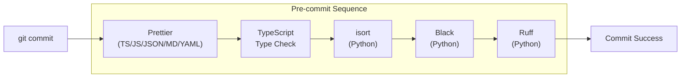
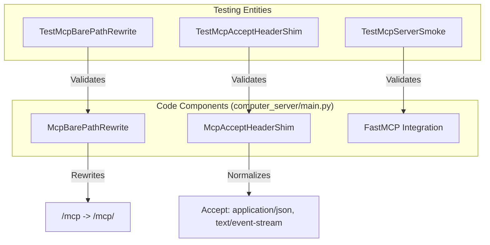

<!-- source: DeepWiki mcp.deepwiki.com · repo trycua/cua · page 14.4 Testing and Code Quality · fetched 2026-10-29 -->

# Testing and Code Quality

<details>
<summary>Relevant source files</summary>

The following files were used as context for generating this wiki page:

- [.github/scripts/tests/test_cua_driver_e2e_inventory.py](.github/scripts/tests/test_cua_driver_e2e_inventory.py)
- [.github/scripts/tests/test_documented_cargo_targets.py](.github/scripts/tests/test_documented_cargo_targets.py)
- [.github/scripts/tests/test_macos_hosted_e2e_workflow.py](.github/scripts/tests/test_macos_hosted_e2e_workflow.py)
- [.github/workflows/authorized-live-jev-use-demo.yml](.github/workflows/authorized-live-jev-use-demo.yml)
- [.github/workflows/ci-cua-driver-contract-clients.yml](.github/workflows/ci-cua-driver-contract-clients.yml)
- [.github/workflows/ci-cua-driver-quick.yml](.github/workflows/ci-cua-driver-quick.yml)
- [.github/workflows/ci-rust-macos.yml](.github/workflows/ci-rust-macos.yml)
- [.github/workflows/ci-rust-windows.yml](.github/workflows/ci-rust-windows.yml)
- [.github/workflows/e2e-rust-linux.yml](.github/workflows/e2e-rust-linux.yml)
- [.github/workflows/e2e-rust-macos.yml](.github/workflows/e2e-rust-macos.yml)
- [.github/workflows/e2e-rust-standalone-browsers.yml](.github/workflows/e2e-rust-standalone-browsers.yml)
- [.github/workflows/e2e-rust-windows.yml](.github/workflows/e2e-rust-windows.yml)
- [TESTING.md](TESTING.md)
- [libs/cua-driver/docs/e2e-ci-reporting.md](libs/cua-driver/docs/e2e-ci-reporting.md)
- [libs/cua-driver/docs/test-harnesses-guide.md](libs/cua-driver/docs/test-harnesses-guide.md)
- [libs/cua-driver/docs/test-matrix.md](libs/cua-driver/docs/test-matrix.md)
- [libs/cua-driver/rust/.cargo/config.toml](libs/cua-driver/rust/.cargo/config.toml)
- [libs/cua-driver/rust/README.md](libs/cua-driver/rust/README.md)
- [libs/cua-driver/rust/Skills/cua-driver/MACOS.md](libs/cua-driver/rust/Skills/cua-driver/MACOS.md)
- [libs/cua-driver/rust/crates/cua-driver-e2e/tests/README.md](libs/cua-driver/rust/crates/cua-driver-e2e/tests/README.md)
- [libs/cua-driver/rust/crates/cua-driver-e2e/tests/harness_appkit_test.rs](libs/cua-driver/rust/crates/cua-driver-e2e/tests/harness_appkit_test.rs)
- [libs/cua-driver/rust/crates/cua-driver-e2e/tests/perception_capture_loop_test.rs](libs/cua-driver/rust/crates/cua-driver-e2e/tests/perception_capture_loop_test.rs)
- [libs/cua-driver/rust/crates/cua-driver-testkit/Cargo.toml](libs/cua-driver/rust/crates/cua-driver-testkit/Cargo.toml)
- [libs/cua-driver/rust/crates/cua-driver-testkit/src/browser_fixture.rs](libs/cua-driver/rust/crates/cua-driver-testkit/src/browser_fixture.rs)
- [libs/cua-driver/rust/crates/cua-driver-testkit/src/cli.rs](libs/cua-driver/rust/crates/cua-driver-testkit/src/cli.rs)
- [libs/cua-driver/rust/crates/cua-driver-testkit/src/daemon.rs](libs/cua-driver/rust/crates/cua-driver-testkit/src/daemon.rs)
- [libs/cua-driver/rust/crates/cua-driver-testkit/src/driver.rs](libs/cua-driver/rust/crates/cua-driver-testkit/src/driver.rs)
- [libs/cua-driver/rust/crates/cua-driver-testkit/src/host_state.rs](libs/cua-driver/rust/crates/cua-driver-testkit/src/host_state.rs)
- [libs/cua-driver/rust/crates/cua-driver-testkit/src/lib.rs](libs/cua-driver/rust/crates/cua-driver-testkit/src/lib.rs)
- [libs/cua-driver/rust/crates/cua-driver-testkit/src/mcp.rs](libs/cua-driver/rust/crates/cua-driver-testkit/src/mcp.rs)
- [libs/cua-driver/rust/crates/cua-driver-testkit/src/paths.rs](libs/cua-driver/rust/crates/cua-driver-testkit/src/paths.rs)
- [libs/cua-driver/rust/crates/cua-driver-testkit/src/raw.rs](libs/cua-driver/rust/crates/cua-driver-testkit/src/raw.rs)
- [libs/cua-driver/rust/crates/cua-driver-testkit/src/reaper.rs](libs/cua-driver/rust/crates/cua-driver-testkit/src/reaper.rs)
- [libs/cua-driver/rust/crates/cua-driver-testkit/src/response.rs](libs/cua-driver/rust/crates/cua-driver-testkit/src/response.rs)
- [libs/cua-driver/rust/crates/cua-driver/src/bundle.rs](libs/cua-driver/rust/crates/cua-driver/src/bundle.rs)
- [libs/cua-driver/rust/crates/cua-driver/tests/embedded_host_sdk_mcp_test.rs](libs/cua-driver/rust/crates/cua-driver/tests/embedded_host_sdk_mcp_test.rs)
- [libs/cua-driver/rust/crates/cua-driver/tests/named_pipe_instance_recovery_test.rs](libs/cua-driver/rust/crates/cua-driver/tests/named_pipe_instance_recovery_test.rs)
- [libs/cua-driver/rust/crates/cua-driver/tests/private_worker_test.rs](libs/cua-driver/rust/crates/cua-driver/tests/private_worker_test.rs)
- [libs/cua-driver/rust/crates/cua-driver/tests/protocol_element_token_test.rs](libs/cua-driver/rust/crates/cua-driver/tests/protocol_element_token_test.rs)
- [libs/cua-driver/rust/crates/cua-driver/tests/protocol_handshake_test.rs](libs/cua-driver/rust/crates/cua-driver/tests/protocol_handshake_test.rs)
- [libs/cua-driver/rust/crates/cua-driver/tests/protocol_media_test.rs](libs/cua-driver/rust/crates/cua-driver/tests/protocol_media_test.rs)
- [libs/cua-driver/rust/crates/cua-driver/tests/protocol_session_test.rs](libs/cua-driver/rust/crates/cua-driver/tests/protocol_session_test.rs)
- [libs/cua-driver/rust/crates/cua-driver/tests/protocol_tools_call_test.rs](libs/cua-driver/rust/crates/cua-driver/tests/protocol_tools_call_test.rs)
- [libs/cua-driver/rust/crates/cua-driver/tests/testkit_host_state_isolation_test.rs](libs/cua-driver/rust/crates/cua-driver/tests/testkit_host_state_isolation_test.rs)
- [libs/cua-driver/rust/crates/cua-driver/tests/transport_config_persistence_test.rs](libs/cua-driver/rust/crates/cua-driver/tests/transport_config_persistence_test.rs)
- [libs/cua-driver/rust/crates/platform-macos/src/input/skylight.rs](libs/cua-driver/rust/crates/platform-macos/src/input/skylight.rs)
- [libs/cua-driver/rust/crates/platform-macos/src/tools/bring_to_front.rs](libs/cua-driver/rust/crates/platform-macos/src/tools/bring_to_front.rs)
- [libs/cua-driver/rust/crates/platform-windows/src/launch_uwp.rs](libs/cua-driver/rust/crates/platform-windows/src/launch_uwp.rs)
- [libs/cua-driver/rust/crates/platform-windows/src/uia/scroll.rs](libs/cua-driver/rust/crates/platform-windows/src/uia/scroll.rs)
- [libs/cua-driver/rust/crates/platform-windows/src/win32/apps.rs](libs/cua-driver/rust/crates/platform-windows/src/win32/apps.rs)
- [libs/cua-driver/rust/crates/platform-windows/src/win32/installed_apps.rs](libs/cua-driver/rust/crates/platform-windows/src/win32/installed_apps.rs)
- [libs/cua-driver/tests/fixtures/apps/cross-platform/electron/.gitignore](libs/cua-driver/tests/fixtures/apps/cross-platform/electron/.gitignore)
- [libs/cua-driver/tests/fixtures/apps/cross-platform/electron/build.sh](libs/cua-driver/tests/fixtures/apps/cross-platform/electron/build.sh)
- [libs/cua-driver/tests/fixtures/apps/cross-platform/electron/main.js](libs/cua-driver/tests/fixtures/apps/cross-platform/electron/main.js)
- [libs/cua-driver/tests/fixtures/apps/cross-platform/electron/package-lock.json](libs/cua-driver/tests/fixtures/apps/cross-platform/electron/package-lock.json)
- [libs/cua-driver/tests/fixtures/apps/cross-platform/electron/preload.js](libs/cua-driver/tests/fixtures/apps/cross-platform/electron/preload.js)
- [libs/cua-driver/tests/fixtures/apps/cross-platform/tauri/build.sh](libs/cua-driver/tests/fixtures/apps/cross-platform/tauri/build.sh)
- [libs/cua-driver/tests/fixtures/apps/cross-platform/tauri/src-tauri/src/main.rs](libs/cua-driver/tests/fixtures/apps/cross-platform/tauri/src-tauri/src/main.rs)
- [libs/cua-driver/tests/fixtures/apps/macos/appkit/main.swift](libs/cua-driver/tests/fixtures/apps/macos/appkit/main.swift)
- [libs/cua-driver/tests/fixtures/shared/scenarios.json](libs/cua-driver/tests/fixtures/shared/scenarios.json)
- [libs/cua-driver/tests/fixtures/shared/web/index.html](libs/cua-driver/tests/fixtures/shared/web/index.html)
- [libs/cua-driver/tests/manual-e2e-allowlist.txt](libs/cua-driver/tests/manual-e2e-allowlist.txt)
- [libs/cua/skills/cua-driver/MACOS.md](libs/cua/skills/cua-driver/MACOS.md)
- [libs/python/agent/tests/conftest.py](libs/python/agent/tests/conftest.py)
- [libs/python/agent/tests/test_computer_agent.py](libs/python/agent/tests/test_computer_agent.py)
- [libs/python/agent/tests/test_telemetry_events.py](libs/python/agent/tests/test_telemetry_events.py)
- [libs/python/core/tests/conftest.py](libs/python/core/tests/conftest.py)
- [libs/python/core/tests/test_telemetry.py](libs/python/core/tests/test_telemetry.py)
- [scripts/ci/linux/run-rust-e2e.sh](scripts/ci/linux/run-rust-e2e.sh)
- [scripts/ci/macos/probe-hosted-runner.sh](scripts/ci/macos/probe-hosted-runner.sh)
- [scripts/ci/macos/run-hosted-rust-e2e.sh](scripts/ci/macos/run-hosted-rust-e2e.sh)
- [scripts/ci/macos/run-rust-e2e.sh](scripts/ci/macos/run-rust-e2e.sh)
- [scripts/ci/macos/verify-hosted-window.swift](scripts/ci/macos/verify-hosted-window.swift)
- [scripts/ci/run-rust-standalone-browser-e2e.sh](scripts/ci/run-rust-standalone-browser-e2e.sh)
- [scripts/ci/windows/run-rust-e2e.ps1](scripts/ci/windows/run-rust-e2e.ps1)
- [scripts/ci/windows/run-rust-standalone-browser-e2e.ps1](scripts/ci/windows/run-rust-standalone-browser-e2e.ps1)
- [scripts/ci/windows/setup-ffmpeg.ps1](scripts/ci/windows/setup-ffmpeg.ps1)
- [scripts/docs-generators/python-sdk.ts](scripts/docs-generators/python-sdk.ts)
- [skills/gui-automation/SKILL.md](skills/gui-automation/SKILL.md)
- [skills/gui-automation/references/command-reference.md](skills/gui-automation/references/command-reference.md)

</details>


## Purpose and Scope

This document covers the testing frameworks, code quality tools, linting standards, and validation processes used across the Cua codebase. It explains how to run tests, configure formatters and linters, use pre-commit hooks, and understand the CI/CD quality gates. The project follows a monorepo structure where Python packages are managed via a `uv` workspace and TypeScript packages via `pnpm` [Development.md:5-25](), [Development.md:34-50]().

---

## Testing Infrastructure

Cua utilizes `pytest` for Python testing and `vitest` for TypeScript packages [Development.md:13-15](), [pyproject.toml:123-126](). Testing is focused on the Single Responsibility Principle (SRP), ensuring that units like the `ComputerAgent` or telemetry modules are tested in isolation with mocked dependencies [libs/python/core/tests/test_telemetry.py:1-5](), [libs/python/agent/tests/test_computer_agent.py:1-6]().

### Python Testing (Pytest)

The root workspace configuration in [pyproject.toml:123-126]() defines the global testing setup:

```toml
[tool.pytest.ini_options]
asyncio_mode = "auto"
python_files = "test_*.py"
testpaths = ["libs/*/tests"]
```

#### Key Test Suites
- **Core Telemetry**: Tests enablement logic and `PostHogTelemetryClient` persistence, verifying that installation IDs are correctly read from or written to `~/.config/cua/installation_id` [libs/python/core/tests/test_telemetry.py:81-129]().
- **ComputerAgent**: Validates initialization, `run()` method async generation, and tool acceptance [libs/python/agent/tests/test_computer_agent.py:13-139]().
- **Agent Telemetry**: Verifies that events like `agent_init` and `computer_action_executed` are emitted with correct metadata when telemetry is enabled [libs/python/agent/tests/test_telemetry_events.py:10-122]().
- **Computer Server**: Smoke-tests `FastMCP` integration and the ASGI shims (`McpBarePathRewrite`, `McpAcceptHeaderShim`) that normalize MCP behavior for clients like Claude.ai [libs/python/computer-server/tests/test_server.py:45-200]().

Sources:
[Development.md:13-15]()
[pyproject.toml:123-126]()
[libs/python/core/tests/test_telemetry.py:1-5]()
[libs/python/agent/tests/test_computer_agent.py:1-6]()
[libs/python/core/tests/test_telemetry.py:81-129]()
[libs/python/agent/tests/test_computer_agent.py:13-139]()
[libs/python/agent/tests/test_telemetry_events.py:10-122]()
[libs/python/computer-server/tests/test_server.py:45-200]()

### cua-driver Validation Layers

The `cua-driver` component requires specialized testing due to its interaction with OS-level graphical interfaces. It follows three distinct validation layers [libs/cua-driver/docs/test-harnesses-guide.md:9-15]():
1. **Unit and protocol tests**: Exercise Rust code and the public MCP/CLI contract without launching a real application [libs/cua-driver/docs/test-harnesses-guide.md:11-12]().
2. **Harness E2E tests**: Launch a small application built from this repository, drive it through the Rust driver, and verify an external application or desktop state [libs/cua-driver/docs/test-harnesses-guide.md:13-15]().
3. **Installed-application checks**: Canonical checks against macOS Calculator/TextEdit or optional apps like LibreOffice.

The `cua-driver` testkit (`cua-driver-testkit`) provides utilities for end-to-end (E2E) testing, including:
- `McpDriver`: Spawns a `cua-driver` MCP server and manages its lifecycle, including recording behavior [libs/cua-driver/rust/crates/cua-driver-testkit/src/mcp.rs:25-35](). It can also spawn a proxy to an already-running installed daemon [libs/cua-driver/rust/crates/cua-driver-testkit/src/mcp.rs:101-112]().
- `FixtureJournal`: Used by test harnesses to record application state changes for assertions.
- `ForegroundSentinel`: Ensures the target application maintains a background posture during testing.
- `CaseSpec`, `Evidence`, `Observation`: Structures for defining test cases, collecting evidence, and recording observations [libs/cua-driver/rust/crates/cua-driver-testkit/src/e2e.rs:32-35]().

#### Rust E2E Test Suites
- **Cross-platform behavior tests**: Located in `libs/cua-driver/rust/crates/cua-driver-e2e/tests/cross_platform_behavior_test.rs` [libs/cua-driver/rust/crates/cua-driver-e2e/tests/cross_platform_behavior_test.rs:1-17](). These tests use shared web fixtures loaded by Electron and Tauri, and cover embedded-browser scenarios [libs/cua-driver/rust/crates/cua-driver-e2e/tests/cross_platform_behavior_test.rs:3-7](). They assert against mutated application state from a fixture-owned loopback journal [libs/cua-driver/rust/crates/cua-driver-e2e/tests/cross_platform_behavior_test.rs:8-9]().
- **Windows Native Harnesses**:
    - `harness_wpf_test.rs`: Integrates against the `CuaTestHarness.Wpf` .NET 8 app, covering various Win32 hosting patterns like UIA Invoke on buttons, modal message box enumeration, and window state extraction [libs/cua-driver/rust/crates/cua-driver-e2e/tests/harness_wpf_test.rs:1-16]().
    - `harness_winui3_test.rs`: Similar to WPF, but for WinUI3 applications.
- **macOS Native Harnesses**:
    - `harness_appkit_test.rs`: Integrates against the `CuaTestHarness.AppKit` Swift app, mirroring the WPF harness for macOS AppKit hosting patterns [libs/cua-driver/rust/crates/cua-driver-e2e/tests/harness_appkit_test.rs:1-16]().
    - `harness_swiftui_test.rs`: Tests against SwiftUI applications.
- **Linux Native Harnesses**:
    - `harness_gtk3_test.rs`: Tests against GTK3 applications, using AT-SPI for accessibility [libs/cua-driver/rust/crates/cua-driver-e2e/tests/harness_gtk3_test.rs:1-6]().
    - `harness_gtk4_test.rs`: Tests against GTK4 applications.
- **Web Harnesses**:
    - `harness_web_test.rs`: Tests against web content within a browser.
- **Agent Cursor Showcase**: `agent_cursor_showcase_test.rs` demonstrates and tests the native cursor overlay [libs/cua-driver/rust/crates/cua-driver-e2e/tests/agent_cursor_showcase_test.rs:1-10]().
- **Perception Capture Loop**: `perception_capture_loop_test.rs` runs the documented capture-bound loop in the capture lane of macOS, Windows, and Linux X11 runners [libs/cua-driver/rust/crates/cua-driver-e2e/tests/perception_capture_loop_test.rs:1-3]().

#### CI Scripts for Rust E2E
The `scripts/ci` directory contains entrypoints for running Rust integration tests in CI environments. These scripts build fixture applications, set testkit paths, execute Rust targets, and collect artifacts [scripts/ci/linux/run-rust-e2e.sh:53-71]().
- `run-rust-standalone-browser-e2e.sh` (macOS and Linux) and `run-rust-standalone-browser-e2e.ps1` (Windows): Run standalone Chrome/Edge adversarial coverage tests [scripts/ci/run-rust-standalone-browser-e2e.sh:1-2]().
- `run-rust-e2e.sh` (Linux) and `run-rust-e2e.ps1` (Windows): Run the canonical Rust desktop matrix on a user session [scripts/ci/linux/run-rust-e2e.sh:1-2]().
- `run-rust-e2e.sh` (macOS): Runs the canonical Rust desktop matrix in a logged-in macOS user session [scripts/ci/macos/run-rust-e2e.sh:1-2]().
- `probe-hosted-runner.sh` (macOS): Probes the GitHub-hosted macOS GUI environment to ensure it meets requirements for E2E testing, such as disabled System Integrity Protection (SIP) and a running WindowServer [scripts/ci/macos/probe-hosted-runner.sh:1-3](), [scripts/ci/macos/probe-hosted-runner.sh:131]().

#### CI Workflows for Rust E2E
- `.github/workflows/e2e-rust-windows.yml`: Defines the E2E workflow for Windows, including shared Electron/Tauri, native WPF/WinUI3/WebView2, and capture/desktop scope tests [.github/workflows/e2e-rust-windows.yml:1-25]().
- `.github/workflows/e2e-rust-macos.yml`: Defines the E2E workflow for macOS, including a hosted environment probe and matrix tests for shared, native, and capture lanes [.github/workflows/e2e-rust-macos.yml:1-20](). It also supports registering direct Lume console runs [.github/workflows/e2e-rust-macos.yml:17-29]().
- `.github/workflows/e2e-rust-linux.yml`: Defines the E2E workflow for Linux, covering shared Electron/Tauri, native GTK3/GTK4, and capture/desktop scope tests [.github/workflows/e2e-rust-linux.yml:1-25]().
- `.github/workflows/e2e-rust-standalone-browsers.yml`: Runs the cross-platform external Chromium browser matrix [scripts/ci/run-rust-standalone-browser-e2e.sh:1-2]().

#### Direct Capture Verification (macOS)
The `CheckPermissionsTool` in `platform-macos` includes logic for verifying ScreenCaptureKit permissions. It uses `SCShareableContent::get()` for a live query of capture capability, which is more reliable than `CGPreflightScreenCaptureAccess()` [libs/cua-driver/rust/crates/platform-macos/src/tools/check_permissions.rs:97-102](). This is crucial for ensuring that the driver can actually perform screen recordings.

Sources:
[libs/cua-driver/docs/test-harnesses-guide.md:9-15]()
[libs/cua-driver/rust/crates/cua-driver-testkit/src/mcp.rs:25-35]()
[libs/cua-driver/rust/crates/cua-driver-testkit/src/mcp.rs:101-112]()
[libs/cua-driver/rust/crates/cua-driver-testkit/src/e2e.rs:32-35]()
[libs/cua-driver/rust/crates/cua-driver-e2e/tests/cross_platform_behavior_test.rs:1-17]()
[libs/cua-driver/rust/crates/cua-driver-e2e/tests/cross_platform_behavior_test.rs:3-7]()
[libs/cua-driver/rust/crates/cua-driver-e2e/tests/cross_platform_behavior_test.rs:8-9]()
[libs/cua-driver/rust/crates/cua-driver-e2e/tests/harness_wpf_test.rs:1-16]()
[libs/cua-driver/rust/crates/cua-driver-e2e/tests/harness_appkit_test.rs:1-16]()
[libs/cua-driver/rust/crates/cua-driver-e2e/tests/harness_gtk3_test.rs:1-6]()
[libs/cua-driver/rust/crates/cua-driver-e2e/tests/agent_cursor_showcase_test.rs:1-10]()
[libs/cua-driver/rust/crates/cua-driver-e2e/tests/perception_capture_loop_test.rs:1-3]()
[scripts/ci/linux/run-rust-e2e.sh:53-71]()
[scripts/ci/run-rust-standalone-browser-e2e.sh:1-2]()
[scripts/ci/linux/run-rust-e2e.sh:1-2]()
[scripts/ci/macos/run-rust-e2e.sh:1-2]()
[scripts/ci/macos/probe-hosted-runner.sh:1-3]()
[scripts/ci/macos/probe-hosted-runner.sh:131]()
[.github/workflows/e2e-rust-windows.yml:1-25]()
[.github/workflows/e2e-rust-macos.yml:1-20]()
[.github/workflows/e2e-rust-macos.yml:17-29]()
[.github/workflows/e2e-rust-linux.yml:1-25]()
[.github/workflows/e2e-rust-standalone-browsers.yml:1-25]()
[libs/cua-driver/rust/crates/platform-macos/src/tools/check_permissions.rs:97-102]()

---

## Python Code Quality Tools

The Python codebase enforces strict standards through tools configured in the root [pyproject.toml]().

### Black: Code Formatter
Black enforces a consistent 100-character line length [pyproject.toml:88-90](). It is the primary formatter for all `.py` files.

### isort: Import Sorter
Configured to use the `black` profile to ensure compatibility [pyproject.toml:118-121]().

### Ruff: Linter and Formatter
Ruff is used for high-speed linting. The configuration selects standard error (E), flake (F), bugbear (B), and isort (I) rules [pyproject.toml:92-98](). It is configured to automatically fix violations during the linting process [pyproject.toml:93]().

### MyPy: Static Type Checker
MyPy is configured for strict type checking, requiring type hints for all function definitions [pyproject.toml:108-116]().
- **Strict Mode**: Enabled [pyproject.toml:114]().
- **Untyped Definitions**: Disallowed [pyproject.toml:110]().

**Note**: MyPy is currently configured but is not yet a mandatory pre-commit gate for all files due to the codebase being partially untyped [Development.md:73-74](), [.pre-commit-config.yaml:44-50]().

Sources:
[pyproject.toml:88-121]()
[Development.md:56-74]()

---

## TypeScript/JavaScript Code Quality

### Prettier
Prettier handles formatting for TS, JS, JSON, Markdown, and YAML files [Development.md:48-50](). It is enforced via `pnpm` scripts:
- `pnpm prettier:check`: Validates formatting [package.json:3]().
- `pnpm prettier:format`: Applies formatting [package.json:4]().

### TypeScript Type Checking
Type checking is managed as a pre-commit gate for the `libs/typescript` directory [.pre-commit-config.yaml:14-19](). It runs `pnpm -C libs/typescript typecheck` to ensure type safety across the TypeScript SDKs.

Sources:
[Development.md:48-50]()
[package.json:3]()
[package.json:4]()
[.pre-commit-config.yaml:14-19]()

---

## Pre-commit Hooks

Pre-commit hooks are provided as local helpers to ensure code meets quality gates before reaching the repository [CONTRIBUTING.md:76-80]().

**Pre-commit Validation Flow**


Sources:
[.pre-commit-config.yaml:1-50]()
[Development.md:56-74]()

---

## Quality Logic Mappings

The following diagrams bridge natural language requirements (e.g., "Privacy", "Server Stability") to the code entities responsible for implementation.

### Telemetry Logic Association

This diagram maps the privacy requirements to the telemetry client implementation.

**Telemetry Logic Association**
```mermaid
classDiagram
    class "ComputerAgent" {
        +model: str
        +run(messages)
        -record_event(name, data)
    }
    class "PostHogTelemetryClient" {
        +installation_id: str
        +record_event(event_name, properties)
        +destroy_client()
    }
    class "TelemetryUtils" {
        +is_telemetry_enabled() bool
    }

    "ComputerAgent" --> "TelemetryUtils" : "checks status via is_telemetry_enabled()"
    "ComputerAgent" --> "PostHogTelemetryClient" : "emits 'agent_init'"
    "ComputerAgent" --> "PostHogTelemetryClient" : "emits 'computer_action_executed'"
```

Sources:
[libs/python/agent/tests/test_computer_agent.py:16-110]()
[libs/python/core/tests/test_telemetry.py:77-178]()
[libs/python/agent/tests/test_telemetry_events.py:15-118]()

### Computer Server Validation Association

This diagram maps the server stability requirements to the testing shims and tools in `computer-server`.

**Server Validation Association**


Sources:
[libs/python/computer-server/tests/test_server.py:45-200]()

---

## Manual Quality Commands

Developers can run the following commands to manually validate their changes [Development.md:58-81]():

| Category | Command | Description |
|---|---|---|
| Hooks | `uv run pre-commit install` | Install Git hooks |
| Hooks | `uv run pre-commit run --all-files` | Run all hooks manually |
| Python | `uv run pytest` | Run Python test suite |
| Formatting | `pnpm prettier:check` | Check TS/MD/JSON formatting |
| Type Check | `pnpm -C libs/typescript typecheck` | Validate TS type safety |

Sources:
[Development.md:58-81]()
[pyproject.toml:123-126]()
[.pre-commit-config.yaml:1-50]()

---

