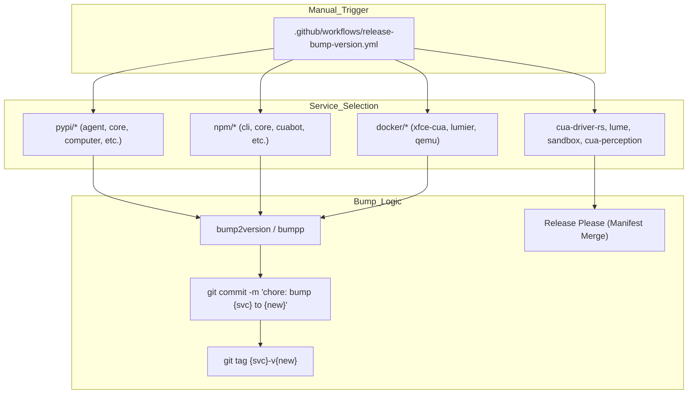
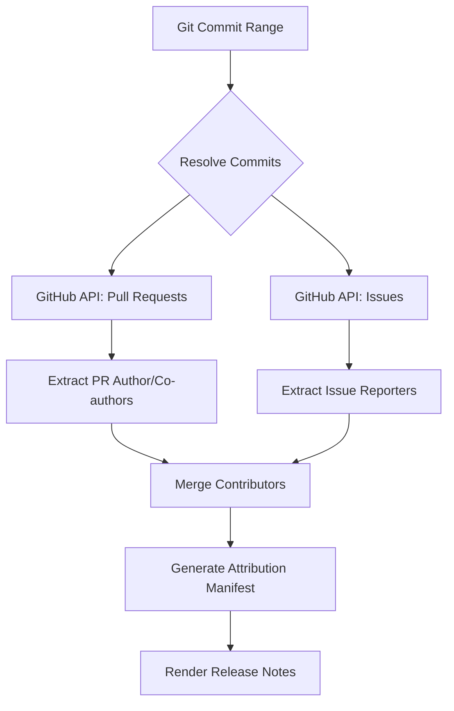
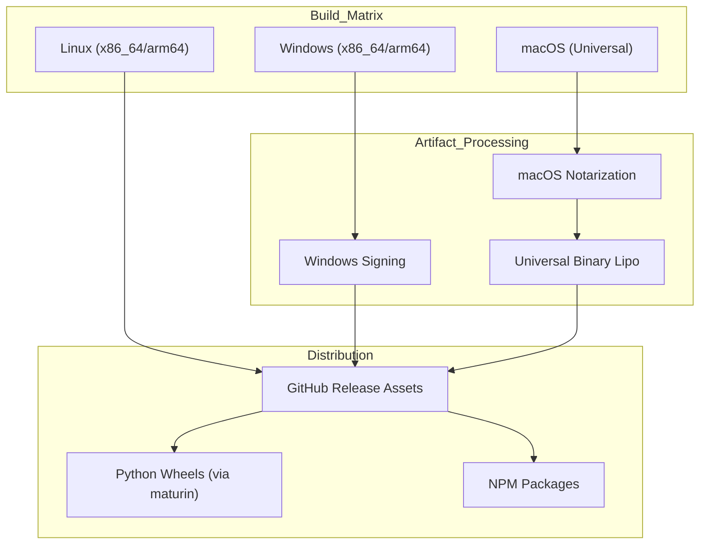

<!-- source: DeepWiki mcp.deepwiki.com · repo trycua/cua · page 14.5 CI/CD and Release Process · fetched 2026-10-29 -->

# CI/CD and Release Process

<details>
<summary>Relevant source files</summary>

The following files were used as context for generating this wiki page:

- [.gitattributes](.gitattributes)
- [.github/CODEOWNERS](.github/CODEOWNERS)
- [.github/release-attribution-config.json](.github/release-attribution-config.json)
- [.github/release-manifest.schema.json](.github/release-manifest.schema.json)
- [.github/release-notes/cua-driver-rs.md](.github/release-notes/cua-driver-rs.md)
- [.github/release-notes/lume.md](.github/release-notes/lume.md)
- [.github/scripts/check_spacesd_published.sh](.github/scripts/check_spacesd_published.sh)
- [.github/scripts/github_release.py](.github/scripts/github_release.py)
- [.github/scripts/mark_perception_release_prs_tagged.py](.github/scripts/mark_perception_release_prs_tagged.py)
- [.github/scripts/merge_release_please_manifests.py](.github/scripts/merge_release_please_manifests.py)
- [.github/scripts/release_attribution.py](.github/scripts/release_attribution.py)
- [.github/scripts/release_channels.py](.github/scripts/release_channels.py)
- [.github/scripts/resolve_release_please_request.py](.github/scripts/resolve_release_please_request.py)
- [.github/scripts/sync_driver_release_docs.py](.github/scripts/sync_driver_release_docs.py)
- [.github/scripts/tests/release_please_spaces_preview.cjs](.github/scripts/tests/release_please_spaces_preview.cjs)
- [.github/scripts/tests/test_cua_driver_release_wiring.py](.github/scripts/tests/test_cua_driver_release_wiring.py)
- [.github/scripts/tests/test_cua_spaces_release_wiring.py](.github/scripts/tests/test_cua_spaces_release_wiring.py)
- [.github/scripts/tests/test_github_release.py](.github/scripts/tests/test_github_release.py)
- [.github/scripts/tests/test_mark_perception_release_prs_tagged.py](.github/scripts/tests/test_mark_perception_release_prs_tagged.py)
- [.github/scripts/tests/test_nightly_release_wiring.py](.github/scripts/tests/test_nightly_release_wiring.py)
- [.github/scripts/tests/test_pr_attribution.py](.github/scripts/tests/test_pr_attribution.py)
- [.github/scripts/tests/test_pr_attribution_command.py](.github/scripts/tests/test_pr_attribution_command.py)
- [.github/scripts/tests/test_release_attribution.py](.github/scripts/tests/test_release_attribution.py)
- [.github/scripts/tests/test_release_bump_authorization.py](.github/scripts/tests/test_release_bump_authorization.py)
- [.github/scripts/tests/test_release_channels.py](.github/scripts/tests/test_release_channels.py)
- [.github/scripts/tests/test_resolve_release_please_request.py](.github/scripts/tests/test_resolve_release_please_request.py)
- [.github/scripts/tests/test_sync_driver_release_docs.py](.github/scripts/tests/test_sync_driver_release_docs.py)
- [.github/scripts/tests/test_validate_release_please_tags.py](.github/scripts/tests/test_validate_release_please_tags.py)
- [.github/scripts/tests/test_validate_release_versions.py](.github/scripts/tests/test_validate_release_versions.py)
- [.github/scripts/validate_release_please_tags.py](.github/scripts/validate_release_please_tags.py)
- [.github/scripts/validate_release_versions.py](.github/scripts/validate_release_versions.py)
- [.github/workflows/cd-container-xfce-cua.yml](.github/workflows/cd-container-xfce-cua.yml)
- [.github/workflows/cd-cua-sdk.yml](.github/workflows/cd-cua-sdk.yml)
- [.github/workflows/cd-cua-spaces.yml](.github/workflows/cd-cua-spaces.yml)
- [.github/workflows/cd-rust-cua-driver.yml](.github/workflows/cd-rust-cua-driver.yml)
- [.github/workflows/ci-container-xfce-cua.yml](.github/workflows/ci-container-xfce-cua.yml)
- [.github/workflows/ci-release-metadata.yml](.github/workflows/ci-release-metadata.yml)
- [.github/workflows/ci-release-reminder.yml](.github/workflows/ci-release-reminder.yml)
- [.github/workflows/ci-release-spacesd-pin.yml](.github/workflows/ci-release-spacesd-pin.yml)
- [.github/workflows/docker-reusable-build.yml](.github/workflows/docker-reusable-build.yml)
- [.github/workflows/docker-reusable-publish.yml](.github/workflows/docker-reusable-publish.yml)
- [.github/workflows/nightly-component-plan.yml](.github/workflows/nightly-component-plan.yml)
- [.github/workflows/nightly-cua-driver.yml](.github/workflows/nightly-cua-driver.yml)
- [.github/workflows/nightly-lume.yml](.github/workflows/nightly-lume.yml)
- [.github/workflows/release-bump-version.yml](.github/workflows/release-bump-version.yml)
- [.github/workflows/release-on-merge.yml](.github/workflows/release-on-merge.yml)
- [.github/workflows/release-please.yml](.github/workflows/release-please.yml)
- [.github/workflows/release-unreleased-digest.yml](.github/workflows/release-unreleased-digest.yml)
- [apps/cua-spaces-macos/Sources/CuaSpacesMacKit/Models/HostModel.swift](apps/cua-spaces-macos/Sources/CuaSpacesMacKit/Models/HostModel.swift)
- [apps/cua-spaces-macos/Sources/CuaSpacesMacKit/Models/HostSetupFailure.swift](apps/cua-spaces-macos/Sources/CuaSpacesMacKit/Models/HostSetupFailure.swift)
- [apps/cua-spaces-macos/Sources/CuaSpacesMacKit/Views/OnboardingView.swift](apps/cua-spaces-macos/Sources/CuaSpacesMacKit/Views/OnboardingView.swift)
- [apps/cua-spaces-macos/Tests/CuaSpacesMacTests/HostSetupFailureTests.swift](apps/cua-spaces-macos/Tests/CuaSpacesMacTests/HostSetupFailureTests.swift)
- [libs/cua-driver/rust/crates/cua-driver-contract/src/session.rs](libs/cua-driver/rust/crates/cua-driver-contract/src/session.rs)
- [libs/cua-driver/rust/crates/cua-driver-core/src/capture_scope.rs](libs/cua-driver/rust/crates/cua-driver-core/src/capture_scope.rs)
- [libs/cua-driver/rust/crates/cua-driver-core/src/perception_client.rs](libs/cua-driver/rust/crates/cua-driver-core/src/perception_client.rs)
- [libs/cua-driver/rust/crates/cua-driver-core/src/perception_tools.rs](libs/cua-driver/rust/crates/cua-driver-core/src/perception_tools.rs)
- [libs/cua-driver/rust/crates/cua-driver/src/doctor.rs](libs/cua-driver/rust/crates/cua-driver/src/doctor.rs)
- [libs/cua-driver/rust/crates/cua-driver/tests/session_capture_scope_test.rs](libs/cua-driver/rust/crates/cua-driver/tests/session_capture_scope_test.rs)
- [libs/cua-driver/rust/crates/platform-windows/src/diagnostics.rs](libs/cua-driver/rust/crates/platform-windows/src/diagnostics.rs)
- [libs/cua-driver/rust/crates/platform-windows/src/uia/fg_bypass.rs](libs/cua-driver/rust/crates/platform-windows/src/uia/fg_bypass.rs)
- [libs/cua-driver/rust/crates/platform-windows/src/uia/windows_enum.rs](libs/cua-driver/rust/crates/platform-windows/src/uia/windows_enum.rs)
- [libs/cua-spacesd/README.md](libs/cua-spacesd/README.md)
- [libs/cua/crates/cua-host/src/driver.rs](libs/cua/crates/cua-host/src/driver.rs)
- [libs/python/agent/cua_agent/loops/uitars.py](libs/python/agent/cua_agent/loops/uitars.py)
- [libs/python/agent/tests/test_uitars_coordinate_security.py](libs/python/agent/tests/test_uitars_coordinate_security.py)
- [libs/xfce-cua/.bumpversion.cfg](libs/xfce-cua/.bumpversion.cfg)
- [libs/xfce-cua/.dockerignore](libs/xfce-cua/.dockerignore)
- [libs/xfce-cua/Dockerfile](libs/xfce-cua/Dockerfile)
- [libs/xfce-cua/README.md](libs/xfce-cua/README.md)
- [libs/xfce-cua/VERSION](libs/xfce-cua/VERSION)
- [release-please-config.json](release-please-config.json)

</details>


This document describes the continuous integration, continuous deployment, and release automation systems used in the Cua monorepo. It covers automated quality checks, version bumping, package publishing to PyPI and npm, Docker image builds, and binary distribution for macOS (Lume) and cross-platform tools (cua-driver).

---

## Release Automation Architecture

The Cua project uses GitHub Actions for all CI/CD automation. The system is designed to handle a multi-language monorepo (Python, TypeScript, Swift, Rust) with coordinated versioning and distribution.

### Centralized Version Management

Version bumping is handled by a central workflow that supports all services in the monorepo.



**Diagram: Version Bumping Data Flow**

The workflow defined in [.github/workflows/release-bump-version.yml:1-54]() allows developers to select a service and a bump type (`patch`, `minor`, `major`). It maps these inputs to specific directories such as `pypi/agent` to `libs/python/agent` [.github/workflows/release-bump-version.yml:76-79]() or `npm/cuabot` to `libs/cuabot` [.github/workflows/release-bump-version.yml:116-119]().

**Sources**: [.github/workflows/release-bump-version.yml:1-191](), [.github/workflows/release-please.yml:1-33]()

---

## Release on Merge and Authorization

To maintain security and quality, Cua implements a strictly audited release trigger upon merging Pull Requests.

### Authorization Gates
Release authorization comes only from audited label events [.github/workflows/release-on-merge.yml:33-34]().
1. **Owner Check**: The system verifies that labels were applied by the release owner (`f-trycua` or `ddupont808`) using the `label_was_applied_by_release_owner` function [.github/workflows/release-on-merge.yml:47-60]().
2. **Trigger**: If a valid `release:<service>` label is found on a merged PR, the `release-bump-version.yml` workflow is triggered [.github/workflows/release-on-merge.yml:147-156]().
3. **Manual Gating**: The manual dispatch workflow is restricted to trusted actors such as `f-trycua`, `ddupont808`, and `cua-release-bot[bot]` [.github/workflows/release-bump-version.yml:56-63]().

### Release Monitoring and Reminders
To ensure developers follow the release contract, the system provides two mechanisms:
- **CI Release Reminder**: A PR-based reminder [.github/workflows/ci-release-reminder.yml:1-5]() that posts a status comment identifying affected packages and whether they are authorized for release [.github/workflows/ci-release-reminder.yml:87-113]().
- **Wiring Tests**: Regression tests like `test_cua_driver_release_wiring.py` verify that release flows (e.g., Python publishing following Rust builds) [.github/scripts/tests/test_cua_driver_release_wiring.py:17-24]() and artifact generation [.github/scripts/tests/test_cua_driver_release_wiring.py:58-67]() are correctly configured.

**Sources**: [.github/workflows/release-on-merge.yml:1-159](), [.github/workflows/ci-release-reminder.yml:1-127](), [.github/scripts/tests/test_cua_driver_release_wiring.py:1-162]()

---

## Release Please Integration

Modern components like `cua-driver-rs`, `lume`, `sandbox`, `cua-spacesd`, `cua-sdk`, `cua-spaces`, and `cua-perception` use Google's `release-please` for automated changelog generation and PR management [.github/workflows/release-please.yml:9-22]().

### Manifest Merging
Because multiple components share a root manifest, the workflow includes a synchronization step to handle rebasing and manifest conflicts [.github/workflows/release-please.yml:148-173](). It uses `merge_release_please_manifests.py` to ensure that one component's release PR doesn't overwrite the version updates of another component [.github/scripts/merge_release_please_manifests.py:1-50]().

The system distinguishes between "stable" and "nightly" channels. The `release_channels.py` script manages the staging of versioned trees for nightly releases without mutating the stable branch state [.github/scripts/release_channels.py:1-30]().

**Sources**: [.github/workflows/release-please.yml:1-173](), [.github/scripts/merge_release_please_manifests.py:1-50](), [.github/scripts/release_channels.py:1-143]()

---

## Release Attribution and Version Validation

The release process includes robust attribution and version validation steps to ensure consistency and proper credit.

### Release Attribution
The `release_attribution.py` script is responsible for building and rendering deterministic, pull-request-first release attribution. It reads the exact local tag range and uses the GitHub API to resolve commits to pull requests, contributors, and explicitly closed issues [.github/scripts/release_attribution.py:1-7]().


**Diagram: Release Attribution Process**

Key aspects of attribution include:
- **Conventional Commits**: It validates PR titles against Conventional Commit specifications, ensuring that only `feat`, `fix`, `perf`, and `revert` types trigger releases by default, unless explicitly opted out [.github/scripts/tests/test_release_attribution.py:80-85]().
- **Contributor Deduplication**: It deduplicates contributors across roles (author, coauthor, reporter) and handles login case insensitivity [.github/scripts/tests/test_release_attribution.py:150-168]().
- **Perception-only Diffs**: It can identify if a change is solely within the `cua-perception` component, which has an independent version authority [.github/scripts/tests/test_release_attribution.py:125-139]().

### Version Validation
The `validate_release_versions.py` script ensures that all version declarations across various files (e.g., `VERSION` files, `pyproject.toml`, `Cargo.toml`, `Cargo.lock`, `.release-please-manifest.json`) are consistent for a given product.

```mermaid
graph TD
    A[Start Validation] --> B{Select Product (e.g., sandbox, driver, lume, perception)};
    B --> C[Load Component Registry];
    C --> D[Identify Version Authority File];
    C --> E[Identify All Versioned Files];
    D --> F[Read Authority Version];
    E --> G[Read Version from Each File];
    F & G --> H{Compare All Versions};
    H -- Mismatch --> I[Fail with VersionError];
    H -- Match --> J[Validation Success];
```
**Diagram: Release Version Validation Flow**

- **Product-Specific Validation**: The script can validate versions for specific products like `sandbox`, `driver`, `lume`, or `perception`, or `all` products [.github/scripts/tests/test_validate_release_versions.py:40-50]().
- **Drift Detection**: It explicitly tests for version drift across different sources, such as `VERSION` files, `pyproject.toml`, `uv.lock`, and `__init__.py` for Python packages, or `Cargo.toml` and `Cargo.lock` for Rust packages [.github/scripts/tests/test_validate_release_versions.py:97-118]().
- **Installer Version Lag**: For `cua-driver`, it allows installer versions to lag behind the source version until publication, but rejects cases where installer versions disagree or are ahead of the source [.github/scripts/tests/test_validate_release_versions.py:158-181]().

**Sources**: [.github/scripts/release_attribution.py:1-185](), [.github/scripts/tests/test_release_attribution.py:1-204](), [.github/scripts/validate_release_versions.py:1-10](), [.github/scripts/tests/test_validate_release_versions.py:1-182]()

---

## Nightly Channels

Nightly releases provide early access to the latest development builds.

- **Nightly Planning**: The `plan_nightly` function in `release_channels.py` derives a nightly version by incrementing the patch version of the latest stable release and appending a date and build number (e.g., `0.19.4-nightly.20260812.3097`) [.github/scripts/release_channels.py:23-26](), [.github/scripts/tests/test_release_channels.py:134-135]().
- **Component Registry**: The `.github/releases/components.json` file defines which components support nightly channels. For example, `cua-perception` is marked `candidateOnly` and does not enable nightly publication [.github/scripts/tests/test_release_channels.py:60-62](), [.github/scripts/tests/test_release_channels.py:81-89]().
- **Tag Grammar**: Strict tag grammars ensure that stable and nightly tags do not cross channels (e.g., `cua-driver-rs-v1.2.3` vs `nightly-cua-driver-rs-v1.2.3-nightly.20260812.42`) [.github/scripts/tests/test_release_channels.py:110-117]().
- **Staging Versioned Tree**: The `stage_versioned_tree` function applies the nightly version to relevant files (e.g., `VERSION`, `Cargo.toml`, `Cargo.lock` for Rust projects) without affecting other files [.github/scripts/tests/test_release_channels.py:170-188]().

**Sources**: [.github/scripts/release_channels.py:1-30](), [.github/scripts/tests/test_release_channels.py:1-193]()

---

## Cross-Platform Binary Builds (cua-driver)

The Rust implementation of `cua-driver` is built for Linux, Windows, and macOS using a matrix-based CD workflow [.github/workflows/cd-rust-cua-driver.yml:1-16]().



**Diagram: cua-driver Build and Distribution Flow**

- **Linux Heritage**: Builds inside a `debian:11` container to ensure GLIBC compatibility (GLIBC 2.31 floor) covering Debian 11+, Ubuntu 20.04+, and RHEL 8+ [.github/workflows/cd-rust-cua-driver.yml:156-170]().
- **macOS Universal**: The workflow generates universal binaries for Darwin using `lipo` to combine `x86_64` and `arm64` [.github/workflows/cd-rust-cua-driver.yml:4-5]().
- **Windows Portability**: The build script `build-node-runtime.mjs` enforces static linking of the C Runtime (`+crt-static`) for Windows MSVC targets to ensure the Node runtime is self-contained. This is implicitly tested by the `test_cua_driver_release_wiring.py` which verifies the overall release process.
- **ARM64 Support**: Native ARM64 runners (e.g., `ubuntu-24.04-arm`, `windows-11-arm`) are used for builds to avoid complex cross-compilation of C dependencies like X11 or Wayland [.github/workflows/cd-rust-cua-driver.yml:134-141]().
- **Nix Packaging**: The `flake.nix` defines a Nix package for `cua-driver`, allowing it to be built and integrated into NixOS systems. It includes a `cuaDriverPackage` that imports `nix/cua-driver/package.nix` [.flake.nix:38-41](). This ensures reproducible builds and easy deployment on Nix-based systems.

**Sources**: [.github/workflows/cd-rust-cua-driver.yml:1-183](), [.github/scripts/tests/test_cua_driver_release_wiring.py:1-162](), [.github/scripts/release_channels.py:176-181](), [.flake.nix:1-162]()

---

## Release Finalization and Asset Management

The `github_release.py` script acts as a finalizer for Release Please drafts.

- **Unique Release Validation**: It verifies that exactly one draft exists for a given tag before proceeding [.github/scripts/github_release.py:141-148]().
- **Asset Cleaning**: Before publishing, it clears any incomplete assets from the draft to ensure a clean release state [.github/scripts/tests/test_github_release.py:82-96]().
- **Nightly Drafts**: For the `nightly` channel, the script can automatically create a private draft at an exact commit SHA [.github/scripts/github_release.py:183-188]().

**Sources**: [.github/scripts/github_release.py:1-188](), [.github/scripts/tests/test_github_release.py:1-225]()

---

## Docker Image Publishing

The project publishes several Docker images, including `xfce-cua`, `kasm`, `xfce`, `lumier`, and QEMU-based images for Android, Linux, and Windows. These images are built and pushed to Docker Hub using a reusable workflow.

### Docker Build and Push Workflow
The `.github/workflows/docker-reusable-publish.yml` workflow handles the build and push process for Docker images.

```mermaid
graph TD
    A[Trigger: workflow_dispatch or workflow_call] --> B{Inputs: image_name, context_dir, tag_prefix, skip_arm64};
    B --> C{Matrix: platform (linux/amd64, linux/arm64)};
    C --> D[Checkout Repository];
    D --> E[Set up Docker Buildx];
    E --> F[Login to Docker Hub];
    F --> G{If PR: Build Only (no push)};
    F --> H{If main branch: Extract Metadata (latest tag)};
    H --> I[Build & Push Digest (main)];
    F --> J{If Tagged: Extract Metadata (semver tags)};
    J --> K[Build & Push Digest (semver)];
    I --> L[Export Digest];
    K --> L;
    L --> M[Upload Digest Artifact];
```
**Diagram: Docker Image Build and Publish Flow**

- **Reusable Workflow**: The `docker-reusable-publish.yml` workflow is designed to be called by other workflows or manually dispatched, accepting parameters like `image_name`, `context_dir`, and `tag_prefix` [.github/workflows/docker-reusable-publish.yml:1-24]().
- **Multi-Platform Builds**: It supports building for `linux/amd64` and `linux/arm64` platforms, with an option to `skip_arm64` if not applicable [.github/workflows/docker-reusable-publish.yml:43-51]().
- **Docker Hub Integration**: The workflow logs into Docker Hub using provided credentials and pushes images to the `trycua` organization [.github/workflows/docker-reusable-publish.yml:71-76]().
- **Tagging Strategy**:
    - For `main` branch pushes, images are tagged as `latest` [.github/workflows/docker-reusable-publish.yml:90-96]().
    - For semantic version tags (e.g., `docker-xfce-v1.2.3`), it extracts major, minor, and patch versions to apply corresponding tags (e.g., `1.2.3`, `1.2`, `1`) [.github/workflows/docker-reusable-publish.yml:115-125]().
- **Digest Export**: After a successful build and push, the Docker image digest is exported and uploaded as an artifact, which can be used for verification or further automation [.github/workflows/docker-reusable-publish.yml:143-165]().
- **`xfce-cua` Specifics**: The `xfce-cua` environment, providing XFCE desktop access inside sandboxes, uses a dedicated build workflow. Its versioning is managed via `.bumpversion.cfg` in `libs/xfce-cua/` [libs/xfce-cua/.bumpversion.cfg:1-5]().

**Sources**: [.github/workflows/docker-reusable-publish.yml:1-165](), [libs/xfce-cua/.bumpversion.cfg:1-7]()

---

