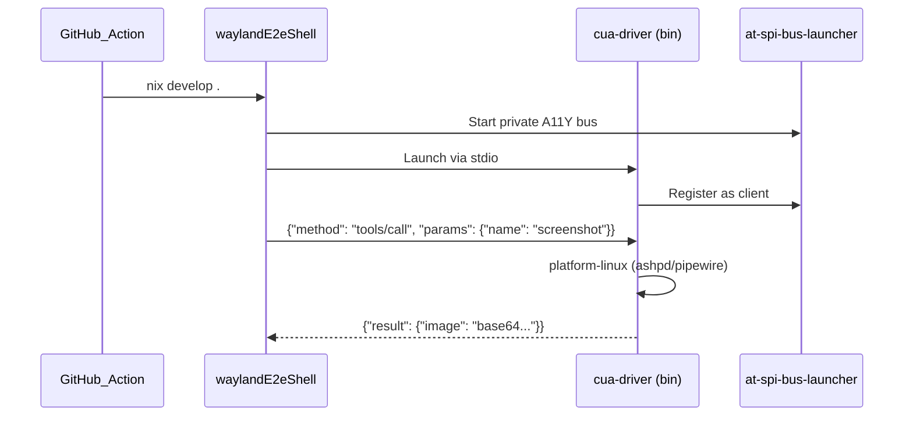

<!-- source: DeepWiki mcp.deepwiki.com · repo trycua/cua · page 14.6 Nix Packaging and NixOS Integration · fetched 2026-10-29 -->

# Nix Packaging and NixOS Integration

<details>
<summary>Relevant source files</summary>

The following files were used as context for generating this wiki page:

- [.github/scripts/tests/test_ci_nix_linux_paths.py](.github/scripts/tests/test_ci_nix_linux_paths.py)
- [.github/workflows/ci-distro-compat-cua-driver.yml](.github/workflows/ci-distro-compat-cua-driver.yml)
- [.github/workflows/ci-nix-linux.yml](.github/workflows/ci-nix-linux.yml)
- [.github/workflows/license-check.yml](.github/workflows/license-check.yml)
- [flake.nix](flake.nix)
- [libs/cua-driver/rust/crates/cua-driver-contract/Cargo.toml](libs/cua-driver/rust/crates/cua-driver-contract/Cargo.toml)
- [libs/cua-driver/rust/crates/cua-driver-core/Cargo.toml](libs/cua-driver/rust/crates/cua-driver-core/Cargo.toml)
- [libs/cua-driver/rust/crates/cua-driver-uia/Cargo.toml](libs/cua-driver/rust/crates/cua-driver-uia/Cargo.toml)
- [libs/cua-driver/rust/crates/cua-driver/Cargo.toml](libs/cua-driver/rust/crates/cua-driver/Cargo.toml)
- [libs/cua-driver/rust/crates/cua-driver/tests/launch_app_standard_user_test.rs](libs/cua-driver/rust/crates/cua-driver/tests/launch_app_standard_user_test.rs)
- [libs/cua-driver/rust/crates/cursor-overlay/Cargo.toml](libs/cua-driver/rust/crates/cursor-overlay/Cargo.toml)
- [libs/cua-driver/rust/crates/pip-preview/Cargo.toml](libs/cua-driver/rust/crates/pip-preview/Cargo.toml)
- [libs/cua-driver/rust/crates/platform-linux/Cargo.toml](libs/cua-driver/rust/crates/platform-linux/Cargo.toml)
- [libs/cua-driver/rust/crates/platform-linux/src/lib.rs](libs/cua-driver/rust/crates/platform-linux/src/lib.rs)
- [libs/cua-driver/rust/crates/platform-macos/Cargo.toml](libs/cua-driver/rust/crates/platform-macos/Cargo.toml)
- [libs/cua-driver/rust/crates/platform-macos/src/lib.rs](libs/cua-driver/rust/crates/platform-macos/src/lib.rs)
- [libs/cua-driver/rust/crates/platform-windows/Cargo.toml](libs/cua-driver/rust/crates/platform-windows/Cargo.toml)
- [libs/cua-driver/rust/crates/platform-windows/src/browser_installation_path.rs](libs/cua-driver/rust/crates/platform-windows/src/browser_installation_path.rs)
- [libs/cua-driver/rust/crates/platform-windows/src/browser_standard_user.rs](libs/cua-driver/rust/crates/platform-windows/src/browser_standard_user.rs)
- [libs/cua-driver/rust/crates/platform-windows/src/lib.rs](libs/cua-driver/rust/crates/platform-windows/src/lib.rs)
- [libs/cua-driver/rust/crates/platform-windows/src/standard_user_launch.rs](libs/cua-driver/rust/crates/platform-windows/src/standard_user_launch.rs)
- [nix/cua-driver/README.md](nix/cua-driver/README.md)
- [nix/cua-driver/package.nix](nix/cua-driver/package.nix)
- [nix/cua-driver/tests/README.md](nix/cua-driver/tests/README.md)

</details>


The Cua project utilizes **Nix** and **NixOS** to provide a reproducible build environment, cross-platform packaging for Linux, and a comprehensive integration testing suite. This infrastructure ensures that `cua-driver` functions correctly across various Linux desktop environments, including X11 and Wayland (Sway, GNOME, KDE), by simulating these environments within isolated NixOS containers.

## Nix Flake Overview

The project's entry point for Nix is the `flake.nix` file, which defines the build outputs and automated checks for `x86_64-linux` and `aarch64-linux` [flake.nix:1-22]().

### Build Configuration
The `cua-driver` Rust package is built using `pkgs.rustPlatform.buildRustPackage` [nix/cua-driver/package.nix:16](). Key implementation details include:
*   **Version Synchronization**: The package version is imported directly from the workspace `Cargo.toml` using `pkgs.lib.importTOML` to prevent version drift [nix/cua-driver/package.nix:21]().
*   **Cargo Lock Import**: Uses `importCargoLock` to derive dependency hashes directly from the committed `Cargo.lock` [nix/cua-driver/package.nix:25-35](). This eliminates manual `cargoHash` maintenance and ensures builds remain stable across dependency updates.
*   **Feature Flags**: The build explicitly enables the `portal-input` and `portal-capture` features [nix/cua-driver/package.nix:48-49](). These enable support for modern Wayland portals, including PipeWire ScreenCast and libei RemoteDesktop input [libs/cua-driver/rust/crates/platform-linux/Cargo.toml:115-129]().

### Dependency Graph
`cua-driver` requires several system libraries to interface with X11, Wayland, and AT-SPI.

| Category | Libraries / Tools | Purpose |
| :--- | :--- | :--- |
| **Build Tools** | `pkg-config`, `rustPlatform.bindgenHook` | FFI binding generation for PipeWire/SPA pods [nix/cua-driver/package.nix:63-69]() |
| **X11 Support** | `libx11`, `libxi`, `libxtst`, `libxext` | Multi-cursor (MPX) and background input via Xlib/XInput [nix/cua-driver/package.nix:70-74]() |
| **Wayland Support** | `pipewire`, `libei`, `libxkbcommon` | Portal-based capture and input injection via `reis` [nix/cua-driver/package.nix:75-83]() |
| **Accessibility** | `atspi` (Rust crate) | Native D-Bus communication with the AT-SPI bus via `zbus` [libs/cua-driver/rust/crates/platform-linux/Cargo.toml:35-39]() |

Sources: [flake.nix:23-42](), [nix/cua-driver/package.nix:1-95](), [libs/cua-driver/rust/crates/platform-linux/Cargo.toml:21-102]()

## NixOS Module (services.cua-driver)

The project provides a NixOS module that allows users to integrate `cua-driver` into their system configuration. The module is exposed via `nixosModules.cua-driver` [flake.nix:159-160]().

**System Architecture: NixOS Integration**
```mermaid
graph TD
    subgraph "NixOS_System"
        [module.nix] -- "defines" --> [systemd.services.cua-driver]
        [systemd.services.cua-driver] -- "manages" --> [cua-driver_Binary]
    end

    [cua-driver_Binary] -- "D-Bus (zbus)" --> [org.a11y.Bus]
    [cua-driver_Binary] -- "stdio/UnixSocket" --> [MCP_Clients]
    [cua-driver_Binary] -- "X11/Wayland_FFI" --> [Display_Server]
    [cua-driver_Binary] -- "Portal_IPC" --> [xdg-desktop-portal]
```
Sources: [flake.nix:156-160](), [nix/cua-driver/package.nix:1-6](), [libs/cua-driver/rust/crates/platform-linux/Cargo.toml:57-69]()

## Wayland Support and Portal Integration

The Nix build enables advanced Wayland features that require modern system headers (PipeWire 0.3+, libei).

### Portal-Libei Feature Contract
The `portal-libei` feature is a compatibility alias for the combined `portal-input` and `portal-capture` features [libs/cua-driver/rust/crates/cua-driver/Cargo.toml:89]().
*   **portal-input**: Pulls in `reis` (libei bindings), `calloop` (event loop), and `xkbcommon` to support GNOME/KDE RemoteDesktop input [libs/cua-driver/rust/crates/platform-linux/Cargo.toml:100-115]().
*   **portal-capture**: Pulls in `pipewire` and `libspa` for per-window ScreenCast capture [libs/cua-driver/rust/crates/platform-linux/Cargo.toml:92-96]().

### Linux Platform Overlays
The `platform-linux` crate implements specific overlay logic for Linux. On X11, it creates an override-redirect window using 32-bit ARGB visuals [libs/cua-driver/rust/crates/platform-linux/src/overlay.rs:1-5](). For Wayland sessions, the driver falls back to XWayland when `DISPLAY` is available or uses native Wayland protocols for window enumeration and capture [libs/cua-driver/rust/crates/platform-linux/src/lib.rs:10-11](). The `wayland_overlay_backend` function determines which Wayland backend to use (SemanticShellHelper, LayerShell, LegacyShellHelper, or None) based on available protocols [libs/cua-driver/rust/crates/platform-linux/src/overlay.rs:131-157]().

Sources: [libs/cua-driver/rust/crates/platform-linux/Cargo.toml:92-115](), [libs/cua-driver/rust/crates/cua-driver/Cargo.toml:89](), [libs/cua-driver/rust/crates/platform-linux/src/lib.rs:10-11](), [libs/cua-driver/rust/crates/platform-linux/src/overlay.rs:1-5](), [libs/cua-driver/rust/crates/platform-linux/src/overlay.rs:131-157]()

## NixOS Integration Tests

The project includes a suite of automated checks and integration tests defined in the flake [flake.nix:134-150]().

### Test Matrix
*   **Rust Unit Tests**: Executes `cargo test` for the Linux-compatible crates (`cua-driver`, `platform-linux`, etc.) in a controlled environment [flake.nix:137-141]().
*   **Policy Validation**: Tests YAML and Rego-based security policies for the driver [flake.nix:142-149]().
*   **Compositor Build**: Validates the `cua-compositor` package, which is used in E2E injection shells [flake.nix:129-135]().

### Wayland E2E Shell
The flake provides a `devShells.cua-driver-wayland-e2e` containing all dependencies needed for end-to-end Wayland testing, including `sway`, `grim`, `wtype`, and `wf-recorder` [flake.nix:92-125](). It also includes a private AT-SPI bus launcher to ensure accessibility tools work in headless CI environments [flake.nix:44-57]().

**Data Flow: MCP Tool Execution in Test Shell**

Sources: [flake.nix:59-125](), [flake.nix:152-154]()

## CI/CD Workflows

The Nix infrastructure is leveraged across multiple CI workflows to ensure stability and compatibility.

### Linux Unit Testing
The `ci-nix-linux.yml` workflow performs deep verification of Linux-specific features [ .github/workflows/ci-nix-linux.yml:1-50]():
*   **Nix Build and Checks**: The workflow builds `cua-compositor` and `cua-driver`, and runs the `cua-driver-linux-rust-unit`, `cua-driver-policy-yaml`, and `cua-driver-policy-rego` checks [ .github/workflows/ci-nix-linux.yml:68-79]().
*   **Cache Nix Store Paths**: Utilizes `DeterminateSystems/magic-nix-cache-action` to cache built store paths, improving build times for subsequent runs [ .github/workflows/ci-nix-linux.yml:88-94]().

### Distro Compatibility Matrix
The `ci-distro-compat-cua-driver.yml` workflow smoke-tests the **released** binary (built via Nix/Debian-11) across multiple distributions (Ubuntu, Debian, Rocky Linux, Fedora) [ .github/workflows/ci-distro-compat-cua-driver.yml:1-15](). It verifies:
*   **glibc ABI Floor**: Ensuring the binary runs on older glibc versions (e.g., Debian 11's 2.31) [ .github/workflows/ci-distro-compat-cua-driver.yml:8-11]().
*   **Runtime Capabilities**: Running `doctor` to detect missing system libraries like `libX11` or AT-SPI bridges [ .github/workflows/ci-distro-compat-cua-driver.yml:12-14]().

Sources: [ .github/workflows/ci-nix-linux.yml:1-50](), [ .github/workflows/ci-nix-linux.yml:68-79](), [ .github/workflows/ci-nix-linux.yml:88-94](), [ .github/workflows/ci-distro-compat-cua-driver.yml:1-150]()

---

